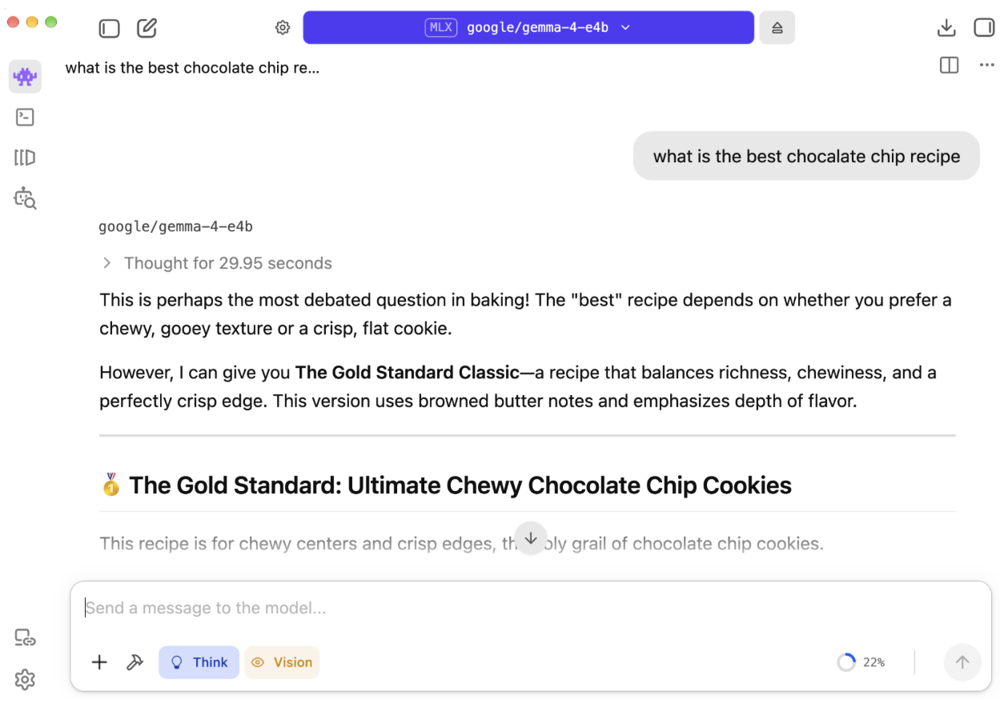
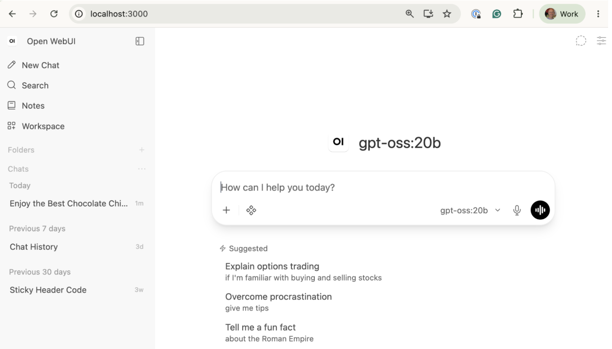
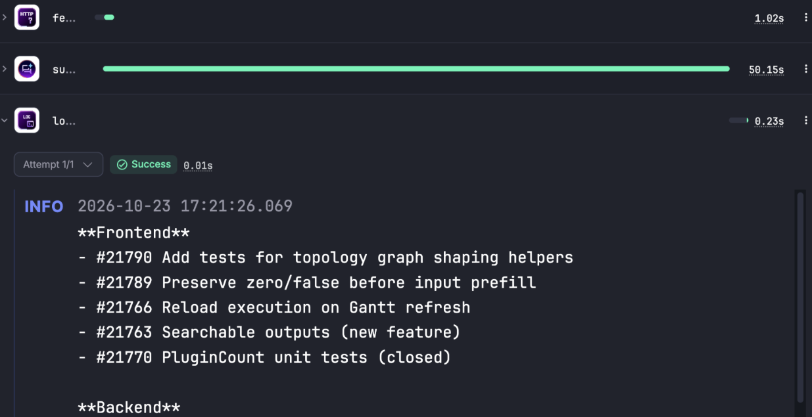
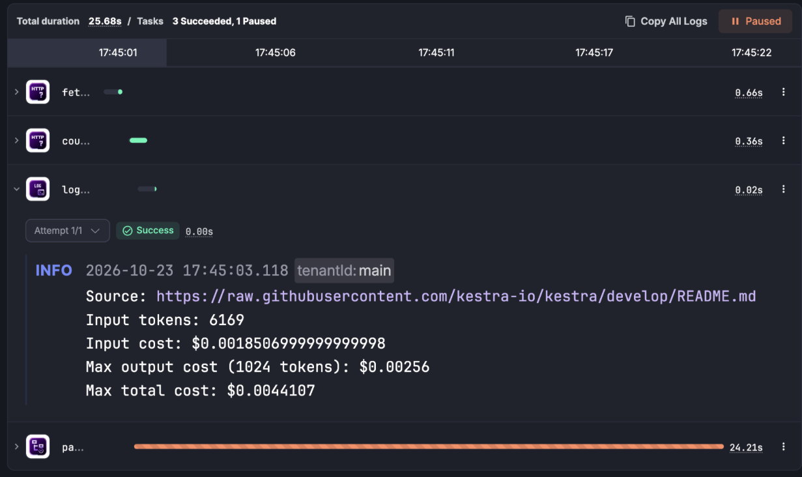
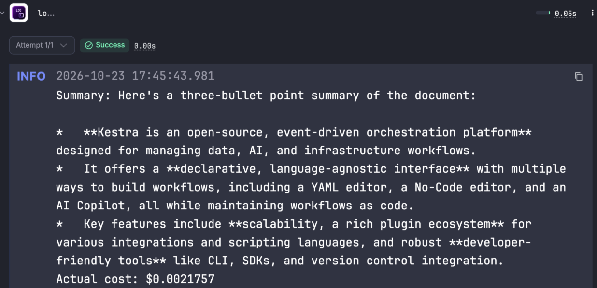
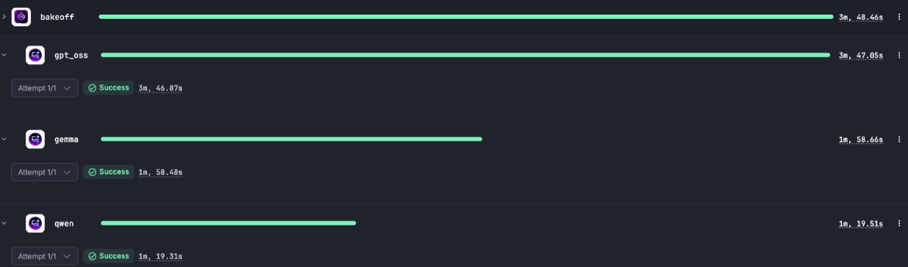
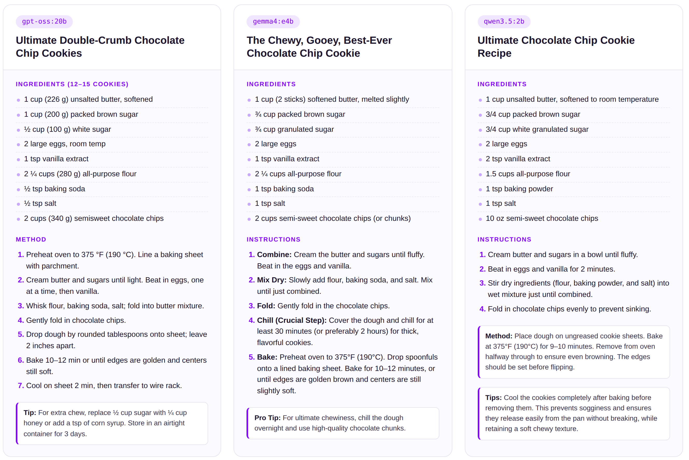

If you joined my session at All Things Open 2026 in Raleigh, this is the write-up for "How to Run and Orchestrate LLMs Locally," with the demo flows ready to copy. If you missed it, everything from the talk is here.

Open-weight LLMs now run well on an ordinary laptop, with no API key and no monthly bill. This post walks through what is actually inside a model file, the hardware you need, and the tools that make local models usable. Then it gets practical: using Kestra to orchestrate your local LLMs, with examples showing how to call a local model on a schedule, add a human approval step, and benchmark three models side by side. And because every benchmark needs a serious question, the last example has three local models compete for the best chocolate chip cookie recipe. Their answers are at the end.

## Why bother with local LLMs

A local LLM consists of a weights file (the model) and an inference engine that loads those weights into memory and runs them to generate text. That's the whole setup, and running it locally rather than on a public LLM provider yields the following benefits:

- **Cost.** No per-token fees and no cloud GPU rental. The cost moves up front, into hardware: enough fast memory to hold the model (GPU VRAM on a PC, unified memory on a Mac) and a GPU to run it. A model will run on CPU alone, but expect a fraction of the speed. Once you've paid for the hardware, running a model 10,000 times costs about the same as running it once (well, plus electricity, and a busy GPU draws a lot of it).
- **Privacy.** Prompts and data never leave your machine or network. If you work with medical records, legal documents, or customer data you'd rather not ship to a third party, this alone settles the question.
- **Offline use.** Everything works with Wi-Fi off, on a plane, or in an air-gapped environment.
- **Learning.** You can inspect the model file, swap quantization levels, and break things without a bill showing up.
- **Prototyping.** Feedback loops are fast and nobody rate-limits you.
- **Continuous jobs.** File watchers, nightly summaries, and code review bots can run non-stop. On a hosted API, that kind of always-on workload is exactly what makes the invoice ugly.

Sounds great, right? There are trade-offs, though, and to understand them, we first need to dig deeper into what an LLM is and how we get from a prompt to an answer.

## What is in an LLM

An LLM file is typically a single large binary. Formats like GGUF and safetensors contain no executable code. Everything the model "knows" is encoded in its parameters: the weights and biases learned during training. Alongside them is a header containing metadata such as the vocabulary, architecture hyperparameters, and quantization info. Depending on the model, the file size ranges from a couple of GB to several hundred.

### Scalars, vectors, matrices, tensors

Parameters are the model and hold everything it knows. They aren't stored as a single flat list. They're grouped into tensors, which are multi-dimensional arrays. Here are some useful definitions:

- A single number is a scalar
- A row of numbers is a vector
- A 2D grid is a matrix
- Higher dimensions are still just called tensors

Most tensors in an LLM file are matrices. Each is identified by a name (like `blk.0.attn_q.weight`, the query weights in layer 0), a shape like `[4096, 4096]`, a dtype like `float16`, and its raw data. That single `[4096, 4096]` tensor contains 16.7M parameters. A 7B model has roughly 300 tensors, many of which are larger, and that's how you reach billions.

So, other than winning a trivia question at a local bar, why does understanding this matter to LLMs? Every practical question about local models (will it fit, how fast will it run, why does the 4-bit version look worse) comes down to the number of tensors, their size, and the precision used to store them. You can live without knowing these details, but awareness helps you determine whether a model will run locally.

### Precision vs file size

The size of the LLM is a simple multiplication:

**File size = Number of parameters × Bytes per parameter**

For a 7B parameter model:

| Precision | Bytes per parameter | Approx. size |
| --- | --- | --- |
| FP32 (full) | 4 | ~28 GB |
| FP16 (half) | 2 | ~14 GB |
| INT8 | 1 | ~7 GB |
| 4-bit | 0.5 | ~3.5 GB |

Smaller data types mean smaller files, but each weight is stored with less precision. Quantization is lossy compression for models: it converts weights released at 16-bit (usually BF16) to 8-bit or 4-bit so they fit in consumer RAM. Using fewer bytes also speeds up generation, since each token requires reading the weights. 8-bit is nearly lossless, while 4-bit is the usual sweet spot for local use. Below 4-bit, quality drops noticeably, especially with small models and math or code tasks. Ollama, for example, pulls a 4-bit build by default for most models, and some, like gpt-oss, are already quantized when released.

### Popular open-weight models

Several providers publish weights you can download for free: Meta (Llama), Mistral, Alibaba (Qwen), DeepSeek, Google (Gemma), and OpenAI (gpt-oss). Anthropic and OpenAI's flagship models remain closed and API-only, and Mistral and Google also keep their best models proprietary while releasing smaller ones openly.

The weights are free. What costs money is the hosted API (the provider or a third party like Together, Groq, or Bedrock running those same weights on their GPUs), your own hardware, and the closed frontier models. The business model is roughly: give away weights to build adoption, then charge for hosted inference, support, and the frontier tier.

One caveat. Most of these are **open-weight**, not open source. Training data and training code are usually not released, and licenses vary. Some ship under Apache 2.0 or MIT, while Llama's community license adds acceptable-use rules and conditions for very large companies. If you're building something commercial, read the license for the specific model.

## Challenges with running LLMs locally

Memory is the constraint that decides everything. Two numbers matter: how much memory the model can be loaded into, and how fast that memory is.

- **Capacity** decides which models you can load at all. The whole weight file has to fit, plus working space for the context window (the KV cache). A rough rule is file size plus 20 to 30 percent, more if you push long contexts. A 20B model at 4-bit needs somewhere around 14 to 16 GB to run comfortably.
- **Bandwidth** decides tokens per second. Generating each token means reading through the weights, so a model that fits but sits in slow memory still crawls.

If a model doesn't fit in GPU memory, most runtimes will spill layers onto the CPU and system RAM. It works. It's also painfully slow, often several times slower than a model that fits.

### PC vs Mac

On a typical Windows or Linux PC, the number that matters is the discrete GPU's VRAM, not system RAM. Consumer NVIDIA cards top out at 24 to 32 GB, and that VRAM is very fast. A gaming PC with 64 GB of RAM and a 12 GB card is effectively a 12 GB machine for LLMs.

Apple Silicon uses unified memory, where the CPU and GPU share one pool. A MacBook or Mac Studio with 64 or 128 GB can hand most of it to the GPU, so it can load models that no consumer graphics card can hold. The catch is speed: on a model that fits in its VRAM, a high-end NVIDIA card generates tokens faster. The Mac wins once the model outgrows the card.

That said, unified memory isn't Mac-only anymore. AMD's Ryzen AI Max, for example, puts up to 128 GB of shared memory in Windows and Linux mini PCs. NVIDIA's RTX Spark, shipping in Windows laptops as of October 2026, does the same with up to 128 GB. It's the consumer version of the chip in DGX Spark, NVIDIA's small Linux desktop for AI developers. DGX Spark is also worth a look for small teams that want one shared inference box on the network. Both are Arm-based and new, so check that your tools run on them before you buy. Of course, all of this is subject to change if you're reading this article a month or two after it's published; these cards will look like I'm talking about a TRS-80. The speed of growth in this field is incredible.

## LLM tools

We discussed the LLM file being just parameters. To get an answer out of it, you need an **inference engine**, a program that loads those tensors into memory and runs the math that turns a prompt into tokens. [llama.cpp](https://github.com/ggml-org/llama.cpp) is the engine most local tools are built on. Many tools package more than just the inference engine; they include model downloads, a chat UI, or an API. In this article, we will cover a few useful tools and explain which components they contain, but keep in mind that dozens of AI tools exist, and new ones show up constantly.

### Ollama

[Ollama](https://ollama.com/) is basically a package manager plus a runtime for LLMs. It bundles a llama.cpp-based engine with model management, a REST API, and it's MIT-licensed. Once installed, you can pull (download) models locally with the pull command:

```bash
ollama pull gpt-oss:20b
```

Once downloaded, you can view models that are installed and those that are loaded into memory.

```bash
ollama list   # models on disk
ollama ps     # models loaded in memory right now
```

To issue a quick prompt, you can even run a model with a prompt from the command line in one command:

```bash
ollama run tinyllama:latest "how do I make chocolate chip cookies"
```

Perhaps the most useful part is that Ollama runs as a background service on port **11434** and serves every model you've pulled over a REST API. It loads a model on first request and unloads it after it sits idle. There's a native API and an OpenAI-compatible endpoint, so most existing client code works if you just change the base URL:

```bash
curl http://localhost:11434/api/chat -d '{
  "model": "gpt-oss:20b",
  "messages": [{"role": "user", "content": "Summarize RAID 5 in two sentences"}],
  "stream": false
}'
```

Or from Python:

```python
from openai import OpenAI

client = OpenAI(base_url="http://localhost:11434/v1", api_key="ollama")
resp = client.chat.completions.create(
    model="gpt-oss:20b",
    messages=[{"role": "user", "content": "Summarize RAID 5 in two sentences"}],
)
print(resp.choices[0].message.content)
```

(The `api_key` is required by the client library but ignored by Ollama.)

One thing to know before you expose it: there's **no authentication** on that port. Fine on localhost. Don't bind it to `0.0.0.0` on a shared network without putting something in front of it.

### LM Studio

[LM Studio](https://lmstudio.ai/) is the all-in-one desktop app: engine, model browser, and chat UI in one install. You search for a model, click download, and start chatting without opening a terminal. It's free to use but not open source ([Jan.ai](https://jan.ai) is the open source alternative if that matters to you). It can also run a local OpenAI-compatible server, so it can stand in for Ollama as a backend.



### Open WebUI

[Open WebUI](https://github.com/open-webui/open-webui) is a self-hosted, ChatGPT-style web front end. It has no engine of its own. You point it at Ollama (or any OpenAI-compatible API) and get chat history, model switching, document uploads, and multi-user accounts in the browser, usually at `localhost:3000` when run in Docker. It works fully offline. Licensing changed in 2025: it now ships under its own Open WebUI License, which adds branding requirements, and there are paid enterprise features.



The key point: once a model server such as Ollama is running, its models are accessible on port 11434 to any HTTP client, whether it's a chat UI, a script, or an orchestrator.

## Orchestrate your LLMs

Calling a model is one line of code. Running it in production is everything around that line: what triggers it, what happens when the model hangs, who approves the output before it goes anywhere, and where the record of all of it lives.

Agents make this sharper. An agent that loops on a task can burn hours of GPU time (or real money, if it falls back to a hosted API) without ever finishing. One that acts on its own output can send the wrong email or delete the wrong thing. For local models, it's less about runaway dollars from public models and more about how long it takes to get an answer. Two controls handle most of this:

- **Timeouts** so a stuck model gets killed instead of running all night.
- **Pause / human-in-the-loop (HITL)** so a person reviews the output, or the estimated cost, before the workflow continues.

### Kestra

[Kestra](https://kestra.io) is an open-source orchestration platform licensed under Apache 2.0. Its workflows are declarative YAML, versioned in Git, and triggered by schedules, webhooks, file drops, or events. It can run anything from Python, SQL, and Bash to containers, and offers more than 2,400 plugins, including an AI plugin with providers for OpenAI, Anthropic, Gemini, and Ollama. Kestra runs on a laptop with Docker Compose, so it can sit right alongside your local model.

An orchestrator is especially important with local models because your hardware is the limiting factor:

- A laptop can hold only so many models in memory at once. A flow-level **concurrency limit prevents three scheduled jobs from hitting Ollama at the same time** and thrashing it with model swaps.
- Local inference is slower and less predictable. **Timeouts and retries catch hung requests** so they don't block everything behind them.
- The hardware sits idle most of the day anyway. **Schedules let you push heavy work** (batch summaries, document processing, benchmarks) to overnight runs.
- If a local model can't handle a step, **swap that step's provider in a few lines of YAML** and keep the rest local.
- Kestra is self-hosted too, so prompts, outputs, and logs stay on your machine. The privacy benefit of running locally carries through the whole pipeline, and **you still get an audit trail of every prompt and response.**

Every flow has an id, a namespace, and a list of tasks. Tasks run in order and pass outputs to each other. That's the whole mental model.

### Example 1: Get a GitHub issue summary using gpt-oss:20b on a schedule

This flow asks the local `gpt-oss:20b` model for a summary of Kestra's GitHub issues every weekday morning.

```yaml
id: daily_issue_digest
namespace: company.ai

variables:
  ollama: http://host.docker.internal:11434
  repo: kestra-io/kestra

tasks:
  - id: fetch_issues
    type: io.kestra.plugin.core.http.Request
    uri: "https://api.github.com/repos/{{ vars.repo }}/issues?state=all&per_page=30&since={{ now() | dateAdd(-1, 'DAYS') | date(\"yyyy-MM-dd'T'HH:mm:ss'Z'\", timeZone='UTC') }}"
    headers:
      Accept: application/vnd.github+json

  - id: summarize
    type: io.kestra.plugin.ai.completion.ChatCompletion
    timeout: PT5M
    provider:
      type: io.kestra.plugin.ai.provider.Ollama
      modelName: gpt-oss:20b
      endpoint: "{{ vars.ollama }}"
    messages:
      - type: SYSTEM
        content: You triage GitHub issues. Group them by theme, flag anything that looks like a bug regression, and keep it under 150 words.
      - type: USER
        content: "{{ outputs.fetch_issues.body | jq('[.[] | {number, title, state, labels: [.labels[].name]}]') | first }}"

  - id: log_digest
    type: io.kestra.plugin.core.log.Log
    message: "{{ outputs.summarize.textOutput }}"

triggers:
  - id: weekday_morning
    type: io.kestra.plugin.core.trigger.Schedule
    cron: "0 8 * * 1-5"
```

This example was run on a 24GB MacBook Pro M4. When run, the local model took about 50 seconds to process the current GitHub issues.



In this example, we wrote to the console. With Kestra and its 2,400+ plugins, you could easily write a Slack message or send the summary via email so it shows up as you drink your morning coffee.

### Example 2: Add a pause for human approval

Some steps may require a larger hosted model than you can run locally. In that case, you can easily switch that step's provider to a hosted model and keep the rest of the flow using your local model. Hosted models charge per token, so before the call runs, it helps to estimate the cost and have someone approve it. Kestra provides a Pause task that stops execution and displays a Resume form in the UI, letting the user observe the flow's state and decide whether to proceed or stop. In this example, we call Google's public Gemini model, estimate the token count for a prompt that will ask it to summarize a web page, and let the user proceed or stop the flow based on the cost.

```yaml
id: pause_flow
namespace: company.ai

inputs:
  - id: url
    type: URI
    defaults: https://raw.githubusercontent.com/kestra-io/kestra/develop/README.md

variables:
  model: gemini-2.5-flash
  prompt: "Summarize this document in three bullet points:"
  input_rate: 0.30        # USD per 1M input tokens
  output_rate: 2.50       # USD per 1M output tokens (includes thinking)
  max_output_tokens: 1024

tasks:
  - id: fetch_page
    type: io.kestra.plugin.core.http.Request
    uri: "{{ inputs.url }}"

  - id: count_tokens
    type: io.kestra.plugin.core.http.Request
    uri: "https://generativelanguage.googleapis.com/v1beta/models/{{ vars.model }}:countTokens"
    method: POST
    contentType: application/json
    headers:
      x-goog-api-key: "{{ secret('GEMINI_API_KEY') }}"
    body: |
      {"contents": [{"parts": [{"text": {{ (vars.prompt ~ "\n\n" ~ outputs.fetch_page.body) | toJson }}}]}]}

  - id: log_estimate
    type: io.kestra.plugin.core.log.Log
    message: |
      Source: {{ inputs.url }}
      Input tokens: {{ outputs.count_tokens.body | jq('.totalTokens') | first }}
      Input cost: ${{ ((outputs.count_tokens.body | jq('.totalTokens') | first) * vars.input_rate / 1000000) | numberFormat("0.000000") }}
      Max output cost ({{ vars.max_output_tokens }} tokens): ${{ (vars.max_output_tokens * vars.output_rate / 1000000) | numberFormat("0.000000") }}
      Max total cost: ${{ (((outputs.count_tokens.body | jq('.totalTokens') | first) * vars.input_rate + vars.max_output_tokens * vars.output_rate) / 1000000) | numberFormat("0.000000") }}

  - id: pause
    type: io.kestra.plugin.core.flow.Pause
    pauseDuration: PT1H
    behavior: CANCEL

  - id: generate_summary
    type: io.kestra.plugin.core.http.Request
    uri: "https://generativelanguage.googleapis.com/v1beta/models/{{ vars.model }}:generateContent"
    method: POST
    contentType: application/json
    headers:
      x-goog-api-key: "{{ secret('GEMINI_API_KEY') }}"
    body: |
      {
        "contents": [{"parts": [{"text": {{ (vars.prompt ~ "\n\n" ~ outputs.fetch_page.body) | toJson }}}]}],
        "generationConfig": {
          "maxOutputTokens": {{ vars.max_output_tokens }},
          "thinkingConfig": {"thinkingBudget": 0}
        }
      }

  - id: log_summary
    type: io.kestra.plugin.core.log.Log
    message: |
      Summary: {{ outputs.generate_summary.body | jq('.candidates[0].content.parts[0].text') | first }}
      Actual cost: ${{ (((outputs.generate_summary.body | jq('.usageMetadata.promptTokenCount') | first) * vars.input_rate + ((outputs.generate_summary.body | jq('.usageMetadata.candidatesTokenCount') | first) + (outputs.generate_summary.body | jq('.usageMetadata.thoughtsTokenCount // 0') | first)) * vars.output_rate) / 1000000) | numberFormat("0.000000") }}
```

You can see from the UI that Kestra paused and waited for the user to proceed.



Note that resuming works from the UI or via the `/executions/{id}/resume` [API](https://kestra.io/docs/api-reference). You can even wire a flow to send a Slack message for the user to approve or deny.



The results from this execution are shown in the screenshot above, including the actual cost. In this example, the work was small, simply reviewing a README file, but the concept showcases the ability for humans to intervene in AI workflows.

### Example 3: Three-model bake-off

Local LLMs are resource-limited, and Kestra supports concurrency, letting you specify the degree of parallelism you want to run in the flow. In this example, we run the same prompt with three local models at once (`concurrent: 3`) and compare the results side by side. The prompt is perhaps one of life's most important questions: "What is the best chocolate chip cookie recipe?"

```yaml
id: chocolate_chip_bakeoff
namespace: company.ai

variables:
  ollama: http://host.docker.internal:11434
  prompt: What is the best chocolate chip cookie recipe? Keep it under 200 words.

tasks:
  - id: bakeoff
    type: io.kestra.plugin.core.flow.Parallel
    concurrent: 3
    tasks:
      - id: gpt_oss
        type: io.kestra.plugin.ai.completion.ChatCompletion
        timeout: PT10M
        provider:
          type: io.kestra.plugin.ai.provider.Ollama
          modelName: gpt-oss:20b
          endpoint: "{{ vars.ollama }}"
        messages:
          - type: USER
            content: "{{ vars.prompt }}"

      - id: gemma
        type: io.kestra.plugin.ai.completion.ChatCompletion
        timeout: PT10M
        provider:
          type: io.kestra.plugin.ai.provider.Ollama
          modelName: gemma4:e4b
          endpoint: "{{ vars.ollama }}"
        messages:
          - type: USER
            content: "{{ vars.prompt }}"

      - id: qwen
        type: io.kestra.plugin.ai.completion.ChatCompletion
        timeout: PT10M
        provider:
          type: io.kestra.plugin.ai.provider.Ollama
          modelName: qwen3.5:2b
          endpoint: "{{ vars.ollama }}"
        messages:
          - type: USER
            content: "{{ vars.prompt }}"

  - id: scorecard
    type: io.kestra.plugin.core.log.Log
    message:
      - "gpt-oss:20b | {{ outputs.gpt_oss.tokenUsage.totalTokenCount }} tokens | {{ outputs.gpt_oss.requestDuration }} ms"
      - "gemma4:e4b | {{ outputs.gemma.tokenUsage.totalTokenCount }} tokens | {{ outputs.gemma.requestDuration }} ms"
      - "qwen3.5:2b | {{ outputs.qwen.tokenUsage.totalTokenCount }} tokens | {{ outputs.qwen.requestDuration }} ms"
```

When executed in parallel on the 24GB MacBook Pro, the gemma and qwen models returned in about a minute and the gpt_oss model took about 3 minutes; during this time, the MacBook froze for about 2 seconds. Here are the running results:



As mentioned previously, the limitation of running locally is memory. Setting `concurrent` on the Kestra side only means parallel execution on the Ollama side if all three models fit in memory at once. If they don't, Ollama queues requests and swaps models in and out, and your latency numbers end up measuring disk reads instead of inference. You can see this when we re-tested this same flow with `concurrent: 1`.

| Run | Total time | What happened |
| --- | --- | --- |
| All three at once (`concurrent: 3`) | About 3 minutes | The laptop froze for about 2 seconds while Ollama swapped models |
| One at a time (`concurrent: 1`) | 2 minutes 12 seconds | gpt-oss 26 s, gemma 24 s, qwen 1 min 20 s |

Running them one at a time was faster, because the three models don't fit in 24 GB at once.

While outside the scope of this article, I know you're probably curious, so each model's best chocolate chip recipe is included at the end of this article.

## Summary

A local LLM consists of a weights file and an inference engine. The file contains billions of parameters organized into tensors, usually quantized to 4-bit so it fits in consumer memory. How much memory you have and how fast it is determine which models you can run and how quickly they respond. That's why unified memory (Apple Silicon, AMD Ryzen AI Max, NVIDIA RTX Spark) matters so much for local AI. On the tooling side, Ollama serves models over an API on port 11434, LM Studio packages everything into a desktop app, and Open WebUI adds a browser chat on top.

Getting a model to answer a prompt is the easy part. Running it reliably on hardware you share with everything else is where an orchestrator matters. The bake-off showed this directly: three models at once took about 3 minutes and froze the laptop, while running them one at a time finished in 2 minutes 12 seconds. Kestra lets you make that call with one line of YAML and adds the rest of what local AI needs: schedules that put idle hardware to work, timeouts so a hung model doesn't block the queue, a Pause step for human sign-off, and per-step provider swaps when a task needs a bigger hosted model. Because Kestra is self-hosted, prompts, outputs, and logs stay on your machine, so the privacy you get from running locally extends through the whole pipeline.

Install Ollama, pull a model, and spin up Kestra in a couple of minutes at [kestra.io/get-started](https://kestra.io/get-started). Paste one of the flows above and see which model bakes the better cookie.

## The best chocolate chip recipes according to local AI models



