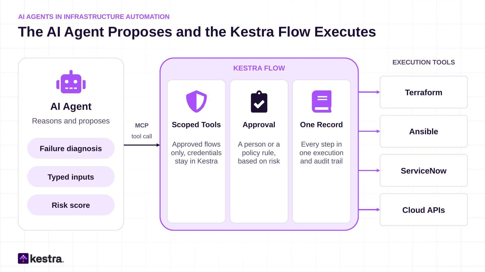
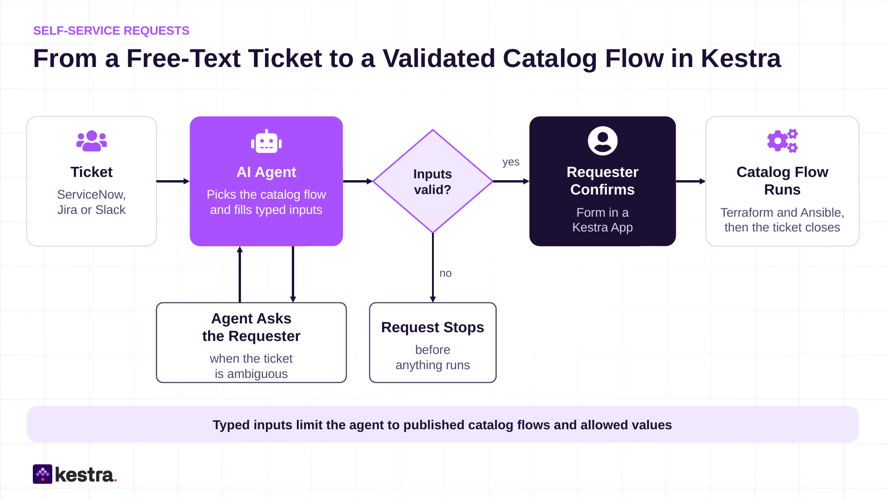
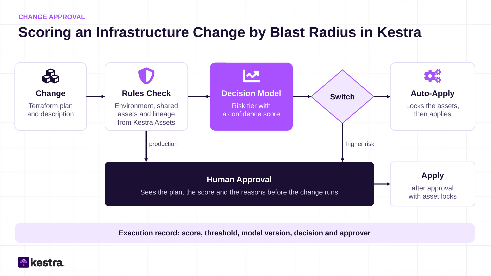
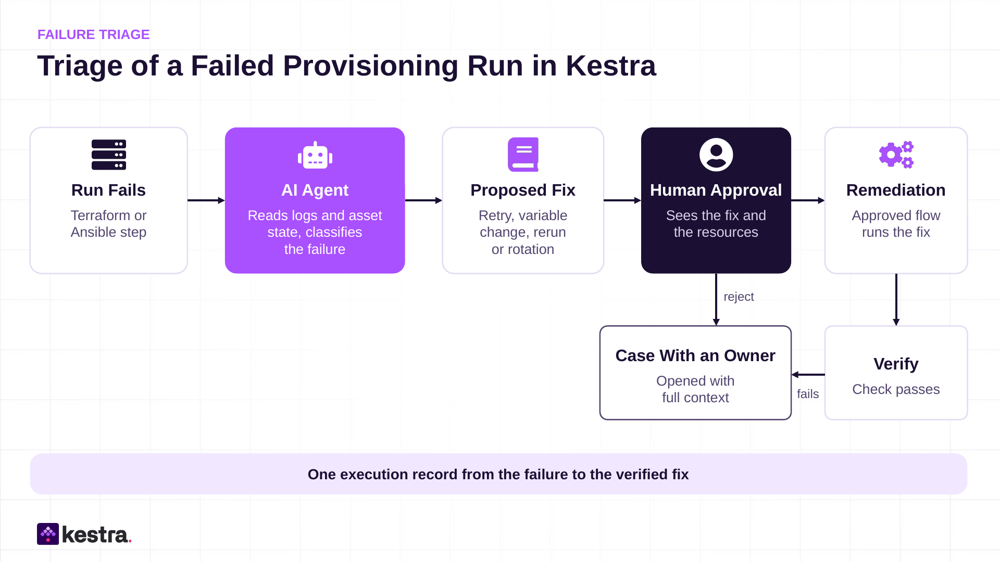

AI agents can already take over useful infrastructure work, as long as a workflow controls what they do. That matters now, because agents are entering infrastructure operations from many directions at once: infrastructure as code tools ship MCP servers, ITSM platforms add their own agents, and cloud providers build agent features into their consoles. Platform teams now get the question from their management: what do we do with agentic AI in infrastructure automation? The hope is faster self-service and fewer nights spent on failed provisioning runs. The open question is how to get there without adding new risk.

In an [article on agentic AI governance from September 2026](https://www.gartner.com/en/articles/agentic-ai-infrastructure-governance), Gartner predicts that by 2029, at least 70 percent of organizations with production agentic AI in infrastructure and operations will experience a material service, security or cost incident linked in part to insufficient runtime controls. The same article describes the control model: agents propose actions, and a separate control layer evaluates them before they run. Low-risk actions can run on their own, while high-impact and irreversible actions need explicit human approval. This post shows what AI agent governance looks like in infrastructure automation.

## AI Agent Governance: The Agent Proposes and the Workflow Executes

Tool-level controls for agents exist. An MCP server for an infrastructure as code tool, for example, enforces that tool's authentication and authorization. However, such a control ends at the boundary of its tool, and the job an agent is asked to do usually spans four or five tools.

The pattern I recommend splits the work. The agent reasons and proposes: a diagnosis, a set of inputs, a risk score. A workflow in the orchestrator executes the change, and that workflow defines the rules:

- **What the agent can touch.** Only approved workflows, exposed to the agent as typed tools with defined inputs. The agent holds no credentials. The worker that runs the step resolves secrets at runtime.
- **Who approves.** This depends on the risk. Low-risk changes run without a person, because a policy rule in the workflow approves them. Higher-risk changes pause until a person approves.
- **What gets recorded.** One execution with the trigger, the agent's output, the approval, the change and the verification.

The examples in this post use [Kestra](https://kestra.io). Infrastructure teams use it to run the [Terraform, Ansible, Shell and PowerShell code they already have](https://kestra.io/infra-automation) as declarative YAML flows, versioned in Git, with approvals, secrets and one execution record per run.

Here's how the split looks in Kestra:



The agent gets the same governed paths a human operator uses, and no direct access to Terraform, Ansible or the cloud console. Every run leaves one execution record that links all steps and subflows, which is the audit trail.

For a broader view of where retries, approvals and audit belong around agents, see my post on [agentic technical debt and where orchestration belongs in AI agent architecture](https://www.kai-waehner.de/blog/2026/11/03/agentic-technical-debt-and-where-orchestration-belongs-in-ai-agent-architecture/).

## How the Agent Reaches the Flows

In Kestra, there are two ways:

1. **Inside a flow.** An AI Agent task does the reasoning as one step, such as reading the logs of a failed run. Kestra has plugins for [OpenAI](https://kestra.io/plugins/plugin-openai), [Anthropic](https://kestra.io/plugins/plugin-anthropic) and [Google Gemini](https://kestra.io/plugins/plugin-gemini), and for open models through [Ollama](https://kestra.io/plugins/plugin-ollama). Decision models have their own plugins, covered below.
2. **From outside.** An agent such as Claude, Cursor or your own calls flows through the Model Context Protocol (MCP). Kestra exposes each flow as a named, typed tool, and the server lists exactly which flows it exposes, which is the list a security reviewer wants to see.

## Three Jobs AI Agents Can Take On Today

The three jobs follow one infrastructure request through its life: it comes in, a change gets approved, and sometimes a run fails. Each job hands the agent more responsibility, so the safeguards around it grow too.

| Job | Today | With an agent | If the agent gets it wrong |
| --- | --- | --- | --- |
| **1 - Request intake** | Requests that don't fit a catalog form arrive as tickets or chat messages, and someone retypes them | The agent maps the request to a published catalog flow and fills its inputs | Validation stops the request, or the requester fixes the form before anything runs |
| **2 - Change approval** | Every change waits in the same review queue, whatever its risk | A decision model scores the change, and low-risk changes apply on their own | A risky change could slip through, so production and anything above the threshold always wait for a person |
| **3 - Failure triage** | Someone finds the failure the next morning and reads logs in three consoles | The agent diagnoses the failure and proposes a fix from approved remediation flows | A bad fix could make things worse, so nothing runs until a person approves it |

## Job 1: Turn Any Request Into a Catalog Request

Many platform teams offer self-service through a catalog: provision a virtual machine, open a firewall port, create a Kubernetes namespace. The front door is often ServiceNow or another ITSM tool, or Kestra Apps, which put a self-service form on top of a flow. A catalog covers the requests someone has already turned into a form. Everything else arrives as free text: a generic ticket, a Slack message, and more and more often another team's AI agent asking for an environment.

Take a request such as "We need a Linux VM for the payments test team, 8 cores, until end of March, same setup as last time." The agent maps it to the right catalog flow and fills its typed inputs: image, size, environment, cost center, lease. It looks up the team's last request for the image and asks the requester for the cost center the ticket leaves out. Flow inputs in Kestra are typed and validated, so an invalid value stops the request before anything runs. The requester confirms the filled form, and an approval for cost or architecture reasons stays a step in the flow.



When the requester is itself an AI agent, the translation step goes away. The agent calls the catalog flow directly as an MCP tool, with the same typed inputs and the same approvals.

This is the job with the lowest risk of the three, because the agent produces data and the flow validates it. It also limits a risk that is easy to miss. Ticket text is untrusted input and can contain instructions aimed at the agent. When the agent's only tools are the published catalog flows, injected text can only reach those flows. Input validation catches malformed values, and the platform team's access rules and the requester's confirmation decide what can actually be requested.

## Job 2: Score Infrastructure Changes by Blast Radius

A Terraform plan that adds three resources in a development account and a plan that modifies a shared load balancer in production carry very different risks. In many organizations, both go through the same change advisory queue, or neither does.

Scoring each change by its blast radius lets the two take different paths:



The flow first checks the facts that rules can decide. Kestra Assets keep an inventory of the resources the flows declare, with the lineage between them, or the check reads the CMDB. Either way, it answers which environment the change hits, how many resources the plan touches, whether one of them is marked as shared or critical, and what depends on them among the declared resources. A decision model then scores the part that rules handle badly, for example whether the change description matches the plan and whether the change resembles earlier changes that caused incidents.

Below the threshold, the flow applies the change on its own, after locking the affected resources so no other Kestra flow writes to them at the same time. A change made outside Kestra, in a console or another tool, does not see the lock. Above the threshold, the flow pauses for a person and shows the score and the reasons. Some rules stay rules whatever the score says. A change in production always waits for a human. Every decision lands in the execution record with the score, the threshold and the model version, which is the evidence an auditor asks for later.

## Job 3: Wake Up to a Diagnosis and a Proposed Fix

A request comes in for a new environment. Terraform provisions the network and the virtual machines, Ansible configures them, and one step fails. Typical causes are a cloud quota, an exhausted IP range in the IP address management (IPAM) system, an expired service credential, or a transient API error. In many teams, a person finds the failure the next morning and reads logs in three consoles to understand it.

The flow's error handling starts the agent step. The agent reads the logs and the state of the affected resources, classifies the failure, and proposes a fix:

- a retry with backoff for a transient API error,
- a changed Terraform variable or a quota request for a capacity problem,
- a rerun of the Ansible playbook for a host that was not reachable,
- a credential rotation through the existing rotation flow.



The execution pauses before anything changes. The approver sees the proposed fix and the resources it would touch. If the approver accepts, the flow runs the fix through an existing, approved remediation flow and verifies the result. If the approver rejects it, or the fix fails, a case opens with an owner. The agent's reach ends at the remediation flows the platform team has published for it.

For the on-call engineer, the night now starts with a diagnosis and a proposed fix in the execution. Over time, the platform team can decide which classes of fixes, such as retries for transient API errors, run without approval.

## Use a Decision Model When the Answer Is a Choice

All three jobs contain a constrained choice: the catalog flow for a ticket, the risk tier of a change, the class of a failure. An LLM can make these choices, but the confidence it reports about its own answer is not calibrated, so a gate has nothing reliable to compare against a threshold.

Decision models, also called System One models, are built for exactly this step. [Jev by TypeSafe AI](https://www.kai-waehner.de/blog/2026/10/20/how-decision-models-became-a-new-ai-category-after-jev/) was the first. A decision model answers typed questions (a choice, a score, or a yes/no probability) with a confidence value. The flow uses that confidence to route with a Switch or If task, or to pause for approval. The confidence says how sure the model is about the classification, which is different from how safe the change is, so the rules and approvals around it still bound the risk. As with any model, test the confidence against your own cases before you trust a threshold. The AI agent keeps the open reasoning work, such as reading logs and writing the fix proposal.

Kestra's [TypeSafe plugin](https://kestra.io/plugins/plugin-typesafe) evaluates typed questions in a flow. Its base URL points either to TypeSafe's hosted Jev or to a Jev-compatible server such as Ollama inside your own network, for teams that cannot send infrastructure data to a vendor. The flow stays the same. Here is a simplified routing step for the change approval in Job 2:

```yaml
id: score_change
namespace: infra.changes

inputs:
  - id: environment
    type: SELECT
    values: [dev, test, prod]
  - id: change_summary
    type: STRING

tasks:
  - id: risk
    type: io.kestra.plugin.typesafe.Evaluate
    apiKey: "{{ secret('TYPESAFE_API_KEY') }}"
    state: "{{ inputs.change_summary }}"
    questions:
      tier:
        type: CHOICE
        instructions: How large is the blast radius of this infrastructure change?
        options:
          low: Isolated resources, easy rollback
          medium: Shared resources in a non-production environment
          high: Shared or customer-facing production resources

  - id: route
    type: io.kestra.plugin.core.flow.Switch
    value: "{{ (inputs.environment != 'prod' and outputs.risk.answers.tier.choice == 'low' and outputs.risk.answers.tier.confidence >= 0.9) ? 'auto' : 'review' }}"
    cases:
      auto:
        - id: apply
          type: io.kestra.plugin.core.flow.Subflow
          namespace: infra.changes
          flowId: apply_change
      review:
        - id: approval
          type: io.kestra.plugin.core.flow.Pause
        - id: apply_after_review
          type: io.kestra.plugin.core.flow.Subflow
          namespace: infra.changes
          flowId: apply_change
```

The production rule is plain logic in the Switch expression. In a real gate, the rules check from Job 2 runs first, and the model scores what is left.

## Where I Would Not Use an Agent Yet

AI agents are not the right tool for every infrastructure job. I would keep them out of these cases for now:

- **Irreversible changes without a tested rollback.** Deleting volumes or backups, DNS cutovers and changes to firewalls on shared networks. The agent may diagnose, and a person executes.
- **Chains that do not exist as a workflow yet.** If the sequence lives in a runbook and in people's heads, there is nothing to scope the agent to. Start by running the chain as one deterministic workflow, then add the agent step.
- **Decisions that must be explainable by rule.** In regulated change management, some approvals have to follow a written rule. A decision table or a human handles those, whatever a model thinks.
- **Major incidents with unknown state.** When nobody knows what the environment looks like, the agent should read and summarize, and people decide.

## Start With One Governed Chain

AI agents can take real work off infrastructure teams, and request intake, change scoring and failure triage are good starting points, in this order of risk. Each of them needs the chain to run as a governed workflow first, because that workflow is where you control what the agent touches, who approves, and what gets recorded.

So the first step is one chain that already hurts: one that crosses at least three tools, carries a compliance or SLA deadline, and is reconstructed by hand today. Run it as one workflow, then add the agent step. To try this pattern in Kestra, whose core is open source under Apache 2.0, start with the [quickstart](https://kestra.io/docs/quickstart). The [governed MCP action blueprint](https://kestra.io/blueprints/mcp-governed-action-request) then shows an agent calling a flow as an MCP tool, with production runs waiting for a person, the same pattern as this post.

If you're building the self-service side of this, Kestra for Infrastructure launches on December 1 with Kestra 2.1. It's part of Kestra Enterprise Edition and gives platform teams a catalog that developers, data teams and AI agents can request infrastructure from, with approval wherever the team wants one. In December, I'll publish a runnable version of the failure triage pattern from Job 3.

For how to pick that first chain, and the case for one control plane above Terraform, Ansible and the other infrastructure tools, see the whitepaper [Infrastructure Automation Is Not Infrastructure Orchestration](https://kestra.io/resources/whitepapers/infrastructure-orchestration).
