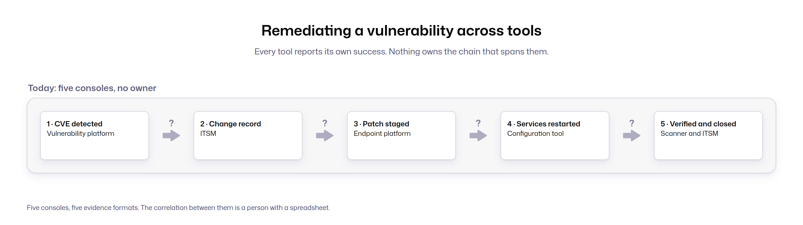
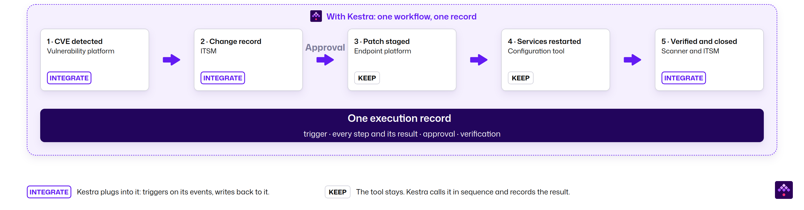

Most infrastructure teams have automated every tool they run. What usually isn't automated is the handoff between those tools, and Day 2 operations are where that gap tends to show up. Take a routine patch.

A critical CVE lands late on a weekday. In many enterprises, it passes through five tools in sequence:

1. The vulnerability platform flags it within minutes.
2. A change record opens in the ITSM system.
3. The patch platform stages the update across several thousand endpoints.
4. A configuration run restarts the affected services.
5. A verification scan is scheduled to confirm the fix.

Every tool does its step and reports success.

*Today: each tool reports its own success, and nothing owns the chain between them.*

Then the patch fails on a few hundred hosts. The restart runs anyway, because nothing told it to wait. The next morning's scan still shows a few hundred hosts as vulnerable, and an engineer needs to rebuild the sequence from five consoles and a spreadsheet to work out why.

> Each tool kept a log of its own step. Nobody kept a log of the chain.

## Why automated infrastructure breaks between the tools

**Infrastructure automation removes manual work inside a single tool. Infrastructure orchestration sequences work across many tools**, and most enterprises have plenty of the first and almost none of the second. Terraform, Ansible, Argo CD, the patch platform, and the scripts around them each automate their own domain well. Day 2 work such as patching, remediation, and certificate rotation crosses those tools by nature, and the sequence between them belongs to a person, a cron entry, or a CI job that was never built for it.

## What the coordination gap costs

The coordination gap costs enterprises in three ways:

- **Operational risk.** Changes that cross several tools break at the seams, and teams rebuild the sequence by hand after an incident.
- **Metered licensing.** Commercial automation tools charge per node, per resource, per core, or per endpoint, so the bill grows with every cluster an AI buildout adds.
- **Audit evidence.** NIS2, DORA, and the Cyber Resilience Act (CRA) ask for proof of when a change ran, who approved it, and how it was verified. A chain across five tools produces evidence in five formats.

## The fix keeps every tool in place

**Kestra adds one control plane above the tools you already run.** Terraform keeps provisioning, Ansible keeps configuring, Kubernetes operators keep reconciling, and the patch platform keeps patching. Kestra triggers each tool in sequence, passes outputs between them, waits for approvals, handles failures, and records the whole run. On the night above, the failed patch step would have stopped the restart, opened a case with the affected hosts attached, and left one record of what ran.

*With Kestra: the same five tools run as one workflow, with an approval gate before the patch and one execution record for the whole run.*

It does two things on one platform. It governs the tools that stay, and it replaces the layer that only exists to connect them: cron entries on jump hosts, CI jobs doing operations work, wrapper scripts, and legacy orchestration products. [A Fortune 500 industrial manufacturer](/stories/fortune-500-company) replaced VMware Aria Automation at 90 percent lower licensing cost, and its Ansible playbooks now run as orchestrated steps. Teams in the same position can follow the step-by-step method in the companion guide [Migrating Off VMware vRA and vRO](/resources/migration/vra).

## Where this goes next

The platform that runs the first chain is the one the next domains land on, so [the whitepaper](/resources/whitepapers/infrastructure-orchestration) proposes five properties to test inside a proof of concept: domain neutrality, deployment and sovereignty flexibility, one canonical definition in Git, licensing per instance, and native reach across the whole chain. The same approval gates, scoped credentials, and audit record that make a patch wave governable are what AI agents need once they start making changes through the same tools.

:::alert{type="info"}
Read the full whitepaper [Infrastructure Automation Is Not Infrastructure Orchestration](/resources/whitepapers/infrastructure-orchestration) for the target architecture, an anonymized production reference from a European bank patching its private cloud, the resource model an Aria replacement needs, and the five shortlist tests in detail.
:::
