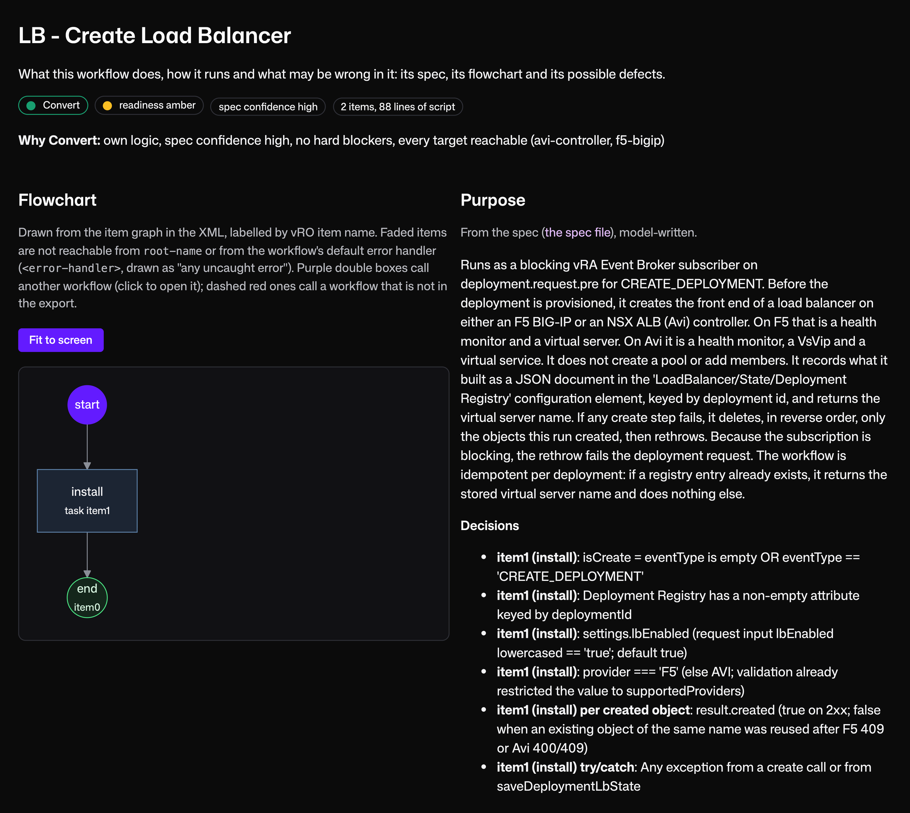
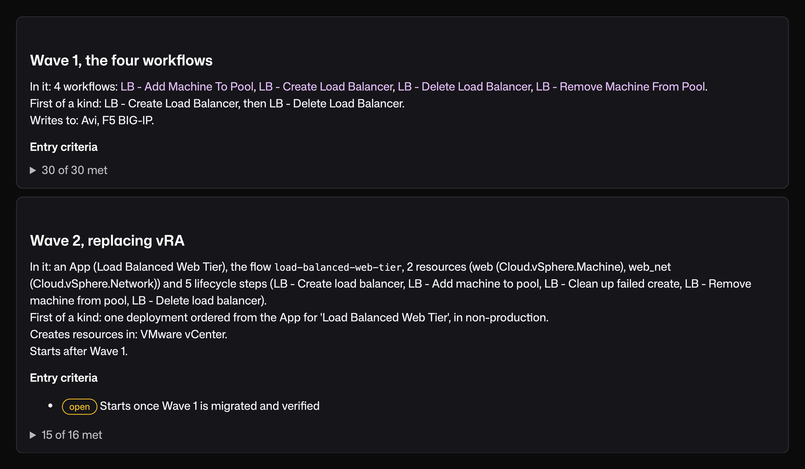

I spent nearly three years at VMware as an Automation Consultant, building custom vRA and vRO automation for banks, government agencies and large companies. Even a single VM provisioning request could involve three consoles: the catalog item in Service Broker, the blueprint in Assembler, and the custom logic in Orchestrator.

Now at Kestra, I talk with teams that want to leave vRA, often because of licensing changes, but don't know how much work the migration would involve. Many inherited automation built over several years, sometimes by professional services, and the people maintaining it don't always know what every workflow does. That makes it hard to estimate the migration or confidently approve a plan.

That's why we built the **Kestra Migration Assistant for vRA**. Kestra is an open-source orchestrator that infrastructure teams at [Crédit Agricole](/customers/credit-agricole) and [Dataport](/customers/dataport) run in production. The Migration Assistant's open-source assessment runs locally against your vRA and vRO exports, inventories the automation, and recommends what to retire, merge, wrap, convert or rebuild. Your engineers review the plan, and we help you migrate the remaining work in waves while vRA keeps running.

## Know What Every Workflow Does, and What to Do With It

The Migration Assistant takes your exported vRO packages and vRA content and produces a migration brief:

- **Workflow inventory**, with what each workflow does, what starts it (a catalog item, a subscription or a schedule) and which other workflows it calls.
- **Integration dependencies**, showing which external systems each workflow calls and which [Kestra plugins](/plugins) cover them.
- **A recommendation per workflow:** retire it, merge it into another, treat it as a wrapper, convert it or rebuild it.
- **A migration plan in waves**, grouping the remaining work by pattern rather than treating every workflow as a separate conversion project.

These are recommendations for your engineers to review. The result is a plan your team can inspect, correct and sign off on before committing to the migration.



## There's Less to Migrate Than Your Export Suggests

If you estimate the migration by multiplying your workflow count by the effort to convert each one, the result can look overwhelming. Much of that count doesn't need a rewrite:

- **Near-duplicates.** The same provisioning workflow copied for different environments or business units can become one Kestra flow with different inputs.
- **Wrappers.** Workflows that mainly invoke an Ansible job, a script or a ServiceNow API are replaced by Kestra flows that call those same systems. The underlying implementation stays where it is.
- **Integration libraries.** Much of the custom REST code we used to write in vRO isn't needed when a Kestra plugin already supports the operations you use, and the assessment recommends retiring it. Kestra has plugins for systems such as ServiceNow, Infoblox, NetBox and Slack.

Unused workflows are a separate check, because an export shows what exists, not what still runs. In our experience, 10 to 20 percent of workflows in a large environment haven't run in twelve months. Check execution history in vRO and have each workflow's owner confirm what's no longer needed before you drop it.

What's left is the custom JavaScript and integrations that need real conversion or redesign. Section 3.2 of the [vRA migration guide](/resources/migration/vra) covers the inventory and rationalization process in more detail.

### An Example: Retry Handling

Retries are a good example of code we used to write repeatedly in vRO integration libraries. If a load balancer API call failed, we needed to handle the error, wait and retry with an increasing delay.

In a vRO scriptable task, that could look like this:

```javascript
var delay = 10000;
for (var attempt = 1; attempt <= 3; attempt++) {
  try {
    var req = lbHost.createRequest("POST", "/pools/" + poolId + "/members",
      JSON.stringify({ address: vmIp, port: 443 }));
    req.contentType = "application/json";
    var resp = req.execute();
    if (resp.statusCode >= 200 && resp.statusCode < 300) break;
    throw "Load balancer returned " + resp.statusCode;
  } catch (e) {
    if (attempt == 3) throw e;
    System.warn("Attempt " + attempt + " failed, retrying: " + e);
    System.sleep(delay);
    delay = delay * 2;
  }
}
```

In Kestra, the HTTP request and exponential backoff are configured on the task:

```yaml
- id: add_pool_member
  type: io.kestra.plugin.core.http.Request
  uri: "{{ secret('LB_URL') }}/pools/{{ inputs.pool_id }}/members"
  method: POST
  contentType: application/json
  body: '{"address": "{{ inputs.vm_ip }}", "port": 443}'
  retry:
    type: exponential
    interval: PT10S
    maxInterval: PT1M
    maxAttempts: 3
```

You still need to decide whether a call is safe to repeat, since a retried POST can add the member twice if the API isn't idempotent. The retry mechanism itself no longer needs custom JavaScript.

## What Stays and What You Decide

Leaving vRA doesn't mean replacing the systems it orchestrates. vSphere, Terraform, Ansible, ServiceNow, your CMDB, IPAM, DNS and your secrets manager all stay, with Kestra calling them.

Two decisions affect the migration scope: where users request infrastructure, and where the record of what was provisioned lives. Most of our customers keep both in their ITSM platform, with Kestra handling orchestration behind it. Others move the catalog or resource inventory into Kestra. Make those decisions before converting workflows, because they determine which parts of the environment change. The [capability map](https://hs.kestra.io/hubfs/kestra-vmware-migration-capability-map.pdf) shows how each part of vRA and vRO maps to Kestra.

## Migrate One Wave at a Time



Once your team has reviewed the brief, we work with your engineers on the conversion and verification, which are separate from the open-source assessment. vRA and Kestra run side by side for the whole migration, and each workflow runs on one platform at a time. When the first wave is done, Kestra runs those workflows while vRA keeps running the ones still waiting for later waves.

- **Prove the approach.** Start with a proof of concept on two or three real workflows, built in Kestra and measured against vRA. This turns your counts into an estimate you can defend.
- **Convert and review.** The Migration Assistant drafts Kestra flows from the vRO workflows, and an engineer reviews each conversion.
- **Test before cutover.** Each converted flow gets tests based on the original behavior, run in a VMware Migration Lab built for your environment. The Lab uses vcsim, a vCenter simulator, with mocks of systems such as your vault and CMDB, and the flows use the real Kestra plugins against them. Moving to your own systems is then a matter of swapping hostnames and credentials, starting in non-production.
- **Cut over workflow by workflow.** Point the existing trigger at a Kestra flow that calls the original vRO workflow, verify that path, then replace the vRO workflow itself. This strangler fig approach tests the integration change separately from the conversion. The vRO version is switched off once the workflow's owner accepts the Kestra one against criteria agreed before the wave started, and until then you can point the trigger back.

Some workflows are better rebuilt than converted, especially when the logic is poorly understood or would be designed differently today. One public-sector agency with roughly 1,600 vRO workflows chose to reimplement them on Kestra rather than convert the existing code.

## Should You Move?

The licence is what starts most of these conversations, but the bigger reason to move is who controls your automation. Your infrastructure vendor should not own your automation. VMware can stay as your hypervisor. The automation on top of it should keep working when the hypervisor, the cloud or the contract changes, and it should be able to take on new capabilities, like AI agents or integrations outside the VMware stack, without waiting for your infrastructure vendor's roadmap. Here's what Kestra gives you on that front:

- **It reaches the systems outside VMware.** vSphere and Nutanix, your cloud accounts, Kubernetes, your ITSM and CMDB, IPAM and DNS, Terraform and Ansible, through more than two thousand plugins, on-prem or fully air-gapped.
- **Your workflows stay portable.** Flows are declarative YAML in your own Git repository, reviewed through pull requests, with task code in Python, Shell or PowerShell, on an open-source core.
- **It brings AI into your workflows.** AI agents and model calls run as tasks inside a flow, next to the infrastructure steps, with the same logs, retries and permissions.
- **Other teams can use the same platform.** The engine that runs your provisioning can also run data pipelines and application workflows, with the same RBAC, secrets and audit trail.

The business case still has to work for your environment. The [payback calculator](/resources/migration/vra/payback) compares staying and moving with your own numbers, and the proof of concept replaces its assumptions with rates measured on your own workflows. If you're keeping VMware Cloud Foundation, confirm that removing vRA actually lowers your licensing bill.

For one customer's result, a [Fortune 500 manufacturer](/customers/fortune-500-company) that replaced vRA and vRO with Kestra reports licensing costs 90 percent lower than Aria Automation, and automation services that used to take six months to deliver now take six days.

## Where to Start

The vRA migration guide covers the full process, from assessing your environment and deciding what stays, through the proof of concept and payback calculation, to switching vRA off.

**→ [Read the vRA migration guide](/resources/migration/vra)**

To run the open-source assessment on your own export, or see a sample migration brief first:

**→ [Get the Kestra Migration Assistant for vRA](/resources/migration/vra/assistant)**

You can also see the Migration Assistant in action, from a vRO export and migration brief to a converted flow tested in the VMware Migration Lab. I'm hosting the European session, and my colleague Parham Parvizi is hosting the Americas session, both with live Q&A:

- **Europe:** Wednesday, November 4 at 2 PM CET (8 AM ET)
- **Americas:** Thursday, November 5 at 11 AM PT

**→ Register: [EU session](https://watch.getcontrast.io/register/kestra-leaving-vra-without-the-big-rewrite) · [US session](https://watch.getcontrast.io/register/kestra-leaving-vra-without-the-big-rewrite-9061c391)**
