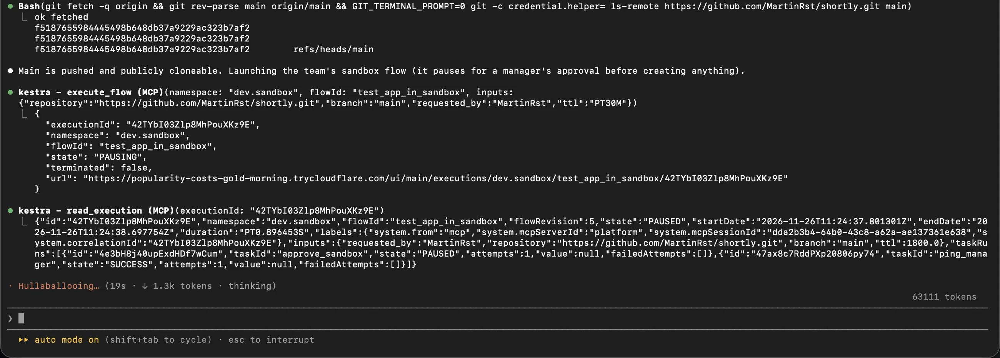
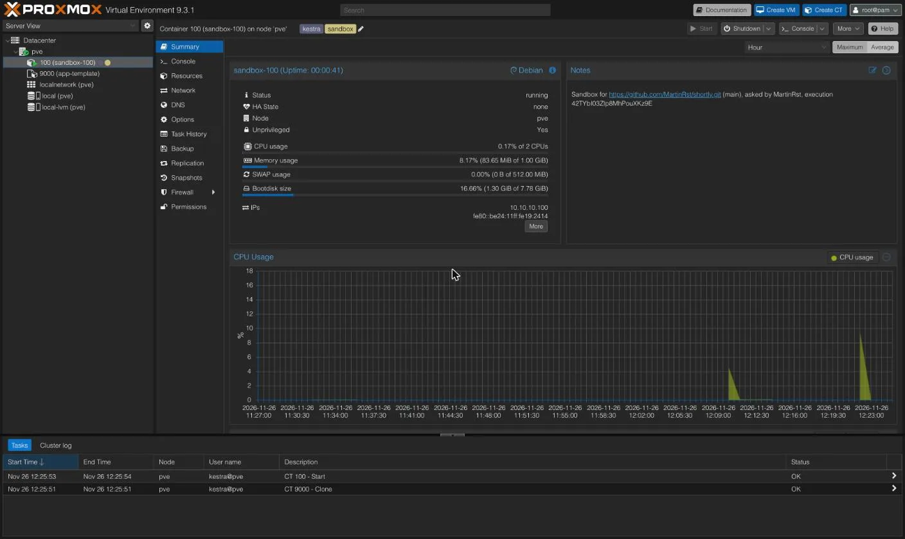
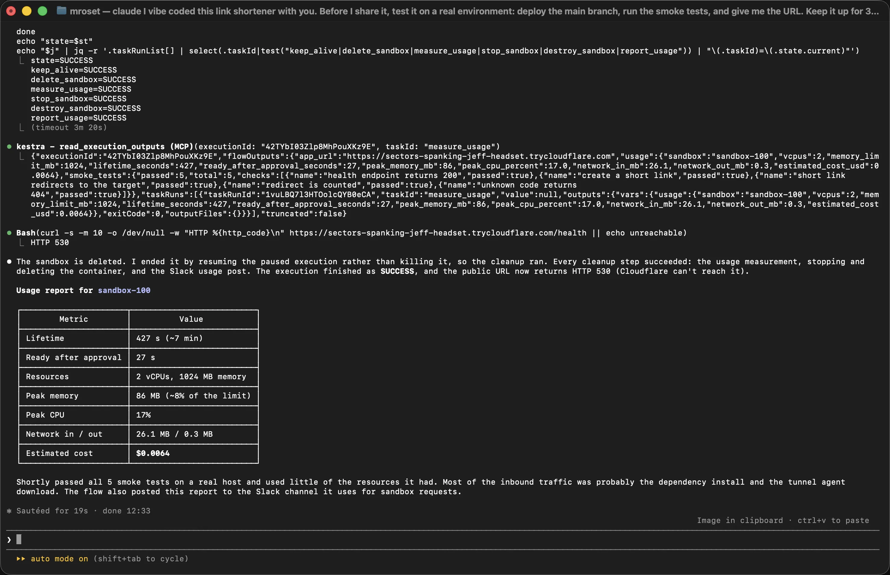
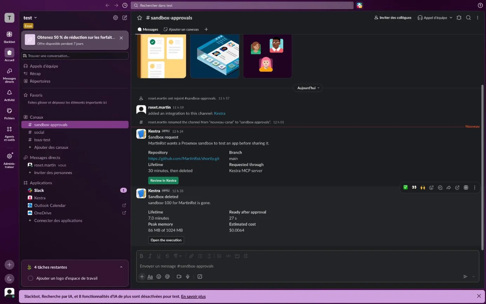
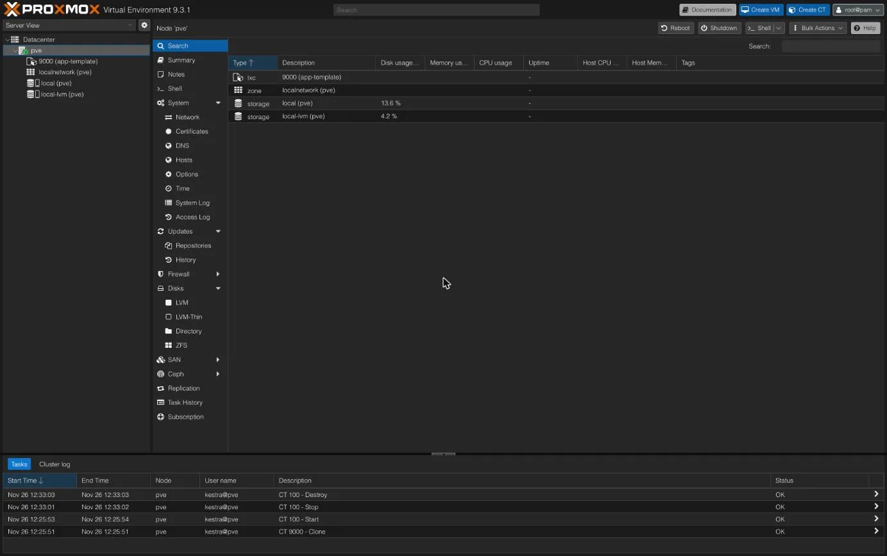

Kestra 2.1 adds the [Kestra MCP Server](/docs/develop-with-ai/kestra-mcp-server), which lets Claude, Cursor, or any MCP client start and follow executions, and the [Approval](/docs/workflow-components/approvals) task, which pauses a flow until a person approves or denies it. With both, an agent can start real work while a person keeps the decision.

To show them together, I picked a case most teams know: testing a vibe-coded app on real infrastructure. Claude Code asks for a sandbox through the MCP server, a manager approves it in Slack, Kestra clones a container on [Proxmox VE](/plugins/plugin-proxmox), [Ansible](/plugins/plugin-ansible) deploys the branch, and the sandbox is deleted with a report of what it consumed. Claude never holds a hypervisor key. Every screenshot below comes from one run.

## Claude starts the flow through the MCP server

The app is Shortly, a FastAPI link shortener with five smoke tests, built with Claude and pushed to a public GitHub repository. In the repository folder, the prompt was:

> I vibe coded this link shortener with you. Before I share it, test it on a real environment: deploy the main branch, run the smoke tests, and give me the URL. Keep it up for 30 minutes.

Claude checked that `main` was pushed, then called the `execute_flow` tool on the Kestra MCP Server with the repository, the branch, who asked, and a 30-minute lifetime. The tool returned the execution ID and a link to it in Kestra.



Claude found the flow because the MCP server tells it where to look. The server is off until you turn it on, and the `instructions` you set are sent to every client that connects:

```yaml
kestra:
  mcp:
    platform-server:
      enabled: true
      instructions: >-
        To test an application in a real environment, run the flow
        dev.sandbox/test_app_in_sandbox with the repository URL and branch.
        The flow waits for a human approval before it creates anything; you
        cannot approve it yourself. Report the app URL, the smoke test results
        and the sandbox usage to the user. To end a sandbox early, resume the
        paused execution so the flow deletes it. Never kill the execution: a
        kill skips the cleanup and leaves the sandbox running.
```

On the Claude Code side, the server is one command:

```bash
claude mcp add --transport http kestra https://kestra.example.com/api/v1/mcp --header "Authorization: Basic <credentials>"
```

## The Approval task waits for a person

The first task of the flow is an [Approval](/docs/workflow-components/approvals) task. Before the execution pauses, its `onWait` branch posts the request to the team's Slack channel with a button that opens the execution in Kestra.


Claude reported what it had started and what it was waiting for. The MCP server has no tool to approve a request, and `resume_execution` refuses an execution that waits on an Approval task, so the agent cannot approve its own sandbox.


In Kestra, the execution carries the `system.from: mcp` label and a banner asking for a review.


In this run I was both the developer and the approver, so I told Claude in the session that I approved, and it recorded that decision through the Kestra API. In a team, the approver is someone else, and the decision is made in Kestra or from the Slack link.

## Kestra creates the sandbox

After approval, the flow lists the containers on the Proxmox node, picks a free ID between 100 and 104, clones the golden template, sets the network, memory, tags and notes, and starts the container. The Proxmox tasks call the API with a `kestra@pve` token stored as a Kestra secret.


The container shows up in Proxmox with the `kestra` and `sandbox` tags. Its notes link back to the repository, the requester, and the execution.



## Ansible deploys the branch

The `AnsibleCLI` task runs a playbook kept as a namespace file. It clones the branch, installs the dependencies in a virtual environment, starts the app under systemd, and waits for `/health`. It then starts a Cloudflare tunnel inside the container, so the sandbox gets a public HTTPS URL that disappears with it. Last, it runs the smoke tests and sends the results and the URL back to Kestra.

Kestra splits the playbook into one task run per Ansible task, so a failed `pip install` shows up as its own red row in the Gantt view, with its logs.

:::collapse{title="The playbook: playbooks/deploy_python_app.yml"}
```yaml
- name: Deploy a Python web app branch into a sandbox
  hosts: sandbox
  gather_facts: false
  environment:
    GIT_TERMINAL_PROMPT: "0"
  vars:
    app_dir: /opt/app
  tasks:
    - name: Wait for the container to accept SSH
      ansible.builtin.wait_for_connection:
        timeout: 120

    - name: Clone the branch
      ansible.builtin.git:
        repo: "{{ repository }}"
        version: "{{ branch }}"
        dest: "{{ app_dir }}"
        depth: 1

    - name: Install the Python dependencies
      ansible.builtin.pip:
        requirements: "{{ app_dir }}/requirements.txt"
        virtualenv: "{{ app_dir }}/.venv"
        virtualenv_command: python3 -m venv

    - name: Install the systemd unit
      ansible.builtin.copy:
        dest: /etc/systemd/system/app.service
        content: |
          [Unit]
          Description=Sandboxed app
          After=network-online.target

          [Service]
          WorkingDirectory={{ app_dir }}
          ExecStart={{ app_dir }}/.venv/bin/uvicorn app.main:app --host 0.0.0.0 --port 8000
          Restart=on-failure

          [Install]
          WantedBy=multi-user.target

    - name: Start the app
      ansible.builtin.systemd_service:
        name: app
        state: restarted
        enabled: true
        daemon_reload: true

    - name: Wait for the health check
      ansible.builtin.uri:
        url: http://127.0.0.1:8000/health
      register: health
      until: health.status == 200
      retries: 30
      delay: 2

    - name: Install the tunnel agent
      ansible.builtin.apt:
        deb: https://github.com/cloudflare/cloudflared/releases/latest/download/cloudflared-linux-arm64.deb

    - name: Publish the app through a tunnel
      ansible.builtin.copy:
        dest: /etc/systemd/system/app-tunnel.service
        content: |
          [Unit]
          Description=Public URL for the sandboxed app
          After=app.service

          [Service]
          ExecStart=/usr/bin/cloudflared tunnel --no-autoupdate --url http://localhost:8000
          Restart=on-failure

          [Install]
          WantedBy=multi-user.target

    - name: Start the tunnel
      ansible.builtin.systemd_service:
        name: app-tunnel
        state: restarted
        enabled: true
        daemon_reload: true

    - name: Read the public URL
      ansible.builtin.shell: journalctl -u app-tunnel --no-pager | grep -o 'https://[a-z0-9-]*\.trycloudflare\.com' | tail -1
      register: public_url
      until: public_url.stdout != ""
      retries: 30
      delay: 2
      changed_when: false

    - name: Wait for the public URL to answer
      ansible.builtin.uri:
        url: "{{ public_url.stdout }}/health"
      register: public_health
      until: public_health.status == 200
      retries: 30
      delay: 3

    - name: Run the smoke tests
      ansible.builtin.shell: "{{ app_dir }}/.venv/bin/python {{ app_dir }}/tests/smoke_test.py http://127.0.0.1:8000 | tail -1 > /tmp/smoke.json"
      changed_when: false
      failed_when: false

    - name: Save the public URL
      ansible.builtin.copy:
        dest: /tmp/public_url.txt
        content: "{{ public_url.stdout }}"

    - name: Bring the public URL back to Kestra
      ansible.builtin.fetch:
        src: /tmp/public_url.txt
        dest: "{{ lookup('env', 'PWD') }}/public_url.txt"
        flat: true

    - name: Bring the results back to Kestra
      ansible.builtin.fetch:
        src: /tmp/smoke.json
        dest: "{{ lookup('env', 'PWD') }}/smoke.json"
        flat: true
```
:::

## Claude gets the URL

Claude read the outputs with `read_execution_outputs`, called `/health` on the public URL itself, and reported back. The sandbox was ready 27 seconds after the approval.


## Teardown and usage

The flow keeps the sandbox with a `Pause` task for the requested lifetime. To end early, Claude resumes that pause through `resume_execution`. It must not kill the execution: a kill skips the `finally` block, and the container keeps running. The `instructions` above say so, and Claude did it this way when asked to tear down.


The `finally` block measures the container through the Proxmox API before deleting it: lifetime, peak CPU and memory, network in and out, and a cost estimate from internal rates set as flow variables. Then it stops the container, deletes it, and posts a summary to Slack.





Kestra keeps the same numbers as a flow output, which other flows and agents can read, and as metrics on the execution.


On the Proxmox side, only the template is left, and the task log shows the whole life of the sandbox, all run by `kestra@pve`.



## The flow

The whole flow, as it ran:

:::collapse{title="dev.sandbox/test_app_in_sandbox"}
```yaml
id: test_app_in_sandbox
namespace: dev.sandbox
description: |
  Creates a short-lived Proxmox sandbox, deploys a Git branch into it with Ansible,
  runs its smoke tests, and deletes the sandbox when the time is up.

inputs:
  - id: repository
    type: STRING
    description: HTTPS URL of the Git repository to test

  - id: branch
    type: STRING
    defaults: main

  - id: requested_by
    type: STRING
    description: Who asked for the sandbox

  - id: ttl
    type: DURATION
    defaults: PT30M
    description: How long the sandbox stays up before it is deleted

variables:
  pve_host: 127.0.0.1
  pve_node: pve
  template: "9000"
  vcpu_hour_rate: 0.025
  gb_hour_rate: 0.004

tasks:
  - id: approve_sandbox
    type: io.kestra.plugin.core.flow.Approval
    timeout: PT2H
    commentRequired: ON_DENY
    onWait:
      - id: ping_manager
        type: io.kestra.plugin.slack.SlackIncomingWebhook
        url: "{{ secret('SLACK_WEBHOOK') }}"
        payload: |
          {
            "text": "Sandbox request from {{ inputs.requested_by }}",
            "blocks": [
              {"type": "section", "text": {"type": "mrkdwn", "text": "*Sandbox request*\n{{ inputs.requested_by }} wants a Proxmox sandbox to test an app before sharing it."}},
              {"type": "section", "fields": [
                {"type": "mrkdwn", "text": "*Repository*\n{{ inputs.repository }}"},
                {"type": "mrkdwn", "text": "*Branch*\n{{ inputs.branch }}"},
                {"type": "mrkdwn", "text": "*Lifetime*\n{{ (inputs.ttl / 60) | numberFormat('#') }} minutes, then deleted"},
                {"type": "mrkdwn", "text": "*Requested through*\nKestra MCP server"}
              ]},
              {"type": "actions", "elements": [
                {"type": "button", "style": "primary", "text": {"type": "plain_text", "text": "Review in Kestra"}, "url": "{{ kestra.url }}ui/main/executions/{{ flow.namespace }}/{{ flow.id }}/{{ execution.id }}"}
              ]}
            ]
          }
    onApprove:
      - id: list_containers
        type: io.kestra.plugin.proxmox.container.List
        host: "{{ vars.pve_host }}"
        node: "{{ vars.pve_node }}"
        tokenId: "{{ secret('PROXMOX_TOKEN_ID') }}"
        tokenSecret: "{{ secret('PROXMOX_TOKEN_SECRET') }}"
        verifySsl: false

      - id: pick_slot
        type: io.kestra.plugin.core.output.OutputValues
        values:
          vmid: "{{ outputs.list_containers.containers | jq('[range(100;105)] - [.[].vmid | tostring | tonumber] | first') | first }}"
          approved_at: "{{ now() }}"

      - id: create_sandbox
        type: io.kestra.plugin.proxmox.container.Clone
        host: "{{ vars.pve_host }}"
        node: "{{ vars.pve_node }}"
        tokenId: "{{ secret('PROXMOX_TOKEN_ID') }}"
        tokenSecret: "{{ secret('PROXMOX_TOKEN_SECRET') }}"
        verifySsl: false
        vmName: "{{ vars.template }}"
        newId: "{{ outputs.pick_slot.values.vmid }}"
        newName: "sandbox-{{ outputs.pick_slot.values.vmid }}"

      - id: configure_sandbox
        type: io.kestra.plugin.proxmox.container.Update
        host: "{{ vars.pve_host }}"
        node: "{{ vars.pve_node }}"
        tokenId: "{{ secret('PROXMOX_TOKEN_ID') }}"
        tokenSecret: "{{ secret('PROXMOX_TOKEN_SECRET') }}"
        verifySsl: false
        vmName: "{{ outputs.pick_slot.values.vmid }}"
        memory: 1024
        cores: 2
        config:
          net0: "name=eth0,bridge=vmbr1,ip=10.10.10.{{ outputs.pick_slot.values.vmid }}/24,gw=10.10.10.1"
          description: "Sandbox for {{ inputs.repository }} ({{ inputs.branch }}), asked by {{ inputs.requested_by }}, execution {{ execution.id }}"
          tags: "sandbox;kestra"

      - id: start_sandbox
        type: io.kestra.plugin.proxmox.container.Start
        host: "{{ vars.pve_host }}"
        node: "{{ vars.pve_node }}"
        tokenId: "{{ secret('PROXMOX_TOKEN_ID') }}"
        tokenSecret: "{{ secret('PROXMOX_TOKEN_SECRET') }}"
        verifySsl: false
        vmName: "{{ outputs.pick_slot.values.vmid }}"

      - id: deploy_app
        type: io.kestra.plugin.ansible.cli.AnsibleCLI
        taskRunner:
          type: io.kestra.plugin.core.runner.Process
        namespaceFiles:
          enabled: true
          include:
            - playbooks/deploy_python_app.yml
        inputFiles:
          id_sandbox: "{{ secret('SANDBOX_SSH_KEY') }}"
          inventory.ini: |
            [sandbox]
            10.10.10.{{ outputs.pick_slot.values.vmid }} ansible_user=root ansible_ssh_private_key_file=id_sandbox
            [sandbox:vars]
            ansible_ssh_common_args='-o StrictHostKeyChecking=no -o UserKnownHostsFile=/dev/null -o ProxyCommand="ssh -i id_sandbox -o StrictHostKeyChecking=no -o UserKnownHostsFile=/dev/null -W %h:%p -p 2222 root@{{ vars.pve_host }}"'
        beforeCommands:
          - chmod 600 id_sandbox
        commands:
          - ansible-playbook -i inventory.ini playbooks/deploy_python_app.yml -e repository={{ inputs.repository }} -e branch={{ inputs.branch }}
        outputFiles:
          - smoke.json
          - public_url.txt

      - id: report
        type: io.kestra.plugin.core.output.OutputValues
        values:
          app_url: "{{ read(outputs.deploy_app.outputFiles['public_url.txt']) | trim }}"
          ready_at: "{{ now() }}"
          smoke_tests: "{{ fromJson(read(outputs.deploy_app.outputFiles['smoke.json'])) }}"
          expires_in: "{{ inputs.ttl }}"

      - id: keep_alive
        type: io.kestra.plugin.core.flow.Pause
        pauseDuration: "{{ inputs.ttl }}"
        behavior: RESUME

finally:
  - id: delete_sandbox
    type: io.kestra.plugin.core.flow.Sequential
    runIf: "{{ outputs.create_sandbox is defined }}"
    tasks:
      - id: measure_usage
        type: io.kestra.plugin.scripts.python.Script
        allowFailure: true
        taskRunner:
          type: io.kestra.plugin.core.runner.Process
        env:
          PVE_TOKEN: "{{ secret('PROXMOX_TOKEN_ID') }}={{ secret('PROXMOX_TOKEN_SECRET') }}"
        script: |
          import json, os, ssl, urllib.request
          from datetime import datetime

          vmid = "{{ outputs.pick_slot.values.vmid }}"
          base = "https://{{ vars.pve_host }}:8006/api2/json/nodes/{{ vars.pve_node }}/lxc/" + vmid
          ctx = ssl._create_unverified_context()

          def get(path):
              req = urllib.request.Request(base + path, headers={"Authorization": "PVEAPIToken=" + os.environ["PVE_TOKEN"]})
              return json.load(urllib.request.urlopen(req, context=ctx))["data"]

          now = get("/status/current")
          points = [p for p in get("/rrddata?timeframe=hour&cf=MAX") if p.get("mem") is not None]
          peak_mem = max([p["mem"] for p in points] + [now["mem"]])
          peak_cpu = max([p.get("cpu", 0) for p in points] + [now["cpu"]])

          lifetime = now["uptime"]
          approved = datetime.fromisoformat("{{ outputs.pick_slot.values.approved_at }}")
          ready_raw = "{{ outputs.report.values.ready_at ?? '' }}"
          ready = (datetime.fromisoformat(ready_raw) - approved).total_seconds() if ready_raw else None
          vcpu_hours = now["cpus"] * lifetime / 3600
          gb_hours = now["maxmem"] / 1024**3 * lifetime / 3600
          cost = vcpu_hours * {{ vars.vcpu_hour_rate }} + gb_hours * {{ vars.gb_hour_rate }}

          usage = {
              "sandbox": now["name"],
              "vcpus": now["cpus"],
              "memory_limit_mb": round(now["maxmem"] / 1024**2),
              "lifetime_seconds": lifetime,
              "ready_after_approval_seconds": round(ready) if ready is not None else None,
              "peak_memory_mb": round(peak_mem / 1024**2),
              "peak_cpu_percent": round(peak_cpu * 100, 1),
              "network_in_mb": round(now["netin"] / 1024**2, 1),
              "network_out_mb": round(now["netout"] / 1024**2, 1),
              "estimated_cost_usd": round(cost, 4),
          }
          metrics = [
              {"name": "sandbox.lifetime", "type": "timer", "value": lifetime},
              {"name": "sandbox.peak_memory_mb", "type": "counter", "value": usage["peak_memory_mb"]},
              {"name": "sandbox.network_in_mb", "type": "counter", "value": usage["network_in_mb"]},
              {"name": "sandbox.estimated_cost_usd", "type": "counter", "value": usage["estimated_cost_usd"]},
          ]
          if ready is not None:
              metrics.append({"name": "sandbox.ready_after_approval", "type": "timer", "value": ready})
          print(json.dumps(usage, indent=2))
          print("::" + json.dumps({"outputs": {"usage": usage}, "metrics": metrics}) + "::")

      - id: stop_sandbox
        type: io.kestra.plugin.proxmox.container.Stop
        allowFailure: true
        host: "{{ vars.pve_host }}"
        node: "{{ vars.pve_node }}"
        tokenId: "{{ secret('PROXMOX_TOKEN_ID') }}"
        tokenSecret: "{{ secret('PROXMOX_TOKEN_SECRET') }}"
        verifySsl: false
        vmName: "{{ outputs.pick_slot.values.vmid }}"

      - id: destroy_sandbox
        type: io.kestra.plugin.proxmox.container.Delete
        host: "{{ vars.pve_host }}"
        node: "{{ vars.pve_node }}"
        tokenId: "{{ secret('PROXMOX_TOKEN_ID') }}"
        tokenSecret: "{{ secret('PROXMOX_TOKEN_SECRET') }}"
        verifySsl: false
        vmName: "{{ outputs.pick_slot.values.vmid }}"

      - id: report_usage
        type: io.kestra.plugin.slack.SlackIncomingWebhook
        allowFailure: true
        url: "{{ secret('SLACK_WEBHOOK') }}"
        payload: |
          
          {
            "text": "Sandbox deleted",
            "blocks": [
              {"type": "section", "text": {"type": "mrkdwn", "text": "*Sandbox deleted*\n{{ u.sandbox ?? 'The sandbox' }} for {{ inputs.requested_by }} is gone."}},
              {"type": "section", "fields": [
                {"type": "mrkdwn", "text": "*Lifetime*\n{{ ((u.lifetime_seconds ?? 0) / 60) | numberFormat('0.0') }} minutes"},
                {"type": "mrkdwn", "text": "*Ready after approval*\n{{ u.ready_after_approval_seconds ?? '-' }} s"},
                {"type": "mrkdwn", "text": "*Peak memory*\n{{ u.peak_memory_mb ?? '-' }} MB of {{ u.memory_limit_mb ?? '-' }} MB"},
                {"type": "mrkdwn", "text": "*Estimated cost*\n${{ u.estimated_cost_usd ?? '-' }}"}
              ]},
              {"type": "actions", "elements": [
                {"type": "button", "text": {"type": "plain_text", "text": "Open the execution"}, "url": "{{ kestra.url }}ui/main/executions/{{ flow.namespace }}/{{ flow.id }}/{{ execution.id }}"}
              ]}
            ]
          }

outputs:
  - id: app_url
    type: STRING
    value: "{{ outputs.report.values.app_url ?? '' }}"
  - id: smoke_tests
    type: JSON
    value: "{{ outputs.report.values.smoke_tests ?? {} }}"
  - id: usage
    type: JSON
    value: "{{ outputs.measure_usage.vars.usage ?? {} }}"
```
:::

If you copy the flow, keep these details:

- The approval comes before anything is created, so a denied or expired request costs nothing.
- The teardown lives in `finally` behind `runIf: "{{ outputs.create_sandbox is defined }}"`, so it runs after a failed deploy too, and is skipped when nothing was created.
- The usage is measured before `stop_sandbox`, while the container still reports its counters.
- The Proxmox token, the SSH key, and the Slack webhook are Kestra secrets. Claude never sees them.

## How this lab runs

To keep the demo reproducible on a laptop, the setup is smaller than a production one:

- Proxmox VE 9.3 for arm64 runs in a QEMU virtual machine, and the sandboxes are LXC containers cloned from a template on LVM-thin storage. On x86 hosts, full VMs work the same way with the `vm` tasks of the Proxmox plugin.
- Ansible reaches the containers through the Proxmox node as an SSH jump host.
- Kestra is a 2.1 build, reachable through a Cloudflare tunnel, and each sandbox publishes its app through its own tunnel.
- The Slack messages go to a test workspace.

## The same flow on VMware or Nutanix

Proxmox is the open-source option. If your sandboxes live on VMware vSphere or Nutanix AHV, the Enterprise Edition has plugins with the same lifecycle tasks. Replace the Proxmox clone, start, stop, and delete tasks:

| Step | Proxmox | VMware vCenter | Nutanix AHV |
|---|---|---|---|
| Create | `proxmox.container.Clone` | [`vcenter.CloneTemplate`](/plugins/plugin-ee-vmware) | [`ahv.CloneTemplate`](/plugins/plugin-ee-nutanix) |
| Start | `proxmox.container.Start` | `vcenter.StartVm` | `ahv.StartVm` |
| Stop | `proxmox.container.Stop` | `vcenter.StopVm` | `ahv.StopVm` |
| Delete | `proxmox.container.Delete` | `vcenter.DeleteVm` | `ahv.DeleteVm` |

The approval, the playbook, the smoke tests, the usage report, and the MCP side stay the same.

## What the Enterprise Edition adds

This run used the open-source edition. For a team, the Enterprise Edition adds:

- The MCP server runs every call as the person behind the agent, with their permissions, and records it in the [audit logs](/docs/enterprise/governance/audit-logs) under their name.
- Approval requests can be assigned to the platform team, followed on the Approvals page, and given a title, so a developer cannot approve their own sandbox.
- [Worker groups](/docs/enterprise/scalability/worker-group) run the Ansible task on workers inside the datacenter, next to the hypervisor.
- Secrets can come from your vault instead of Kestra's own store.

## Try it

- Turn on the [Kestra MCP Server](/docs/develop-with-ai/kestra-mcp-server) and connect Claude Code, Cursor, or another MCP client.
- Install the [Proxmox](/plugins/plugin-proxmox), [Ansible](/plugins/plugin-ansible), and [Slack](/plugins/plugin-slack) plugins.
- Start from the flow above and replace the template ID, the network, and the playbook with yours.

If you build something with it, tell us in the [Kestra community on Slack](/slack).
