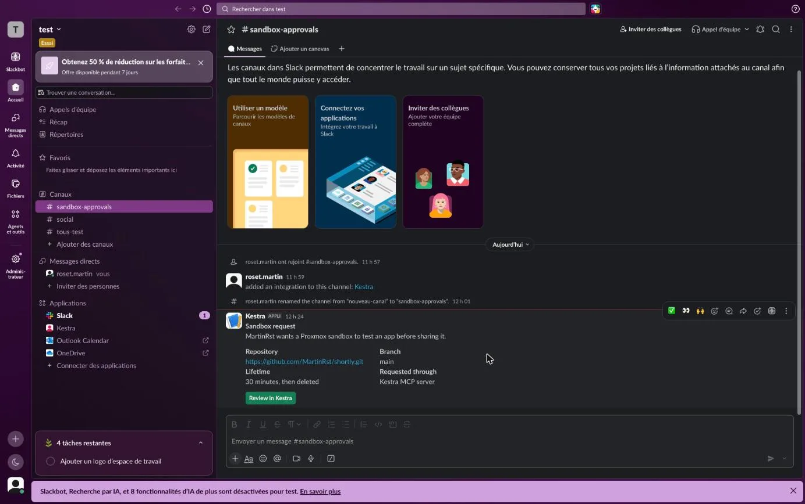
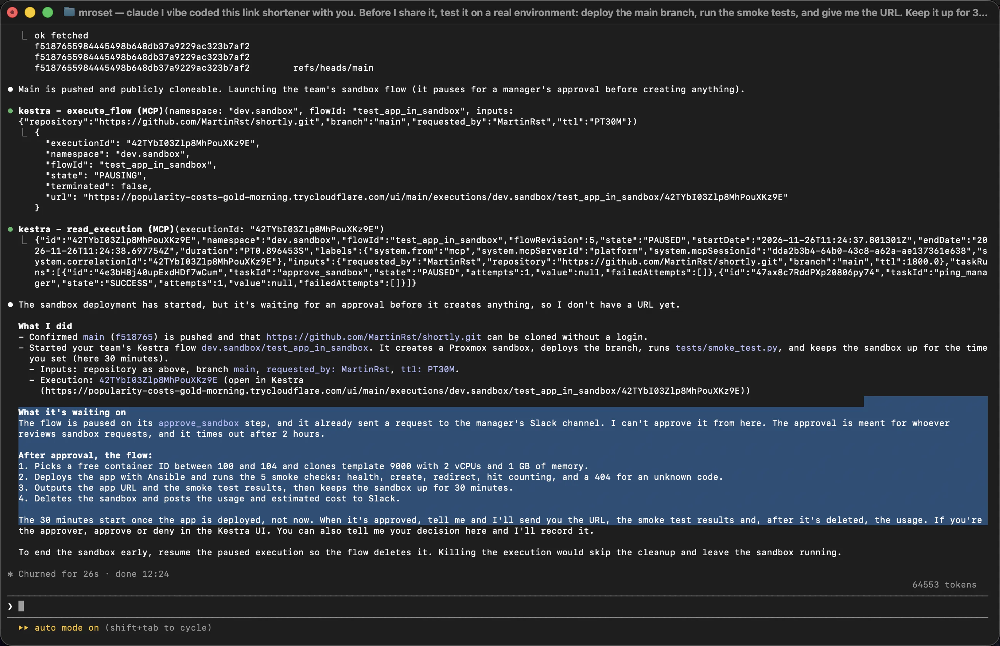
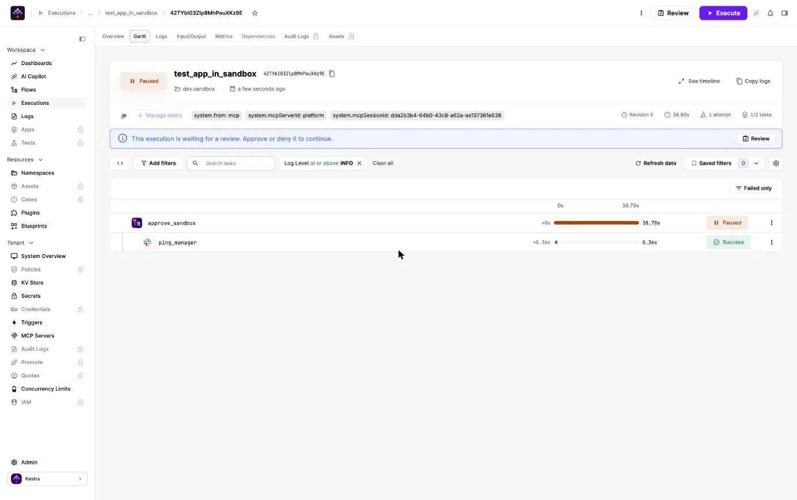
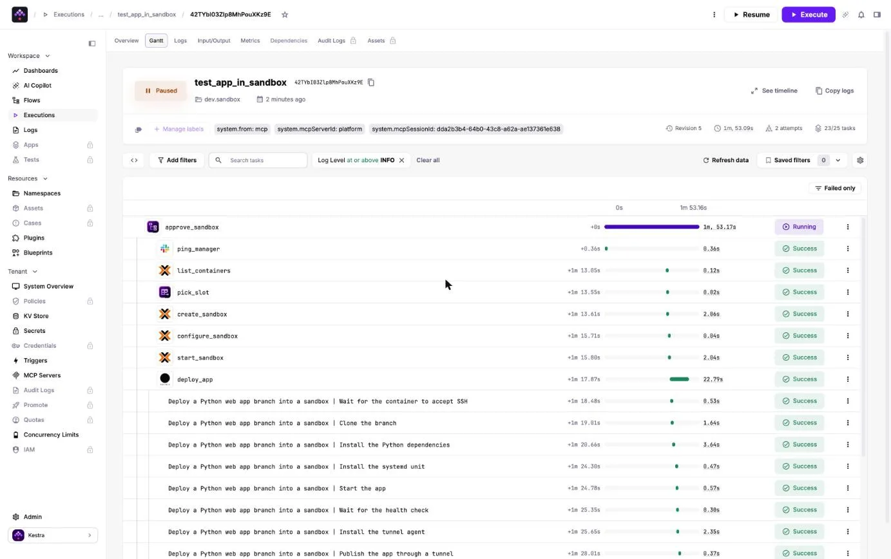
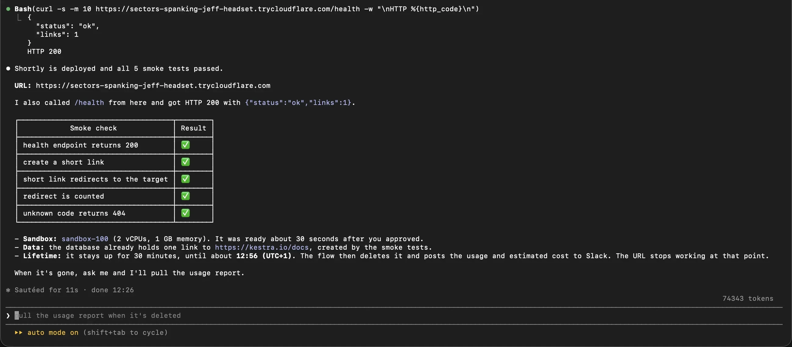
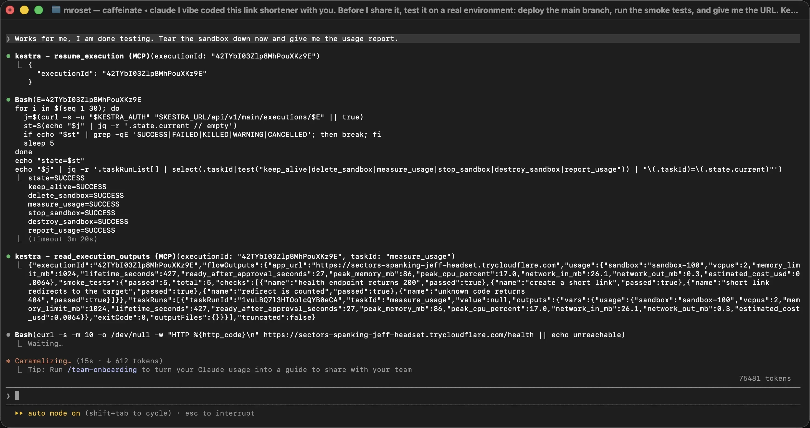
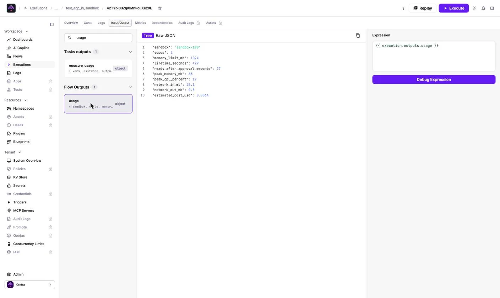
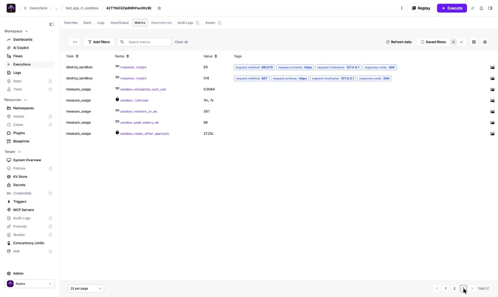
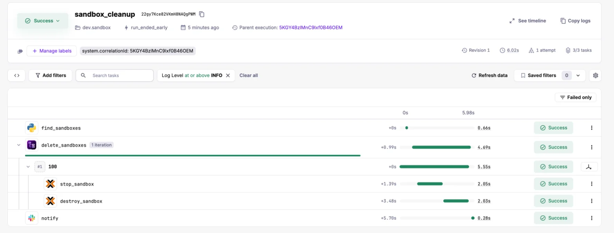
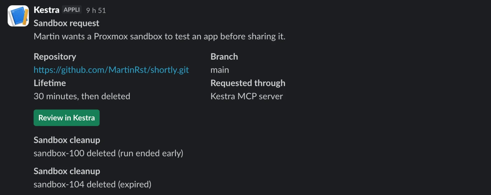

AI agents have been part of Kestra since the beginning, and each release gives them more to work with, from AI Agent tasks inside flows to [MCP Flows](/blogs/2026-09-04-kestra-2-0-flows-as-agent-tools) that turn any flow into a tool. [Kestra 2.1](/blogs/release-2-1) builds the [Kestra MCP Server](/docs/develop-with-ai/kestra-mcp-server) into Kestra itself: Claude Code, Codex, Cursor, or any MCP client gets Kestra's own operations as tools, and the [Approval](/docs/workflow-components/approvals) task gives a flow a real yes or no from a person. Together, an agent starts the work and a person makes the decision.

This post covers what each feature does, then shows them in one run: Claude Code gets a Proxmox VE sandbox to test an app, a manager approves it in Slack, and the sandbox is deleted with a usage report. The flow is a [blueprint](/blueprints/proxmox-app-sandbox-with-approval) you can import.


## What the Kestra MCP Server gives an agent

MCP Flows let an agent call the flows you chose to expose. The MCP Server goes further and exposes Kestra itself. From a chat, an agent can:

- read and edit flows, and draft a new flow for you to review before anything is saved
- start, restart, replay, pause, resume, or kill executions
- read execution details, outputs, and logs, and search logs across executions
- manage namespace files and KV entries

In Kestra Enterprise, agents can also work with apps, test suites, and user groups, for 78 tools in all.

The tools carry hints that tell the client whether a call only reads, makes changes, or deletes or starts something, so your client can ask before acting. The server is off until you turn it on, every request is authenticated, and you can limit it to some tenants and choose the sign-in methods it accepts, OAuth included.

You can also give every connected agent standing instructions. In this example, they point the agent at one flow and set the rules for using it:

```yaml
kestra:
  mcp:
    platform-server:
      enabled: true
      instructions: >-
        To test an application in a real environment, run the flow
        dev.sandbox/test_app_in_sandbox with the repository URL and branch.
        The flow waits for a human approval before it creates anything; you
        cannot approve it yourself. Report the app URL, the smoke test results
        and the sandbox usage to the user. To end a sandbox early, resume the
        paused execution so the flow reports its usage and deletes it.
```

Connecting Claude Code is one command:

```bash
claude mcp add --transport http kestra https://kestra.example.com/api/v1/mcp --header "Authorization: Basic <credentials>"
```

## What the Approval task adds

Before 2.1, asking a person for a decision meant a `Pause` task, and the only way to say no was to kill the execution. The Approval task waits for a reviewer, then runs `onApprove` or `onDeny`. Reviewers can leave a comment and fill in fields, a request can approve itself when a condition is met, and it can expire after a timeout. An `onWait` branch runs before the pause, which is where you notify the approver.

The MCP server has no tool to approve a request, and `resume_execution` refuses an execution that waits on an Approval task. An agent can start a flow that needs approval, but it cannot approve it.

## Why a flow instead of a skill

Many teams write an agent skill for operations like a Kubernetes cluster upgrade: the rules, the prechecks, the postchecks. On a normal day it works. On a bad day, nothing enforces it, because a skill tells the agent what it should do, not what it can do. Hand that skill to a junior engineer and the risk grows.

With the MCP Server, the agent calls a predefined flow instead. It still decides when the work runs, but it can only run the steps the flow defines, with the prechecks, approvals, and rollback built in. Every run is recorded, so you can audit it, improve it, and show how reliable it is.

## One run, end to end

The app is Shortly, a FastAPI link shortener built with Claude and pushed to GitHub. In the repository folder, the prompt was:

> I vibe coded this link shortener with you. Before I share it, test it on a real environment: deploy the main branch, run the smoke tests, and give me the URL. Keep it up for 30 minutes.

Claude checked that `main` was pushed, then called `execute_flow` with the repository, the branch, who asked, and a 30-minute lifetime.


The Approval task posted the request to Slack before pausing.



Claude reported what it had started and that it could not approve the request itself. In Kestra, the execution carries the `system.from: mcp` label and waits for a review.





In this run I was both the developer and the approver, so I approved from the Claude session, and Claude recorded my decision through the Kestra API. In a team, the approver is someone else, deciding in Kestra or from the Slack link.

After approval, Kestra cloned a container from a template on Proxmox VE, configured and started it, and ran an Ansible playbook that deployed the branch and ran the smoke tests. Each Ansible task shows up as its own task run.




Claude read the outputs, checked the public URL itself, and reported back. The sandbox was ready 27 seconds after the approval.



## What the sandbox consumed

When asked to tear down, Claude called `resume_execution`, which ends the pause and runs the flow's `finally` block: measure the sandbox, stop it, delete it, and report.



Before deleting the container, the flow measures it through the Proxmox API: lifetime, peak CPU and memory, network, and an estimated cost from internal rates. Claude, Slack, and Kestra all get the same numbers.


In Kestra, the usage is a flow output that other flows and agents can read, and a set of metrics on the execution.





Proxmox keeps the full life of the sandbox in its task log, every step run by the `kestra@pve` token.


## Cleanup that holds however the run ends

I thought I would just give the cleanup to the prompt, with instructions telling the agent to end a sandbox by resuming the run, never by killing it. But a flow is deterministic by design and a prompt is not, so the flow should own the cleanup. A person can kill the execution from the UI, a task can fail, or an agent can call a different tool. Kill stops an execution on the spot, which is what a stop button is for, so the teardown also lives in a second flow, `sandbox_cleanup`.

It has two triggers. A Flow trigger fires when `test_app_in_sandbox` ends in `KILLED` or `FAILED` and deletes the container that run created. A schedule runs every 15 minutes and deletes any sandbox past its expiry. Each sandbox carries its execution ID and an expiry in its Proxmox notes, so the cleanup flow finds it without anything from the original run.

To test it, I killed a run while its sandbox was up. The cleanup flow started on its own, linked to the killed execution, and stopped and destroyed `sandbox-100` in six seconds.



Both paths report to the same Slack channel. The second message comes from the scheduled sweep, which removed a container I had left past its expiry.



Nothing in the cleanup depends on the agent following its instructions.

## The blueprint

The flow is available as the [Approved Proxmox VE Sandbox for AI Agents with Usage Report](/blueprints/proxmox-app-sandbox-with-approval) blueprint. It includes the Approval task with the Slack request, the Proxmox clone and teardown, the Ansible playbook inline, the smoke tests, and the usage report. Set six secrets for Proxmox, SSH, and Slack, adjust the template ID and network, and point your agent at it. The cleanup flow is the [Proxmox VE sandbox cleanup](/blueprints/proxmox-sandbox-cleanup) blueprint; import it in the same namespace.

## With Kestra Enterprise

Kestra open source runs everything shown above. Kestra Enterprise adds what a team needs before agents touch shared infrastructure.

### Agents act as the person behind them

Each MCP call runs with that person's permissions, so an agent only sees and does what they can. With RBAC on namespaces, you can let developers run the sandbox flow and nothing else. Every change an agent makes shows up in the [audit logs](/docs/enterprise/governance/audit-logs) under the person's name.

### Approvals go to the right people

You can assign a request to specific people or groups, so a developer cannot approve their own sandbox, and give it a title. The Approvals page lists every pending and resolved request, reviewers and requesters get notifications, several approvals can chain into one multi-step sign-off, and reviewers can decide from an App without opening Kestra. See [Approvals in Kestra Enterprise](/docs/enterprise/governance/approvals).

### The same flow runs on VMware or Nutanix

If your sandboxes live on VMware vSphere or Nutanix AHV, replace the four Proxmox tasks with the Enterprise plugins. The approval, the playbook, the usage report, and the MCP side stay the same.

| Step | Proxmox | VMware vCenter | Nutanix AHV |
|---|---|---|---|
| Create | `proxmox.container.Clone` | [`vcenter.CloneTemplate`](/plugins/plugin-ee-vmware) | [`ahv.CloneTemplate`](/plugins/plugin-ee-nutanix) |
| Start | `proxmox.container.Start` | `vcenter.StartVm` | `ahv.StartVm` |
| Stop | `proxmox.container.Stop` | `vcenter.StopVm` | `ahv.StopVm` |
| Delete | `proxmox.container.Delete` | `vcenter.DeleteVm` | `ahv.DeleteVm` |

### Execution stays inside your network

[Worker groups](/docs/enterprise/scalability/worker-group) run the Ansible task on workers next to the hypervisor, and secrets can come from your existing vault instead of Kestra's own store.

## How this lab runs

To keep the demo on a laptop, the setup is smaller than a production one. Proxmox VE 9.3 for arm64 runs in a QEMU virtual machine, and the sandboxes are LXC containers on LVM-thin storage. Ansible reaches them through the Proxmox node as an SSH jump host. Kestra is a 2.1 build reachable through a Cloudflare tunnel, each sandbox publishes its app through its own tunnel, and the Slack messages go to a test workspace.

## Try it

- Read what else is in [Kestra 2.1](/blogs/release-2-1).
- Turn on the [Kestra MCP Server](/docs/develop-with-ai/kestra-mcp-server) and connect Claude Code, Cursor, or another MCP client.
- Import the [Proxmox sandbox blueprint](/blueprints/proxmox-app-sandbox-with-approval) and point it at your template and network.

If you build something with it, tell us in the [Kestra community on Slack](/slack).
