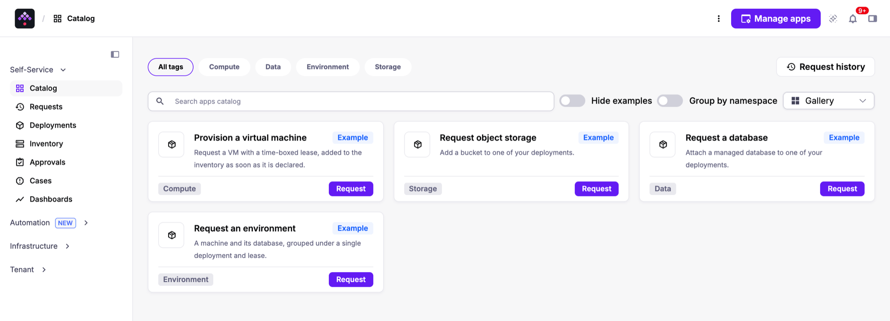
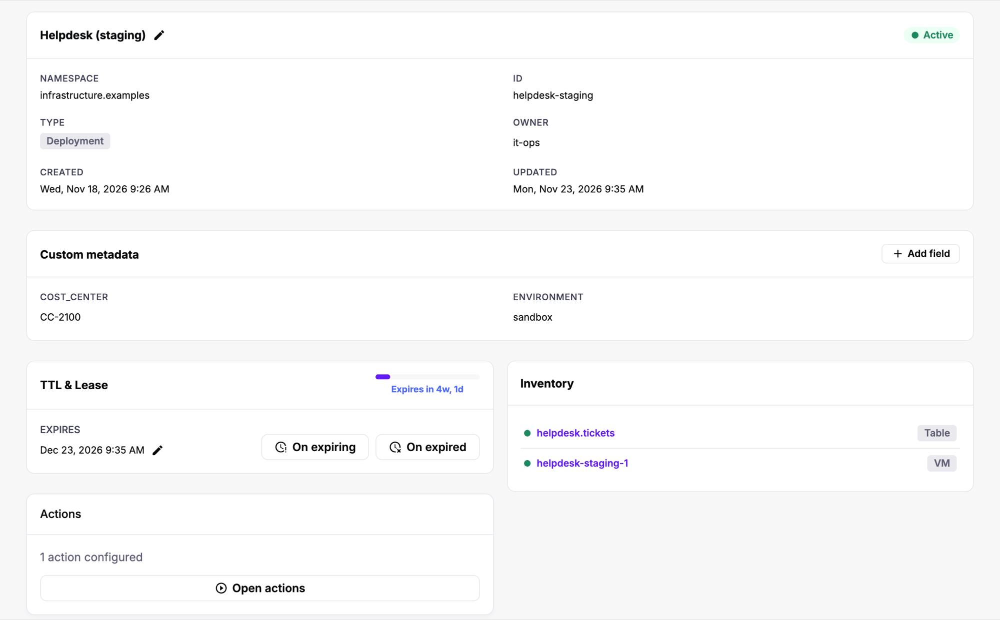
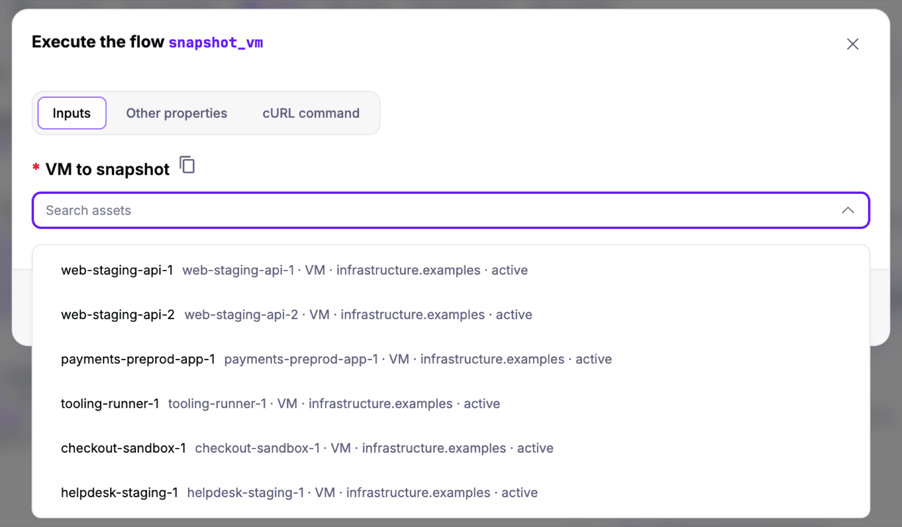
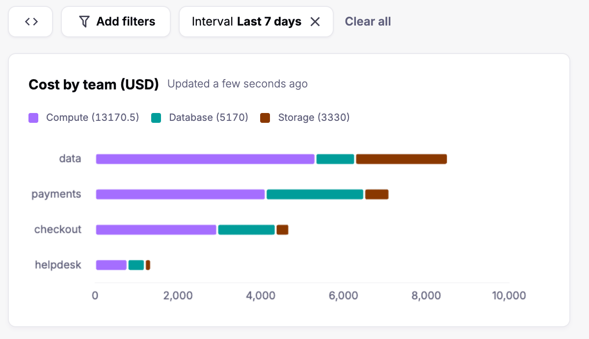

<!--
DRAFT NOTES (remove before publishing)
- Sources: Release=2.1 + kind/highlight issues (project 15), the docs/release-2-1 branch, the CEO/CTO positioning note for Kestra for Infrastructure, the marketing positioning artifact, and the Verticals product enablement deck.
- Kestra for Infrastructure wording follows the positioning note: always the full name, presented as a product built on the Kestra platform. Never "tenant", "tenant type", "mode", "workspace", or "a setting you turn on" in this post; setup stays in the docs. No customer names, no roadmap, no dates beyond launch, no names of next products, no Cloud availability. Don't claim every request is approved, that expired leases are decommissioned automatically, or that the open-source Terraform/OpenTofu/Ansible tasks fill the Inventory on their own. Governed provisioning (EE beta) stays out until it ships.
- Embargoed: Data Orchestration Artifacts (dbt/Airbyte/Fivetran/JDBC artifacts) and the deep dbt integration stay out of this post (changelog only, kept for a later announcement). Plugin endpoints are described generically for that reason. The dbt asset types migration guide is left out of the upgrade table.
- Left out on purpose: Bring Your Own Worker, asset health (ee#11937 open), dataURL() (2.0.8), by-query flat-param rejection (2.0.7), Replay with modified inputs (2.0.0), auto-emitted Terraform/OpenTofu assets (ee#9222 not planned), plugin auto-install on EE (ee#11724 not planned), Failure Debug panel (closed as duplicate), Health Center/Diagnostics (open), Source Search (2.0), EmbeddedSubflow (ee#3501, no work done).
- TODO markers: TODO(arcade, priority N) for interactive demos, TODO(screenshot) for static images, VERIFY for facts to confirm before publishing.
-->


Kestra 2.1 is out, and it's a release we've been looking forward to sharing. Many of you already use Kestra to give your teams infrastructure on demand, so we turned that into a product: **Kestra for Infrastructure**, the first product built on the Kestra platform. It's made for platform and IT teams who want to make infrastructure available to the whole company without losing control of what gets created.

If infrastructure isn't your world, there's plenty in 2.1 for you too, and much of it is in every edition, open source included. Flows can now stop for a real yes-or-no decision, forms can offer existing resources to pick from, you can find an execution by the order ID it processed, and long scripts can pick up where they left off after a failure.

The table below lists the highlights and the edition each one belongs to. Everything else is in the sections that follow and in the changelog.

| Feature | What it does | Edition |
|---|---|---|
| Kestra for Infrastructure | Self-service provisioning: a Catalog, Requests, Deployments with leases, Inventory, and Day 2 actions | EE |
| Approval task | Pause a flow until someone approves or denies it | OSS, EE, Cloud |
| Approvals page | Assign reviewers, follow every request, and chain sign-offs | EE, Cloud |
| Asset leases and the ASSET input | Give every asset an owner and a lease, and let people pick assets in a form | EE, Cloud |
| Searchable inputs and outputs | Find executions by a business value such as an order ID | OSS, EE, Cloud |
| TABLE input | Collect rows of records in a grid | EE, Cloud |
| Script checkpoints (beta) | Resume a long script from where it stopped | OSS, EE, Cloud |
| Execution timeline | See your executions on a time axis | OSS, EE, Cloud |
| Dashboard charts from flow outputs | Chart a file that a flow returns | EE, Cloud |
| Kestra MCP Server | Give AI agents Kestra's own tools | OSS, EE |
| Keyless cloud access | Reach AWS, Google Cloud, and JFrog without storing keys | EE |
| New queue backends | Google Cloud Pub/Sub, NATS JetStream, Amazon SQS/SNS, and Azure Event Hubs | EE |

:::alert{type="info"}
**Upgrading from 2.0?** Most flows need no changes, but a few API and configuration changes do. See [Upgrade and Migration](#upgrade-and-migration) before you upgrade.
:::

## Kestra for Infrastructure

If you work on a platform team, you probably know the pattern. More and more people need infrastructure: developers testing a branch, data teams who need a database for a week, and now AI agents too. Direct access to the cloud is usually restricted, so each of those needs turns into a ticket that someone handles by hand, and environments nobody uses anymore are rarely cleaned up. Many teams are also rebuilding the self-service portal they had on VMware vRA and vRO, or looking for an alternative to Ansible Automation Platform and AWX.

Infrastructure automation has become one of the two largest ways teams use Kestra, alongside data. Kestra for Infrastructure turns what those teams built into a product, with examples ready to use. It starts with **self-service provisioning**: everyone requests what they need from a catalog, and your platform team stays in control of what gets created and how long it lives, with the Terraform, OpenTofu, and Ansible code it already uses.



This is what your platform team gets:

- The home page is the **Catalog**. Each entry is a request form with a flow behind it, so anyone can ask for a VM, a database, or a whole environment without opening a ticket or reading Terraform code. Forms can have several steps, and a flow can wait for an approval before anything is provisioned.
- Every request shows up under **Requests**, with who asked, what they entered, and what it created. Behind each request is a regular Kestra execution, with the logs, retries, permissions, and audit trail you already rely on.
- A deployment groups everything for one project, application, or environment, with an owner and a lease. The **Deployments** page flags leases that end within a week or have already ended, you can extend one in a couple of clicks, and a flow can run when a lease is about to end and once it has.
- Your existing runbooks become **Day 2 actions**. Attach any flow to a deployment or a resource to resize, snapshot, or decommission it, and offer each action only where it applies, for example on active VMs in staging or production.
- The **Inventory** lists every resource and the deployment it belongs to. Flows add resources as they create them, and you can bring in the ones Kestra didn't create from a Terraform state file, a CSV, or JSON and YAML, with a preview before anything is saved.
- Templates describe a whole setup, like an application with its database and its machine. Answer a few questions and Kestra creates the flow and its Catalog entry for you. You can start a template from scratch or from a flow you already have.
- An overview dashboard shows deployments by environment and resources by type and by owner, and you can chart any metadata you record on a resource.



You won't start from an empty page. Example catalog entries, flows, deployments, and a dashboard are ready on your first visit, and a short product tour shows you around: request a sandbox, see the flow behind it, extend its lease, and decommission it. The examples only declare resources, so nothing is created in your cloud while you explore.

The first demo requests a VM from the Catalog and follows it to the deployment it creates:

<div style="position: relative; padding-bottom: calc(56.4617% + 41px); height: 0px; width: 100%;"><iframe src="https://demo.arcade.software/3DXLsMaDFuodZH72jPAC?embed&embed_mobile=tab&embed_desktop=inline&show_copy_link=true" title="Provision a Virtual Machine Using the Self-Service Catalog" frameborder="0" loading="lazy" webkitallowfullscreen mozallowfullscreen allowfullscreen allow="clipboard-write; autoplay" style="position: absolute; top: 0; left: 0; width: 100%; height: 100%; color-scheme: light;" ></iframe></div>

The second runs a Day 2 action on an existing deployment, resizing one of its VMs:

<div style="position: relative; padding-bottom: calc(56.4617% + 41px); height: 0px; width: 100%;"><iframe src="https://demo.arcade.software/CXQzSthSroYruAfZJmgK?embed&embed_mobile=tab&embed_desktop=inline&show_copy_link=true" title="Change VM Size in an Existing Deployment" frameborder="0" loading="lazy" webkitallowfullscreen mozallowfullscreen allowfullscreen allow="clipboard-write; autoplay" style="position: absolute; top: 0; left: 0; width: 100%; height: 100%; color-scheme: light;" ></iframe></div>

AI agents play by the same rules as people. Expose a catalog flow to an agent with the [MCP Tool trigger](/docs/workflow-components/triggers/mcp-tool-trigger), and its requests go through the same flow, approval step, and audit trail as anyone else's.

Because it's built on the Kestra platform, Kestra for Infrastructure comes with everything else Kestra does. [Cases](/docs/enterprise/governance/cases) follow up on failed requests with linked Jira or ServiceNow tickets, [Assets](/docs/enterprise/governance/assets) let other teams and flows find every resource, and [Apps](/docs/enterprise/scalability/apps) put a form in front of any flow.

Your flows are YAML, versioned in Git, and run the Terraform, OpenTofu, Ansible, Shell, Python, and PowerShell code you already have, VMware PowerCLI scripts included. RBAC, SSO, secrets, audit logs, and isolated workers for on-premises and air-gapped environments come along too. And the resources your platform team provisions are right there for data teams on the same platform.

Kestra for Infrastructure is part of Kestra Enterprise Edition, self-hosted, and covers provisioning and Day 2 operations. To set it up, see [Kestra for Infrastructure in the docs](/docs/kestra-for-infra), and if you'd like to see it with your own use cases, [talk to our team](/demo).

<!-- VERIFY: confirm the sales/demo link marketing wants here (product page on kestra.io, or /demo). -->

## Approvals

Until now, asking someone for a decision meant a `Pause` task, and the only way to say no was to kill the execution. The new `Approval` task gives your flow a real yes or no: it waits for a reviewer, then runs the tasks for whichever way they decided. Reviewers can leave a comment and fill in a few fields, and a request can approve itself when a condition is met or expire after a while.

```yaml
- id: approve_deploy
  type: io.kestra.plugin.core.flow.Approval
  timeout: P1D
  commentRequired: ON_DENY
  onApprove:
    - id: deploy
      type: io.kestra.plugin.core.log.Log
      message: "Approved by {{ outputs.approve_deploy.by }}"
  onDeny:
    - id: report_denial
      type: io.kestra.plugin.core.log.Log
      message: "Stopped by {{ outputs.approve_deploy.by }}: {{ outputs.approve_deploy.comment }}"
```

In the Enterprise Edition, you can assign a request to specific people or groups and follow every request on the new **Approvals** page, with notifications for reviewers and requesters. You can chain several approvals into one multi-step sign-off, and reviewers can decide from an App without opening Kestra. `Pause` and `HumanTask` keep working as before. See the [Approval task](/docs/workflow-components/approvals) and [Approvals in Kestra Enterprise](/docs/enterprise/governance/approvals).


## Assets

Assets got a lot of love in this release. Kestra for Infrastructure is built on them, so every team using assets in the Enterprise Edition and Cloud gets the same improvements.

- Every asset can now have an owner, a status, and a lease. A flow can react when a lease is about to end or has ended, for example to warn the owner a week ahead and clean up afterwards, and owners get a notification in Kestra too. See [TtlTrigger](/docs/enterprise/governance/assets/tasks-and-triggers#ttltrigger).
- Actions show up only where they make sense. Give an action like Decommission a condition on status, namespace, or metadata, and Kestra explains why it's unavailable everywhere else. See [Asset actions](/docs/enterprise/governance/assets/declare-assets#asset-actions).
- Relations connect a deployment to the resources inside it, or a VM to the load balancer in front of it, and both show up on the asset graph. If you used lineage events in 2.0, read the [asset relations migration guide](/docs/migration-guide/v2.1.0/asset-relations) before upgrading.

The new **ASSET input** lets people pick existing resources from a searchable list when they run a flow, such as the VM to snapshot or the deployment a new database belongs to. You decide which types, namespaces, or statuses show up, and people only see what they're allowed to. Inputs can depend on each other, so a form can ask for a deployment first and then offer only its VMs. See [ASSET inputs](/docs/workflow-components/inputs#asset-inputs).



## Searchable Inputs and Outputs

Finding the execution that handled a particular order used to mean copying the order ID into a label, or digging through logs. In 2.1, add `searchable: true` to an input or an output, and you can search for executions by that value on the Executions page.

```yaml
outputs:
  - id: orderIds
    type: ARRAY
    value: "{{ outputs.parse.values.orderIds }}"
    searchable: true
```

Lists work too. Each item counts on its own, so you can find an execution by any of the order IDs it handled, which labels can't do. See [Searchable outputs](/docs/workflow-components/outputs#searchable-outputs) and [Searchable inputs](/docs/workflow-components/inputs#searchable-inputs).

## TABLE Input

Some forms need a list, like a set of disks, firewall rules, or users to onboard. The `TABLE` input shows it as a grid, checks every cell against its column's rules, and shows all the errors at once, so nobody has to write a JSON list by hand. You can paste rows straight from a spreadsheet, too. See [TABLE inputs](/docs/workflow-components/inputs#table-inputs).


<!-- VERIFY: TABLE input Cloud availability (TODO in source). -->

## Reusable Inputs Editor

Reusable Inputs, added in 2.0, let you define a set of inputs once per namespace and use it in any flow. Some of those sets have grown into real reference lists, like the bill of materials of an application, so in 2.1 each set gets its own editor. Edit it in No Code or YAML, paste rows from a spreadsheet, save a draft without affecting the flows that use it, and compare or restore earlier versions.

You can also keep a set up to date from a flow, for example by refreshing it from a CSV export every night with the new `Set` task. See [Reusable Inputs](/docs/workflow-components/reusable-inputs#edit-a-set-in-the-ui).

<!-- VERIFY: the Set, List, and Delete tasks ship in the plugin-kestra release for 2.1 (merged to next/v2.1 in plugin-kestra#215, not released as of 2026-11-23). Drop the sentence about the Set task if they don't make GA. -->

## Webhook Responses

Some services, like Meta and Microsoft Graph, check a webhook URL before they send any events, and expect a specific reply. The Webhook trigger can now choose the status code, headers, and body it sends back, so those checks pass without a proxy in front of Kestra.

It can also verify signed requests, such as the ones GitHub sends, and turn away anything unsigned before an execution starts. Signature checks also shipped in 2.0.10. See [Customize the webhook response](/docs/workflow-components/triggers/webhook-trigger#customize-the-webhook-response) and [Verify the request signature](/docs/workflow-components/triggers/webhook-trigger#verify-the-request-signature).

## Script Checkpoints (Beta)

Nobody likes watching a long script fail at batch 300 of 400 and start over from batch 1. With checkpoints, your script saves its progress as it goes, and a retry or a restart picks up where it left off. Turn it on with `durable: true` on any script task.

Checkpoints work with any script language and task runner. They're in beta, so details may still change, and we'd love to hear how they work for you. See [Checkpoints](/docs/scripts/checkpoints).

## Following Executions

The Executions page has a new **Timeline** view next to the table. Each execution is a bar on a time axis, grouped by namespace and flow, so overlapping runs, gaps in a schedule, or the one run that held a slot for too long are easy to spot. Click a bar to open the execution, or drill down from a namespace into its flows. See [Timeline](/docs/ui/executions#timeline).

<div style="position: relative; padding-bottom: calc(56.4617% + 41px); height: 0px; width: 100%;"><iframe src="https://demo.arcade.software/bQNIYqinlfOKXElhLDBw?embed&embed_mobile=tab&embed_desktop=inline&show_copy_link=true" title="Explore Workflow Runs on the Timeline View" frameborder="0" loading="lazy" webkitallowfullscreen mozallowfullscreen allowfullscreen allow="clipboard-write; autoplay" style="position: absolute; top: 0; left: 0; width: 100%; height: 100%; color-scheme: light;" ></iframe></div>

Each `Loop` iteration runs as its own execution, which used to mean opening them one by one to find the one that failed. The **Gantt** tab now shows how many iterations a Loop ran and how many failed. Expand it to see them in place, and step from one failure to the next without leaving the page. See [Loop iterations](/docs/ui/executions#loop-iterations).


## Notifications

The notifications bell is now in every edition. Long bulk actions, like killing, replaying, or restarting many executions, run in the background and report their progress there, so you can keep working while they finish.

Flows can send notifications too. The new `Notify` task drops a message in the bell of the people you choose, for example to tell someone their environment is ready, with a link to open it. See [Notifications](/docs/ui#notifications).

## Dashboards: Chart a Flow's Output

Some numbers live outside Kestra: a weekly cost report, a list of open vulnerabilities, a count from a warehouse query. Your dashboards can now chart a file that a flow returns, read from its latest successful run. Let the flow do the heavy lifting on a schedule, and the chart always shows its latest result. See [Outputs](/docs/ui/dashboard#outputs-ee-and-cloud-only).



## SLA and Concurrency

A new SLA catches executions that run longer than the flow's recent average, so you can spot slow runs without picking a fixed time limit for every flow. See [AVG_DURATION](/docs/workflow-components/sla#avg_duration).

Concurrency limits can now cap how many executions wait in line. The Concurrency Limits page moves into the tenant and shows how many executions are queued, and your team can reset counters themselves. In the Enterprise Edition, every reset is recorded in the audit log. See [Concurrency](/docs/workflow-components/concurrency).

## Cases: Tickets and Events

In 2.0, Cases tracked incidents inside Kestra. In 2.1, they connect to the ticketing tools your teams already use. Link a case to a ticket in Jira, ServiceNow, GitHub, GitLab, Linear, Zendesk, and others, and let Kestra generate the flow that opens a ticket whenever a case is created. A new trigger also starts a flow on case events, filtered by type and severity. See [External tickets](/docs/enterprise/governance/cases#external-tickets).

## Apps

Apps get new building blocks that make them work well as internal dashboards and request portals:

- A grid lays out blocks in columns, and stacks them on small screens.
- Any dashboard chart can sit inside an app.
- An assets block lists what an execution created or updated, grouped by deployment.
- Each app can render narrow for a form, or wide for tables and charts.

See [Apps](/docs/enterprise/scalability/apps).

## AI

**Generate a unit test** in a flow's menu asks the AI Copilot to draft a test for that flow, with fixtures, mocks, and assertions. Apply it right away or review it in the editor first. See [Generate a unit test](/docs/develop-with-ai/ai-copilot#generate-a-unit-test).

The new Kestra MCP Server gives AI agents like Claude or Cursor the same tools the AI Copilot uses, so they can look at your flows and executions or restart a failed run. It's off by default, and in the Enterprise Edition every call runs with the caller's permissions. See [Kestra MCP Server](/docs/develop-with-ai/kestra-mcp-server). The 2.0 feature that turns your own flows into tools for agents is now called [MCP Flows](/docs/ai-orchestration/mcp-server).

## Keyless Cloud Access

Storing cloud keys in Kestra secrets always meant one more thing to rotate. In 2.1, Kestra can vouch for your flows the way GitHub Actions does: each task gets a short-lived token that AWS, Google Cloud, or JFrog swaps for temporary credentials, so there are no keys to store. You decide on their side which flows or namespaces get in.

This helps most when Kestra runs on-premises or on a different cloud from the one it needs to reach. Each tenant, or even a single namespace, can also get its own issuer, so one team's cloud account never trusts another team's flows. One thing to plan for: your Kestra URL has to be reachable over HTTPS from the internet, because that's where the provider checks each token.

Keyless access is part of the Enterprise Edition. It isn't available on Kestra Cloud yet, so if you'd like it there, let your account team know. See [OIDC issuer](/docs/enterprise/auth/oidc-issuer).

## Default Retention Policy

Executions and logs tend to pile up until someone writes a purge flow, usually after the database has slowed down. Now, when you set up the Enterprise Edition or create a tenant, Kestra asks how long to keep executions and logs, with an option to keep failed ones, and creates a nightly retention flow for you. To change the policy later, you edit that flow like any other. See [Default retention flow](/docs/administrator-guide/purge#default-retention-flow).

<!-- VERIFY: Cloud behavior of the default retention flow. -->

## SAML 2.0 and Password Policies

SAML 2.0 joins OIDC and LDAP as a way to sign in to the Enterprise Edition, for organizations whose identity provider only speaks SAML. Users are created the first time they sign in, their groups stay in sync, and Single Logout works too. See [SAML](/docs/enterprise/auth/sso/saml).

For Basic Auth, passwords can now expire after a set time, with a heads-up before they do, and recent passwords can be blocked from reuse. Both are off by default, so nobody gets locked out on the day you upgrade. See [Password expiration and reuse](/docs/enterprise/auth/rbac#password-expiration-and-reuse).

## Queue Backends

2.0 made the queue independent of the database, and 2.1 adds four more brokers to the Enterprise Edition: Google Cloud Pub/Sub, NATS JetStream, Amazon SQS/SNS, and Azure Event Hubs, alongside Kafka, Redis, and AMQP. If your team already runs one of them, you don't need to run Kafka just for Kestra. See [Message broker queue backends](/docs/configuration/enterprise-and-advanced#message-broker-queue-backends).

If you run Kestra on a database, the queue can now live in its own database, even on a different engine, to spread the load across two servers. See [Dedicated queue database](/docs/configuration/runtime-and-storage#dedicated-queue-database).

## Plugins

The Plugins page now lists each plugin once, as a card or a table row. In the Enterprise Edition, it also shows which versions are installed on your instance and which are available, and Instance Owners can install, update, and uninstall versions from the same page. See [Plugins page](/docs/enterprise/instance/versioned-plugins#from-the-ui).

A few plugin additions from this cycle:

- [Microsoft Defender XDR](/plugins/plugin-microsoft365): list and update alerts and incidents, run advanced hunting queries, and start flows on new alerts and incidents.
- [Microsoft Sentinel](/plugins/plugin-azure): list, read, and update incidents, comment on them, run KQL queries, and start flows on new incidents.
- [Snyk](/plugins/plugin-snyk): list security issues, and start a flow when new ones appear.
- JDBC `Queries`: run several SQL statements in one task, with parameters, transactions, and an output for each statement.
- [Task runner monitoring](/docs/task-runners/types/kubernetes-task-runner#monitoring) (EE): the Kubernetes, AWS, Azure, Google Cloud, and Huawei Cloud task runners can report CPU, memory, and network usage, and forward traces from the task.

## Additional Improvements

- [Context panel](/docs/ui/flows#context-panel-enterprise) (EE): the flow editor's Context panel is now one searchable tree of inputs, variables, KV pairs, and secrets, with click-to-copy expressions.
- [Expired sessions](/docs/ui#expired-sessions): when your session ends, sign in again and pick up where you were, without losing unsaved changes.
- [Sessions](/docs/enterprise/auth/authentication#sessions) (EE): signing in on another browser or device no longer signs you out elsewhere.
- [Reschedule an execution](/docs/workflow-components/execution#schedule-and-reschedule-an-execution): move a scheduled execution that hasn't started yet, instead of deleting and recreating it.
- [Flow trigger `waitForAllRetries`](/docs/workflow-components/triggers/flow-trigger#suppressing-intermediate-failure-alerts-during-retries): skip the failures between retries, so your alerting flows stay quiet for runs that recover.
- [Invitations](/docs/enterprise/auth/invitations) (EE): invite up to 25 people at once with the same groups and roles.
- [HTTPS behind a reverse proxy](/docs/configuration/observability-and-networking#secure-cookies): HSTS and secure cookies now work when Kestra sits behind a proxy that handles HTTPS.
- [`PurgeMetrics`](/docs/administrator-guide/purge#purge-metrics): clean up execution metrics on their own, much faster than with a full execution purge.

The [2.1 changelog](/docs/releases/changelog/v2.1.0) lists every other improvement in this release.

## Upgrade and Migration

Most flows need no changes when you upgrade from 2.0. A few things are worth a look first:

- The concurrency limit API now takes the scope in the request body, and its search results are paged.
- In the Enterprise Edition, a few role permissions were removed, and a role bound to a namespace can only grant namespace-level permissions. Existing bindings are moved for you.
- With SSO, logout is now POST-only, so register `<your Kestra URL>/ui` as a post-logout redirect URI in your identity provider.
- Asset lineage events are replaced by relations. Back up your database before you upgrade.

The [v2.1.0 migration guide](/docs/migration-guide/v2.1.0) walks through each of these, plus a few smaller changes to webhook responses, flow output types, queue configuration keys, server CLI commands, and the `assets()` function.

## Get Started

The [quickstart](/docs/quickstart) and [Docker Compose setup](/docs/installation/docker-compose) are updated for 2.1, and the full list of changes is in the [changelog](/docs/releases/changelog/v2.1.0) and the [GitHub release notes](https://github.com/kestra-io/kestra/releases/tag/v2.1.0).

Thank you to everyone who tried the release candidates and told us what worked and what didn't. As always, find us on [GitHub](https://github.com/kestra-io/kestra/issues) or [Slack](https://kestra.io/slack) with questions, ideas, and what you're orchestrating.
