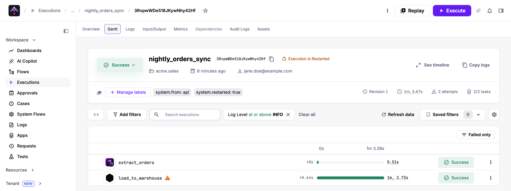
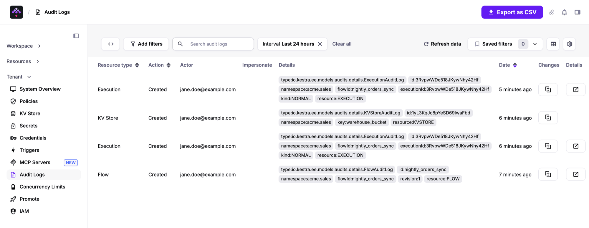
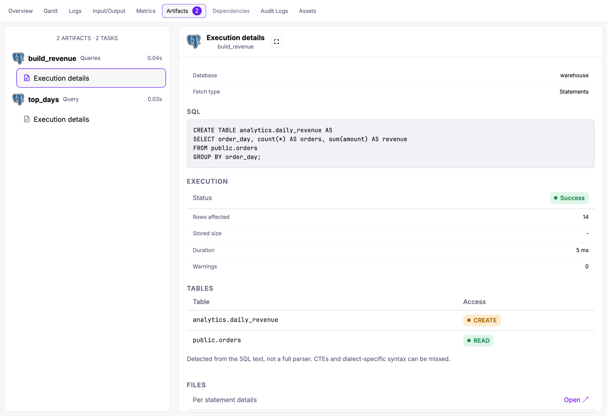
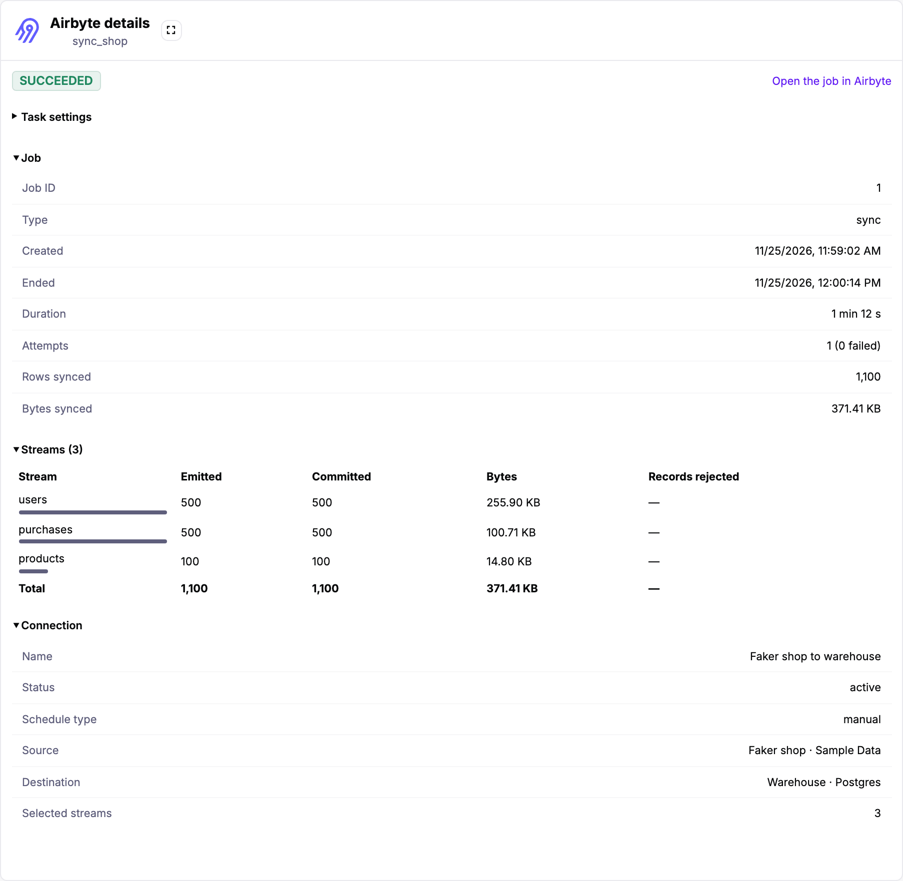
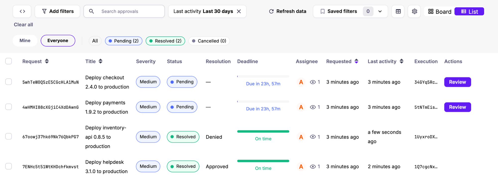
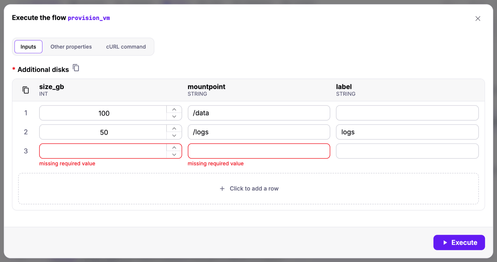
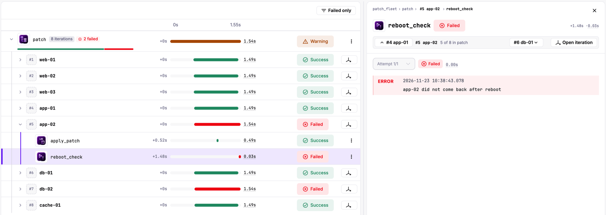

<!--
DRAFT NOTES (remove before publishing)
- Sources: Release=2.1 + kind/highlight issues (project 15) and the docs/release-2-1 branch.
- Kestra for Infrastructure is out of this post: its launch moved to mid-January 2027 (docs parked in docs#6444). Don't mention it, Infrastructure tenants, the Catalog home page, the Deployments or Inventory pages, inventory import, or app templates. Generic asset features (leases, relations, actions, the ASSET input) stay.
- Data Orchestration Artifacts: the embargo was lifted by the CTO on 2026-11-24, so JDBC, Airbyte, and Fivetran artifacts are in the Execution Artifacts section. dbt is in too, but plugin-dbt#350/#351/#362/#364 must ship after core 2.1 before publishing. The dbt asset types migration guide is still left out of the upgrade table.
- Left out on purpose: Bring Your Own Worker, asset health (ee#11937 open), dataURL() (2.0.8), by-query flat-param rejection (2.0.7), Replay with modified inputs (2.0.0), auto-emitted Terraform/OpenTofu assets (ee#9222 not planned), plugin auto-install on EE (ee#11724 not planned), Failure Debug panel (closed as duplicate), Health Center/Diagnostics (open), Source Search (2.0), EmbeddedSubflow (ee#3501, no work done).
- TODO markers: TODO(arcade, priority N) for interactive demos, TODO(screenshot) for static images, VERIFY for facts to confirm before publishing.
-->


Kestra 2.1 is about who gets to act on your flows, and how you keep control when they do. AI agents can now work with your instance through the Kestra MCP Server, with your permissions and in your audit log. And when a decision belongs to a person, the new Approval task waits for a real yes or no.

In 2.1, additionally, you can see the SQL, tables, and sync stats behind a data task, find an execution by the order ID it processed, and pick up a long script where it left off after a failure. Here are the highlights, with the edition each one is in.

| Feature | What it does | Edition |
|---|---|---|
| Kestra MCP Server | Let AI agents read and change flows, executions, and more, with your permissions | OSS, EE |
| Execution artifacts | See the SQL, tables, and sync stats behind a data task | OSS, EE, Cloud |
| Approval task | Pause a flow until someone approves or denies it | OSS, EE, Cloud |
| Approvals page | Assign reviewers, follow every request, and chain sign-offs | EE, Cloud |
| Asset leases and the ASSET input | Give every asset an owner and a lease, and let people pick assets in a form | EE, Cloud |
| Searchable inputs and outputs | Find executions by a business value such as an order ID | OSS, EE, Cloud |
| TABLE input | Collect rows of records in a grid | EE, Cloud |
| Script checkpoints (beta) | Resume a long script from where it stopped | OSS, EE, Cloud |
| Execution timeline | See your executions on a time axis | OSS, EE, Cloud |
| Dashboard charts from flow outputs | Chart a file that a flow returns | EE, Cloud |
| Keyless cloud access with OIDC | Reach AWS, Google Cloud, and JFrog with short-lived OIDC tokens instead of stored keys | EE |
| New queue backends | Google Cloud Pub/Sub, NATS JetStream, Amazon SQS/SNS, and Azure Event Hubs | EE |

:::alert{type="info"}
**Upgrading from 2.0?** Most flows need no changes, but a few API and configuration changes do. See [Upgrade and Migration](#upgrade-and-migration) before you upgrade.
:::

## Kestra MCP Server

The new Kestra MCP Server gives Claude, Cursor, or any other MCP client the same tools as the AI Copilot, and there are a lot of them. An agent can read and edit flows, start, restart, replay, or kill executions, search logs, and manage namespace files and KV entries. It can also draft a new flow for you to review before anything is saved. In the Enterprise Edition, agents can work with apps, test suites, groups, and announcement banners too, for 78 tools in all.

Here's what that looks like. Asked why a nightly sync failed, Claude Code finds the execution, reads the logs, and checks the KV store: the key the flow needs doesn't exist. Give it the value, and it creates the key and restarts the run from the failed task.

<div style="position: relative; padding-bottom: calc(64.2857% + 41px); height: 0px; width: 100%;"><iframe src="https://demo.arcade.software/IArRp3Gt6ocLCQtAbOIT?embed&embed_mobile=tab&embed_desktop=inline&show_copy_link=true" title="Fix a Failed Execution with Claude Code and the Kestra MCP Server" frameborder="0" loading="lazy" webkitallowfullscreen mozallowfullscreen allowfullscreen allow="clipboard-write; autoplay" style="position: absolute; top: 0; left: 0; width: 100%; height: 100%; color-scheme: light;" ></iframe></div>

In Kestra, it's a regular restart. The first task keeps its result, and the second one succeeds on its second attempt.



Agents don't get a back door. The server is off until you turn it on, and every request has to be authenticated. In the Enterprise Edition, each call runs as the person behind the agent, so the agent can only see and do what they can, and every change shows up in the audit log under their name. Each tool also tells the client whether it only reads, makes changes, or deletes or starts something, so your client can ask before acting.



Turning it on takes a few lines of configuration:

```yaml
kestra:
  mcp:
    platform-server:
      enabled: true
      tenants: [dev]
      instructions: "Only restart executions in the dev tenant."
```

You can limit the server to some tenants, choose the sign-in methods it accepts (OAuth included), and give agents standing instructions like the one above. See [Kestra MCP Server](/docs/develop-with-ai/kestra-mcp-server).

<!-- VERIFY: the link depends on docs#6386 (new page develop-with-ai/05.kestra-mcp-server) merging into docs/release-2-1; until then the tools are documented at /docs/ai-orchestration/mcp-server#platform-mcp-server. Also confirm with engineering that the 78 tools ship in 2.1 (no releases/v2.1.x branch yet). -->

The AI Copilot in the Kestra UI got the same tools, so you can do the same work from a chat. In Edit and Plan modes, it asks you to confirm before it changes anything. It can also draft a unit test for a flow: pick **Generate a unit test** in the flow's menu, and Copilot writes the test cases with fixtures, mocks, and assertions for you to apply or review. See [Generate a unit test](/docs/develop-with-ai/ai-copilot#generate-a-unit-test).

The open-source edition now gets every Copilot provider the Enterprise Edition has: OpenAI, Anthropic, Google Gemini and Vertex AI, Azure OpenAI, Amazon Bedrock, Mistral, DeepSeek, OpenRouter, and models served by Ollama. You can register several and pick a default. And if you haven't set up a provider yet, Copilot runs on a free tier hosted by Kestra, so you can try it right away. See [Configure an LLM provider](/docs/develop-with-ai/ai-copilot#configure-an-llm-provider).

The 2.0 feature that turns your own flows into tools for agents is now called [MCP Flows](/docs/ai-orchestration/mcp-server).

## Execution Artifacts

A green JDBC or Airbyte task tells you the query or the sync ran. Finding out which tables it touched, or how many rows each stream moved, meant reading through outputs and logs. Data plugins now attach an artifact to every run that lays this out for you. You'll find them in two places. Every execution has a new **Artifacts** tab that lists the artifacts of all its tasks. And in the topology view, a task node shows an **Artifacts** button whenever it has artifacts, so you can open its details without leaving the graph.

- **JDBC**, for every database the plugin supports: the SQL that ran, the rows it affected or fetched, its duration and warnings, and each table the statements read, wrote, or created.
- **Airbyte**: the job's attempts and duration, the records each stream emitted and committed, the connection's source and destination, and why an attempt failed, with a link to the job in Airbyte.
- **Fivetran**: the connector's sync state and freshness, its alerts, and a breakdown per table.
- **dbt** (CLI and Cloud): a model graph colored by run status, and the compiled SQL of each model, which is off by default and turned on with `outputCompiledSql: true`. In the Enterprise Edition and Cloud, each dbt model, seed, snapshot, test, and exposure is recorded as its own asset type, and asset cards show the test status of a model.

<!-- VERIFY: dbt needs plugin-dbt#350, #351, #362, and #364 (all open, kind/do-not-merge, need core 2.1 GA) released before publishing. #362 is breaking (dbt asset types replace Table), so add it to Upgrade and Migration with a migration guide, or drop the asset sentence. Add the dbt plugin version to the sentence below. -->

To get them, update the plugins to JDBC 3.0, Airbyte 1.8, Fivetran 2.1, or the dbt release for Kestra 2.1, or any later version. In the Enterprise Edition and Cloud, JDBC tasks with `assets.enableAuto: true` also record the tables they read and write as assets, with the lineage between them. See [Artifacts](/docs/ui/executions#artifacts) and [Plugins that emit assets](/docs/enterprise/governance/assets/declare-assets#plugins-that-emit-assets).





## Approvals

Until now, asking someone for a decision meant a `Pause` task, and the only way to say no was to kill the execution. The new `Approval` task gives your flow a real yes or no: it waits for a reviewer, then runs the tasks for whichever way they decided. Reviewers can leave a comment and fill in a few fields, and a request can approve itself when a condition is met or expire after a while.

```yaml
- id: approve_deploy
  type: io.kestra.plugin.core.flow.Approval
  timeout: P1D
  commentRequired: ON_DENY
  onApprove:
    - id: deploy
      type: io.kestra.plugin.core.log.Log
      message: "Approved by {{ outputs.approve_deploy.by }}"
  onDeny:
    - id: report_denial
      type: io.kestra.plugin.core.log.Log
      message: "Stopped by {{ outputs.approve_deploy.by }}: {{ outputs.approve_deploy.comment }}"
```

In the Enterprise Edition, you can assign a request to specific people or groups and follow every request on the new **Approvals** page, with notifications for reviewers and requesters. You can chain several approvals into one multi-step sign-off, and reviewers can decide from an App without opening Kestra. `Pause` and `HumanTask` keep working as before. See the [Approval task](/docs/workflow-components/approvals) and [Approvals in Kestra Enterprise](/docs/enterprise/governance/approvals).



## Ecosystem: IDE, Coding Agents, and Script Libraries

Flows are code, so it helps to write them where you write the rest of your code. The new [JetBrains plugin](/docs/ide-extensions/jetbrains) brings Kestra to IntelliJ IDEA, PyCharm, WebStorm, and the other JetBrains IDEs. It completes flow YAML from the plugins installed on your instance, checks it as you type, previews the flow's topology, and runs the flow from the editor with live logs.

If a coding agent writes your flows, Kestra's [Agent Skills](/docs/develop-with-ai/agent-skills#install-as-a-plugin) now install as a plugin in Claude Code, Codex, and Cursor, with the Docs MCP server already connected. They help the agent write, harden, and migrate flows, then deploy and run them with `kestractl`.

Scripts get the same treatment. Kestra's [script libraries](/docs/scripts/outputs-metrics#other-languages) now cover 10 more languages: R, PowerShell, Ruby, PHP, Perl, Groovy, Lua, Julia, Go, and C# or F#. Send outputs, metrics, logs, and assets with a function call instead of hand-written `::{}::` lines. Every library, Python and Node.js included, can also read the execution context, such as the flow's labels, when the task sets `executionContext: true`.

## Assets

Assets got a lot of love in this release, especially if you use them to keep track of the infrastructure your flows create. These changes are in the Enterprise Edition and Cloud.

- Every asset can now have an owner, a status, and a lease. A flow can react when a lease is about to end or has ended, for example to warn the owner a week ahead and clean up afterwards, and owners get a notification in Kestra too. See [TtlTrigger](/docs/enterprise/governance/assets/tasks-and-triggers#ttltrigger).
- Actions show up only where they make sense. Give an action like Decommission a condition on status, namespace, or metadata, and Kestra explains why it's unavailable everywhere else. See [Asset actions](/docs/enterprise/governance/assets/declare-assets#asset-actions).
- Relations connect a deployment to the resources inside it, or a VM to the load balancer in front of it, and both show up on the asset graph. If you used lineage events in 2.0, read the [asset relations migration guide](/docs/migration-guide/v2.1.0/asset-relations) before upgrading.
- Assets are written while a task runs, not after it ends. A task's declared outputs appear as soon as it starts, and anything it emits shows up right away, so you can follow a VM while it's being created. See the [asset write timing migration guide](/docs/migration-guide/v2.1.0/asset-write-timing).

The new **ASSET input** lets people pick existing resources from a searchable list when they run a flow, such as the VM to snapshot or the deployment a new database belongs to. You decide which types, namespaces, or statuses show up, and people only see what they're allowed to. Inputs can depend on each other, so a form can ask for a deployment first and then offer only its VMs. See [ASSET inputs](/docs/workflow-components/inputs#asset-inputs).


## Searchable Inputs and Outputs

Finding the execution that handled a particular order used to mean copying the order ID into a label, or digging through logs. In 2.1, add `searchable: true` to an input or an output, and you can search for executions by that value on the Executions page.

```yaml
outputs:
  - id: orderIds
    type: ARRAY
    value: "{{ outputs.parse.values.orderIds }}"
    searchable: true
```

Lists work too. Each item counts on its own, so you can find an execution by any of the order IDs it handled, which labels can't do. See [Searchable outputs](/docs/workflow-components/outputs#searchable-outputs) and [Searchable inputs](/docs/workflow-components/inputs#searchable-inputs).

## TABLE Input

Some forms need a list, like a set of disks, firewall rules, or users to onboard. The `TABLE` input shows it as a grid, checks every cell against its column's rules, and shows all the errors at once, so nobody has to write a JSON list by hand. You can paste rows straight from a spreadsheet, too. See [TABLE inputs](/docs/workflow-components/inputs#table-inputs).



<!-- VERIFY: TABLE input Cloud availability (TODO in source). -->

## Reusable Inputs Editor

Reusable Inputs, added in 2.0, let you define a set of inputs once per namespace and use it in any flow. Some of those sets have grown into real reference lists, like the bill of materials of an application, so in 2.1 each set gets its own editor. Edit it in No Code or YAML, paste rows from a spreadsheet, save a draft without affecting the flows that use it, and compare or restore earlier versions.

You can also keep a set up to date from a flow, for example by refreshing it from a CSV export every night with the new `Set` task. See [Reusable Inputs](/docs/workflow-components/reusable-inputs#edit-a-set-in-the-ui).

<!-- VERIFY: the Set, List, and Delete tasks ship in the plugin-kestra release for 2.1 (merged to next/v2.1 in plugin-kestra#215, not released as of 2026-11-23). Drop the sentence about the Set task if they don't make GA. -->

## Webhook Responses

Some services, like Meta and Microsoft Graph, check a webhook URL before they send any events, and expect a specific reply. The Webhook trigger can now choose the status code, headers, and body it sends back, so those checks pass without a proxy in front of Kestra.

It can also verify signed requests, such as the ones GitHub sends, and turn away anything unsigned before an execution starts. Signature checks also shipped in 2.0.10. See [Customize the webhook response](/docs/workflow-components/triggers/webhook-trigger#customize-the-webhook-response) and [Verify the request signature](/docs/workflow-components/triggers/webhook-trigger#verify-the-request-signature).

## Script Checkpoints (Beta)

Nobody likes watching a long script fail at batch 300 of 400 and start over from batch 1. With checkpoints, your script saves its progress as it goes, and a retry or a restart picks up where it left off. Turn it on with `durable: true` on any script task.

Checkpoints work with any script language and task runner, and with CLI tasks that run commands the same way, such as `AzCLI` and the CloudQuery tasks. You can already use them with the script tasks of the [plugin-scripts](/plugins/plugin-scripts) plugins, such as Shell and Python. They're in beta, so details may still change, and we'd love to hear how they work for you. See [Checkpoints](/docs/scripts/checkpoints).

## Following Executions

The Executions page has a new **Timeline** view next to the table. Each execution is a bar on a time axis, grouped by namespace and flow, so overlapping runs, gaps in a schedule, or the one run that held a slot for too long are easy to spot. Click a bar to open the execution, or drill down from a namespace into its flows. See [Timeline](/docs/ui/executions#timeline).

<div style="position: relative; padding-bottom: calc(56.4617% + 41px); height: 0px; width: 100%;"><iframe src="https://demo.arcade.software/bQNIYqinlfOKXElhLDBw?embed&embed_mobile=tab&embed_desktop=inline&show_copy_link=true" title="Explore Workflow Runs on the Timeline View" frameborder="0" loading="lazy" webkitallowfullscreen mozallowfullscreen allowfullscreen allow="clipboard-write; autoplay" style="position: absolute; top: 0; left: 0; width: 100%; height: 100%; color-scheme: light;" ></iframe></div>

Each `Loop` iteration runs as its own execution, which used to mean opening them one by one to find the one that failed. The **Gantt** tab now shows how many iterations a Loop ran and how many failed. Expand it to see them in place, and step from one failure to the next without leaving the page. See [Loop iterations](/docs/ui/executions#loop-iterations).



## Notifications

The notifications bell is now in every edition. Long bulk actions, like killing, replaying, or restarting many executions, run in the background and report their progress there, so you can keep working while they finish.

Flows can send notifications too. The new `Notify` task drops a message in the bell of the people you choose, for example to tell someone their environment is ready, with a link to open it. See [Notifications](/docs/ui#notifications).

## Dashboards: Chart a Flow's Output

Some numbers live outside Kestra: a weekly cost report, a list of open vulnerabilities, a count from a warehouse query. Your dashboards can now chart a file that a flow returns, read from its latest successful run. Let the flow do the heavy lifting on a schedule, and the chart always shows its latest result. See [Outputs](/docs/ui/dashboard#outputs-ee-and-cloud-only).


## SLA and Concurrency

A new SLA catches executions that run longer than the flow's recent average, so you can spot slow runs without picking a fixed time limit for every flow. See [AVG_DURATION](/docs/workflow-components/sla#avg_duration).

Concurrency limits can now cap how many executions wait in line. The Concurrency Limits page moves into the tenant and shows how many executions are queued, and your team can reset counters themselves. In the Enterprise Edition, every reset is recorded in the audit log. See [Concurrency](/docs/workflow-components/concurrency).

## Cases: Tickets and Events

In 2.0, Cases tracked incidents inside Kestra. In 2.1, they connect to the ticketing tools your teams already use. Link a case to a ticket in Jira, ServiceNow, GitHub, GitLab, Linear, Zendesk, and others, and let Kestra generate the flow that opens a ticket whenever a case is created. A new trigger also starts a flow on case events, filtered by type and severity. See [External tickets](/docs/enterprise/governance/cases#external-tickets).

## Apps

Apps get new building blocks that make them work well as internal dashboards and request portals:

- A grid lays out blocks in columns, and stacks them on small screens.
- Any dashboard chart can sit inside an app.
- An assets block lists what an execution created or updated, grouped by deployment.
- Each app can render narrow for a form, or wide for tables and charts.

See [Apps](/docs/enterprise/scalability/apps).

## Keyless Cloud Access with OIDC

Storing cloud keys in Kestra secrets always meant one more thing to rotate. In 2.1, Kestra can act as an OpenID Connect (OIDC) issuer and vouch for your flows the way GitHub Actions does: each task gets a short-lived OIDC token that AWS, Google Cloud, or JFrog swaps for temporary credentials, so there are no keys to store. On the provider's side, you register Kestra like any other OIDC identity provider and decide which flows or namespaces get in.

The tokens identify flows, namespaces, and tenants, not people. To sign users in to Kestra with OIDC, see [SSO](/docs/enterprise/auth/sso).

This helps most when Kestra runs on-premises or on a different cloud from the one it needs to reach. Each tenant, or even a single namespace, can also get its own issuer, so one team's cloud account never trusts another team's flows. One thing to plan for: your Kestra URL has to be reachable over HTTPS from the internet, because that's where the provider checks each token.

Keyless access is part of the Enterprise Edition. It isn't available on Kestra Cloud yet, so if you'd like it there, let your account team know. See [OIDC issuer](/docs/enterprise/auth/oidc-issuer).

## Default Retention Policy

Executions and logs tend to pile up until someone writes a purge flow, usually after the database has slowed down. Now, when you set up the Enterprise Edition or create a tenant, Kestra asks how long to keep executions and logs, with an option to keep failed ones, and creates a nightly retention flow for you. To change the policy later, you edit that flow like any other. See [Default retention flow](/docs/administrator-guide/purge#default-retention-flow).

<!-- VERIFY: Cloud behavior of the default retention flow. -->

## SAML 2.0 and Password Policies

SAML 2.0 joins OIDC and LDAP as a way to sign in to the Enterprise Edition, for organizations whose identity provider only speaks SAML. Users are created the first time they sign in, their groups stay in sync, and Single Logout works too. See [SAML](/docs/enterprise/auth/sso/saml).

For Basic Auth, passwords can now expire after a set time, with a heads-up before they do, and recent passwords can be blocked from reuse. Both are off by default, so nobody gets locked out on the day you upgrade. See [Password expiration and reuse](/docs/enterprise/auth/rbac#password-expiration-and-reuse).

## Queue Backends

2.0 made the queue independent of the database, and 2.1 adds four more brokers to the Enterprise Edition: Google Cloud Pub/Sub, NATS JetStream, Amazon SQS/SNS, and Azure Event Hubs, alongside Kafka, Redis, and AMQP. If your team already runs one of them, you don't need to run Kafka just for Kestra. See [Message broker queue backends](/docs/configuration/enterprise-and-advanced#message-broker-queue-backends).

If you run Kestra on a database, the queue can now live in its own database, even on a different engine, to spread the load across two servers. See [Dedicated queue database](/docs/configuration/runtime-and-storage#dedicated-queue-database).

## Security Plugins

Security teams can now work with their detection and response tools from a flow: pull alerts and incidents, triage and update them, and respond, without hand-written API calls. Most of these plugins also start a flow when something new shows up.

- [Microsoft Defender XDR](/plugins/plugin-microsoft365): list and update alerts and incidents, run advanced hunting queries, and start flows on new alerts and incidents.
- [Microsoft Sentinel](/plugins/plugin-azure): list, read, and update incidents, comment on them, run KQL queries, and start flows on new incidents.
- [Aikido](/plugins/plugin-aikido): list and export open security issues, snooze or unsnooze them, scan repositories and containers and export their SBOMs, get compliance reports, and start flows on new issues.
- [Snyk](/plugins/plugin-snyk): list security issues, and start a flow when new ones appear.
- [GitGuardian](/plugins/plugin-gitguardian): list and manage secret incidents (assign, resolve, ignore, add notes), scan content for leaked secrets, manage honeytokens, and start flows on new incidents.
- [Proofpoint TAP](/plugins/plugin-ee-proofpoint) (EE): pull the clicks and messages that reached your users, look up a threat's summary and forensic evidence, list your Very Attacked People, and start flows on new SIEM events.
- [Torq](/plugins/plugin-ee-torq) (EE): run a Torq workflow through its webhook, read workflows and their executions, query, update, and comment on cases, and start flows on new or updated cases.

<!-- VERIFY: add GuardDuty and Okta (SOAR wave 2) once their plugin links are known. CrowdStrike and Aikido already shipped, add them if they belong in this release. -->

## New Plugins

Since 2.0, 60 new plugin repositories have been released, which brings the catalog to over 2,900 plugins. Here is what's new, with the Enterprise Edition ones marked. The new security plugins are in the section above.

**Network automation** (EE): built-in plugins for the vendors behind most network estates, so you no longer need Ansible or raw HTTP calls. They share one contract: `GetConfig`, `DiffConfig`, `ApplyConfig`, `Check` (dry run), and pre and post checks, so a flow works the same across vendors.

- Switches and routers: Arista EOS and CloudVision, Cisco IOS-XE, IOS, and NX-OS.
- Firewalls and access: Palo Alto PAN-OS and Panorama, Fortinet FortiGate and FortiManager, Aruba Central and AOS 10, Cisco ISE.
- Sources of truth and monitoring: NetBox, Infoblox, IP Fabric, Tufin, AKIPS, Zabbix, and F5 APM.
- A reachability check task for ICMP ping and TCP connect.

<!-- VERIFY: ship status and plugin links per vendor. Arista 1.0.0 (2026-10-27, bundled in EE 2.0.8), Cisco 1.0.0 (2026-10-27, IOS-XE only), then 1.1.0 (2026-11-25). plugin-ee-paloalto, fortinet, aruba, akips, tufin, zabbix 1.0.0 shipped 2026-11-24, ipfabric 1.0.0 on 2026-11-25. Confirm NX-OS, IOS, ISE, F5 APM (ee-f5 1.2.0), Infoblox (ee-infoblox 1.3.0 and 1.4.0), and the reachability task are in those releases, and drop what is not. Also add GuardDuty and Okta if they ship. -->

**Data and AI**
- Vector databases: [Qdrant](/plugins/plugin-qdrant), [Chroma](/plugins/plugin-chroma), [LanceDB](/plugins/plugin-lancedb), and [Milvus](/plugins/plugin-milvus).
- [Cerebras](/plugins/plugin-cerebras) for LLM inference, [TypeSafe](/plugins/plugin-typesafe) to evaluate content with its Jev decision model, and [Sonilo](/plugins/plugin-sonilo) to generate music and sound effects.
- [Alibaba Cloud](/plugins/plugin-alibaba).
- Lakehouse and storage: [Apache Iceberg](/plugins/plugin-iceberg), [Apache Hudi](/plugins/plugin-hudi), [ScyllaDB](/plugins/plugin-scylladb), [Quickwit](/plugins/plugin-quickwit), [Apache Iggy](/plugins/plugin-iggy), [S2](/plugins/plugin-s2) (stream storage), and [DataHub](/plugins/plugin-ee-datahub) (EE).
- Web and documents: [Firecrawl](/plugins/plugin-firecrawl), [Playwright](/plugins/plugin-playwright), [Selenium](/plugins/plugin-selenium), [Browser Use](/plugins/plugin-browseruse), and [Apache PDFBox](/plugins/plugin-pdfbox).

**BI and analytics**: [Looker](/plugins/plugin-looker), [Apache Superset](/plugins/plugin-superset), [Metabase](/plugins/plugin-metabase), [GoodData](/plugins/plugin-gooddata), [Qlik Cloud](/plugins/plugin-qlikcloud), [Google Data Studio](/plugins/plugin-data-studio), [PostHog](/plugins/plugin-posthog), and [Datadog](/plugins/plugin-datadog).

**Business apps**: [Pylon](/plugins/plugin-pylon), [Figma](/plugins/plugin-figma), [Clay](/plugins/plugin-clay), [Box](/plugins/plugin-box), [Mailchimp](/plugins/plugin-mailchimp), [Ashby](/plugins/plugin-ashby), [Deel](/plugins/plugin-deel), [Payfit](/plugins/plugin-payfit), [Pennylane](/plugins/plugin-pennylane), [Mercury](/plugins/plugin-mercury) (business banking), [Sent](/plugins/plugin-sent) (messaging and contacts), [QuickBooks](/plugins/plugin-quickbooks), [Matrix](/plugins/plugin-matrix), and [SEC EDGAR](/plugins/plugin-edgar).

**Delivery and workflows**: [Helm](/plugins/plugin-helm), [Tekton](/plugins/plugin-tekton), [Camunda](/plugins/plugin-camunda), and [Apache NiFi](/plugins/plugin-nifi).

<!-- VERIFY: plugin pages are generated from the releases, so check each link resolves. -->

## Plugins Hub

The Plugins page now lists each plugin once, as a card or a table row. In the Enterprise Edition, it also shows which versions are installed on your instance and which are available, and Instance Owners can install, update, and uninstall versions from the same page. See [Plugins page](/docs/enterprise/instance/versioned-plugins#from-the-ui).

Other plugin improvements from this cycle:

- JDBC `Queries`: run several SQL statements in one task, with parameters, transactions, and an output for each statement.
- [Task runner monitoring](/docs/task-runners/types/kubernetes-task-runner#monitoring) (EE): the Kubernetes, AWS, Azure, Google Cloud, and Huawei Cloud task runners can report CPU, memory, and network usage, and forward traces from the task.
- [Private Service Connect for Cloud Run](/docs/task-runners/types/google-cloudrun-task-runner#private-service-connect-endpoints) (EE): the Cloud Run task runner and `cloudrun.Run` task can reach Google APIs through Private Service Connect endpoints, for Kestra running on-premises or in a locked-down network.

## Additional Improvements

- [Context panel](/docs/ui/flows#context-panel-enterprise) (EE): the flow editor's Context panel is now one searchable tree of inputs, variables, KV pairs, and secrets, with click-to-copy expressions.
- [Expired sessions](/docs/ui#expired-sessions): when your session ends, sign in again and pick up where you were, without losing unsaved changes.
- [Sessions](/docs/enterprise/auth/authentication#sessions) (EE): signing in on another browser or device no longer signs you out elsewhere.
- [Reschedule an execution](/docs/workflow-components/execution#schedule-and-reschedule-an-execution): move a scheduled execution that hasn't started yet, instead of deleting and recreating it.
- [Flow trigger `waitForAllRetries`](/docs/workflow-components/triggers/flow-trigger#suppressing-intermediate-failure-alerts-during-retries): skip the failures between retries, so your alerting flows stay quiet for runs that recover.
- [Invitations](/docs/enterprise/auth/invitations) (EE): invite up to 25 people at once with the same groups and roles.
- [HTTPS behind a reverse proxy](/docs/configuration/observability-and-networking#secure-cookies): HSTS and secure cookies now work when Kestra sits behind a proxy that handles HTTPS.
- [`PurgeMetrics`](/docs/administrator-guide/purge#purge-metrics): clean up execution metrics on their own, much faster than with a full execution purge.

The [2.1 changelog](/docs/releases/changelog/v2.1.0) lists every other improvement in this release.

## Upgrade and Migration

Most flows need no changes when you upgrade from 2.0. A few things are worth a look first:

- The concurrency limit API now takes the scope in the request body, and its search results are paged.
- In the Enterprise Edition, a few role permissions were removed, and a role bound to a namespace can only grant namespace-level permissions. Existing bindings are moved for you.
- With SSO, logout is now POST-only, so register `<your Kestra URL>/ui` as a post-logout redirect URI in your identity provider.
- Asset lineage events are replaced by relations. Back up your database before you upgrade.
- A namespace ID can no longer end with a dot or contain two dots in a row, such as `team.`. Move the flows of any such namespace before you upgrade.
- In the Enterprise Edition, a task that reads another namespace's file by its `kestra://` URI now needs that namespace to allow it, if the namespace restricts Allowed Namespaces.
- If you deploy the Enterprise Edition with Helm and use `workerGroups`, delete the worker group Deployments before `helm upgrade`, since each one gets its own pod selector.

The [v2.1.0 migration guide](/docs/migration-guide/v2.1.0) walks through each of these, plus a few smaller changes to webhook responses, flow output types, queue configuration keys, server CLI commands, and the `assets()` function.

## Get Started

The [quickstart](/docs/quickstart) and [Docker Compose setup](/docs/installation/docker-compose) are updated for 2.1, and the full list of changes is in the [changelog](/docs/releases/changelog/v2.1.0) and the [GitHub release notes](https://github.com/kestra-io/kestra/releases/tag/v2.1.0).

Thank you to everyone who tried the release candidates and told us what worked and what didn't. As always, find us on [GitHub](https://github.com/kestra-io/kestra/issues) or [Slack](https://kestra.io/slack) with questions, ideas, and what you're orchestrating.
