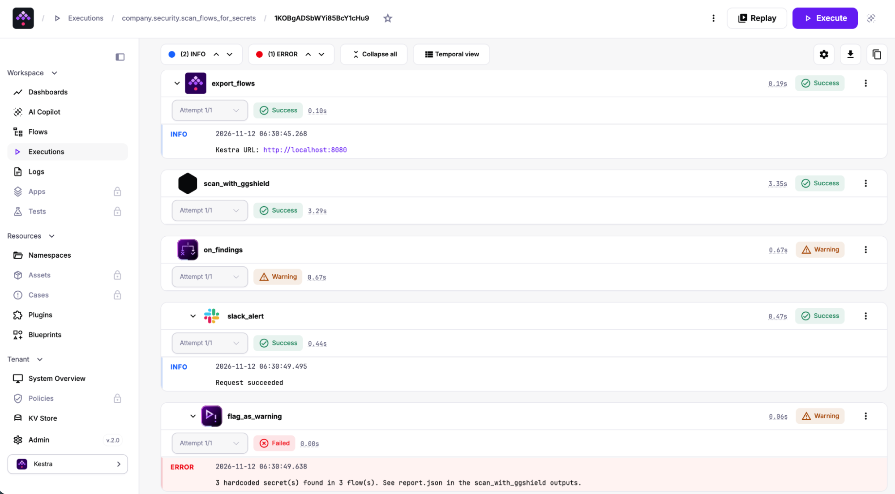
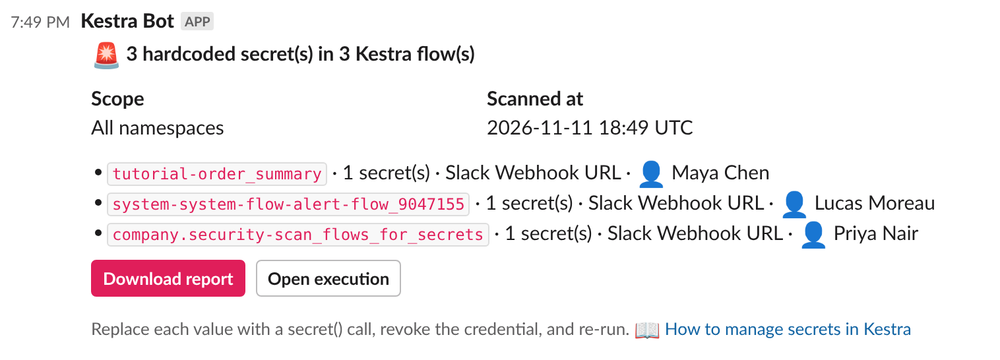
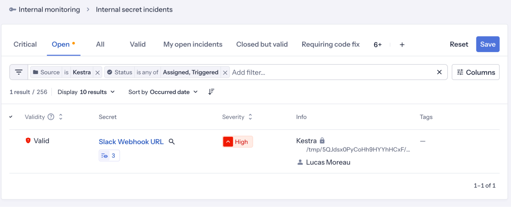

Your orchestrator has credentials to every database, bucket, and API in your stack. Your secrets scanner watches your git repositories. Nobody watches the flow definitions in between. Here is a Kestra flow that does, in about 40 lines of YAML, using [ggshield](https://github.com/GitGuardian/ggshield), GitGuardian's open-source scanner.

### The blind spot

Kestra stores flows in its own database. You can sync them to git, but nothing forces a flow written in the UI to ever reach a repository, so a scanner wired to GitHub or GitLab never sees it.

Kestra gives you `{{ secret('NAME') }}` for credentials and masks the value in logs. The failure is human: someone pastes a warehouse password into a `password:` property to test a connection, it works, and the paste stays. The question this flow answers every morning is simple: does any flow contain a credential that should have been a `secret()` call?

### The flow

Four tasks: export every flow in the instance to a ZIP, scan it with ggshield in a Docker container, count the findings, then alert Slack.

```yaml
id: scan_flows_for_secrets
namespace: company.security

tasks:
  - id: export_flows
    type: io.kestra.plugin.kestra.flows.Export
    auth:
      username: "{{ secret('KESTRA_USERNAME') }}"
      password: "{{ secret('KESTRA_PASSWORD') }}"

  - id: scan
    type: io.kestra.plugin.scripts.shell.Commands
    taskRunner:
      type: io.kestra.plugin.scripts.runner.docker.Docker
    containerImage: gitguardian/ggshield:latest
    env:
      GITGUARDIAN_API_KEY: "{{ secret('GITGUARDIAN_API_KEY') }}"
    inputFiles:
      flows.zip: "{{ outputs.export_flows.flowsZip }}"
    outputFiles:
      - report.json
    commands:
      - python -m zipfile -e flows.zip flows/
      - ggshield secret scan path --recursive --yes --json --exit-zero flows/ > report.json
      - |
        python - <<'EOF'
        import json
        r = json.load(open("report.json"))
        hits = [e["filename"].split("/")[-1] for e in r["entities_with_incidents"] if e["total_incidents"]]
        print("::" + json.dumps({"outputs": {"incidents": r["total_incidents"], "flows": ", ".join(hits)}}) + "::")
        EOF

  - id: alert
    type: io.kestra.plugin.core.flow.If
    condition: "{{ outputs.scan.vars.incidents > 0 }}"
    then:
      - id: slack
        type: io.kestra.plugin.slack.notifications.SlackIncomingWebhook
        url: "{{ secret('SLACK_WEBHOOK_URL') }}"
        payload: |
          {"text": "GitGuardian found {{ outputs.scan.vars.incidents }} hardcoded secret(s) in Kestra flows: {{ outputs.scan.vars.flows }}"}
      - id: flag_as_warning
        type: io.kestra.plugin.core.execution.Fail
        allowFailure: true
        errorMessage: "{{ outputs.scan.vars.incidents }} hardcoded secret(s) found. See report.json in the scan outputs."

triggers:
  - id: daily
    type: io.kestra.plugin.core.trigger.Schedule
    cron: "0 7 * * *"
```

Three secrets to set in the namespace: your Kestra login for the export, a GitGuardian API key (the free plan is enough), and a Slack webhook. Every credential the flow needs goes through `secret()`, so it practices what it checks, and ggshield's default output truncates matched values, so the stored report never contains a full secret.

### What you get

A green run every morning is a dated, auditable statement that no flow in the tenant holds a hardcoded credential. A run that finds secrets names the flows to fix, in Slack and in the execution list, with the JSON report attached. GitGuardian's engine covers more than 600 specific detector types plus generic high-entropy patterns, so AWS keys, database URIs, SaaS tokens, and private keys are caught in one pass.

*A run of the full version that found secrets: export, scan, and Slack alert, then `flag_as_warning` puts the execution in Warning.*



*The Slack alert from the full version: the counts, one line per flow with the detector and the owner label, and buttons to the report and the execution.*



*On the Business and Enterprise plans, the same finding as an incident in GitGuardian, under a custom source named Kestra.*



### Going further

- **Use the GitGuardian plugin.** The new [GitGuardian plugin](https://kestra.io/plugins/plugin-gitguardian) calls the GitGuardian API straight from Kestra: `scan.Scan` checks files for hardcoded secrets without a Docker container, `scan.CreateIncidents` records them on a custom source, and triggers react to new incidents, honeytoken events, and audit log entries. It is a Business plugin.
- **Open incidents in GitGuardian.** On the Business and Enterprise plans, add `--source-uuid <your custom source>` to the ggshield command and each finding becomes a dashboard incident with an owner, a severity, and the usual remediation workflow. In the blueprint, this is the `create_incidents` input.
- **Richer alerts.** Send a Block Kit payload through the same webhook to get a header with the counts, one line per flow with the detectors found, and buttons to the report, the execution, and your GitGuardian incidents.
- **Gate deploys instead of auditing nightly.** Swap the Schedule trigger for a Webhook trigger and call it from the CI job that deploys your flows.

The full version of the flow is published as the [Scan Kestra flows for hardcoded secrets with GitGuardian](/blueprints/scan-flows-for-secrets-with-gitguardian) blueprint. It works on the free plan, and a `create_incidents` input switches on incident creation for the Business and Enterprise plans.

Scan your flows and find out what your orchestrator has been holding. The [Kestra secrets docs](/docs/concepts/secret) cover how to move a pasted credential behind `secret()`, and ggshield is free to try with a [GitGuardian account](https://www.gitguardian.com).
