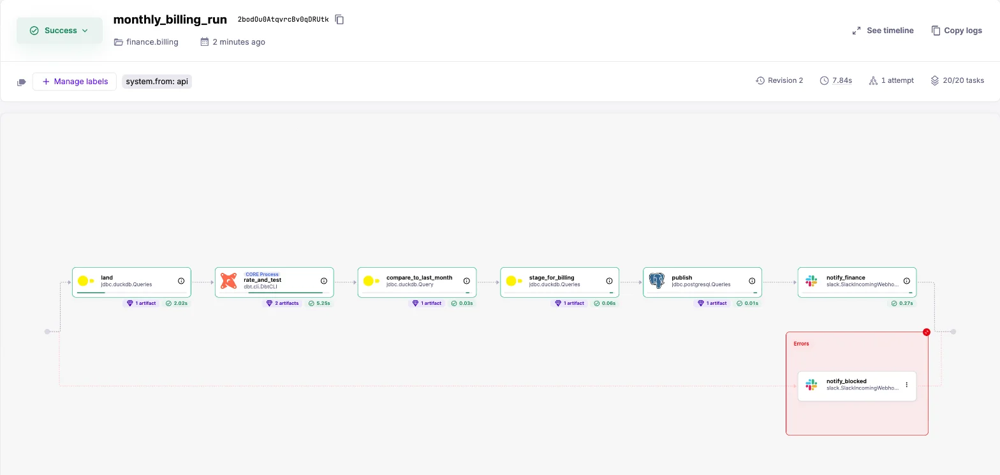
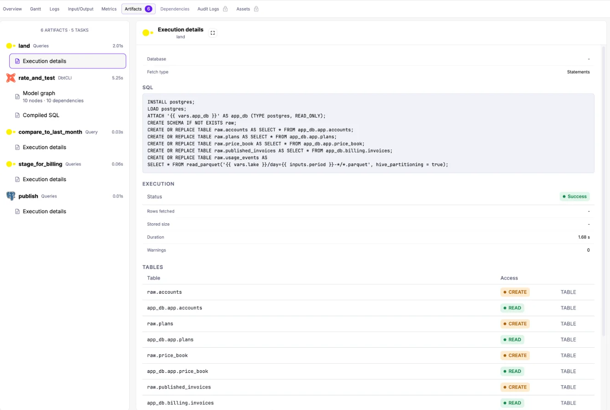
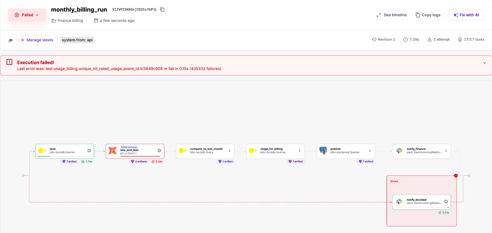
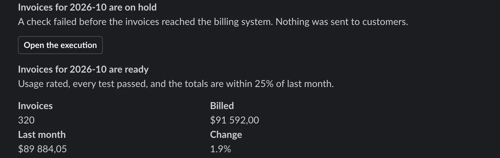

[Kestra 2.1](/blogs/release-2-1) adds execution artifacts. A plugin can now ship its own view of what a task did in a run, and Kestra shows it next to the execution. The dbt plugin ships two: a graph of the models dbt ran and the compiled SQL of each one. The JDBC plugins ship one for every query, with the SQL, the row counts, and the tables it read or wrote. There's nothing to add to your flows. Once you're on a plugin version that has them, every run gets them.

To show what each one looks like on a real run, I built a monthly billing flow for a usage-based product. It loads metering events and a price book into DuckDB, rates the usage with dbt, and publishes invoices to PostgreSQL.

## Why billing

A mistake in a billing run ends up on a customer's invoice, so the flow has to be strict about what it publishes and someone has to find the cause fast when it stops. That's where artifacts help most.

The flow is also a good stand-in for most production data jobs. Reference data comes from the application database, events come from object storage, dbt models and tests them, a check compares the result with the last good run, and the last step writes to a database other teams read from. Each of those steps runs on a plugin that has an artifact.

## Where artifacts show up

Every execution now has an **Artifacts** tab listing the artifacts of all its tasks. In the topology, a task with artifacts gets a badge with the count, and you can open them from the node.



The billing flow ends up with six artifacts: one on each DuckDB and PostgreSQL task, and two on the dbt task.


## The dbt model graph

The **Model graph** draws the project the way dbt ran it, with sources, seeds, snapshots, and models and the dependencies between them. Each node has its status and duration. Green built, red failed, grey was skipped because something upstream failed. Click a node to see its unique ID, the relation it created, and what sits above and below it.


This one is from the first October run. `int_rated_usage` built fine, but its tests failed, so dbt skipped `fct_invoice_lines` and `invoices`. Those are the two models that feed the billing system, so no invoice was produced.

The tests don't appear in the graph, but you still see them: `DbtCLI` turns every model, seed, and test into its own task run, and the Gantt view lists them with their state.


## Compiled SQL

The **Compiled SQL** view shows what dbt actually sent to the database for each model, with the Jinja rendered and the variables filled in. You pick the model from a list that also shows its status, and it opens on the first failed model when there is one.


In the October run, the `unique` test on `int_rated_usage.event_id` failed on 435,332 rows, meaning those events had picked up two prices. The compiled SQL shows how a price gets picked: by plan, meter, and the dates the price is valid. If two price rows cover the same days, an event matches both. That's what happened. Someone added the new Team price for output tokens starting October 15 and never set an end date on the old one. Setting it fixed the run.

Compiled SQL is off by default because it can expose the literal values you pass with `--vars`. You turn it on per task:

```yaml
- id: rate_and_test
  type: io.kestra.plugin.dbt.cli.DbtCLI
  outputCompiledSql: true
  commands:
    - "dbt build --vars 'period: {{ inputs.period }}'"
```

Both views are built from files the task already stores (the model graph and `manifest.json`), so you don't need to host `dbt docs serve` anywhere. They work with dbt Core through `DbtCLI` and with dbt Cloud jobs.

## Execution details for SQL tasks

On the JDBC side, `Query`, `Queries`, and `Batch` get an **Execution details** view, whatever the database. It shows the SQL, the fetch type, how many rows were fetched or changed, how long it took, any warnings, and every table the statements touched, with whether each was read, created, written, or dropped.

The `land` task attaches the PostgreSQL application database read-only, copies four tables into DuckDB, and reads the month's usage events from Parquet. Its view lists every table it read and created.



The month-over-month check is one DuckDB query. It calls `error()` to fail the run if the total moved more than 25%, and its view shows the single row it returned and the two tables it compared.


`publish` runs on PostgreSQL and swaps the month's invoices in a single transaction. Its view shows 1,403 rows affected, the two `billing` tables it wrote, and the staging tables it read from.


The table list comes from parsing the SQL text, so it can miss some dialect-specific syntax. The view says so right under the table.

## The October run

The flow prices every metering event at the rate that applied on the day it happened. October had 6,719,171 events across 320 accounts, after dropping the ones that had been delivered twice.

The first run stopped at `rate_and_test`. The month-over-month check alone wouldn't have caught it: the overcharge came to $3,699.14 across 123 accounts, which only moved the total by 6%. The flow's `errors` branch posted to Slack, and nothing reached the billing database.



Following the Slack link, the error banner named the failing test, the model graph showed what it had blocked, and the compiled SQL showed the join that matched two prices. Once the old price had an end date, the rerun passed at 1.9% above September and published 320 invoices for $91,592. A full run takes under 8 seconds, about 2 to load 6.7 million events and 5 for dbt.



## Using the same flow for other jobs

The billing-specific part is the dbt project and the two SQL checks. Everything around them carries over, and each piece can be replaced:

| Part | In this flow | Can be replaced with |
|---|---|---|
| Reference data | PostgreSQL `app` schema, attached read-only by DuckDB | MySQL, SQLite, or another database DuckDB can attach, or a JDBC `Query` with `fetchType: STORE` |
| Events | Parquet files partitioned by day | S3, GCS, or Azure Blob paths, Iceberg or Delta tables, or a dlt, Airbyte, or Fivetran sync task |
| Compute | DuckDB file on the worker | MotherDuck, or Snowflake, Redshift, or PostgreSQL with the matching dbt adapter and JDBC plugin |
| Models and tests | dbt project inline in the flow | Your own dbt project, cloned from Git with `io.kestra.plugin.git.Clone` or kept in namespace files |
| Check | Month-over-month total in one DuckDB query | Row counts, freshness, or a reconciliation against a source of truth, as a query that calls `error()` or as a dbt test |
| Publish | Transactional insert into PostgreSQL | Any JDBC database, a table swap in your warehouse, an API call with the HTTP task, or a file in object storage |
| Sign-off | None | An [Approval](/docs/workflow-components/approvals) task before `publish` |

Month-end close works the same way, with ledger and bank exports in, and a publish only when the journals balance. So does replenishment, with orders and warehouse stock feeding purchase suggestions, or reverse ETL, where product events and CRM data turn into scores written back to the CRM. You keep the artifacts if you swap the engine: move from DuckDB to Snowflake and the execution details still list the tables each query touched.

## Which plugins have artifacts

| Plugin | Tasks | Artifact |
|---|---|---|
| dbt | `DbtCLI`, dbt Cloud jobs | Model graph, Compiled SQL |
| JDBC (DuckDB, PostgreSQL, MySQL, Snowflake, and the other JDBC databases) | `Query`, `Queries`, `Batch` | Execution details |
| Airbyte | `connections.Sync`, `connections.CheckStatus`, Airbyte Cloud `jobs.Sync` and `jobs.Reset` | Airbyte details |
| Fivetran | `connectors.Sync`, `connectors.Status` | Fivetran details |

<!-- VERIFY: dbt artifacts need plugin-dbt#350 (DbtCLI) and #351 (dbt Cloud) released for Kestra 2.1. Add the dbt plugin version, and the JDBC 3.0, Airbyte 1.8, Fivetran 2.1 minimums. Drop the asset-type sentence below if #362 or #364 are not out. -->

In Kestra Enterprise and Kestra Cloud, the same plugins also record [assets](/docs/enterprise/governance/assets). With `assets.enableAuto: true`, JDBC tasks record the tables they read and write, with the lineage between them. dbt models, seeds, snapshots, tests, and exposures each get their own asset type, and a model's asset card shows whether its tests passed.

## Try it

The billing flow is available as the [Usage-Based Billing with dbt, DuckDB, and an Audit Gate](/blueprints/usage-billing-dbt-duckdb) blueprint, with the dbt project included. Run it for a closed month and open the **Artifacts** tab of the execution. To see how artifacts work, or to build one for your own plugin, read [plugin artifacts and assets](/docs/concepts/plugin-artifacts-vs-assets).
