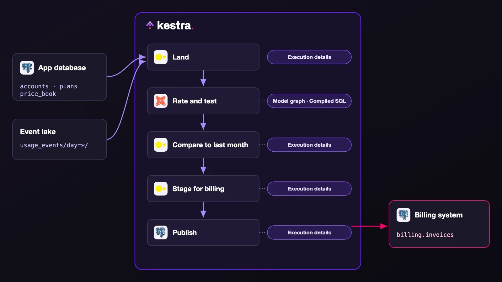
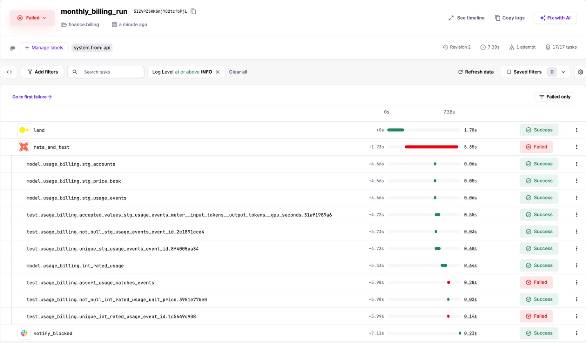
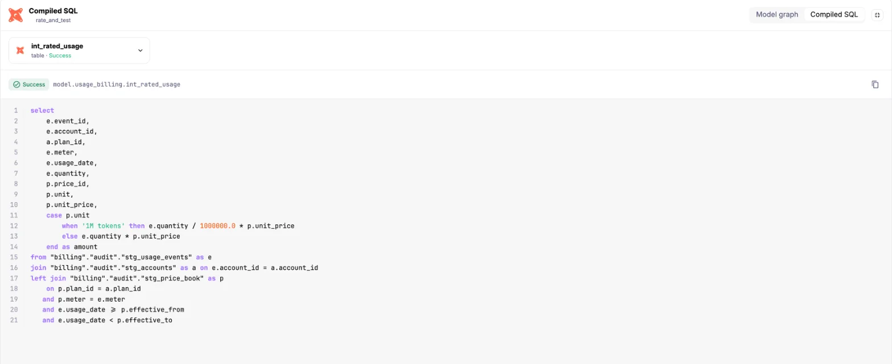
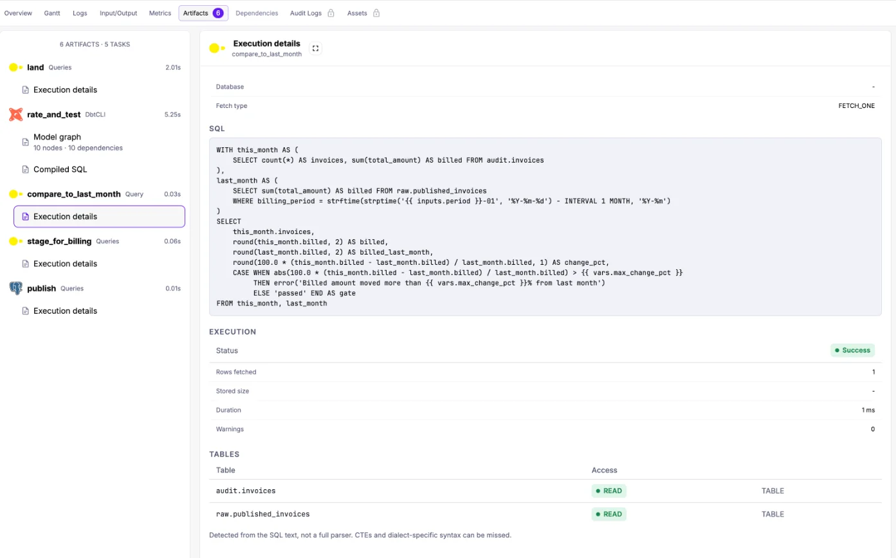
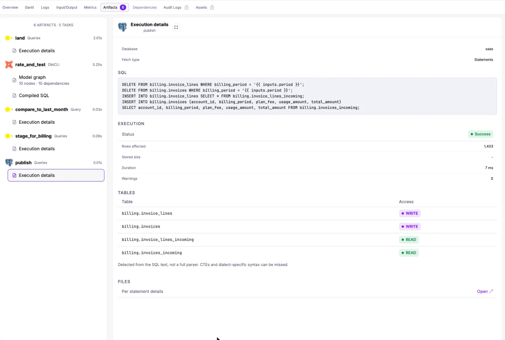

[Kestra 2.1](/blogs/release-2-1) adds execution artifacts: views that a plugin ships to show what one of its tasks did in a run. The dbt plugin adds two, a model graph and the compiled SQL of each model. The JDBC plugins add one to every query, with the SQL, the rows, and the tables it touched. You don't configure them in your flow. Install a plugin version that has them, and every run of its tasks gets them.

This post goes through each artifact on a real flow: a monthly usage-based billing run that loads metering events and a price book into DuckDB, rates them with dbt, and publishes invoices to PostgreSQL.

## Why a billing run

Billing is where a data error reaches a customer directly. The output isn't a dashboard someone may question later, it's an invoice. That makes the run strict about when it publishes and makes the cost of a silent error concrete, so it shows what each artifact is for.

It also has the shape of most production data jobs. Reference data comes from an application database, high-volume events come from object storage, dbt joins and tests them, a check compares the result with the last good run, and a final step writes to a system other teams depend on. Every step of that shape uses a plugin with an artifact.

## Where artifacts appear

Each execution has an **Artifacts** tab that lists the artifacts of all its tasks, in the order the flow ran them. In the topology, a task with artifacts shows a badge with their count, and the task's details open from the node.


The billing flow has six artifacts across five tasks: one for each DuckDB and PostgreSQL task, and two for the dbt task.



## The dbt model graph

The **Model graph** artifact draws the project as dbt ran it: sources, seeds, snapshots, and models, with the dependencies between them. Each node carries its run status and duration. Green nodes built, red nodes failed, and grey nodes were skipped because something upstream failed.

Select a node to see its unique ID, the relation it built in the warehouse, and its upstream and downstream nodes.


This is the October billing run. `int_rated_usage` built, but its tests failed, so dbt skipped `fct_invoice_lines` and `invoices`, the two models that feed the billing system. Everything above them built.

The test results themselves are task runs. `DbtCLI` turns each model, seed, and test into its own task run, so the Gantt view lists them with their state and duration.



## Compiled SQL

The **Compiled SQL** artifact shows the SQL dbt ran for each model, with Jinja rendered and variables filled in. A selector lists the models with their status, and the view opens on the first failed one.



In the October run, `unique_int_rated_usage_event_id` failed on 435,332 rows: events that matched two prices. The compiled SQL of `int_rated_usage` shows how a price is picked, by plan, meter, and the date range of the price row. Two rows with overlapping ranges both match. The price book had a new row for the Team plan's output tokens from October 15, and the old row was still open-ended. Closing it fixed the run.

Compiled SQL is off by default, because it can contain the literal values of `--vars`. Turn it on per task:

```yaml
- id: rate_and_test
  type: io.kestra.plugin.dbt.cli.DbtCLI
  outputCompiledSql: true
  commands:
    - "dbt build --vars 'period: {{ inputs.period }}'"
```

Both dbt artifacts read files the task already stores, the model graph and `manifest.json`, so there is no `dbt docs serve` to host. They work for dbt Core with `DbtCLI` and for dbt Cloud jobs.

## Execution details for SQL tasks

The JDBC plugins add **Execution details** to `Query`, `Queries`, and `Batch`, for every database they support. The artifact shows the SQL, the fetch type, the rows fetched or affected, the duration, the warnings, and a table of every table the statements read, created, wrote, or dropped.

The `land` task attaches the PostgreSQL application database read-only and copies four tables into DuckDB, then reads the month's usage events from Parquet. Its artifact lists each source table and each table it created.


The month-over-month check is a single DuckDB query that fails the run with `error()` when the total moves more than 25%. Its artifact shows the row it fetched and the two tables it compared.



The PostgreSQL `publish` task replaces the month's invoices in one transaction. Its artifact shows the database, 1,403 rows affected, the two `billing` tables written, and the incoming tables read.



Table detection reads the SQL text, so some dialect-specific syntax can be missed, and the artifact says so under the table.

## The October run, end to end

The billing run rates every metering event against the price in effect on the day it happened. In October that was 6,719,171 events across 320 accounts, after removing events the pipeline had delivered twice.

The first October run stopped at `rate_and_test`. The month-over-month check would have passed, because the overcharge was $3,699.14 on 123 accounts, a 6% move on the total. The flow's `errors` branch posted to Slack and nothing reached the billing database.


From the Slack link, the error banner named the test, the model graph showed what it blocked, and the compiled SQL showed the join that matched two prices. After the price row was closed, the rerun passed at 1.9% over September and published 320 invoices for $91,592. The whole run takes under 8 seconds: 2 seconds to land 6.7 million events, 5 seconds for dbt.


## Adapting the flow to your own pipeline

The billing logic lives in the dbt project and the two SQL checks. The structure around it stays the same for other jobs, and each piece can be swapped:

| Part | In this flow | Swap it for |
|---|---|---|
| Reference data | PostgreSQL `app` schema, attached read-only by DuckDB | MySQL, SQLite, or another database DuckDB can attach, or a JDBC `Query` with `fetchType: STORE` |
| Events | Parquet files partitioned by day | S3, GCS, or Azure Blob paths, Iceberg or Delta tables, or a dlt, Airbyte, or Fivetran sync task |
| Compute | DuckDB file on the worker | MotherDuck, or Snowflake, Redshift, or PostgreSQL through the matching dbt adapter and JDBC plugin |
| Models and tests | Inline dbt project | Your dbt project from Git with `io.kestra.plugin.git.Clone`, or from namespace files |
| Gate | Month-over-month total in one DuckDB query | Row counts, freshness, or reconciliation against a source of truth, each as a query that calls `error()` or a dbt test |
| Publish | Transactional insert into PostgreSQL | Any JDBC database, a table swap in your warehouse, an API call with the HTTP task, or a file in object storage |
| Sign-off | None | An [Approval](/docs/workflow-components/approvals) task before `publish` |

The same flow fits month-end close (ledger and bank exports, publish when journals balance), stock and replenishment (orders and warehouse feeds, publish purchase suggestions), or reverse ETL (product events and CRM data, publish scores to the CRM). The artifacts come with the plugins in every case: change DuckDB for Snowflake and the execution details still list the tables each query touched.

## Which plugins have artifacts

| Plugin | Tasks | Artifact |
|---|---|---|
| dbt | `DbtCLI`, dbt Cloud jobs | Model graph, Compiled SQL |
| JDBC (DuckDB, PostgreSQL, MySQL, Snowflake, and every other JDBC database) | `Query`, `Queries`, `Batch` | Execution details |
| Airbyte | `connections.Sync`, `connections.CheckStatus`, Airbyte Cloud `jobs.Sync` and `jobs.Reset` | Airbyte details |
| Fivetran | `connectors.Sync`, `connectors.Status` | Fivetran details |

<!-- VERIFY: dbt artifacts need plugin-dbt#350 (DbtCLI) and #351 (dbt Cloud) released for Kestra 2.1. Add the dbt plugin version, and the JDBC 3.0, Airbyte 1.8, Fivetran 2.1 minimums. Drop the asset-type sentence below if #362 or #364 are not out. -->

In Kestra Enterprise and Kestra Cloud, the same plugins write [assets](/docs/enterprise/governance/assets). JDBC tasks with `assets.enableAuto: true` record the tables they read and write with lineage. dbt models, seeds, snapshots, tests, and exposures are recorded as their own asset types, and the asset card shows a model's test status.

## Try it

The billing flow is available as the [Usage-Based Billing with dbt, DuckDB, and an Audit Gate](/blueprints/usage-billing-dbt-duckdb) blueprint, with the dbt project inline. Run it for a closed period and open the **Artifacts** tab of the execution. For how artifacts work and how to build one for your own plugin, see [plugin artifacts and assets](/docs/concepts/plugin-artifacts-vs-assets).
