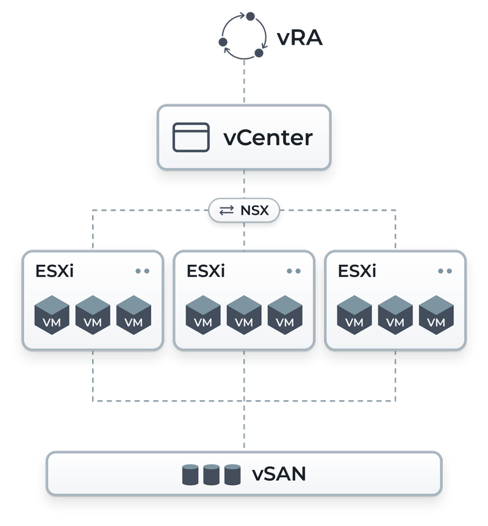
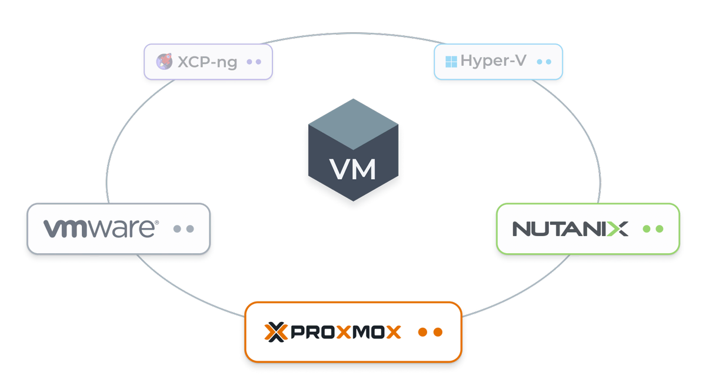
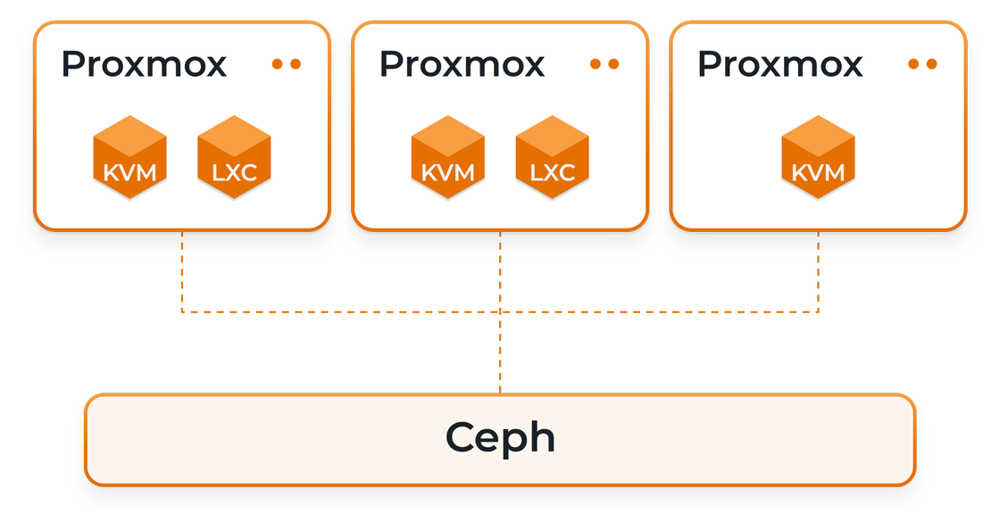
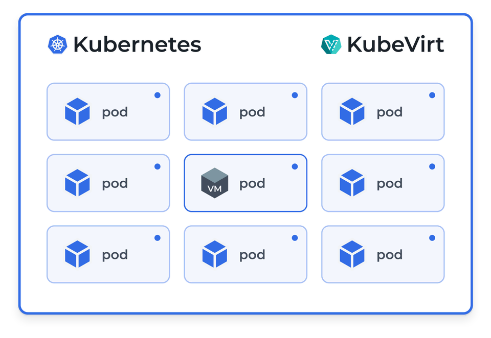
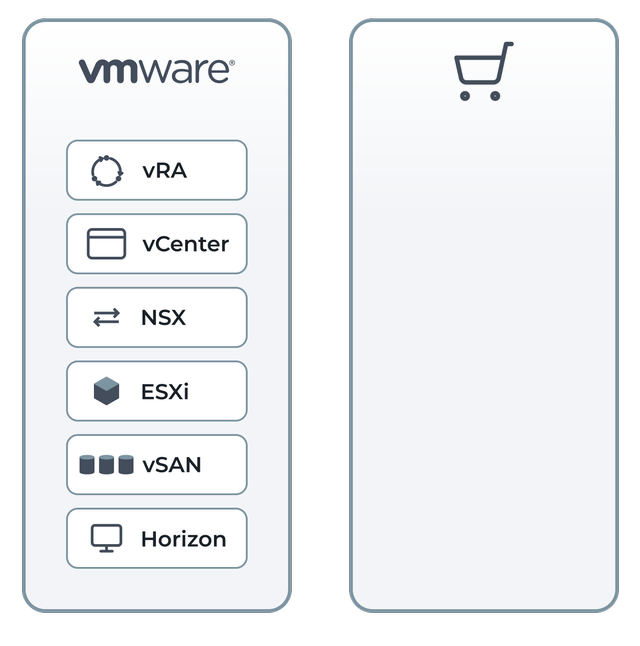
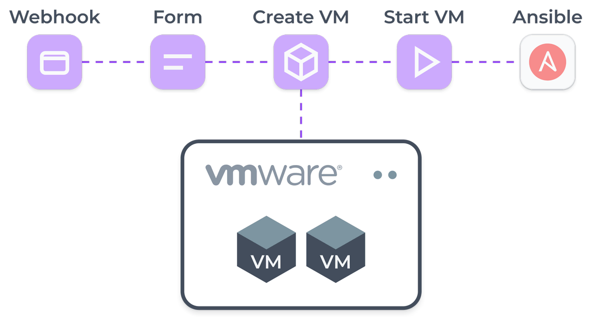

<div class="row align-items-center">
<div class="col-md-5">

Leaving VMware means choosing what runs the VMs next. This page scores seven alternatives (Proxmox VE, XCP-ng, OpenStack, Nutanix AHV, Hyper-V, OpenShift Virtualization and Harvester) in six scenarios, then gives each one's licensing, support terms, backup options and migration path from VMware. The vendor pages behind every line are listed by platform in Sources at the end, all read on 16 November 2026. Nothing here was run, and no cell is a number of mine: each one is Wins, Works or Weak, with the line from the docs behind it.

</div>
<div class="col-md-7">

<div style="max-width: 342px; margin: 0 auto;">



</div>

</div>
</div>

## The scorecard

<div style="max-width: 600px; margin: 0 auto;">



</div>

How a cell is scored:

- **Wins**: what the scenario needs is in the product and its own licence, documented by the vendor.
- **Works**: it can be done, with a limit, an extra paid product or an extra platform to run.
- **Weak**: the docs show a gap for this scenario, or say nothing about it.

More than one alternative can win a scenario. Each scenario below gives the reason behind its Wins and Weak cells.

<table class="table table-dark">
<thead><tr><th></th><th>Small team, tight budget</th><th>Data sovereignty</th><th>One vendor for servers and storage</th><th>A Windows-first team</th><th>Edge sites</th><th>Already on Kubernetes</th></tr></thead>
<tbody>
<tr><td><strong>Proxmox VE</strong></td><td style="background: var(--ks-background-tag-success)"><strong>Wins</strong></td><td style="background: var(--ks-background-tag-success)"><strong>Wins</strong></td><td>Works</td><td>Works</td><td>Works</td><td style="color: var(--ks-content-tertiary)">Weak</td></tr>
<tr><td><strong>XCP-ng</strong></td><td style="background: var(--ks-background-tag-success)"><strong>Wins</strong></td><td style="background: var(--ks-background-tag-success)"><strong>Wins</strong></td><td>Works</td><td>Works</td><td>Works</td><td>Works</td></tr>
<tr><td><strong>OpenStack</strong></td><td style="color: var(--ks-content-tertiary)">Weak</td><td style="background: var(--ks-background-tag-success)"><strong>Wins</strong></td><td style="color: var(--ks-content-tertiary)">Weak</td><td style="color: var(--ks-content-tertiary)">Weak</td><td style="color: var(--ks-content-tertiary)">Weak</td><td>Works</td></tr>
<tr><td><strong>Nutanix AHV</strong></td><td style="color: var(--ks-content-tertiary)">Weak</td><td>Works</td><td style="background: var(--ks-background-tag-success)"><strong>Wins</strong></td><td>Works</td><td style="background: var(--ks-background-tag-success)"><strong>Wins</strong></td><td>Works</td></tr>
<tr><td><strong>Hyper-V</strong></td><td>Works</td><td>Works</td><td>Works</td><td style="background: var(--ks-background-tag-success)"><strong>Wins</strong></td><td>Works</td><td>Works</td></tr>
<tr><td><strong>OpenShift Virtualization</strong></td><td style="color: var(--ks-content-tertiary)">Weak</td><td>Works</td><td>Works</td><td>Works</td><td>Works</td><td style="background: var(--ks-background-tag-success)"><strong>Wins</strong></td></tr>
<tr><td><strong>Harvester</strong></td><td>Works</td><td>Works</td><td>Works</td><td>Works</td><td>Works</td><td style="background: var(--ks-background-tag-success)"><strong>Wins</strong></td></tr>
</tbody>
</table>

## The six scenarios

### A small team on a tight budget

Proxmox VE and XCP-ng win: both are free to run with every feature, and both publish their support prices.

- **Proxmox VE,** <span style="background: var(--ks-background-tag-success)">**Wins.**</span> AGPLv3; the No-Subscription repository needs no key, though Proxmox does not recommend it for production. Per socket per year, net of VAT: Community EUR 120, Basic EUR 370, Standard EUR 550, Premium EUR 1,100.
- **XCP-ng,** <span style="background: var(--ks-background-tag-success)">**Wins.**</span> "All features are available for free"; the Essential plan covers up to 3 hosts for 2000 a year.
- **Nutanix AHV,** <span style="color: var(--ks-content-tertiary)">**Weak.**</span> No published price; the small option is NCI-Edge, licensed per VM, "restricted to small clusters running up to 25 concurrently powered-on VMs".
- **OpenShift Virtualization,** <span style="color: var(--ks-content-tertiary)">**Weak.**</span> No published self-managed price: "Pricing varies based on your sizing and subscription choices"; the Virtualization Engine edition is sold per bare-metal node.
- **OpenStack,** <span style="color: var(--ks-content-tertiary)">**Weak.**</span> Free code, but "OpenStack control planes should also be deployed across at least three failure domains".

### Data sovereignty

XCP-ng, Proxmox VE and OpenStack win: open source, run where you choose, and each one's vendor or foundation documents the case.

- **XCP-ng,** <span style="background: var(--ks-background-tag-success)">**Wins.**</span> Vates is in Grenoble, France, and "Vates VMS is based on a 100% open-source virtualization stack, without dependency on a non-European proprietary vendor".
- **Proxmox VE,** <span style="background: var(--ks-background-tag-success)">**Wins.**</span> Proxmox is in Vienna, Austria, the code is AGPLv3, and Proxmox Offline Mirror serves hosts that "are completely air-gapped".
- **OpenStack,** <span style="background: var(--ks-background-tag-success)">**Wins.**</span> Apache 2.0, and "OpenStack serves as the foundation for sovereign private and hybrid clouds", with "scheduler-enforced data residency through availability zones and host aggregates".

### One vendor for servers and storage

Nutanix AHV wins: the hypervisor, the storage and the management come in one licence.

<div style="max-width: 560px; margin: 0 auto;">



</div>

- **Nutanix AHV,** <span style="background: var(--ks-background-tag-success)">**Wins.**</span> AHV is "not sold or licensed as a standalone product" but built into NCI, and "Nutanix Prism is included with Nutanix Cloud Infrastructure at no additional cost"; external arrays work too, with Pure Storage FlashArray generally available since 2025-12-10. Limit: "Nutanix Flow is available under a separate license".
- **OpenStack,** <span style="color: var(--ks-content-tertiary)">**Weak.**</span> Storage (Cinder) is one more project, and who supports the whole depends on which of the 22 listed distributions you pick.

### A Windows-first team

Hyper-V wins: it is part of Windows Server, which the team already licenses.

- **Hyper-V,** <span style="background: var(--ks-background-tag-success)">**Wins.**</span> In both Standard and Datacenter editions of Windows Server 2025. Standard covers "2 virtual machines, plus one Hyper-V host per license", Datacenter "unlimited virtual machines"; suggested MSRP for 16 cores: USD 1,176 Standard, USD 6,771 Datacenter. Limit: Storage Spaces Direct needs Datacenter.
- **OpenStack,** <span style="color: var(--ks-content-tertiary)">**Weak.**</span> No Microsoft tooling, and the official image guide only points to "the last available trial version of Windows Server 2012 R2".

Whatever the hypervisor, Windows Server stays licensed per core, with "CALs ... required for every user or device accessing a server".

### Edge sites

Nutanix AHV wins: small clusters at every site, managed from one place, under its own licence.

- **Nutanix AHV,** <span style="background: var(--ks-background-tag-success)">**Wins.**</span> "1-node, 2-node, and 3+-node options", and "Nutanix Central makes it simple to monitor and manage tens or hundreds of edge locations all in one place"; NCI-Edge licenses small clusters per VM.
- **OpenStack,** <span style="color: var(--ks-content-tertiary)">**Weak.**</span> OpenInfra's edge stack is StarlingX, which "is not a part of the OpenStack cloud infrastructure project".

### Already on Kubernetes

OpenShift Virtualization and Harvester win: both run the VMs on the Kubernetes cluster itself.

<div style="max-width: 480px; margin: 0 auto;">



</div>

- **OpenShift Virtualization,** <span style="background: var(--ks-background-tag-success)">**Wins.**</span> It "has long been an included feature with all self-managed OpenShift editions", "an operator included with any Red Hat OpenShift edition". Limit: live migration needs shared storage with ReadWriteMany (RWX) access.
- **Harvester,** <span style="background: var(--ks-background-tag-success)">**Wins.**</span> "Built on Kubernetes", with "Virtualization management with KubeVirt" and "Storage management with Longhorn", under Apache 2.0. Limit: production nodes need 16 cores and 64 GB of RAM.
- **Proxmox VE,** <span style="color: var(--ks-content-tertiary)">**Weak.**</span> It runs KVM VMs and LXC containers; the admin guide describes no Kubernetes layer, so Kubernetes runs inside guests.

## Getting the VMs out: import tools and VDDK

<div class="row align-items-center">
<div class="col-md-7">

Broadcom completed its acquisition of VMware on 22 November 2023. It then stopped selling perpetual licences, so "offerings will solely be available as subscriptions or as term licenses", with VMware Cloud Foundation and vSphere Foundation as the two offers.

Many import tools read VM disks through VMware's Virtual Disk Development Kit (VDDK). Broadcom's wording is that "access to the VDDK SDK is made available only to those who are part of the Technology Alliance Program (TAP)"; its public download pages stopped answering in August 2026, and Red Hat says "VMware VDDK images are currently unavailable to end-users via standard public downloads". So check each tool before you plan the move:

</div>
<div class="col-md-5">



</div>
</div>

<table class="table table-dark">
<thead><tr><th>Alternative</th><th>Official import tool</th><th>Needs VDDK?</th></tr></thead>
<tbody>
<tr><td><strong>Proxmox VE</strong></td><td>Import wizard, ESXi 6.5 to 8.0 tested (<a href="https://pve.proxmox.com/wiki/Migrate_to_Proxmox_VE">guide</a>)</td><td style="color: var(--ks-content-tertiary)">The guide does not mention VDDK</td></tr>
<tr><td><strong>XCP-ng</strong></td><td>Xen Orchestra V2V, ESXi 6.x to 8.x (<a href="https://docs.xen-orchestra.com/migrate-from-vmware/v2v-migration-guide">guide</a>)</td><td style="background: var(--ks-background-tag-success)">No: "nothing to download from VMware or Broadcom"</td></tr>
<tr><td><strong>OpenStack</strong></td><td>virt-v2v, Coriolis, MigrateKit (<a href="https://www.openstack.org/vmware-migration-to-openstack/vmware-to-openstack-migration-guide">guide</a>)</td><td style="color: var(--ks-content-tertiary)">The guide does not say</td></tr>
<tr><td><strong>Nutanix AHV</strong></td><td>Nutanix Move, free (<a href="https://www.nutanix.com/blog/flexible-vm-migrations-to-the-nutanix-cloud-platform-with-move-directpath">DirectPath</a>)</td><td>Not for eligible configurations, since Move 6.3.3</td></tr>
<tr><td><strong>Hyper-V</strong></td><td>Windows Admin Center VM Conversion, preview (<a href="https://learn.microsoft.com/en-us/windows-server/manage/windows-admin-center/use/migrate-virtual-machines-vm-conversion-extension">guide</a>); SCVMM 2025, offline only</td><td style="background: var(--ks-background-alert-warning)">Windows Admin Center: yes, VDDK 8.0.3 only; the SCVMM page does not mention it</td></tr>
<tr><td><strong>OpenShift Virtualization</strong></td><td>Migration Toolkit for Virtualization (<a href="https://access.redhat.com/solutions/7146995">solution 7146995</a>)</td><td style="background: var(--ks-background-alert-warning)">Yes for vSAN; Red Hat cannot distribute the image</td></tr>
<tr><td><strong>Harvester</strong></td><td>vm-import-controller add-on (<a href="https://docs.harvesterhci.io/v1.9/advanced/addons/vmimport/">VM import</a>)</td><td style="color: var(--ks-content-tertiary)">The page does not mention VDDK</td></tr>
</tbody>
</table>

## Keeping the self-service when the hypervisor changes

The hypervisor is half of what VMware did; vRA's self-service on top is the other half. In Kestra, the request is a flow: its typed inputs are what the team fills in, one task creates and powers on the VM on Proxmox VE, and one runs the Ansible playbook that configures it. Both plugins are open source, Apache 2.0. If the hypervisor changes, only the create task changes; the inputs and the Ansible step stay. Fernando Mattos covers what happens to the vRA and vRO automation on top of the hypervisor in [Leaving VMware? Start With the Orchestrator, Not the Hypervisor](/blogs/vmware-exit-strategy-orchestrator-first).

<div style="max-width: 600px; margin: 0 auto;">



</div>

No published blueprint does exactly this with open-source tasks only, so the flow below joins two of them, each task copied as published: `provision_vm` with the `vm_name` and `vm_id` inputs from [Provision a VM and Register It in NetBox](https://kestra.io/blueprints/netbox-vm-provision-register) (its NetBox steps, which are Enterprise, left out), and `ansible_configure` with the `vm_address` and `environment` inputs from [Provision VMware VMs with Ansible and ServiceNow](https://kestra.io/blueprints/vmware-provision-configure-register) (its vCenter clone, ServiceNow and Slack steps left out). Written for Kestra 1.3.39 or later.

```yaml
id: proxmox-vm-self-service
namespace: company.team

inputs:
  - id: vm_name
    type: STRING
    defaults: app-vm-01
  - id: vm_id
    type: INT
    defaults: 201
    description: Unused Proxmox VMID to assign to the new VM.
  - id: vm_address
    type: STRING
    description: "Hostname or IP that Ansible will reach the new VM on."
  - id: environment
    type: SELECT
    values: [ dev, staging, production ]
    defaults: staging

tasks:
  - id: provision_vm
    type: io.kestra.plugin.proxmox.vm.Create
    description: Create and power on the VM on Proxmox VE.
    host: "{{ secret('PROXMOX_HOST') }}"
    node: "{{ secret('PROXMOX_NODE') }}"
    username: "{{ secret('PROXMOX_USERNAME') }}"
    password: "{{ secret('PROXMOX_PASSWORD') }}"
    vmId: "{{ inputs.vm_id }}"
    vmName: "{{ inputs.vm_name }}"
    cores: 2
    memory: 4096
    disk: "local-lvm:32"
    powerOn: true

  - id: ansible_configure
    type: io.kestra.plugin.ansible.cli.AnsibleCLI
    inputFiles:
      inventory.ini: |
        [app]
        {{ inputs.vm_name }} ansible_host={{ inputs.vm_address }} ansible_user=ubuntu
      configure.yml: "{{ read(secret('ANSIBLE_PLAYBOOK')) }}"
    commands:
      - ansible-playbook -i inventory.ini configure.yml --extra-vars "env={{
        inputs.environment }}"
    retry:
      type: constant
      interval: PT2M
      maxAttempts: 3
```

#### Where it stops

- **The VM needs an operating system first.** As published, the create task gives the VM a blank disk (the task's defaults are "1 vCPU, 1024 MiB RAM, 8 GiB disk"), so Ansible has nothing to reach until the VM boots an OS, from the task's `osTemplate` ("a cloud-init image or ISO on the node's storage") or a template. Neither blueprint shows that step.
- **Someone writes the flow first, in YAML,** before anyone can fill in the inputs.
- **A custom form is Enterprise.** Apps, which "let you wrap any Kestra flow in a custom UI", are Enterprise Edition and Cloud only; in the open-source edition, the form is the flow's inputs.
- **Dropping vRA may not cut the bill.** Kestra's own migration guide: "If vRA is part of a VCF bundle you will keep buying for the hypervisor, removing vRA may not reduce that invoice at all".

## The seven alternatives, side by side

| | Licence and price | Support | Backup | Worth knowing |
|---|---|---|---|---|
| **Proxmox VE 9.2** | AGPLv3; a subscription buys the Enterprise Repository | EUR 120 to 1,100 per socket a year; 24/7 tickets on Premium | Proxmox Backup Server 4.2; Veeam is a partner | The load balancer is in technology preview; several clusters on one screen need Proxmox Datacenter Manager |
| **XCP-ng 8.3 LTS** | Free, "all features are available for free"; Xen Orchestra mostly AGPLv3 | Vates VMS, from 2000 a year for 3 hosts to 1800 per host a year for 24/7 | Built into Xen Orchestra; Veeam since 13.1 | The load balancer and V2V are only in the XO 5 interface for now |
| **OpenStack 2026.2** | Apache 2.0 | Through one of 22 commercial distributions | Cinder volume backups, Freezer | A minimal install is already five services |
| **Nutanix AHV (NCI 7.6)** | Inside NCI, per CPU core; no public price | 24x7, P1 answered in 1 hour or 30 minutes | Native DR down to 0 RPO; Veeam | Flow networking is a separate licence |
| **Hyper-V (Windows Server 2025)** | Per core with CALs: USD 1,176 Standard, USD 6,771 Datacenter for 16 cores | Per incident, 2-hour first response for Severity A; supported until 2034 | Azure Backup Server; checkpoints are not a backup | Load balancing runs only when a node joins, unless you turn it on |
| **OpenShift Virtualization 4.22** | In every self-managed OpenShift edition; no public price | Standard in business hours, or Premium 24x7 | OADP, whole VMs or single files | Live migration needs RWX shared storage |
| **Harvester v1.9** | Apache 2.0; subscription with no per-CPU fees, no public price | Standard, or Priority with 24x7 for Severity 1 and 2 | NFS or S3, Longhorn volumes only | Upgrading to v1.9.0 is not recommended yet; v1.8.x maintenance ends 2026-12-29 |

## What the sources leave open

- **Prices behind a sales call.** Nutanix, Red Hat and SUSE publish no self-managed price, Microsoft gives no price for its per-incident support, and Vates prints $ and € beside the same figures.
- **Gaps in the docs.** No Proxmox page says whether its import wizard uses VDDK, and no SUSE page covers sovereignty or air-gapped installs.
- **Pages behind a login.** Nutanix Move's supported ESXi versions and the AHV load balancer are documented on Nutanix's support portal, which was not read.

## What this doesn't cover

Hardware sizing, prices quoted by a sales team, performance, and any platform outside these seven. Every line above is what the vendor's own pages said on 16 November 2026; check the linked page before you sign anything.

## Sources

The main pages behind this post, all read on 16 November 2026.

<span style="display: block; font-size: 0.85rem; line-height: 1.55; color: var(--ks-content-tertiary); margin-bottom: 0.6rem;"><strong>VMware and Broadcom:</strong> [Broadcom 8-K, Exhibit 99.1](https://www.sec.gov/Archives/edgar/data/1730168/000114036123054354/ef20015100_ex99-1.htm); [VMware blog](https://blogs.vmware.com/cloud-foundation/2024/01/22/vmware-end-of-availability-of-perpetual-licensing-and-saas-services/); [ShapeBlue](https://www.shapeblue.com/broadcom-vddk-download-vmware-to-kvm/)</span>

<span style="display: block; font-size: 0.85rem; line-height: 1.55; color: var(--ks-content-tertiary); margin-bottom: 0.6rem;"><strong>Proxmox VE:</strong> [Admin guide](https://pve.proxmox.com/pve-docs/pve-admin-guide.html); [Pricing](https://www.proxmox.com/en/products/proxmox-virtual-environment/pricing); [Migrate to Proxmox VE](https://pve.proxmox.com/wiki/Migrate_to_Proxmox_VE)</span>

<span style="display: block; font-size: 0.85rem; line-height: 1.55; color: var(--ks-content-tertiary); margin-bottom: 0.6rem;"><strong>XCP-ng and Xen Orchestra:</strong> [Licenses](https://docs.xcp-ng.org/project/licenses/); [Vates pricing](https://vates.tech/en/pricing-and-support/); [V2V guide](https://docs.xen-orchestra.com/migrate-from-vmware/v2v-migration-guide)</span>

<span style="display: block; font-size: 0.85rem; line-height: 1.55; color: var(--ks-content-tertiary); margin-bottom: 0.6rem;"><strong>OpenStack:</strong> [Software](https://www.openstack.org/software/); [Distributions](https://www.openstack.org/marketplace/distros/); [VMware to OpenStack guide](https://www.openstack.org/vmware-migration-to-openstack/vmware-to-openstack-migration-guide)</span>

<span style="display: block; font-size: 0.85rem; line-height: 1.55; color: var(--ks-content-tertiary); margin-bottom: 0.6rem;"><strong>Nutanix AHV:</strong> [AHV](https://www.nutanix.com/products/ahv); [Software options](https://www.nutanix.com/products/cloud-platform/software-options); [DirectPath](https://www.nutanix.com/blog/flexible-vm-migrations-to-the-nutanix-cloud-platform-with-move-directpath)</span>

<span style="display: block; font-size: 0.85rem; line-height: 1.55; color: var(--ks-content-tertiary); margin-bottom: 0.6rem;"><strong>Hyper-V and Azure Local:</strong> [Editions comparison](https://learn.microsoft.com/en-us/windows-server/get-started/editions-comparison); [Pricing](https://www.microsoft.com/en-us/windows-server/pricing); [Migrate](https://learn.microsoft.com/en-us/windows-server/manage/windows-admin-center/use/migrate-virtual-machines-vm-conversion-extension)</span>

<span style="display: block; font-size: 0.85rem; line-height: 1.55; color: var(--ks-content-tertiary); margin-bottom: 0.6rem;"><strong>OpenShift Virtualization:</strong> [Subscription guide](https://www.redhat.com/en/resources/self-managed-openshift-subscription-guide); [About, OpenShift 4.22](https://docs.redhat.com/en/documentation/openshift_container_platform/4.22/html/virtualization/about); [Solution 7146995](https://access.redhat.com/solutions/7146995)</span>

<span style="display: block; font-size: 0.85rem; line-height: 1.55; color: var(--ks-content-tertiary); margin-bottom: 0.6rem;"><strong>Harvester:</strong> [Harvester overview](https://docs.harvesterhci.io/v1.9/); [SUSE Virtualization](https://www.suse.com/products/rancher/virtualization/); [VM import](https://docs.harvesterhci.io/v1.9/advanced/addons/vmimport/)</span>

<span style="display: block; font-size: 0.85rem; line-height: 1.55; color: var(--ks-content-tertiary); margin-bottom: 0.6rem;"><strong>Kestra:</strong> [`io.kestra.plugin.proxmox.vm.Create`](https://kestra.io/plugins/plugin-proxmox/proxmox-ve-vm/io.kestra.plugin.proxmox.vm.create); [`io.kestra.plugin.ansible.cli.AnsibleCLI`](https://kestra.io/plugins/plugin-ansible/cli/io.kestra.plugin.ansible.cli.ansiblecli); [Migrating off vRA and vRO](https://kestra.io/resources/migration/vra)</span>
