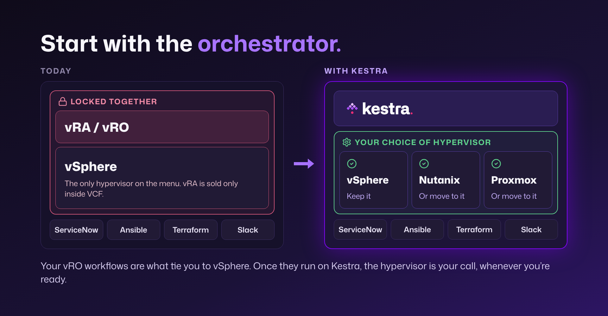

Most teams planning to leave VMware start with the hypervisor. They compare Nutanix and Proxmox, price out the move, and plan how to get the VMs across. What very few plan is the automation that runs on top of it: the vRA catalog people request machines from, the vRO workflows behind every request, and the Day 2 actions that keep the environment running. The teams we talk to, and the partners who help them migrate, describe the same pattern. The hypervisor move gets a plan, and the automation gets discovered halfway through.

In our November 4 webinar, Faizan Qazi and I made the case for starting with the orchestrator instead, and showed what that looks like with Kestra. Below are the key moments, each with the replay cued to it.

## Most VMware Exit Plans Start in the Wrong Place

If you run VMware, vRA and vRO are most likely your orchestration layer, and they were built for vSphere. Every catalog request, lifecycle event and Day 2 action runs through them, along with the integrations to ServiceNow, Terraform, Ansible and your CMDB. That layer is what ties you to vSphere, and it's increasingly priced and scoped by VMware. vRA is now sold only as part of [VMware Cloud Foundation](https://kestra.io/vs/vmware-cloud-foundation), licensed per core on subscription, so the automation is now priced as part of the hypervisor. What it can reach is VMware's call too: several vRO plugins were deprecated in VCF 9, and native AWS, Azure and GCP management were deprecated and switched off by default.

Replacing the orchestrator first turns the hypervisor into a separate decision. With Kestra running your automation, ServiceNow, Terraform, Ansible and your CMDB stay where they are, and you can keep vSphere, move some workloads to Nutanix or Proxmox, or move all of them, on your own schedule. Teams that move the hypervisor first tend to end up here anyway, because the workflows that provisioned and patched their VMs don't move with them.

<iframe src="https://www.youtube.com/embed/oDmypfno4oc?start=286&end=356" title="You're not stuck on VMware because of vSphere" frameborder="0" allow="accelerometer; autoplay; clipboard-write; encrypted-media; gyroscope; picture-in-picture; web-share" referrerpolicy="strict-origin-when-cross-origin" allowfullscreen></iframe>

## Why Moving Hypervisors Feels Impossible

Moving VMs is a problem with a known shape. The automation is what makes the move feel impossible. Every vRO workflow that provisions, patches or decommissions a machine has to be recreated for the new platform, the old and new setups have to run side by side until the move is done, and most teams don't know where to start because they aren't sure what they have. In most environments we see some version of the same picture:

- Years of accumulated vRO workflows, many written by engineers who have since left or by outside consultants.
- Unclear dependencies between workflows, actions and the systems they call.
- JavaScript in scriptable tasks that fewer and fewer engineers can read and change.
- Automation that works in production today, and a real risk of breaking it.

So teams stay. The will to leave is usually there, and what holds them back is uncertainty. The teams we talk to tell us they don't see vRO as a long-term option, and the alternative many of them have landed on is writing their own scripts. Scripts can recreate the provisioning, but not what vRA gave you around it: a catalog people request from, a record of who ran what, and an inventory of what was provisioned.

<iframe src="https://www.youtube.com/embed/oDmypfno4oc?start=593&end=623" title="Nobody knows what these workflows do" frameborder="0" allow="accelerometer; autoplay; clipboard-write; encrypted-media; gyroscope; picture-in-picture; web-share" referrerpolicy="strict-origin-when-cross-origin" allowfullscreen></iframe>

## Kestra Replaces Both vRA and vRO, and Keeps the Rest of Your Stack

Kestra is an open source orchestrator (Apache 2.0), with an Enterprise edition built on the same engine, and it runs in production at companies like Apple, JPMorgan Chase, Crédit Agricole and Dataport. Flows are declared in YAML, so they live in Git and get reviewed like any other code, and plugins connect them to the tools you already run. It replaces both VMware layers, the vRO workflow engine and the vRA catalog, deployments and Day 2 actions. Here's how the pieces map:

| In vRA and vRO | In Kestra |
| --- | --- |
| Workflows and scriptable tasks | Flows declared in YAML, kept in Git and promoted like code |
| Package files exported and imported by hand | Git, with review and promotion between environments |
| Actions and vRO plugins | Kestra plugins for [vSphere](https://kestra.io/plugins/plugin-ee-vmware), [Nutanix](https://kestra.io/plugins/plugin-ee-nutanix), [Proxmox](https://kestra.io/plugins/plugin-proxmox), [ServiceNow](https://kestra.io/plugins/plugin-servicenow), public clouds and more |
| Configuration elements | Namespaces, the KV store, and secrets from the vault you already use |
| Service Broker catalog items | Kestra Apps with dynamic forms |
| Deployments | Assets that track what was provisioned |
| Day 2 actions | Flows that act on assets, run from an App, on a schedule, or when an asset changes |
| ServiceNow, Terraform, Ansible, your CMDB, IPAM and vault | They stay where they are, and Kestra calls them through plugins |

This mapping is Kestra Enterprise (the vSphere and Nutanix plugins, Apps and external secrets managers are Enterprise features). Kestra for Infrastructure, arriving December 1, packages this for platform teams, with requests, deployments and inventory pages, and an owner and a lease on every deployment.

<iframe src="https://www.youtube.com/embed/oDmypfno4oc?start=525&end=577" title="What vRO and vRA become in Kestra" frameborder="0" allow="accelerometer; autoplay; clipboard-write; encrypted-media; gyroscope; picture-in-picture; web-share" referrerpolicy="strict-origin-when-cross-origin" allowfullscreen></iframe>

<iframe src="https://www.youtube.com/embed/oDmypfno4oc?start=1454&end=1502" title="A load balancer's lifecycle in vRA" frameborder="0" allow="accelerometer; autoplay; clipboard-write; encrypted-media; gyroscope; picture-in-picture; web-share" referrerpolicy="strict-origin-when-cross-origin" allowfullscreen></iframe>

<iframe src="https://www.youtube.com/embed/oDmypfno4oc?start=2074&end=2204" title="The same load balancer lifecycle in Kestra" frameborder="0" allow="accelerometer; autoplay; clipboard-write; encrypted-media; gyroscope; picture-in-picture; web-share" referrerpolicy="strict-origin-when-cross-origin" allowfullscreen></iframe>

## Move Without a Big Rewrite, or Rebuild If That's Easier

The first step is finding out what you have. The open source Kestra Migration Assistant reads your vRO package export (and your vRA export, if you have one) on your own machine and produces a brief your team can plan from:

- What each workflow does, and which systems it touches.
- Which Kestra plugins cover those systems.
- A recommendation for each workflow, including which ones to retire.
- A migration plan in waves, from the lowest-risk workflows to the catalog itself.

<iframe src="https://www.youtube.com/embed/oDmypfno4oc?start=715&end=763" title="The Migration Assistant in one breath" frameborder="0" allow="accelerometer; autoplay; clipboard-write; encrypted-media; gyroscope; picture-in-picture; web-share" referrerpolicy="strict-origin-when-cross-origin" allowfullscreen></iframe>

It was built to be safe to run in a locked-down environment. It sanitizes secrets and IP addresses before anything goes to a model, sends no telemetry, works with whichever model your company has approved (or with no model at all), and doesn't need Kestra installed.

<iframe src="https://www.youtube.com/embed/oDmypfno4oc?start=763&end=785" title="Nothing leaves your machine" frameborder="0" allow="accelerometer; autoplay; clipboard-write; encrypted-media; gyroscope; picture-in-picture; web-share" referrerpolicy="strict-origin-when-cross-origin" allowfullscreen></iframe>

<iframe src="https://www.youtube.com/embed/oDmypfno4oc?start=2836&end=2881" title="Q&amp;A: how the Migration Assistant handles your data" frameborder="0" allow="accelerometer; autoplay; clipboard-write; encrypted-media; gyroscope; picture-in-picture; web-share" referrerpolicy="strict-origin-when-cross-origin" allowfullscreen></iframe>

From there the move goes wave by wave, with vRA still running everything that hasn't moved yet. The conversion is the other half of the Migration Assistant, and we run it with your team. Each wave is converted and verified before it touches your systems. Tests are written from the original workflows first, the converted flows run in a lab that simulates vCenter and mocks the systems your workflows call (F5, Avi, ServiceNow and others), and the results are checked against what the vRO workflows did. The next wave starts once the last one is verified in production.

Some teams skip conversion and rebuild instead, and that's easier than it sounds when catalog items become Apps and plugins replace most of the custom JavaScript. One EU federal agency with roughly 1,600 vRO workflows chose to rebuild rather than convert. Most environments end up with a mix: convert the workflows that are clean, rebuild the ones that are messy, and retire the ones nobody uses.

<iframe src="https://www.youtube.com/embed/oDmypfno4oc?start=1919&end=2006" title="How do you know the AI conversion works?" frameborder="0" allow="accelerometer; autoplay; clipboard-write; encrypted-media; gyroscope; picture-in-picture; web-share" referrerpolicy="strict-origin-when-cross-origin" allowfullscreen></iframe>

**[Talk to us](https://kestra.io/demo)** and we'll walk through the assessment with you, or [run the Migration Assistant yourself](https://kestra.io/resources/migration/vra/assistant) first.

## Get What vRA Never Gave You

Replacing the orchestrator is also a chance to get things vRA and vRO never offered. Two stand out:

- **Inventory you can reason about.** Every deployment is an asset with its dependencies, so before you update the certificate on a load balancer's virtual server, you can see which machines the change would affect. Asset lifecycle events can also trigger flows, so deleting a machine runs the flow that removes it from the pool.

  
<iframe src="https://www.youtube.com/embed/oDmypfno4oc?start=2252&end=2325" title="The blast radius of a change" frameborder="0" allow="accelerometer; autoplay; clipboard-write; encrypted-media; gyroscope; picture-in-picture; web-share" referrerpolicy="strict-origin-when-cross-origin" allowfullscreen></iframe>

- **A safe place for AI agents.** vRO has no built-in way to run AI agents. In Kestra, an agent works inside a flow, and the flow defines what it can touch, who approves its changes, and what goes into the audit trail. [Kai's post on AI agents for infrastructure automation](https://kestra.io/blogs) covers what agents can realistically do for infrastructure teams today. **\[PLACEHOLDER: replace this link with Kai's post URL once it publishes on Nov 18\]**

## Where to Start

We asked Faizan Qazi, a Senior Solutions Engineer at Kestra who built vRA and vRO workflows for enterprises at VMware, what a team running vRO should do first, before talking to any vendor. His advice:

- **Map what your workflows touch.** List the systems they talk to, and the risk of moving each one.
- **Take stock of what you've built.** Your vRO libraries and JavaScript, and the Terraform modules and Ansible playbooks they call.
- **Check what a new platform supports natively.** Anything it doesn't becomes boilerplate your team writes while still keeping business as usual running.

[Watch his full answer](https://www.youtube.com/watch?v=oDmypfno4oc&t=2623s) (replay from 43:43, about a minute and a half).

When you're ready for the next step:

- **[Talk to us](https://kestra.io/demo).** We'll look at your environment with you and show what replacing vRA and vRO would take.
- **Build the case.** The [vRA migration guide](https://kestra.io/resources/migration/vra) walks through the decisions and the plan, and the [payback calculator](https://kestra.io/resources/migration/vra/payback) shows whether the move pays off for your team.
- **Look on your own first.** [Run the Migration Assistant](https://kestra.io/resources/migration/vra/assistant) on the sample files, then on your own export.
- **See Kestra for infrastructure automation** in [an 8-minute walkthrough](https://www.youtube.com/watch?v=brZo-5NdP2E).

The [full webinar recording](https://www.youtube.com/watch?v=oDmypfno4oc) is also available if you'd like to watch both demos end to end.

## FAQ

### Why are teams migrating off VMware?

vRA is now sold only as part of VMware Cloud Foundation, licensed per core on subscription, so the automation layer is priced with the hypervisor. Several vRO plugins were also deprecated in VCF 9, and native AWS, Azure and GCP management is switched off by default.

### Can I keep vSphere while replacing vRA and vRO?

Yes. Replace the orchestrator first and the hypervisor becomes a separate decision: keep vSphere, move some workloads to Nutanix or Proxmox, or move all of them, on your own schedule.

### What replaces vRealize Orchestrator workflows?

In Kestra, vRO workflows and scriptable tasks become flows declared in YAML, kept in Git and promoted like code. Actions and vRO plugins map to Kestra plugins, and Service Broker catalog items become Kestra Apps with dynamic forms.

### Do I have to rewrite every vRO workflow?

No. The open source Kestra Migration Assistant reads your vRO package export and recommends what to convert, rebuild or retire. We run the conversion with your team. Workflows then move in waves while vRA keeps running everything that hasn't moved yet.
