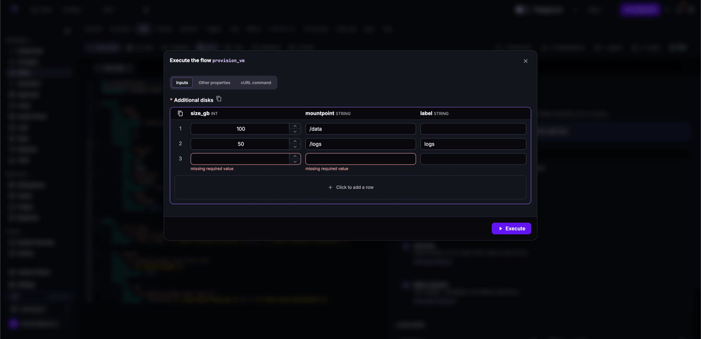
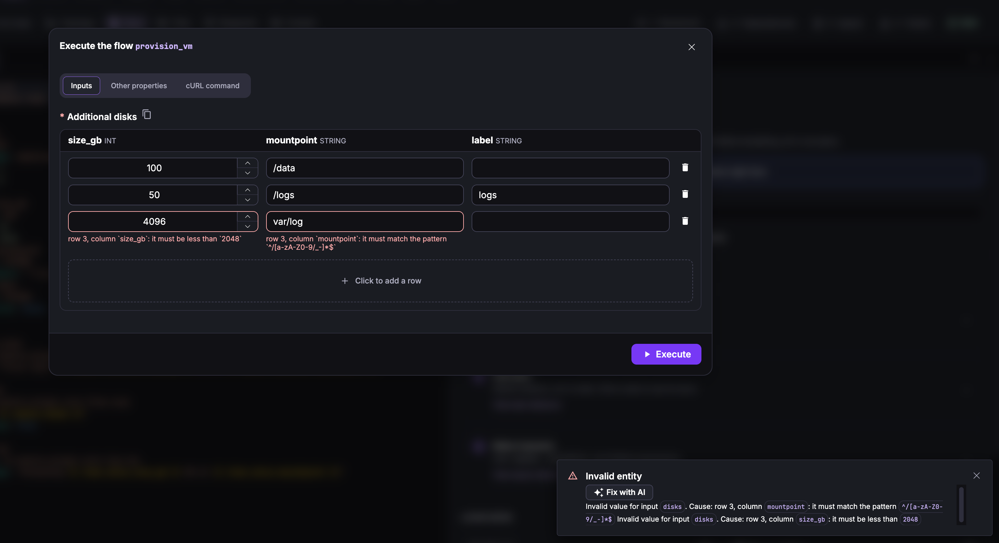

Inputs are typed, validated parameters passed to a flow at execution time.

<div class="video-container">
  <iframe src="https://www.youtube.com/embed/peQvnhaspyQ?si=gcZxTX5KF2dC7ZLO" title="YouTube video player" allow="accelerometer; autoplay; clipboard-write; encrypted-media; gyroscope; picture-in-picture; web-share" referrerpolicy="strict-origin-when-cross-origin" allowfullscreen></iframe>
</div>

Flow inputs are stored in the execution context and accessed with `{{ inputs.parameter_name }}`. All inputs are validated when the execution is created; invalid or missing required inputs prevent the execution from being created and it will not appear in the executions list.

## Declaring inputs

Inputs are declared under the `inputs` key. Each input requires an `id` and a `type`. Inputs are required by default; `required: false` makes an input optional.

```yaml
id: inputs_demo
namespace: company.team

inputs:
  - id: username
    type: STRING
    defaults: "alice"
    description: The user to greet.

  - id: threshold
    type: INT
    min: 1
    max: 100

  - id: environment
    type: SELECT
    values:
      - dev
      - staging
      - prod
    defaults: dev

  - id: config_file
    type: FILE
    allowedFileExtensions: [".json", ".yaml"]

  - id: optional_note
    type: STRING
    required: false

tasks:
  - id: log
    type: io.kestra.plugin.core.log.Log
    message: "Hello {{ inputs.username }} — deploying to {{ inputs.environment }}"
```

## Input types

Inputs are strongly typed and validated before execution starts.

| Type | Accepts | Constraints & extra properties |
|---|---|---|
| `STRING` | Any string | `validator` (regex) |
| `EMAIL` | Valid email address | `validator` (regex) |
| `INT` | Integer | `min`, `max` |
| `FLOAT` | Float | `min`, `max` |
| `BOOL` | `true` or `false` | — |
| `DATETIME` | [ISO 8601](https://en.wikipedia.org/wiki/ISO_8601) datetime in UTC, e.g. `2042-04-02T04:20:42.000Z` | `after`, `before` |
| `DATE` | ISO 8601 date without timezone, e.g. `2042-12-03` | `after`, `before` |
| `TIME` | ISO 8601 time without timezone, e.g. `10:15:30` | `after`, `before` |
| `DURATION` | ISO 8601 duration, e.g. `PT5M6S` | `min`, `max` |
| `SELECT` | One value from a predefined list | `values`, `expression`, `allowCustomValue`, `autoSelectFirst` |
| `MULTISELECT` | One or more values from a predefined list | Same as `SELECT` |
| `FILE` | Uploaded file, `nsfile:///` (namespace file), or `file:///` (local allowed path) | `allowedFileExtensions`; stored in [internal storage](../../08.architecture/data-components/index.md#internal-storage); the only type that accepts a multipart file upload via the API; all other types require a plain string value |
| `JSON` | Valid JSON string | `jsonSchema` (JSON Schema Draft 2020-12) |
| `ION` | Ion-formatted text, parsed into a structured object (Map or List) accessible with dot notation, e.g. `{{ inputs.record.name }}`; use Ion syntax for `defaults`: `'{name:"Ada",score:21}'` | — |
| `YAML` | Valid YAML string | — |
| `URI` | Valid URI, kept as a string | — |
| `SECRET` | Encrypted string, decrypted at runtime and masked in UI and logs | `validator` (regex); requires [encryption key](../../configuration/05.security-and-secrets/index.md) |
| `ARRAY` | JSON array or YAML list | `itemType` (required) |
| `FORM` | Groups child inputs as a multi-step wizard in the Execute modal | Cannot nest; no `defaults`/`prefill` on the FORM itself |
| `TABLE` | Ordered list of typed records, entered as rows in a grid (Enterprise Edition) | `columns` (required), `minRows`, `maxRows`; see [TABLE inputs](#table-inputs) |
| `REUSABLE_INPUTS` | References a namespace-level named input group (Enterprise Edition) | See [Reusable Inputs](../22.reusable-inputs/index.md) |

:::alert{type="info"}
Due to [YAML's scalar formats](https://yaml.org/spec/1.1/current.html#id864510), `yes`/`no` may be parsed as booleans. Wrap them in quotes when using them as `SELECT` values: `"Yes"`, `"No"`.
:::

:::alert{type="info"}
`FILE` defaults use the universal file protocol: `nsfile:///` for namespace files, `file:///` for local files from an explicitly allowed path. Configure allowed paths under `kestra.local-files.allowed-paths` in your Kestra configuration.
:::

## Input properties

| Property | Description |
|---|---|
| `id` | Identifier used to reference the input, e.g. `{{ inputs.user }}`. |
| `type` | Data type, as listed above. |
| `required` | Whether the input is required. Defaults to `true`. |
| `defaults` | Default value applied when no value is provided at runtime. |
| `prefill` | Initial value shown in the UI that can be cleared to `null`. Unlike `defaults`, a cleared prefill resolves to `null`. |
| `displayName` | Label shown in the UI instead of the `id`. |
| `description` | Markdown description displayed in the UI. |
| `descriptionDisplayMode` | How the `description` is displayed: `TEXT` (default) renders it between the label and the field, `TOOLTIP` renders it as a hoverable help icon next to the label. |
| `validator` | Regex pattern for `STRING` and `SECRET` types. |
| `expression` | Pebble expression used to populate `SELECT` and `MULTISELECT` values dynamically, e.g. `{{ kv('MY_LIST') }}`. |
| `dependsOn` | Makes this input conditional on other inputs being provided or matching a `condition`. |
| `autoSelectFirst` | Auto-selects the first value in `SELECT`/`MULTISELECT` lists as the default. |
| `searchable` | Stores the input value so you can find executions by it. Defaults to `false`. See [Searchable inputs](#searchable-inputs). |

### Description display mode

:::badge{version=">=2.1" editions="OSS,EE,Cloud"}
:::

Long descriptions make forms unwieldy. Set `descriptionDisplayMode: TOOLTIP` to keep the form compact and show the description only when the user hovers the help icon next to the label. This applies to the Execute modal and to [Apps](../../07.enterprise/04.scalability/apps/index.md) forms.

```yaml
inputs:
  - id: environment
    type: SELECT
    displayName: Environment
    description: The target environment for deploying VMs. Pick `prod` only after the change was approved.
    descriptionDisplayMode: TOOLTIP
    values:
      - dev
      - prod
```

## Input validation

### Type constraints

`INT`, `FLOAT`, and `DURATION` accept `min` and `max`. `DATE`, `TIME`, and `DATETIME` accept `after` and `before`. `STRING` and `SECRET` accept a `validator` regex.

```yaml
inputs:
  - id: age
    type: INT
    min: 18
    max: 64

  - id: username
    type: STRING
    validator: ^[a-z0-9_]{3,20}$

  - id: start_date
    type: DATE
    after: "2024-01-01"
    before: "2025-01-01"
```

### JSON Schema validation

The `jsonSchema` property validates a `JSON` input against a JSON Schema at execution time. An invalid payload rejects the execution before any task runs:

```yaml
id: json_schema_validation
namespace: company.team

inputs:
  - id: payload
    type: JSON
    jsonSchema: |
      {
        "$schema": "https://json-schema.org/draft/2020-12/schema",
        "type": "object",
        "required": ["name"],
        "properties": {
          "name": { "type": "string" }
        },
        "additionalProperties": false
      }

tasks:
  - id: log
    type: io.kestra.plugin.core.log.Log
    message: "Hello, {{ inputs.payload.name }}!"
```

Kestra reports each schema error as a separate message, so a payload with several problems shows all of them at once. An error on a nested value, such as a property of the wrong type, also names its location, for example `payload.name`.

To validate JSON at any point in a flow — not just at execution start — use the [ValidateJsonSchema](../../15.how-to-guides/validate-json-schema/index.md) task from plugin-serdes.

## Nested inputs

A `.` in an input `id` creates a nested structure, accessible with the same dot notation in expressions:

```yaml
inputs:
  - id: db.host
    type: STRING
    defaults: localhost

  - id: db.port
    type: INT
    defaults: 5432

tasks:
  - id: log
    type: io.kestra.plugin.core.log.Log
    message: "Connecting to {{ inputs.db.host }}:{{ inputs.db.port }}"
```

## FORM inputs

`FORM` groups related inputs under a shared label and renders a multi-step wizard in the Execute modal:

```yaml
id: provision_environment
namespace: company.team

inputs:
  - id: requester
    type: STRING
    required: true

  - id: environment
    type: FORM
    displayName: Environment setup
    description: Where the environment runs and what size it needs.
    inputs:
      - id: region
        type: SELECT
        defaults: eu-central-1
        values:
          - eu-central-1
          - eu-west-1
          - us-east-1

      - id: instance_type
        type: SELECT
        defaults: t3.medium
        values:
          - t3.medium
          - t3.large
          - t3.xlarge

tasks:
  - id: log
    type: io.kestra.plugin.core.log.Log
    message: |
      Requester: {{ inputs.requester }}
      Region: {{ inputs.environment.region }}
      Instance: {{ inputs.environment.instance_type }}
```

:::alert{type="warning"}
A FORM cannot contain another FORM. `defaults` and `prefill` belong on individual child inputs, not on the FORM itself.
:::

A `FORM` also accepts [`descriptionDisplayMode: TOOLTIP`](#description-display-mode), which shows its description as a help icon next to the group title in the wizard instead of a text block, in the Execute modal and in Apps.

When triggering a flow with FORM inputs via the API, use flat dotted field names:

```bash
curl -X POST "http://localhost:8080/api/v1/main/executions/company.team/provision_environment" \
  -H "Content-Type: multipart/form-data" \
  -F "requester=platform-team" \
  -F "environment.region=eu-central-1" \
  -F "environment.instance_type=t3.large"
```

## TABLE inputs

:::badge{version=">=2.1" editions="EE,Cloud"}
:::

`TABLE` collects a list of records with the same typed fields, such as the disks to attach to a VM or a set of firewall rules. The Execute modal and [Apps](../../07.enterprise/04.scalability/apps/index.md) forms render it as a grid with one column per field, each header showing the column's type. Users add rows with **Click to add a row** and remove them with the delete icon. The grid keeps at least `minRows` rows.

Declare each column under `columns` as a regular input. Its rules, such as `min`, `max`, or `validator`, apply to that column in every row. `minRows` and `maxRows` limit the number of rows:

```yaml
id: provision_vm
namespace: company.team

inputs:
  - id: disks
    type: TABLE
    displayName: Additional disks
    minRows: 1
    maxRows: 8
    columns:
      - id: size_gb
        type: INT
        min: 10
        max: 2048
      - id: mountpoint
        type: STRING
        validator: "^/[a-zA-Z0-9/_-]*$"
      - id: label
        type: STRING
        required: false

tasks:
  - id: first_disk
    type: io.kestra.plugin.core.log.Log
    message: "First disk: {{ inputs.disks[0].size_gb }} GB at {{ inputs.disks[0].mountpoint }}"

  - id: attach
    type: io.kestra.plugin.core.flow.Loop
    values: "{{ inputs.disks }}"
    parseValues: true
    tasks:
      - id: log
        type: io.kestra.plugin.core.log.Log
        message: "Attaching {{ item.value.size_gb }} GB at {{ item.value.mountpoint }}"
```



The value is a list of objects, one per row, keyed by column `id`. Reference a cell with `{{ inputs.disks[0].size_gb }}`, where the index starts at 0. To loop over the rows, pass the input to a [Loop](../01.tasks/00.flowable-tasks/index.md#loop) task with `parseValues: true` so `item.value` is the row object.

Columns are required by default, like any input. Set `required: false` on a column to let users leave its cells empty. An omitted cell resolves to `null`, and so does an empty value in a column of a non-text type such as `INT` or `DATE`.

A `TABLE` can sit inside a [FORM](#form-inputs). Reference it with the form's path, such as `{{ inputs.environment.disks }}`.

### Column rules

Kestra checks the columns when you save the flow:

- **Types:** `STRING`, `INT`, `FLOAT`, `BOOL`, `DATE`, `DATETIME`, `TIME`, `DURATION`, `EMAIL`, `URI`, `SELECT`, and `MULTISELECT`.
- **IDs:** each column `id` must be unique within the table and cannot contain a `.`.
- **Properties:** a column cannot declare `defaults`, `prefill`, `dependsOn`, or `expression`. A `SELECT` or `MULTISELECT` column takes static `values`.
- **Row limits:** `minRows` cannot be greater than `maxRows`.

`TABLE` cannot be used as the `itemType` of an `ARRAY` or `MULTISELECT` input. In the open-source edition, saving a flow with a `TABLE` input fails with an error that names the input.

### Validation errors

Kestra validates every cell of every row and reports all errors at once, so the user can fix them in one pass. Each message names the row, counted from 1, and the column:

```text
Invalid value for input `disks`. Cause: row 3, column `size_gb`: it must be less than `2048`
Invalid value for input `disks`. Cause: row 4, column `mountpoint`: missing required value
```

A row with a key that isn't a declared column, or a row that isn't an object, is also rejected. Kestra checks `minRows` and `maxRows` once every cell is valid. In the Execute modal, each error appears below its cell:



To check values without creating an execution, send them to `POST /api/v1/{tenant}/executions/{namespace}/{id}/validate`. The response returns each cell error with a `path` field that locates the cell, such as `disks[2].size_gb`, where the row index starts at 0. An error about the input as a whole, such as the row count, has no `path`.

### Pass a TABLE input via the API

Send the rows as one JSON-encoded field, the same way as an `ARRAY` or `JSON` input:

```bash
curl -X POST "http://localhost:8080/api/v1/main/executions/company.team/provision_vm" \
  -H "Content-Type: multipart/form-data" \
  -F 'disks=[{"size_gb": 100, "mountpoint": "/data"}, {"size_gb": 50, "mountpoint": "/logs", "label": "logs"}]'
```

Invalid rows return a `422` response whose `detail` lists every error.

<!-- TODO(2.1 RC): confirm availability on Cloud. -->

## Array inputs

`ARRAY` accepts a JSON array or YAML list. The `itemType` property is required:

```yaml
inputs:
  - id: ids
    type: ARRAY
    itemType: INT
    defaults: [1, 2, 3]
```

## Searchable inputs

:::badge{version=">=2.1" editions="OSS,EE,Cloud"}
:::

Set `searchable: true` on an input to find executions by its value, such as an order ID or a customer code. Kestra stores the value when the execution is created, so you can find executions that are still running.

```yaml
id: process_orders
namespace: company.sales

inputs:
  - id: customerId
    type: STRING
    searchable: true

  - id: orderIds
    type: ARRAY
    itemType: STRING
    searchable: true

tasks:
  - id: log
    type: io.kestra.plugin.core.log.Log
    message: "Processing {{ inputs.orderIds | length }} orders for {{ inputs.customerId }}"
```

Kestra stores each item of an `ARRAY` input separately, so a search for one order ID finds this execution. Use an `ARRAY` input rather than `MULTISELECT` to search on several values.

Searchable inputs follow these rules:

- **Types:** `STRING`, `EMAIL`, `SELECT`, `INT`, `FLOAT`, `BOOL`, `URI`, `DATE`, `DATETIME`, `TIME`, `DURATION`, and `ARRAY` of those scalar values. Saving a flow that marks an input of any other type as searchable, such as `SECRET`, `FILE`, or `MULTISELECT`, fails with an error that names the input.
- **When values are stored:** after all inputs pass validation. An execution rejected for invalid inputs stores no searchable values. An input left empty has no searchable value.
- **IDs:** an ID can be searchable on an input or on an output of the same flow, not both.
- **Size limits, errors, replays, and cleanup:** the same as for [searchable outputs](../06.outputs/index.md#searchable-outputs). A value that can't be stored is logged as an error, and the execution still runs.

<!-- TODO(runtime, 2.1 RC): confirm that executions started by a Flow trigger store searchable inputs, and the filter key for a searchable input inside a FORM input (dotted ID such as `environment.region`?). -->

To find executions by a searchable input, use the **Inputs & Outputs** filter on the **Executions** page or the `searchableData` API filter. See [Find executions by searchable value](../06.outputs/index.md#find-executions-by-searchable-value).

## Using inputs in a flow

Inputs are referenced with `{{ inputs.name }}` in any dynamic property. Bracket notation is required for IDs containing hyphens or other special characters:

```yaml
inputs:
  - id: message
    type: STRING

  - id: my-file
    type: FILE

tasks:
  - id: use_inputs
    type: io.kestra.plugin.scripts.shell.Commands
    commands:
      - echo "{{ inputs.message }}"
    inputFiles:
      upload.tmp: "{{ inputs['my-file'] }}"
```

## Setting inputs at execution time

Input values are provided at execution time via the UI Execute modal, the API, the CLI ([`kestractl`](../../kestra-cli/kestractl/index.md#installation)), or the Python SDK (`kestra` pip package). See [Execute a flow](../03.execution/index.md#execute-via-api) for full examples with `curl`, Python, and kestractl.

## Inputs vs. variables

[Variables](../04.variables/index.md) are defined before execution and cannot be changed once it starts. Inputs are provided at execution time and can differ between runs.

## Dynamic inputs

`SELECT` and `MULTISELECT` inputs support an `expression` property that populates the dropdown from a Pebble expression: a KV store lookup, an HTTP API call, or a subflow result:

```yaml
inputs:
  - id: environment
    type: SELECT
    expression: "{{ kv('ENVIRONMENTS') }}"
```

See the [Dynamic inputs how-to guide](../../15.how-to-guides/dynamic-inputs/index.md) for HTTP function examples, subflow-populated dropdowns, and chaining dependent dropdowns.

## Conditional inputs

`dependsOn` makes an input conditional on one or more other inputs. When `condition` evaluates falsy, the input is hidden in the Execute modal:

```yaml
inputs:
  - id: notify
    type: BOOL
    defaults: false

  - id: slack_channel
    type: STRING
    dependsOn:
      inputs:
        - notify
      condition: "{{ inputs.notify == true }}"
```

`slack_channel` only appears in the Execute modal when `notify` is `true`. See the [Dynamic inputs how-to guide](../../15.how-to-guides/dynamic-inputs/index.md) for full conditional provisioning examples.

## Label/value pairs in SELECT and MULTISELECT

Each entry in `values` can be a plain string or a `{label, value}` object. The UI shows `label`; `{{ inputs.x }}` resolves to `value`:

```yaml
inputs:
  - id: aws_account
    type: SELECT
    displayName: AWS Account
    values:
      - label: "Production"
        value: "123456789012"
      - label: "Staging"
        value: "987654321098"

tasks:
  - id: log
    type: io.kestra.plugin.core.log.Log
    message: "Account ID: {{ inputs.aws_account }}"
```

`defaults`, `autoSelectFirst`, and validation all operate on the `value` field, not the `label`.

## Custom values in SELECT and MULTISELECT

`allowCustomValue: true` allows users to enter a value outside the predefined list:

```yaml
inputs:
  - id: cloud_provider
    type: SELECT
    allowCustomValue: true
    values:
      - AWS
      - GCP
      - Azure
```

When an execution is created with a value for an input that sets `allowCustomValue: true`, Kestra doesn't render the input's `expression`. This lets a `Subflow` task or a trigger start a flow whose dropdown uses `subflow()`. See [Start the flow from a Subflow task or a trigger](../../15.how-to-guides/dynamic-inputs/index.md#start-the-flow-from-a-subflow-task-or-a-trigger).
