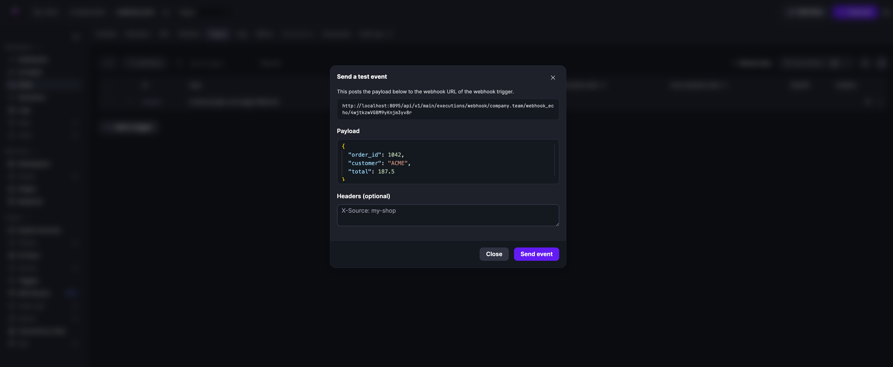

Trigger flows automatically in response to web-based events.

A Webhook trigger generates a unique URL that lets external applications (such as GitHub, Amazon EventBridge, or any system that can send HTTP requests) start new executions in Kestra. Each webhook URL requires a secret `key`. Store the key value in [Kestra Secrets](../../../06.concepts/04.secret/index.md) and reference it from the trigger definition; never hardcode a key directly in the flow YAML. Kestra accepts `GET`, `POST`, and `PUT` requests on the webhook URL.

<div class="video-container">
  <iframe src="https://www.youtube.com/embed/4-KrkkgSeic?si=Ujl09_9Pv5x64YaF" title="YouTube video player" allow="accelerometer; autoplay; clipboard-write; encrypted-media; gyroscope; picture-in-picture; web-share" referrerpolicy="strict-origin-when-cross-origin" allowfullscreen></iframe>
</div>

## Example

```yaml
id: trigger
namespace: company.team

tasks:
  - id: hello
    type: io.kestra.plugin.core.log.Log
    message: "Hello World! 🚀"

triggers:
  - id: webhook
    type: io.kestra.plugin.core.trigger.Webhook
    key: "{{ secret('WEBHOOK_KEY') }}"
```

The `key` is embedded in the webhook URL: `/api/v1/main/executions/webhook/{namespace}/{flowId}/{key}`. To start the flow:

```bash
https://{kestra_domain}/api/v1/main/executions/webhook/{namespace}/{flowId}/{key}
```

Replace `kestra_domain`, `namespace`, `flowId`, and `key` with your values. You can also copy the webhook URL from the **Triggers** tab.

## Handling the request body

By default, the webhook trigger reads the request body and makes it available as `trigger.body`. Use the `fetchType` property to change this behavior.

```yaml
triggers:
  - id: webhook
    type: io.kestra.plugin.core.trigger.Webhook
    key: "{{ secret('WEBHOOK_KEY') }}"
    fetchType: FETCH   # FETCH (default) | STORE | NONE
```

| `fetchType` | Body handling |
|---|---|
| `FETCH` | Body is read into memory and exposed as `trigger.body`. Text, JSON, XML, YAML, CSV, and form-urlencoded bodies are decoded as strings or parsed objects. Binary bodies (any other content type) are base64-encoded. This is the default. |
| `STORE` | Body is streamed directly to internal storage without being held in memory. The flow receives a `kestra://` URI on `trigger.uri`. Use this for large payloads or when you do not want body content written into the execution record. |
| `NONE` | Body is read off the connection and dropped. The flow receives neither `trigger.body` nor `trigger.uri`. |

:::alert{type="info"}
File parts in a `multipart/form-data` request are always stored in internal storage, regardless of `fetchType`.
:::

### Binary and non-text bodies

When a request body has a content type that is not text, JSON, XML, YAML, CSV, or form-urlencoded, `FETCH` base64-encodes it and stores the result in `trigger.body`. Pass `trigger.body` to a script task to decode and process the raw bytes.

```yaml
id: webhook_binary_body
namespace: company.team

tasks:
  - id: log_body
    type: io.kestra.plugin.core.log.Log
    message: "base64={{ trigger.body }}"

triggers:
  - id: webhook
    type: io.kestra.plugin.core.trigger.Webhook
    key: "{{ secret('WEBHOOK_KEY') }}"
    fetchType: FETCH
```

### Stream large bodies to internal storage

With `fetchType: STORE`, the body is streamed to internal storage and the flow receives `trigger.uri` instead of `trigger.body`.

```yaml
id: webhook_store_body
namespace: company.team

tasks:
  - id: log_uri
    type: io.kestra.plugin.core.log.Log
    message: "uri={{ trigger.uri }}"

  - id: measure_body
    type: io.kestra.plugin.core.storage.Size
    uri: "{{ trigger.uri }}"

triggers:
  - id: webhook
    type: io.kestra.plugin.core.trigger.Webhook
    key: "{{ secret('WEBHOOK_KEY') }}"
    fetchType: STORE
```

:::alert{type="warning"}
When `fetchType: STORE`, the body is never deserialized. `when` conditions that reference `trigger.body` will not work; filter on headers or query parameters instead.
:::

### File uploads with multipart/form-data

When a request arrives as `multipart/form-data`, file parts are stored in internal storage and exposed on `trigger.parts`. Text fields are exposed on `trigger.formFields`. This works regardless of `fetchType`.

Each entry in `trigger.parts` has the following shape:

```yaml
trigger:
  parts:
    - name: photo
      filename: result.jpg
      contentType: image/jpeg
      size: 20345
      uri: kestra:///company/team/executions/5cVhZ…/webhook/0/result.jpg
  formFields:
    note:
      - "looks good"
```

Flow that receives a file upload and measures its size:

```yaml
id: webhook_multipart
namespace: company.team

tasks:
  - id: log_parts
    type: io.kestra.plugin.core.log.Log
    message: "parts={{ trigger.parts }} fields={{ trigger.formFields }}"

  - id: measure_upload
    type: io.kestra.plugin.core.storage.Size
    uri: "{{ trigger.parts[0].uri }}"

  - id: log_size
    type: io.kestra.plugin.core.log.Log
    message: "size={{ outputs.measure_upload.size }}"

triggers:
  - id: webhook
    type: io.kestra.plugin.core.trigger.Webhook
    key: "{{ secret('WEBHOOK_KEY') }}"
```

Stored bytes are scoped to the execution and purged with it. If no execution is created (for example, because a `when` condition vetoed the request), stored bytes are cleaned up automatically.

## Pass request data to scripts through environment variables

Anyone who has the webhook URL can call it without signing in to Kestra; the `key` is the only check. Treat everything the caller sends (`trigger.body`, `trigger.headers`, `trigger.parameters`, `trigger.formFields`) as untrusted input.

In script tasks, Kestra renders expressions in `commands`, `beforeCommands`, `script`, and `interpreter` before the interpreter runs, so a request value written there becomes part of the code. With the shell `Commands` task below, a body of `{"name": "$(id)"}` runs the `id` command, even inside double quotes:

```yaml
# Unsafe: the request body becomes shell code
- id: greet
  type: io.kestra.plugin.scripts.shell.Commands
  commands:
    - echo "Hello {{ trigger.body.name }}"
```

Pass the value through `env` instead. The interpreter receives it as data and never parses it as code:

```yaml
- id: greet
  type: io.kestra.plugin.scripts.shell.Commands
  env:
    NAME: "{{ trigger.body.name }}"
  commands:
    - echo "Hello $NAME"
```

The same applies to other languages: in a Python `Script`, read the value with `os.environ["NAME"]` rather than writing `{{ trigger.body.name }}` into the script. To pass a whole JSON body, set `BODY: "{{ trigger.body | toJson }}"` and parse it in the script. Never wrap request data in the `render()` function, which evaluates any expression the caller sends.

See [Security hardening](../../../security-hardening/index.md#webhook-endpoints) for how to protect the webhook endpoint itself.

## Filtering webhook executions with `when`

Use the `when` property to conditionally fire the trigger based on the request body or headers. The `when` value is a [Pebble expression](../../../expressions/index.mdx) evaluated against the incoming request. If the expression evaluates to a falsy value, Kestra ignores the request and no execution is created.

```yaml
triggers:
  - id: webhook
    type: io.kestra.plugin.core.trigger.Webhook
    key: "{{ secret('WEBHOOK_KEY') }}"
    when: "{{ trigger.body.hello == 'world' }}"
```

### Filtering on headers

`trigger.headers` maps each header name to a **list** of values, so use `contains` rather than `==` when filtering:

```yaml
triggers:
  - id: webhook
    type: io.kestra.plugin.core.trigger.Webhook
    key: "{{ secret('WEBHOOK_KEY') }}"
    when: "{{ trigger.headers['X-GitHub-Event'] contains 'push' }}"
```

Header names are matched by the exact casing the sender used. HTTP/2 clients and many proxies canonicalize headers to lowercase, so `trigger.headers['X-GitHub-Event']` finds nothing when the client sends `x-github-event`. Check your client's behavior and match the case accordingly.

You can combine body and header criteria in a single expression using `and` / `or`:

```yaml
triggers:
  - id: webhook
    type: io.kestra.plugin.core.trigger.Webhook
    key: "{{ secret('WEBHOOK_KEY') }}"
    when: "{{ trigger.body.event == 'push' and trigger.headers['X-GitHub-Event'] contains 'push' }}"
```

## Webhook response

By default, the trigger responds immediately without waiting for the flow to finish. Set `wait: true` to hold the HTTP connection open until the execution completes (or the trigger's timeout is reached), and `returnOutputs: true` to include the flow outputs as a JSON object in the response body.

```yaml
triggers:
  - id: webhook
    type: io.kestra.plugin.core.trigger.Webhook
    key: "{{ secret('WEBHOOK_KEY') }}"
    wait: true
    returnOutputs: true
```

- `wait: true` keeps the HTTP connection open until the flow finishes or the trigger's timeout is reached.
- `returnOutputs: true` returns the flow outputs as the HTTP response body.

## Return flow outputs in the webhook response

To send task outputs back to the caller in the HTTP response, configure the Webhook trigger to wait for the execution and return outputs. The flow must expose at least one `outputs` entry.

```yaml
id: webhook_return_outputs
namespace: company.team

tasks:
  - id: make_payload
    type: io.kestra.plugin.core.output.OutputValues
    values:
      result: "Hello {{ trigger.parameters.name[0] ?? 'world' }}!"

outputs:
  - id: greeting
    type: STRING
    value: "{{ outputs.make_payload.values.result }}"

triggers:
  - id: webhook
    type: io.kestra.plugin.core.trigger.Webhook
    key: "{{ secret('WEBHOOK_KEY') }}"
    wait: true
    returnOutputs: true
    responseContentType: application/json   # sets the Content-Type header only; body is always the JSON outputs map
```

- Call the webhook URL with a query parameter (for example `?name=Alice`). The execution runs synchronously because `wait: true` is set.
- The HTTP response body contains the flow outputs as a JSON object. With the example above, the response includes `"greeting": "Hello Alice!"`.
- `responseContentType` sets the `Content-Type` header on the response. It does not change how the body is serialized: the body is always the JSON-serialized outputs map when `returnOutputs: true` is set.

## Customize the webhook response

:::badge{version=">=2.1" editions="OSS,EE,Cloud"}
:::

Some services only accept a webhook URL after it answers a verification request with a specific status code, header, or body. Use these properties to control what the caller receives:

| Property | Effect | Default |
|---|---|---|
| `responseCode` | HTTP status code of the response. | `200`, or `500` when `wait: true` is set and the execution fails |
| `responseHeaders` | Map of header names to values added to the response. | No extra headers |
| `responseBody` | String sent as the response body. Cannot be combined with `returnOutputs`. | The execution details, or the flow outputs with `returnOutputs: true` |
| `responseContentType` | `Content-Type` header of the response: `application/json` or `text/plain`. A `Content-Type` set in `responseHeaders` takes precedence. | `application/json` |

All four properties apply whether or not the trigger waits for the execution. `responseCode`, `responseHeaders`, and `responseBody` accept expressions:

- Without `wait`, they are rendered as soon as the execution is created, and the caller gets the response right away. Expressions can use the trigger variables (`trigger.body`, `trigger.headers`, `trigger.parameters`) and `execution.id`.
- With `wait: true`, they are rendered after the execution finishes, so expressions can also use task and flow outputs. Set `wait: true` whenever an expression reads `outputs`.

If an expression cannot be rendered, the webhook responds with `500`.

<!-- TODO(runtime): with wait: false, does a responseCode that reads outputs now fail with 500? Before 2.1 it was ignored on immediate responses. If so, add it to the 2.1 migration notes. -->

### Answer a verification request

Meta (WhatsApp, Instagram, Messenger) verifies a webhook URL with a `GET` request carrying a `hub.challenge` query parameter, and expects the challenge value back as a plain-text body with status `200`. Later event notifications arrive without that parameter:

```yaml
id: meta_webhook
namespace: company.team

tasks:
  - id: process_event
    type: io.kestra.plugin.core.log.Log
    message: "Received Meta webhook event"

triggers:
  - id: webhook
    type: io.kestra.plugin.core.trigger.Webhook
    key: "{{ secret('WEBHOOK_KEY') }}"
    responseCode: 200
    responseHeaders:
      Content-Type: text/plain
    responseBody: "{{ trigger.parameters['hub.challenge'][0] ?? 'EVENT_RECEIVED' }}"
```

- A verification request (`?hub.mode=subscribe&hub.challenge=1158201444`) gets `1158201444` back as the body.
- An event notification gets `EVENT_RECEIVED` back.
- The trigger does not wait for the execution, so Meta gets its response immediately, however long the flow takes.
- Meta also sends the verify token you registered as `hub.verify_token`. This flow does not check it; the webhook `key` is what protects the URL.

Microsoft Graph works the same way with a `validationToken` query parameter. Set `responseContentType: text/plain` and `responseBody: "{{ trigger.parameters.validationToken[0] ?? 'notification processed' }}"`.

Set `Content-Type: text/plain`, through `responseHeaders` or `responseContentType`, whenever `responseBody` is not JSON.

<!-- TODO(runtime): confirm how a responseBody string is sent when no Content-Type is set (raw or as a quoted JSON string). The response falls back to Micronaut's application/json default, and the PR tests only cover text/plain. -->

### Return a header to the caller

Asana confirms a new webhook by sending an `X-Hook-Secret` header and expects the same header back in the response. Use `responseHeaders` to echo it:

```yaml
id: asana_webhook
namespace: company.team

tasks:
  - id: process_event
    type: io.kestra.plugin.core.log.Log
    message: "Received Asana webhook event"

triggers:
  - id: webhook
    type: io.kestra.plugin.core.trigger.Webhook
    key: "{{ secret('WEBHOOK_KEY') }}"
    responseHeaders:
      X-Hook-Secret: "{{ trigger.headers['X-Hook-Secret'][0] ?? '' }}"
```

`trigger.headers` maps each header name to a list of values, so the expression reads the first one. Header names keep the casing the sender used; see [Filtering on headers](#filtering-on-headers). Each response header takes a single value.

<!-- TODO(runtime): confirm Asana accepts the handshake with this flow, and that an empty X-Hook-Secret header on event notifications causes no issue. -->

:::alert{type="warning"}
The response is sent to anyone who calls the webhook URL. Do not put secrets in `responseBody` or `responseHeaders`, either directly or through an expression such as `secret()` or `kv()`: they are rendered with the flow's secrets available, and the result is returned to the caller as is.
:::

Request values that end up in the response are not evaluated again, so a caller who sends an expression such as `{{ ... }}` in a parameter gets that text back unchanged.

## Test a webhook trigger

The **Triggers** tab on the flow page includes a **Send a test event** button for testing without an external tool. The modal accepts a custom JSON payload and optional headers:



See the [Webhook trigger plugin documentation](/plugins/core/trigger/io.kestra.plugin.core.trigger.webhook) for a full list of properties and outputs.
