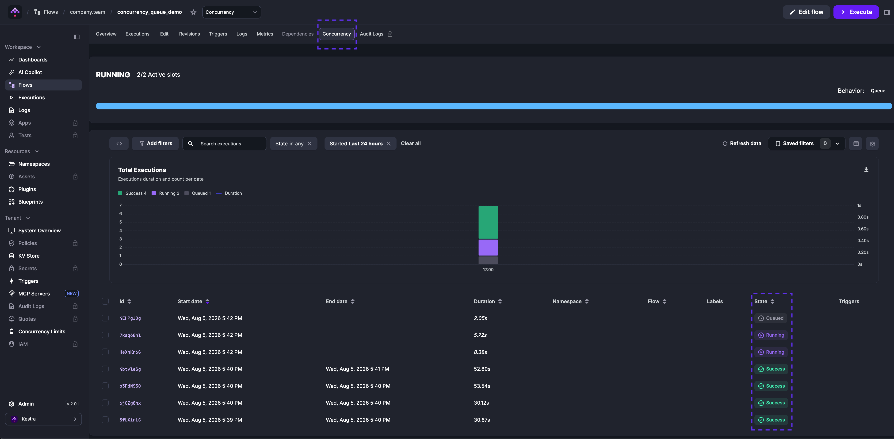
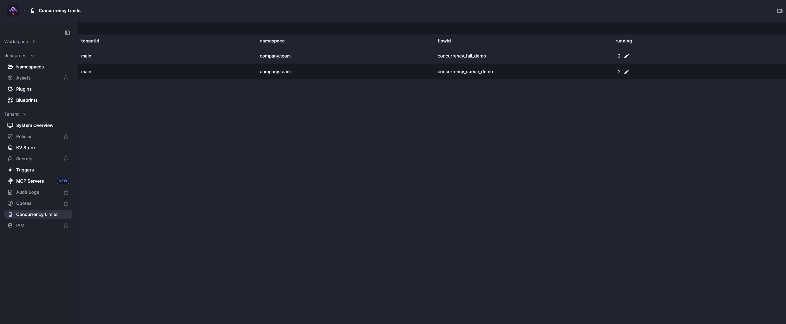
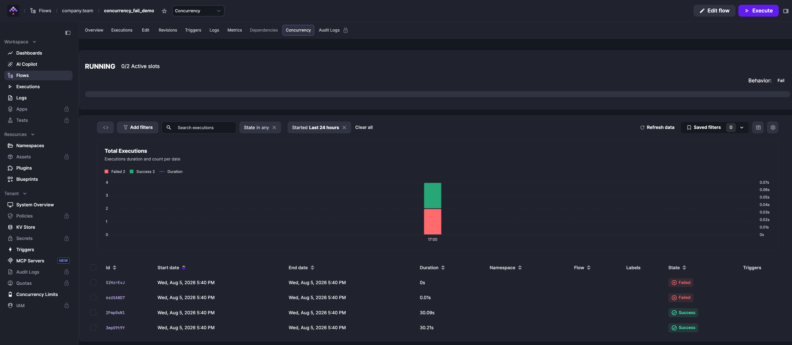
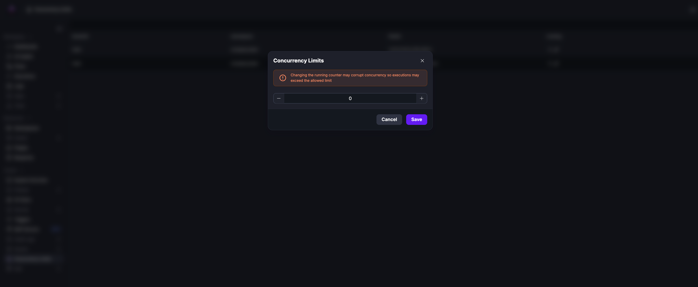

Concurrency limits control how many executions can run at the same time, at the flow, namespace, or tenant level. When a limit is reached, new executions are queued, cancelled, or failed depending on the configured `behavior`.

Once an execution occupies a concurrency slot, it keeps that slot until it reaches a terminal state. This includes executions in the `PAUSED` state while they wait for manual approval. For example, with `concurrency.limit` set to 1, a flow paused by a `Pause` task blocks all subsequent executions until the paused execution is resumed, killed, or otherwise reaches a terminal state. Resuming the execution continues to use its existing slot, so it cannot exceed the configured limit.

:::alert{type="info"}
Concurrency limits executions, not the number of tasks a worker runs. Task processing is governed by worker thread pools and task runners. Concurrency uses database locks to hold slots, so heavy contention (many executions competing for the same lock) can increase database load and slow scheduling.
:::

<div class="video-container">
  <iframe src="https://www.youtube.com/embed/lDGOqqMyQEo?si=01KzCswO3dHdhYdt" title="YouTube video player" allow="accelerometer; autoplay; clipboard-write; encrypted-media; gyroscope; picture-in-picture; web-share" referrerpolicy="strict-origin-when-cross-origin" allowfullscreen></iframe>
</div>

## Configuring concurrency

### Flow level

Set `concurrency.limit` on a flow to cap its parallel executions:

```yaml
id: concurrency_example
namespace: company.team

concurrency:
  limit: 2

tasks:
  - id: wait
    type: io.kestra.plugin.scripts.shell.Commands
    taskRunner:
      type: io.kestra.plugin.core.runner.Process
    commands:
      - sleep 10
```

With `limit: 2`, a third execution waits until one of the two running executions completes.

### Namespace level

Set a concurrency limit on a namespace to cap the total simultaneous executions across all flows within that namespace and its children.

Navigate to **Namespaces**, open the target namespace, click **Edit**, and scroll to the **Concurrency** section. Set the **Limit** and choose a **Behavior** (`Queue`, `Cancel`, or `Fail`). The same configuration is also available via the API.

A namespace concurrency limit applies to every flow whose namespace matches or is a child of the configured namespace. For example, a limit on `company` applies to flows in `company`, `company.team`, and `company.team.project`.

### Tenant level

Set a concurrency limit at the tenant level to cap total simultaneous executions across all namespaces in the tenant.

:::alert{type="warning"}
Namespace and tenant limits with `behavior: QUEUE` (the default) can deadlock when flows in that scope start [subflows](../10.subflows/index.md) that run in the same scope, including child namespaces. With `wait: true` (the default), a parent execution keeps its slot while it waits, and the subflow execution needs a slot from the same limit. Once every slot is held by an execution waiting on a queued subflow, no execution in the namespace or tenant can start, including flows that don't use subflows. Kestra reports no error or timeout, and the deadlock does not resolve on its own. To prevent or resolve this, see [Parent executions stuck waiting on queued subflows](#parent-executions-stuck-waiting-on-queued-subflows).
:::

## `behavior` property

By default, executions that exceed the limit are queued. Set `behavior` to control what happens instead:

- `QUEUE`: hold the execution until a slot opens (default).
- `CANCEL`: immediately mark the execution as `CANCELLED`.
- `FAIL`: immediately mark the execution as `FAILED`.

If you expect execution spikes, combine a conservative limit with backoff at the source (e.g., slower trigger rates) to avoid large queues that increase database lock contention.

```yaml
id: concurrency_limited_flow
namespace: company.team

concurrency:
  behavior: FAIL # QUEUE, CANCEL, or FAIL
  limit: 2

tasks:
  - id: wait
    type: io.kestra.plugin.scripts.shell.Commands
    taskRunner:
      type: io.kestra.plugin.core.runner.Process
    commands:
      - sleep 10
```

:::alert{type="warning"}
When an execution starts from a [Trigger](../07.triggers/index.mdx), the trigger locks until it finishes, preventing multiple executions from that trigger from running concurrently. The `behavior` property does not apply in this case; no new executions start while the trigger is locked.

Read more in the [Locked Triggers](../07.triggers/index.mdx#locked-triggers) section.
:::

## Evaluation order

Kestra evaluates concurrency limits from the most specific scope to the most general:

1. **Flow-level** concurrency is checked first.
2. **Namespace-level** concurrency is checked next, starting from the flow's own namespace and moving up through each parent namespace to the root.
3. **Tenant-level** concurrency is checked last.

The first limit reached defines the behavior for that execution. When a more specific limit is reached, no slot is consumed at higher levels.

For example, if a flow defines `limit: 5` with `QUEUE` and its parent namespace defines `limit: 10` with `FAIL`, a sixth execution of that flow is queued (flow-level limit is reached first). If the flow has no limit of its own but the parent namespace is at its limit of 10, the execution fails.

## Monitoring concurrency

### Per-flow Concurrency tab

The **Concurrency** tab on a Flow page shows current slot usage, the configured behavior, and a list of running and queued executions for that flow.



### Concurrency Limits page

The **Concurrency Limits** page under **Tenant** in the sidebar lists every flow, namespace, and tenant concurrency limit configured, along with its live running count. It provides a tenant-wide view of concurrency usage across all scopes.



## Concurrent trigger executions

Any [Trigger](../07.triggers/index.mdx) type supports concurrent executions through the `allowConcurrent` property. By default, `allowConcurrent: false`: while an execution from the trigger is still running, the trigger stays locked and creates no new execution until that execution ends.

```yaml
id: sleep_concurrent
namespace: company.team
tasks:
  - id: sleep
    type: io.kestra.plugin.core.flow.Sleep
    duration: PT60S
triggers:
  - id: schedule
    type: io.kestra.plugin.core.trigger.Schedule
    cron: "* * * * * *"
    withSeconds: true
    allowConcurrent: false
```

Set `allowConcurrent: true` to allow multiple executions to run simultaneously from the same trigger.

## Updating a concurrency limit

Update a concurrency limit when executions are backing up or hitting the limit unexpectedly. Avoid changing limits routinely; a stable limit is a deliberate resource protection decision.

Edit the `concurrency.limit` value directly in the flow editor and save. The executor reads the latest flow revision immediately, so the new limit takes effect for all in-progress executions without a restart.

You can also update the limit from the **Concurrency Limits** page in the sidebar: click the edit icon next to the affected flow, adjust the limit, and save. This applies the change without modifying the flow YAML.

## Troubleshooting concurrency issues

### Check the Concurrency tab

The **Concurrency** tab on the Flow page shows which executions are running, queued, or failed, and which hold slots versus which are waiting.



### Reset a stuck running counter

If executions were deleted while running, their concurrency slots can remain occupied indefinitely. The **Concurrency Limits** page allows manual adjustment of the running counter for affected flows.



:::alert{type="warning"}
Do **not** delete executions to free stuck slots; deleted executions still hold concurrency slots. Instead, select stuck executions and click **Kill** to cancel them and release their slots. Use the counter reset only when slots remain stuck after killing all relevant executions.
:::

### Parent executions stuck waiting on queued subflows

If parent executions stay `RUNNING` on a Subflow task while their subflow executions stay `QUEUED`, a namespace or tenant limit is deadlocked. Each parent holds a slot that its subflow needs, so no execution in that scope starts until a slot frees up. Executions of unrelated flows in the same scope also stay `QUEUED`, and the deadlock does not clear on its own.

On the **Concurrency Limits** page, the running count for the affected namespace or tenant stays at its configured limit, while the number of `QUEUED` executions in that scope keeps growing on the **Executions** page.

To resolve the deadlock, open a queued subflow execution and click **Force run**. A force-run execution starts without taking a concurrency slot. When the subflow completes, its parent completes and releases its slot, and the remaining queued executions start. If the queue does not clear, open a waiting parent execution and click **Kill current and subflows** to release its slot.

To prevent the deadlock, apply one of these changes:

- Set the limit higher than the number of parent executions that can wait on subflows at the same time.
- Set `behavior` to `FAIL` or `CANCEL`. A subflow execution that exceeds the limit then ends immediately instead of queuing, so the problem surfaces as a failed or cancelled execution.
- Set `wait: false` on the Subflow task when the parent does not need the subflow's outputs or final state.
- For a namespace limit, move the subflows to a namespace that the limit does not cover, such as a sibling namespace. Child namespaces count against the parent namespace's limit, so moving subflows into a child namespace does not help.
