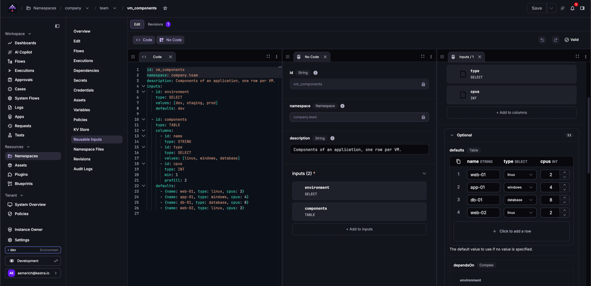

Reusable inputs let you define a named group of typed inputs once at the namespace level and reference them in any flow.

## Define a reusable input set

A reusable input set is defined at the namespace level with an `id`, an optional description, and an `inputs` list structured the same as flow inputs.

```yaml
id: ad_credentials
namespace: company.team
description: Active Directory credentials required by provisioning flows.
inputs:
  - id: username
    type: STRING
    required: true
    displayName: AD Username

  - id: domain
    type: SELECT
    required: true
    values:
      - corp.example.com
      - eu.example.com

  - id: password
    type: SECRET
    required: true
    displayName: AD Password
```

The set's `id` must start with a letter or digit and may contain letters, digits, dots, hyphens, and underscores. All flow input types are valid inside a set, including `FORM` groups and [`TABLE`](../05.inputs/index.md#table-inputs) inputs.

Each time you save, Kestra stores a new revision.

## Edit a set in the UI

:::badge{version=">=2.1" editions="EE,Cloud"}
:::

Open a namespace and select the **Reusable Inputs** tab. The list shows each set visible from the namespace, including sets inherited from parent namespaces, with its latest revision. Click **Add reusable inputs** to create a set, or open a set's row menu and select **Edit**.

Each set opens on its own editor page, laid out like the flow editor, with **Edit** and **Revisions** tabs. On the **Edit** tab, the **Code** panel holds the set's YAML, and the **No Code** panel lists the set's inputs. Select an input to open its form in a new panel, with the same fields as for flow inputs. Changes in one panel appear in the other.



The editor validates the set while you edit it and shows each error in the validation status of the editor bar. **Undo** and **Redo** in the editor bar cover every change made in either panel until you save. `Ctrl+Z` and `Ctrl+Shift+Z` also work outside a text field.

The `id` and `namespace` of a set can't be changed once it's created. To save a set under another `id` or in another namespace, [duplicate it](#duplicate-or-delete-a-set).

### Edit TABLE defaults in a grid

In the **No Code** panel, a `TABLE` input's `columns` are edited as a list of inputs, and its `defaults` are edited in a grid. The grid works the same way as in the Execute modal, including the row menu and copying and pasting rows from Excel. See [Edit rows in the grid](../05.inputs/index.md#edit-rows-in-the-grid).

The editor grid adds a few behaviors:

- Click a column header to open that column's form.
- Renaming a column renames it in every row, and a new column is added to every row with an empty value.
- An empty cell is stored as `null`, which is different from `0` or `""`.
- When the input has [filters](../05.inputs/index.md#filter-rows-by-other-inputs), the grid still shows every row, with a note below it explaining that only the matching rows are shown at execution.
## Save a set as a draft

:::badge{version=">=2.1" editions="EE,Cloud"}
:::

Save a draft to keep unfinished work without affecting flows. **Save** is the default action in the editor bar, and **Save as draft** is in its dropdown.

- **Save** is refused while the set has validation errors, and the message names the first error.
- **Save as draft** stores the set even when it's invalid.

Executions use the latest revision of a set that isn't a draft. When the latest revision is a draft, the editor shows a banner naming the revision that flows use instead, and the Reusable Inputs list marks the set with a **Draft** tag.

A set whose revisions are all drafts can't be used yet. Saving a flow that references it fails with:

```text
Reusable inputs 'servers' in namespace 'company.team' only have draft revisions, so save a revision that isn't a draft to use them.
```

Kestra doesn't fall back to a set with the same `id` in a parent namespace in this case, since the flow would run with different inputs.

## Review and restore revisions

:::badge{version=">=2.1" editions="EE,Cloud"}
:::

The **Revisions** tab lists every revision of the set, with who saved it, when, and whether it's a draft. Compare two revisions side by side, or restore an earlier one. A restored revision is saved as a new revision, so the history is kept.

If someone else saves the set while you're editing it, the validation status warns that your revision is outdated, and a banner above the editor bar names the newer revision, who saved it, and when. Your unsaved changes are kept until you choose one of the banner's actions:

- **Compare** opens both revisions in the **Revisions** tab.
- **Discard my changes and reload** loads the newer revision.

If you save instead, Kestra asks you to confirm before overwriting the newer revision.

## Duplicate or delete a set

:::badge{version=">=2.1" editions="EE,Cloud"}
:::

Open a set's row menu in the Reusable Inputs list:

- **Duplicate** asks for an `id` and a target namespace, then copies the set's latest revision as revision 1 of a new set. You can duplicate sets inherited from a parent namespace.
- **Delete** removes the set. It's disabled for an inherited set, which can only be deleted in its own namespace.

## Reference a set in a flow

The `REUSABLE_INPUTS` input type accepts a `ref` property naming the set to include. Kestra expands the set's inputs inline before execution starts, prefixing each child input id with the reference id (`<refId>.<childId>`).

```yaml
id: provision_ad_account
namespace: company.team

inputs:
  - id: environment
    type: SELECT
    values: [staging, production]

  - id: ad
    type: REUSABLE_INPUTS
    ref: ad_credentials

tasks:
  - id: log
    type: io.kestra.plugin.core.log.Log
    message: |
      User: {{ inputs.ad.username }}
      Domain: {{ inputs.ad.domain }}
```

The set expands into three inputs (`ad.username`, `ad.domain`, and `ad.password`) available alongside `environment` in the execution form.

### Access input values

Reference each child input as `{{ inputs.<refId>.<childId> }}`, where `refId` is the `id` of the `REUSABLE_INPUTS` input in the flow and `childId` is the `id` from the set definition.

```
{{ inputs.ad.username }}
{{ inputs.ad.domain }}
{{ inputs.ad.password }}
```

## Set properties

| Property | Required | Description |
| --- | --- | --- |
| `ref` | Yes | The `id` of the reusable input set to include. |
| `namespace` | No | Namespace where the set is defined. Defaults to the flow's own namespace. Resolution walks the hierarchy; a set in a parent namespace is available to child namespaces. |
| `revision` | No | Integer revision to pin. Omit to use the latest revision that isn't a draft at execution time. |

### Pin a specific revision

The `revision` property pins the set to a specific saved version. When omitted, the latest revision that isn't a draft is used at execution time. A pinned revision is used even if it's a draft, unless the draft has no inputs, in which case execution creation fails.

```yaml
inputs:
  - id: ad
    type: REUSABLE_INPUTS
    ref: ad_credentials
    revision: 3
```


### Use a set from a parent namespace

A set defined in `company` is available to any flow in `company`, `company.team`, `company.team.infra`, and any other descendant namespace. If a child namespace defines a set with the same `id`, the child's definition takes precedence over the parent's. To use a set from a different branch of the hierarchy, set `namespace` explicitly:

```yaml
inputs:
  - id: ad
    type: REUSABLE_INPUTS
    ref: ad_credentials
    namespace: company
```

## RBAC

The `REUSABLE_INPUTS` resource controls who can manage reusable input sets. Flows that reference a set require only normal flow-execution permissions; the expansion happens server-side before the execution form is rendered.

| Role | Permissions |
| --- | --- |
| Viewer | View, list |
| Launcher | View, list |
| Editor | View, list, create, update, delete |
| Admin | All actions |

## Audit logs

Kestra records an audit log entry for every create, update, and delete operation on a reusable input set. Each entry includes the set `id`, `namespace`, and revision. Filter by resource type `REUSABLE_INPUTS` in the **Audit Logs** page to see who changed a set and when.

## Manage sets with the API

The [Kestra API](../../api-reference/index.mdx) manages sets under `/api/v1/{tenant}/namespaces/{namespace}/reusable-inputs`. Send the set's YAML to `PUT .../reusable-inputs/{id}` to create or update it. Add `?draft=true` to save the revision as a draft, which is stored even when it's invalid. Without it, an invalid set returns `422` with the first error.

`GET .../reusable-inputs/{id}` and the list endpoint return the revision an execution would use, the latest that isn't a draft. Add `?allowDraft=true` to include drafts. To check a set without saving it, send its YAML to `POST .../reusable-inputs/{id}/validate`.

You can also manage sets with [`kestractl reusable-inputs`](../../kestra-cli/kestractl/index.md#reusable-inputs-enterprise-edition).

<!-- TODO(2.1): document the io.kestra.plugin.kestra.ee.reusableinputs Set, List, and Delete tasks once they can be verified against the plugin-kestra 2.1 release. -->

## Validation

Kestra checks a referenced set when you save a flow. Saving fails with a `422` if the set doesn't exist in the flow's namespace or any of its parent namespaces, or if all of its revisions are drafts:

```text
Invalid Flow: Input 'ad': reusable inputs 'ad_credentials' were not found in namespace 'company.team' (nor in any of its parent namespaces).
```

If the set is deleted after the flow is saved, execution creation fails with an error naming the missing set.

A reusable input set's inputs are expanded in a single pass. If a set's inputs list contains a `REUSABLE_INPUTS` entry, that nested reference is not recursively expanded and the execution form will fail to render it correctly. Keep set definitions flat.
