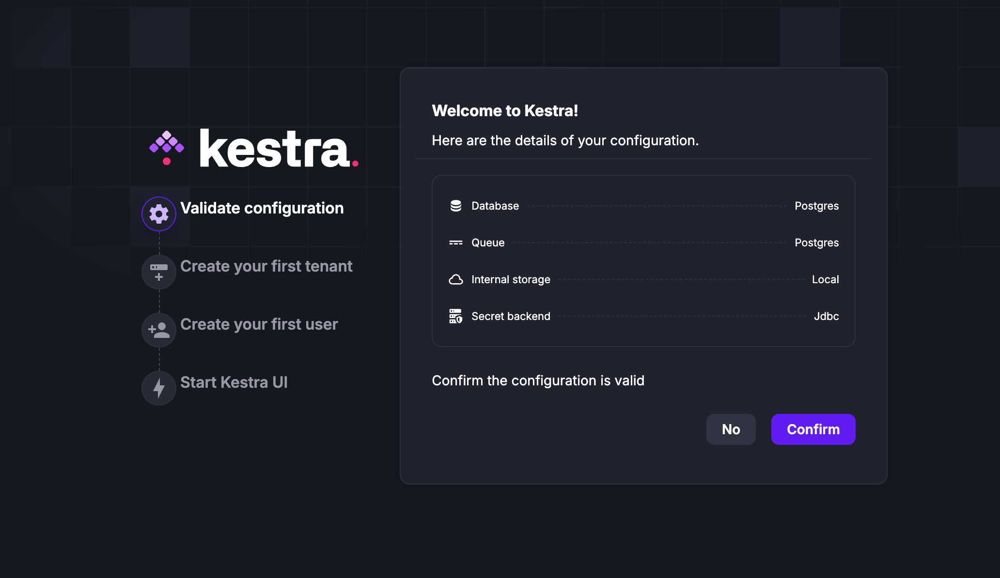
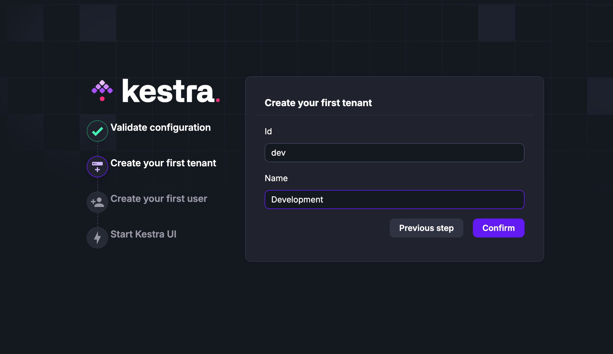
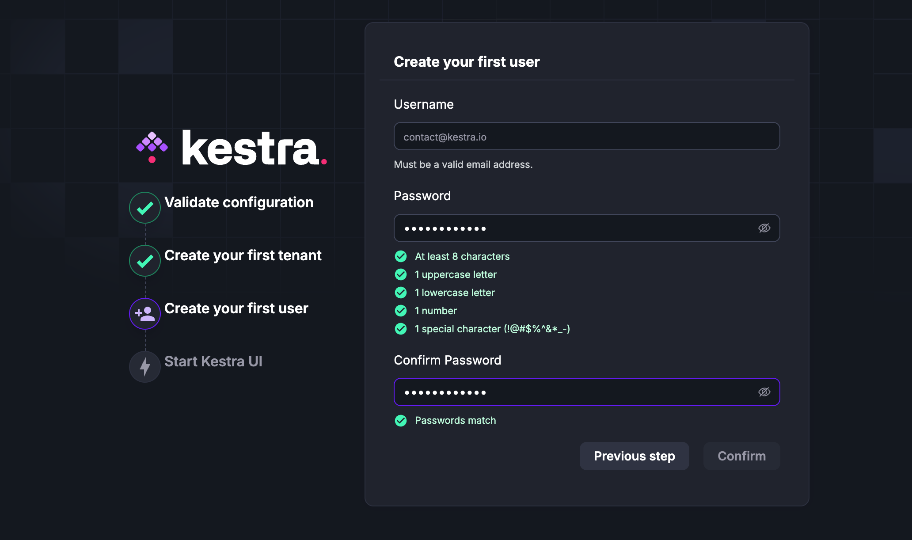
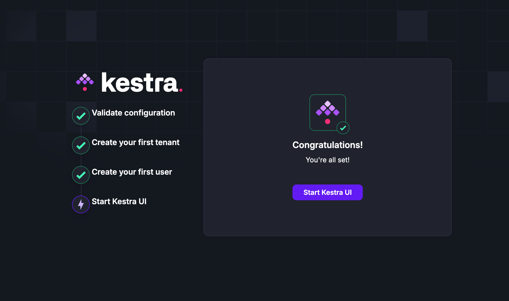

When you launch Kestra Enterprise Edition for the first time, Kestra walks you through configuring your instance: setting up your first tenant, choosing a retention policy, creating your first user, and starting the Kestra UI.

## Prerequisites

Kestra Enterprise Edition requires a valid license under `kestra.ee.license`. Contact [sales@kestra.io](mailto:sales@kestra.io) to obtain one.

The license is set up using three configuration properties: `id`, `fingerprint`, and `key`.

- `kestra.ee.license.id`: license identifier.
- `kestra.ee.license.fingerprint`: license authentication. This is required to use [Versioned Plugins](../../05.instance/versioned-plugins/index.md).
- `kestra.ee.license.key`: license key.

```yaml
kestra:
  ee:
    license:
      id: <LICENSE ID>
      fingerprint: <LICENSE FINGERPRINT>
      key: |
        <LICENSE KEY>
```

When you launch Kestra Enterprise Edition, it will check the license and display the validation step in the log.

## Step 1: Validate configuration

The first screen shows the main configuration of your instance. It displays:
- whether `multitenancy` is enabled
- whether `default tenant` is enabled — if yes, you can skip Step 2 allowing you to create your first tenant
- which `database` backend is configured (e.g., PostgreSQL or Elasticsearch)
- which `queue` backend is configured (e.g., PostgreSQL or Kafka)
- which `internal storage` backend is configured (e.g., S3, GCS, Azure Blob Storage, an S3-compatible store, or local storage)
- which `secret` backend is configured (e.g., Vault, AWS Secrets Manager, Elasticsearch, or not set up yet)



This step asks you to confirm whether your configuration is valid. If not, you can correct the configuration, restart the instance, and start the setup from scratch.

## Step 2: Create your first tenant

If `multitenancy` is enabled, Kestra will prompt you to create your first tenant. Enter a Tenant ID and Tenant Name, for example:
- tenant id: `stage`
- tenant name: `Staging Environment`

If you enabled a default tenant, you can skip this step.




## Step 3: Choose a retention policy

Executions, logs, metrics, and output files accumulate with every run. This step generates a daily flow that purges them, so the instance doesn't slow down as the database and storage grow.

<!-- TODO(runtime test): retention step written from kestra-ee#11845 source (merged 2026-11-10). Check the screens and the generated flow on an EE image built after that date, and confirm how Cloud tenants get a retention flow. -->

Set how long to keep each kind of data:

- **Keep executions for**: the number of days a finished execution is kept, with its metrics and output files.
- **Keep logs for**: the number of days execution logs and trigger logs are kept.

Both start at 90 days. Select **Keep forever** to keep one of them indefinitely. Turn on **Keep failed executions forever** to never purge `FAILED` executions and their logs. Executions that haven't finished, such as running or paused ones, are never purged.

Click **Save** to generate the `retention` flow in the [system flows](../../../06.concepts/system-flows/index.md) namespace of your first tenant. The values also become the instance's default policy, which the tenant creation wizard starts from. You can change the flow later in the flow editor or through Git. See [Default retention flow](../../../10.administrator-guide/purge/index.md#default-retention-flow) for what it purges.

Click **Skip** to set up purging yourself, for example from the purge blueprint. No flow and no default policy are created.

Kestra hides this step when a flow in the `main` tenant already uses `PurgeExecutions` or `PurgeLogs`.

## Step 4: Create your first user

Create the first user. This user receives the [Instance Owner](../../03.auth/rbac/index.md#instance-owner) privilege and can manage tenants, users, and roles across the instance.



## Step 5: Start Kestra UI

Once your tenant and user are configured, Kestra will launch the UI and log you into your new tenant as the first user.


