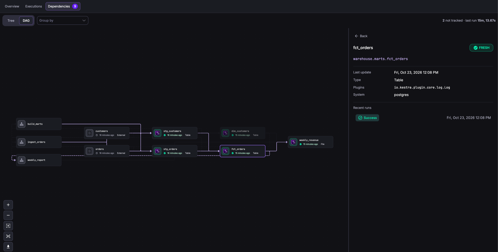
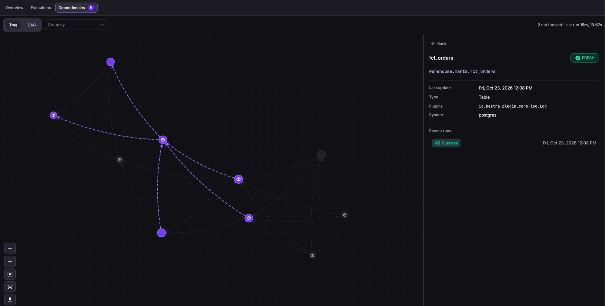

This reference covers the Assets pages in the UI, the dependencies graph, locking, and the API and `kestractl` commands that do the same work.

Most assets come from flows. Use the UI, the API, or `kestractl` to inspect them, to register resources that no flow manages, and to fix metadata by hand.

## Assets list

Open **Assets** in the left navigation to list every asset you can see in the tenant. The list shows each asset's ID, display name, type, namespace, and metadata, and you can filter it by ID, namespace, type, metadata, and lock status.

To register an asset, select **Create Asset**. Enter an ID, choose a type or type a custom one, and optionally set a namespace, display name, description, and metadata. Kestra rejects an ID that another asset already uses.

Assets also appear in context:

- The **Assets** tab of a namespace lists the assets in that namespace.
- The **Assets** tab of an execution lists the assets its tasks read and wrote.

## Asset detail page

Select an asset to open its detail page. It has three tabs:

| Tab | Shows |
| --- | --- |
| **Overview** | Description, metadata (**Asset Values**), **Upstream Assets**, **Downstream Assets**, and the **Flows** that read or write the asset. Shows the lock holder and expiry when the asset is locked. |
| **Executions** | Every execution that used the asset as an input or an output, linked to the execution page |
| **Dependencies** | The dependencies graph centered on the asset |

Use **Edit** to change the display name, description, namespace, type, or metadata. You can't change the ID. To delete the asset, open the **⋮** menu and select **Delete**. Deleting emits a `DELETED` event to any [`EventTrigger`](../02.tasks-and-triggers/index.md#eventtrigger).

## Explore the dependencies graph

The **Dependencies** tab draws assets and flows as nodes. An edge from an asset to a flow means the flow reads the asset. An edge from a flow to an asset means the flow writes it. An edge between two assets means a task read the first and wrote the second.

### Layouts

Switch between two layouts with the **Tree** and **DAG** toggle in the graph toolbar.

**DAG** places nodes left to right by dependency depth, with the flows that read and write the assets in the first column. Each asset node shows its type, how long ago it was last written, and its freshness. The layout is the same on every load, so use it for screenshots and reviews.



**Tree** uses a force-directed layout that spreads dense graphs out. It draws nodes as icons without labels, and highlights the edges connected to the selected node.



### Freshness states

Each asset node shows a freshness state based on the latest execution that wrote it. A summary above the graph counts the nodes in each state.

| State | Meaning |
| --- | --- |
| **Fresh** | The latest write happened within the producing flow's schedule cadence, plus a grace period. |
| **Stale** | The latest write is older than the cadence plus the grace period. |
| **Failed** | The latest producing execution ended in `FAILED`, `KILLED`, or `CANCELLED`. |
| **Not tracked** | Kestra can't compute a cadence, or no producing execution is recorded. |

Kestra reads the cadence from the cron expression of the producing flow's [`Schedule` trigger](../../../../05.workflow-components/07.triggers/01.schedule-trigger/index.md). The grace period is a quarter of the cadence, capped at two hours. Kestra can only compute a cadence for nicknames such as `@daily` and for crons that set only the minute and hour fields. An asset produced by a flow without a `Schedule` trigger, or with a cron that sets the day, month, or weekday, shows **Not tracked**.

These states are for display only. To act on stale assets, use [`FreshnessTrigger`](../02.tasks-and-triggers/index.md#freshnesstrigger), which applies its own `maxStaleness` threshold.

### Group by

Use **Group by** to cluster asset nodes:

| Option | Groups by |
| --- | --- |
| **Dataset** | The `schema` metadata key, or the second-to-last segment of a dotted ID such as `analytics.marts.fct_orders` |
| **Type** | The last segment of the asset type |
| **Plugins** | The plugin of the task that produced the asset, for example `jdbc` or `dbt` |
| **System** | The `system` metadata key |
| **Namespace** | The asset or flow namespace |

Hover a group to fade the other nodes. Select it to keep it highlighted, and select it again or select an empty area to release it.

### Node details

Select a node to open a side panel with the asset's name and ID, its freshness state, when it was last written, its type, the task type that produced it (**Plugins**), its `system`, and its recent runs linked to their executions. Double-click a node to open its detail page.

## Lock an asset

A lock blocks writes to an asset for a limited time. Reads are never blocked. Use locks to protect a resource during maintenance or while one execution changes it.

There are two kinds of lock:

| Owner | Created by | Blocks |
| --- | --- | --- |
| Execution | The [`Acquire` task](../02.tasks-and-triggers/index.md#acquire-and-release), or the API with an execution ID | Writes from every other execution, the UI, and the API. The owning execution can still write, and each write extends the lock. |
| User | The UI, or the API without an execution ID | Writes from every execution, including executions the locking user starts, and edits by other users through the UI and the API. The user who holds the lock can still edit and delete the asset. |

To lock an asset in the UI, open the **⋮** menu on its detail page, select **Lock**, and choose a duration from 5 minutes to 24 hours, or **Custom** for any ISO 8601 duration. The detail page then shows who holds the lock and until when, with the banner *You might be seeing outdated metadata as this asset is currently locked for writing.* Select **Unlock** to release it. A user with the `UNLOCK` permission can release any lock, whatever its owner.

How a lock affects each write path:

| Write path | Result while another owner holds the lock |
| --- | --- |
| Task `assets.outputs`, emitted assets, typed inputs | The write is skipped and the task's [failure behavior](../01.declare-assets/index.md#failure-behavior) applies. `WARN`, the default, sets a successful task to `WARNING`. |
| UI edit or delete, API update or delete | Rejected with HTTP 423, unless the user holds the lock |
| `PurgeAssets` and purge by query | The locked asset is skipped. The rest are purged. |

Locks expire on their own. Deleting an asset also removes its lock.

## Automate with the API

The Assets API is available at `/api/v1/{tenant}/assets`. Create and update requests take the asset as a YAML body.

| Method and path | Action | Permission |
| --- | --- | --- |
| `POST /assets` | Create an asset. Returns 409 if the ID exists. | `ASSET:CREATE` |
| `PUT /assets/{id}` | Update an existing asset with the same [update rules](../01.declare-assets/index.md#update-rules) as a flow write. Returns 404 if it doesn't exist. | `ASSET:UPDATE` |
| `GET /assets/{id}` | Get one asset | `ASSET:VIEW` |
| `GET /assets/search` | Search assets with query filters | `ASSET:LIST` |
| `GET /assets/{id}/dependencies` | Get the dependencies graph of one asset | `ASSET:VIEW` |
| `DELETE /assets/{id}` | Delete one asset | `ASSET:DELETE` |
| `DELETE /assets/by-ids` | Delete several assets by ID | `ASSET:DELETE` |
| `DELETE /assets/by-query` | Delete assets that match query filters. Add `purge=true` to hard-delete. | `ASSET:DELETE` |
| `POST /assets/{id}/lock` | Lock an asset | `ASSET:LOCK` |
| `DELETE /assets/{id}/lock` | Unlock an asset | `ASSET:UNLOCK` |
| `GET /assets/usages/search` | Search the usage records that link assets to executions | `ASSET:LIST` |
| `DELETE /assets/usages/by-query` | Hard-delete usage records | `ASSET:DELETE` |
| `GET /assets/lineage-events/search` | Search lineage events | `ASSET:LIST` |
| `DELETE /assets/lineage-events/by-query` | Hard-delete lineage events | `ASSET:DELETE` |

For namespaced assets, the permission must cover the asset's namespace. This request registers a table that no flow manages:

```bash
curl -X POST "https://kestra.example.com/api/v1/main/assets" \
  -H "Authorization: Bearer $KESTRA_API_TOKEN" \
  -H "Content-Type: application/x-yaml" \
  --data-binary @- <<'EOF'
id: finance.general_ledger
namespace: company.finance
type: io.kestra.plugin.ee.assets.Table
displayName: General ledger
metadata:
  system: oracle
  owner: finance-platform
EOF
```

For request and response schemas, see the [Enterprise API reference](../../../../api-reference/01.enterprise/index.mdx).

## Automate with kestractl

`kestractl assets` wraps the same endpoints:

```bash
# Register an asset from a YAML file
kestractl assets create --file general-ledger.yaml

# Inspect assets and their dependencies
kestractl assets list --output json
kestractl assets get finance.general_ledger
kestractl assets dependencies finance.general_ledger --expand-all

# Delete assets
kestractl assets delete finance.general_ledger
kestractl assets delete-by-query --namespace company.finance --purge
```

See [kestractl assets commands](../../../../kestra-cli/kestractl/index.md#assets-enterprise-edition) for every command and flag.

## Permissions

Asset access uses the `ASSET` RBAC resource with the actions `VIEW`, `LIST`, `CREATE`, `UPDATE`, `DELETE`, `LOCK`, and `UNLOCK`. Namespace-scoped grants apply to assets in those namespaces. Global assets aren't restricted by namespace. See the [ASSET permissions reference](../../../03.auth/rbac/permissions-reference/index.md).
