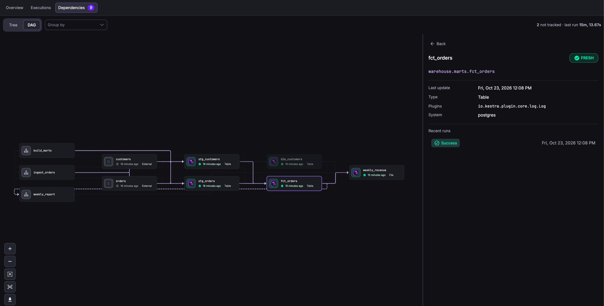
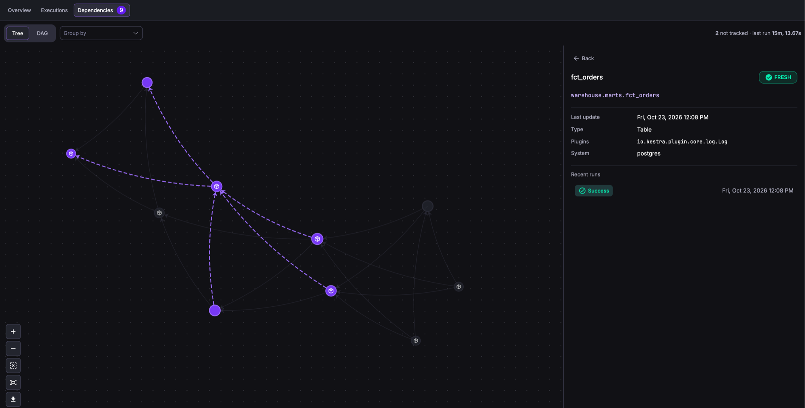

This reference covers the Assets pages in the UI, the dependencies graph, locking, and the API and [`kestractl`](../../../../kestra-cli/kestractl/index.md#installation) commands that do the same work.

Most assets come from flows. Use the UI, the API, or `kestractl` to inspect them, to register resources that no flow manages, and to fix metadata by hand.

## Assets list

Open **Assets** in the left navigation to list every asset you can see in the tenant. The list shows each asset's ID, display name, type, namespace, and metadata, and you can filter it by ID, namespace, type, metadata, and lock status.

To register an asset, select **Create Asset**. Enter an ID, choose a type or type a custom one, and optionally set a namespace, display name, description, status, TTL, owner, and metadata. Kestra rejects an ID that another asset already uses.

In the same dialog, set a **Parent** to make the asset part of another one, and select **Add relationship** to link it to other assets or flows:

| Relationship | Links the asset to | Stored as |
| --- | --- | --- |
| **Upstream of** | An asset this one feeds | `UPSTREAM_OF`, from this asset |
| **Downstream of** | An asset that feeds this one | `UPSTREAM_OF`, to this asset |
| **Related to** | Any other asset, with no direction | `RELATED` |
| **Produced by flow** | The flow that writes this asset | `PRODUCES` |
| **Consumed by flow** | A flow that reads this asset | `CONSUMED_BY` |

Kestra adds the relationships once the asset is saved. If one can't be added, for example because you can't view its target, the asset is still saved and an error message gives the reason.

Assets also appear in context:

- The **Assets** tab of a namespace lists the assets in that namespace.
- The **Assets** tab of an execution lists the assets its tasks read and wrote.

## Asset detail page

Select an asset to open its detail page. It has three tabs:

| Tab | Shows |
| --- | --- |
| **Overview** | Description, lifecycle status, TTL and owner, metadata (**Asset Values** and **Custom metadata**), **Actions**, **Part Of** and **Parts**, **Related Assets**, **Upstream Assets**, **Downstream Assets**, and the **Flows** that read or write the asset. Shows the lock holder and expiry when the asset is locked. |
| **Executions** | Every execution that used the asset as an input or an output, linked to the execution page |
| **Dependencies** | The dependencies graph centered on the asset |

Use **Edit** to change the display name, description, namespace, type, or metadata, change or clear the **Parent**, or add relationships. You can't change the ID. The dialog doesn't remove existing relationships; remove them through the [relations endpoints](#automate-with-the-api). To change the [owner](../01.declare-assets/index.md#lifecycle-fields), select the pencil icon next to **Owner** on the **Overview** tab and pick a user or group. Kestra stores the choice as `user:<name>` or `group:<name>` and shows it without the prefix. To delete the asset, open the **⋮** menu and select **Delete**. Deleting emits a `DELETED` event to any [`EventTrigger`](../02.tasks-and-triggers/index.md#eventtrigger). Deleting a parent asset detaches its parts by default. See [Relations](#relations).

To run an [asset action](../01.declare-assets/index.md#asset-actions), select **Open actions** in the **Actions** card on the **Overview** tab, pick the action, and fill in its inputs. An action whose `when` conditions don't hold is disabled, and the list shows each unmet condition with the asset's current value, for example *status must equal active (currently decommissioned)*. On a destroyed asset, every action is disabled. Running an action needs `ASSET:UPDATE` on the asset and `FLOW:EXECUTE` on the action flow's namespace.

With `ASSET:UPDATE`, select **Manage actions** in the same dialog to edit or remove actions, or select **Add action** to attach a new one. In the dialog, select the flow the action runs and set its **Display name**. The **Availability** section then appears. Select **Add condition** and pick a field, an operator, and a value for each condition. An action without conditions is always offered. The field list includes the asset's metadata keys, and you can type any other key as `metadata.<key>`.

Kestra doesn't write UI or API changes to actions back to the flow. If a flow declares `assetActions` for the asset, each run of that flow replaces the stored actions, including your edits. Manage an asset's actions either in the flow or in the UI and API, not both.

### Plugin footers on asset cards

A plugin can add a footer below an asset's card, for example to show test results that its tasks stored in the asset's metadata. The footer is a plugin artifact, and it shows the asset's latest metadata. See [Plugin artifacts and assets](../../../../06.concepts/plugin-artifacts-vs-assets/index.md).

## Explore the dependencies graph

The **Dependencies** tab draws assets and flows as nodes. An edge from an asset to a flow means the flow reads the asset. An edge from a flow to an asset means the flow writes it. An edge between two assets means a task read the first and wrote the second. The graph also shows **Part of** edges from an asset to its parent and **Related** edges between related assets. Edge labels name each relation: **Produces**, **Consumed by**, **Upstream of**, **Part of**, and **Related**. When a parent has many parts, the graph shows the first ones and lets you load more.

### Layouts

Switch between two layouts with the **Tree** and **DAG** toggle in the graph toolbar.

**DAG** places nodes left to right by dependency depth, with the flows that read and write the assets in the first column. Each asset node shows its type, how long ago it was last written, and its freshness. The layout is the same on every load, so use it for screenshots and reviews.



**Tree** uses a force-directed layout that spreads dense graphs out. It draws nodes as icons without labels, and highlights the edges connected to the selected node.



### Freshness states

Each asset node shows a freshness state based on the latest execution that wrote it. A summary above the graph counts the nodes in each state.

| State | Meaning |
| --- | --- |
| **Fresh** | The latest write happened within the producing flow's schedule cadence, plus a grace period. |
| **Stale** | The latest write is older than the cadence plus the grace period. |
| **Failed** | The latest producing execution ended in `FAILED`, `KILLED`, or `CANCELLED`. |
| **Not tracked** | Kestra can't compute a cadence, or no producing execution is recorded. |

Kestra reads the cadence from the cron expression of the producing flow's [`Schedule` trigger](../../../../05.workflow-components/07.triggers/01.schedule-trigger/index.md). The grace period is a quarter of the cadence, capped at two hours. Kestra can only compute a cadence for nicknames such as `@daily` and for crons that set only the minute and hour fields. An asset produced by a flow without a `Schedule` trigger, or with a cron that sets the day, month, or weekday, shows **Not tracked**.

These states are for display only. To act on stale assets, use [`FreshnessTrigger`](../02.tasks-and-triggers/index.md#freshnesstrigger), which applies its own `maxStaleness` threshold.

### Group by

Use **Group by** to cluster asset nodes:

| Option | Groups by |
| --- | --- |
| **Dataset** | The `schema` metadata key, or the second-to-last segment of a dotted ID such as `analytics.marts.fct_orders` |
| **Type** | The last segment of the asset type |
| **Plugins** | The plugin of the task that produced the asset, for example `jdbc` or `dbt` |
| **System** | The `system` metadata key |
| **Namespace** | The asset or flow namespace |
| **Consumer** | The flow that reads the asset. An asset that several flows read belongs to each of their groups. Assets no flow reads are grouped under **No consumer**, and flows you can't see under **Hidden flow**. |

Each option appears only when it produces at least one group, and **Consumer** only when a flow in the graph reads an asset.

Hover a group to fade the other nodes. Select it to keep it highlighted, and select it again or select an empty area to release it.

### Node details

Select a node to open a side panel with the asset's name and ID, its freshness state, when it was last written, its type, the task type that produced it (**Plugins**), its `system`, and its recent runs linked to their executions. Double-click a node to open its detail page.

## Relations

Kestra stores how assets connect as relations. Flows create most of them: lineage relations come from task inputs and outputs, and `partOf` and `related` declarations create **Part of** and **Related** relations. See [Relate assets](../01.declare-assets/index.md#relate-assets).

| Relation | API `kind` | Direction | Created by |
| --- | --- | --- | --- |
| Produces | `PRODUCES` | Flow to asset | A flow writing the asset |
| Consumed by | `CONSUMED_BY` | Asset to flow | A flow reading the asset |
| Upstream of | `UPSTREAM_OF` | Asset to asset | A task reading one asset and writing another |
| Part of | `PART_OF` | Asset to its parent asset | `partOf`, or the API |
| Related | `RELATED` | Between two assets, no direction | `related`, or the API |

To set relations without a flow, use the **Parent** and **Relationships** fields of the asset dialog, or include `partOf` and `related` in the YAML body when you create or update an asset through the API, including bulk imports. An update that leaves out `partOf` keeps the stored parent; clear it with the parent endpoint. The same [update rules](../01.declare-assets/index.md#update-rules) apply as for a flow write. You can also add and remove single relations with the relations endpoints. See [Automate with the API](#automate-with-the-api).

To remove a relation that a flow derived, delete it through the API. Kestra remembers the removal, so later runs of the flow don't recreate it. A relation that a flow declares comes back the next time the flow declares it. Adding a removed relation again through the API restores it.

When you delete an asset that has parts, choose what happens to them with the `children` parameter of the delete endpoints:

| `children` | Effect |
| --- | --- |
| `DETACH` | The parts stay and lose their parent. This is the default. |
| `DELETE` | The parts and all their descendants are deleted too. The delete fails without changes if any of them is locked or you can't delete it. |

## Lock an asset

A lock blocks writes to an asset for a limited time. Reads are never blocked. Use locks to protect a resource during maintenance or while one execution changes it.

There are two kinds of lock:

| Owner | Created by | Blocks |
| --- | --- | --- |
| Execution | The [`Acquire` task](../02.tasks-and-triggers/index.md#acquire-and-release), or the API with an execution ID | Writes from every other execution, the UI, and the API. The owning execution can still write, and each write extends the lock. |
| User | The UI, or the API without an execution ID | Writes from every execution, including executions the locking user starts, and edits by other users through the UI and the API. The user who holds the lock can still edit and delete the asset. |

To lock an asset in the UI, open the **⋮** menu on its detail page, select **Lock**, and choose a duration from 5 minutes to 24 hours, or **Custom** for any ISO 8601 duration. The detail page then shows who holds the lock and until when, with the banner *You might be seeing outdated metadata as this asset is currently locked for writing.* Select **Unlock** to release it. A user with the `UNLOCK` permission can release any lock, whatever its owner.

How a lock affects each write path:

| Write path | Result while another owner holds the lock |
| --- | --- |
| Task `assets.outputs`, emitted assets, typed inputs | The write is skipped and the task's [failure behavior](../01.declare-assets/index.md#failure-behavior) applies. `WARN`, the default, sets a successful task to `WARNING`. |
| UI edit or delete, API update or delete | Rejected with HTTP 423, unless the user holds the lock |
| `PurgeAssets` and purge by query | The locked asset is skipped. The rest are purged. |

Locks expire on their own. Deleting an asset also removes its lock.

## Automate with the API

The Assets API is available at `/api/v1/{tenant}/assets`. Create and update requests take the asset as a YAML body.

| Method and path | Action | Permission |
| --- | --- | --- |
| `POST /assets` | Create an asset. Returns 409 if the ID exists. | `ASSET:CREATE` |
| `PUT /assets/{id}` | Update an existing asset with the same [update rules](../01.declare-assets/index.md#update-rules) as a flow write. Returns 404 if it doesn't exist. | `ASSET:UPDATE` |
| `GET /assets/{id}` | Get one asset. The response's `actionAvailability` lists, for each asset action, whether its conditions hold and the asset's current value for each unmet one. | `ASSET:VIEW` |
| `GET /assets/search` | Search assets with query filters | `ASSET:LIST` |
| `PATCH /assets/{id}` | Update `description`, `displayName`, or `metadata` with a JSON body. Metadata keys are merged into the stored metadata. | `ASSET:UPDATE` |
| `POST /assets/bulk` | Create or update many assets from YAML documents separated by `---`. Add `dryRun=true` to preview. See [Import through the API](../../tenants/infrastructure/index.md#import-through-the-api). | `ASSET:CREATE`, and `ASSET:UPDATE` to update existing assets |
| `GET /assets/{id}/dependencies` | Get the dependencies graph of one asset. Filter with `kinds`, and use `expandAll` and `hubCursor` to page through large parents. | `ASSET:VIEW` |
| `GET /api/v1/{tenant}/flows/{namespace}/{id}/asset-dependencies` | Get the asset relation graph around a flow. Takes the same `kinds`, `expandAll`, and `hubCursor` parameters as `GET /assets/{id}/dependencies`. | `ASSET:VIEW`, and `FLOW:VIEW` or `ASSET:VIEW` on the flow's namespace |
| `GET /assets/{id}/relations` | List one page of an asset's relations of one kind. `kind` and `direction` are required: `OUTBOUND` or `INBOUND` for directed kinds, `BOTH` for `RELATED`. Page with `size` (default `20`) and `after`, set to the previous page's `nextCursor`. | `ASSET:VIEW` |
| `GET /assets/{id}/relations/summary` | Summarize an asset's relations by kind | `ASSET:VIEW` |
| `POST /assets/{id}/relations` | Add a relation with a JSON body of `kind`, `direction`, `targetId`, and optional `targetNamespace` and `role`. `PART_OF` isn't accepted: set a parent with `PUT /assets/{id}/parent`. Posting an existing relation replaces its `role`. | `ASSET:UPDATE`, and `VIEW` on the other end |
| `DELETE /assets/{id}/relations/{uid}` | Remove a relation | `ASSET:DELETE`, or `ASSET:UPDATE` for a parent link |
| `PUT /assets/{id}/parent` | Set the parent with a JSON body of `parentId` and optional `namespace` and `role` | `ASSET:UPDATE`, and `VIEW` on the parent |
| `DELETE /assets/{id}/parent` | Remove the parent | `ASSET:UPDATE` |
| `POST /assets/{id}/actions/run` | Run an attached [asset action](../01.declare-assets/index.md#asset-actions). The JSON body names the action's `namespace` and `flowId`, and can pass `inputs` and `labels`. Returns 409 if the action's conditions don't hold. | `ASSET:UPDATE`, and `FLOW:EXECUTE` on the action flow |
| `DELETE /assets/{id}` | Delete one asset. Set `children` to `DETACH` or `DELETE` for its parts. | `ASSET:DELETE` |
| `DELETE /assets/by-ids` | Delete several assets by ID. Accepts `children`. | `ASSET:DELETE` |
| `DELETE /assets/by-query` | Delete assets that match query filters. Add `purge=true` to hard-delete. Accepts `children`. | `ASSET:DELETE` |
| `POST /assets/{id}/lock` | Lock an asset | `ASSET:LOCK` |
| `DELETE /assets/{id}/lock` | Unlock an asset | `ASSET:UNLOCK` |
| `GET /assets/usages/search` | Search the usage records that link assets to executions | `ASSET:LIST` |
| `DELETE /assets/usages/by-query` | Hard-delete usage records | `ASSET:DELETE` |

For namespaced assets, the permission must cover the asset's namespace. This request registers a table that no flow manages:

```bash
curl -X POST "https://kestra.example.com/api/v1/main/assets" \
  -H "Authorization: Bearer $KESTRA_API_TOKEN" \
  -H "Content-Type: application/x-yaml" \
  --data-binary @- <<'EOF'
id: finance.general_ledger
namespace: company.finance
type: io.kestra.plugin.ee.assets.Table
displayName: General ledger
metadata:
  system: oracle
  owner: finance-platform
EOF
```

For request and response schemas, see the [Enterprise API reference](../../../../api-reference/01.enterprise/index.mdx).

## Automate with kestractl

`kestractl assets` covers creating, inspecting, and deleting assets. Use the API for relations, actions, `PATCH`, and bulk import.

```bash
# Register an asset from a YAML file
kestractl assets create --file general-ledger.yaml

# Inspect assets and their dependencies
kestractl assets list --output json
kestractl assets get finance.general_ledger
kestractl assets dependencies finance.general_ledger --expand-all

# Delete assets
kestractl assets delete finance.general_ledger
kestractl assets delete-by-query --namespace company.finance --purge
```

See [kestractl assets commands](../../../../kestra-cli/kestractl/index.md#assets-enterprise-edition) for every command and flag.

## Permissions

Asset access uses the `ASSET` RBAC resource with the actions `VIEW`, `LIST`, `CREATE`, `UPDATE`, `DELETE`, `LOCK`, and `UNLOCK`. Namespace-scoped grants apply to assets in those namespaces. Global assets aren't restricted by namespace.

Linking an asset to another one requires `VIEW` on the other asset's namespace. Creating, updating, or bulk-importing an asset whose `partOf` or `related` points to an asset you can't view returns `403`. A parent that hasn't changed, or a related asset that's already linked, isn't checked again, so an asset linked to one you can't see stays editable. Adding relationships from the asset dialog, or through `POST /api/v1/{tenant}/assets/{id}/relations`, requires `UPDATE` on the asset and `VIEW` on the target: `ASSET` `VIEW` for an asset, `FLOW` `VIEW` for a flow.

See the [ASSET permissions reference](../../../03.auth/rbac/permissions-reference/index.md).
