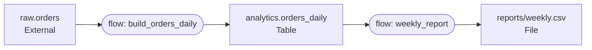

An asset is Kestra's record of a resource that your flows read or write, such as a database table, a file in object storage, or a virtual machine.

<div class="video-container">
  <iframe src="https://www.youtube.com/embed/XhICXP_GXic?si=jUBFcCv7vqSqqvKn" title="YouTube video player" allow="accelerometer; autoplay; clipboard-write; encrypted-media; gyroscope; picture-in-picture; web-share" referrerpolicy="strict-origin-when-cross-origin" allowfullscreen></iframe>
</div>

## Why assets exist

A flow knows which tasks it runs. It doesn't know what those tasks change outside Kestra. Once you run more than a handful of flows, questions like these become hard to answer:

- Which flow writes the `analytics.orders_daily` table, and which flows read it?
- When was that table last written, and did the run that wrote it succeed?
- If you drop the `raw.orders` table, what breaks downstream?
- Which virtual machines in production run Ubuntu 22.04, and who owns them?

Without assets, the answers live in SQL files, Terraform state, and people's memory. With assets, each task states what it reads and writes, and Kestra keeps the record up to date every time the task runs. Lineage and inventory become a byproduct of running your flows instead of a separate documentation project.

## How Kestra records assets

You attach an `assets` block to a task. `inputs` lists the resources the task reads. `outputs` lists the resources it creates or updates.

The partial example below shows only the `assets` block of a task that builds a daily orders table from a raw table:

```yaml
assets:
  inputs:
    - id: raw.orders
  outputs:
    - id: analytics.orders_daily
      type: io.kestra.plugin.ee.assets.Table
      metadata:
        system: postgres
        database: analytics
```

When the task finishes, Kestra does the following:

1. Creates or updates each output asset. If the task fails, Kestra skips this step, so a failed run never overwrites an asset's metadata.
2. Creates any input asset that doesn't exist yet as a placeholder of type `io.kestra.core.models.assets.External`. A later task that declares the same ID as an output replaces the placeholder type.
3. Records lineage: each input points to each output of the same task, and the flow points to the assets it reads and writes.
4. Records a usage entry for every asset on the execution, so each asset keeps a history of the executions that read or wrote it.

Assets outlive executions. When a second flow declares `analytics.orders_daily` as an input, Kestra connects it to the same asset, and the dependency graph grows across flows:



Kestra identifies an asset by its `id` within a tenant. The namespace and the type are attributes, not part of the identity, so two flows that use the same `id` always refer to the same asset. Choosing stable, meaningful IDs is the most important modeling decision you make. See [Asset best practices](../../../14.best-practices/13.assets/index.md).

## Ways to create assets

You can register assets in several ways, and you can mix them:

| Method | When to use it |
| --- | --- |
| Declare `assets.inputs` and `assets.outputs` on a task | You know which resources the task touches. Works on any task. |
| Turn on `assets.enableAuto` on a plugin that emits assets | The plugin can detect resources itself, for example dbt models or tables created by a SQL query. |
| Print an asset line from a script task | A Python, Shell, or other script task creates resources that only the script knows about. |
| Run the `Set` task | You want to register or update an asset as its own step, without tying it to another task. |
| Use the UI, the API, or `kestractl` | You want to register resources that no flow manages, or automate registration from outside Kestra. |

The [asset declaration reference](./01.declare-assets/index.md) covers the first three methods. The [asset tasks and triggers reference](./02.tasks-and-triggers/index.md) covers `Set`. [Manage assets in the UI, API, and CLI](./03.manage-assets/index.md) covers the rest.

## What you can do with assets

| Goal | Feature | Start here |
| --- | --- | --- |
| See which flows produce and consume each resource | Dependencies graph | [Manage assets](./03.manage-assets/index.md#explore-the-dependencies-graph) |
| Capture lineage from dbt, SQL, and BI tools without writing it by hand | Auto-emitting plugins | [Track lineage across a dbt pipeline](../../../15.how-to-guides/asset-lineage-dbt/index.md) |
| Start a flow when an upstream table changes | `EventTrigger` | [Run a flow when a table changes](../../../15.how-to-guides/asset-event-triggers/index.md) |
| Detect resources that haven't been refreshed on time | `FreshnessTrigger` | [Detect and refresh stale data](../../../15.how-to-guides/asset-freshness/index.md) |
| Keep an inventory of the infrastructure your flows provision | Output assets with metadata | [Build an infrastructure inventory](../../../15.how-to-guides/asset-infrastructure-inventory/index.md) |
| Start a flow on each phase of a VM's lifecycle, such as post-provisioning or removal | `EventTrigger` with a `phase` metadata key | [Trigger flows on each phase of a VM's lifecycle](../../../15.how-to-guides/asset-vm-lifecycle-phases/index.md) |
| Pick targets for an operation from the inventory instead of typing them | `assets()` Pebble function | [Target fleet operations with asset metadata](../../../15.how-to-guides/asset-fleet-operations/index.md) |
| Stop two executions from changing the same resource at once | `Acquire` and `Release` locks | [Prevent concurrent changes to a resource](../../../15.how-to-guides/asset-locks/index.md) |
| Let a platform team publish resources that other teams build on | Global assets and allowed namespaces | [Share platform resources across teams](../../../15.how-to-guides/asset-platform-sharing/index.md) |
| Send lineage to Marquez or another OpenLineage-compatible tool | `AssetShipper` | [Send asset lineage to OpenLineage](../../../15.how-to-guides/asset-openlineage/index.md) |
| Chart your inventory | Dashboard `Assets` data source | [Dashboards](../../../09.ui/00.dashboard/index.md#assets-ee-and-cloud-only) |

## Assets compared with other Kestra features

Assets describe resources that live outside Kestra. Other features store data that Kestra itself manages:

| Feature | What it holds | Lifetime |
| --- | --- | --- |
| [Outputs](../../../05.workflow-components/06.outputs/index.md) | Values and files produced by one task run | One execution |
| [KV Store](../../../06.concepts/05.kv-store/index.md) | Values your flows read and write as state | Until you delete or expire it |
| [Namespace files](../../../06.concepts/02.namespace-files/index.md) | Code and configuration your flows use | Until you delete it |
| Assets | Metadata about external resources, plus their lineage and usage history | Until you delete or purge it |

An asset never holds the resource's data. A `Table` asset records that a table exists, where it lives, and which flows touch it. The rows stay in your database.

## When assets don't fit

Assets add the most value for resources that several flows or teams share, or that you need to find, audit, or react to later. They add little for:

- Temporary files that exist only inside one execution. Use [outputs](../../../05.workflow-components/06.outputs/index.md) instead.
- Values your flows read and write as state, such as a last-processed timestamp. Use the [KV Store](../../../06.concepts/05.kv-store/index.md).
- Resources that no flow touches and nobody needs to find. A catalog of unused entries is noise.

## Next steps

- Learn the `assets` property, built-in types, and auto-emitting plugins in the [asset declaration reference](./01.declare-assets/index.md).
- Look up triggers, tasks, the `assets()` function, and exporters in the [asset tasks and triggers reference](./02.tasks-and-triggers/index.md).
- Explore, lock, and automate assets in [Manage assets in the UI, API, and CLI](./03.manage-assets/index.md).
- Plan IDs, metadata, and namespaces with the [asset best practices](../../../14.best-practices/13.assets/index.md).
- For an end-to-end architecture walkthrough with diagrams, read [Assets for infrastructure automation](https://kestra.io/blogs/assets-for-infra-automation).
