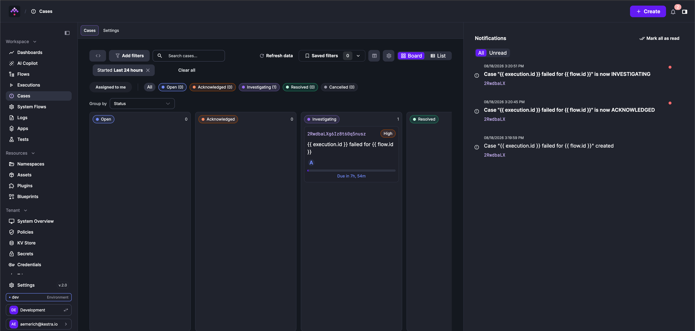
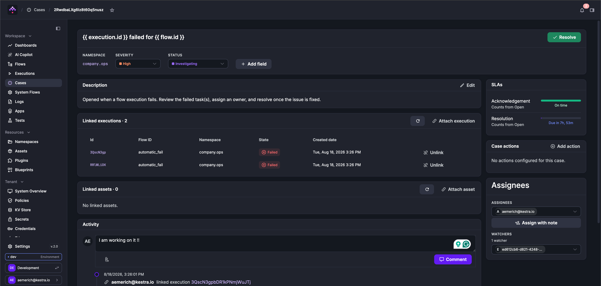
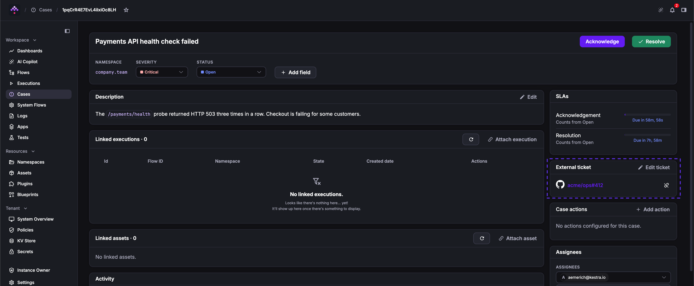
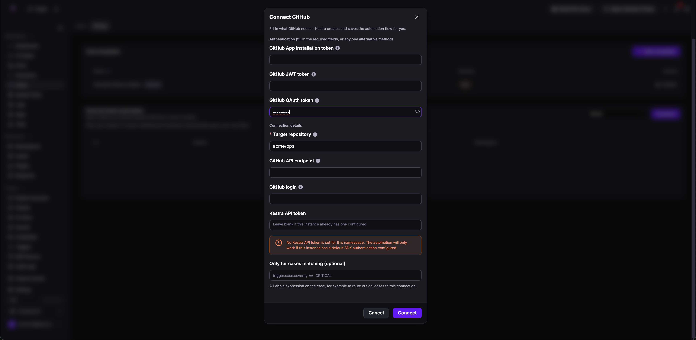
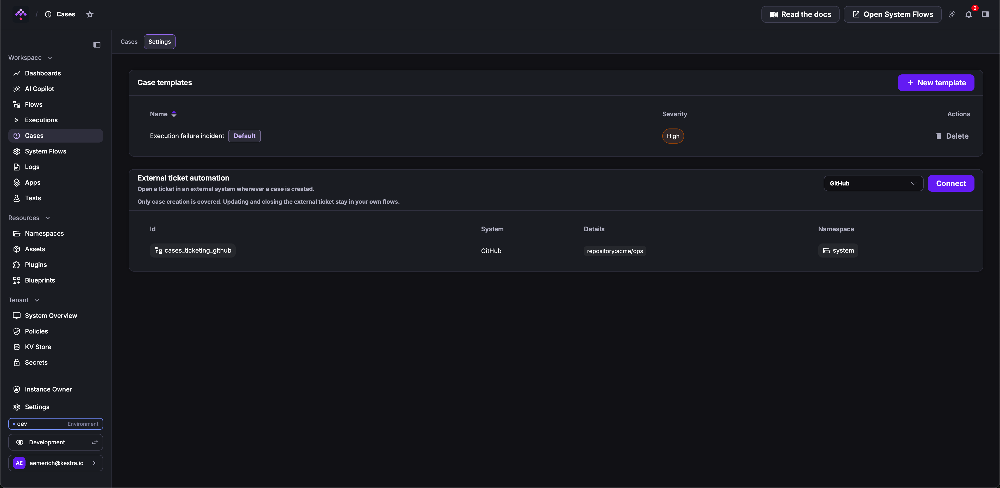
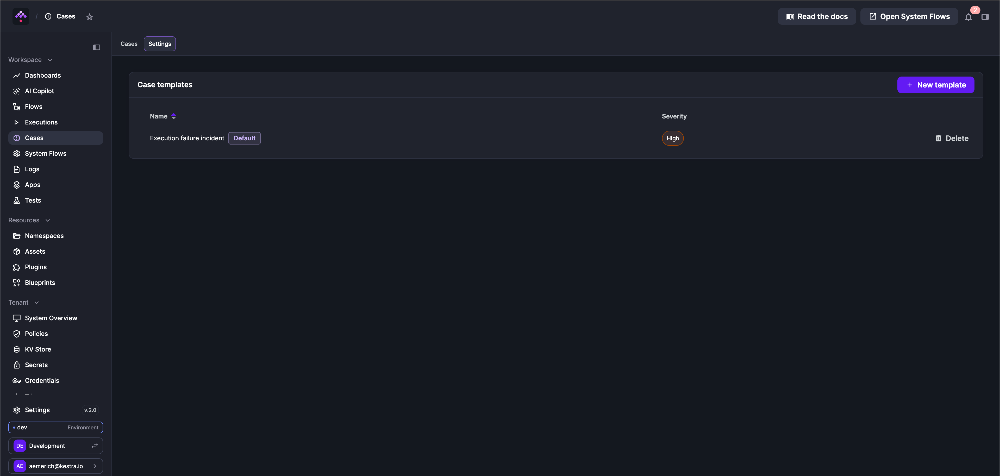

Track and resolve incidents directly in Kestra, next to the executions that caused them.

When an execution fails, it is often an incident. Cases lets you track and resolve those incidents directly in Kestra, without a separate tool.

Cases are not limited to failures; you can open one for executions that need approvals, or for successful executions that produced unexpected outputs.

The `CreateCase` task lets you open cases automatically from your flow YAML:

- in the `errors`, `finally`, or `afterExecution` blocks, to auto-create custom cases when the execution moves to a terminal state like Failed, Killed, Warning, or Success
- anywhere in the regular `tasks` block, to create cases based on custom conditions within the flow, for example if a given output is bad (error status code on some API request).

Not every execution needs to be treated as an independent case, though. Often a single production issue (e.g. an external API that is temporarily unreachable) can easily create 10 to 100 failed executions within an hour. Sending Slack alerts for each failed execution can quickly get so noisy that users mute the channel, making the alerting useless. Cases solve this with **deduplication**: with `linkMatchingExecutions: true`, new failing executions are attached to the already-open case for the same flow and task instead of opening a new one.

Cases also connect to the tools your team already uses: a case can be linked to a ticket in GitHub, Jira, ServiceNow, or another ticketing system, and flows can react to anything that happens on a case with the `CaseEvent` trigger.

:::alert{type="warning"}
Cases require the [Kestra plugin](https://kestra.io/plugins/plugin-kestra) to be installed on your Kestra EE instance, because the `CreateCase` and `SetTicket` tasks and the `CaseEvent` trigger used under the hood by Cases come from this plugin. The default Docker image with plugins included already contains it. If you manage plugins yourself, install the Kestra plugin through [Versioned Plugins](../../05.instance/versioned-plugins/index.md) to use Cases reliably.
:::

## What a case contains

- Title and description: the description supports Markdown
- Severity: `Critical`, `High`, `Medium`, or `Low`; defaults to `Medium`
- Status: `Open`, `Acknowledged`, `Investigating`, `Resolved`, or `Cancelled`; `Resolved` and `Cancelled` are terminal
- Namespace: every case belongs to a namespace, and all permission checks are scoped to it
- Assignees and watchers: both accept users and groups; assignees are responsible for the case, watchers only receive notifications. The same user or group cannot be both at once — assigning them as an assignee removes them from the watchers
- Custom fields: typed fields (Text, Select, Multi-select) defined per case or inherited from a template; cases use custom fields instead of labels
- SLAs: optional acknowledgement and resolution targets
- Linked executions and assets: the executions and [assets](../01.assets/index.md) affected by the incident
- Case actions: flows attached to the case as one-click remediation buttons
- External ticket: at most one [ticket in an external system](#external-tickets) such as GitHub, Jira, or ServiceNow, stored as a system name, a ticket key, and a URL
- Origin: the flow, task, and execution that created the case (set only when created by the `CreateCase` task); this is the deduplication key
- Template reference: the case template the case was created from, if any

## Case lifecycle

There is no restrictive state machine: any status can be changed to any other, including reopening a resolved or cancelled case. A few rules apply:

1. Resolving requires a **resolution reason**; the note is optional. When the case was created from a template, the template can restrict the allowed reasons and make the note mandatory. Without a template, the built-in reasons are offered: Fixed, Workaround applied, Configuration change, Duplicate, No action needed, Won't fix.
2. Cancelling accepts an optional reason and note.
3. The first time the case moves from `Open` to any other status, the acknowledgement time is recorded (this satisfies the acknowledgement SLA and is kept even if the case is later reopened).
4. Reopening a terminal case clears the resolution, and the case's auto-attach flow (if any) is recreated.

## SLAs

Each case can have two optional SLA targets, set directly or inherited from a template:

1. Acknowledgement: met the first time the case moves from `Open` to any other status
2. Resolution: met when the case is resolved

Both clocks start at case creation. Each of the two SLAs can be in one of six states: `Not started`, `Running`, `Overdue`, `Met`, `Missed`, or `Voided` (cancelling a case voids its pending SLAs). States are computed at read time and never persisted. The UI shows a live countdown ("Due in 2h", "Due 30m ago") on the case detail page, board cards, and the list's Resolution SLA column.

When a target is missed, a background check records an `SLA_ACKNOWLEDGEMENT_BREACHED` or `SLA_RESOLUTION_BREACHED` event in the case's timeline and sends an in-app notification to the case's assignees and watchers. The check runs every 5 minutes by default and can be tuned or disabled through the `kestra.cases.sla-breach-check` configuration; each of the two SLAs is notified at most once per case.

## The CreateCase task

The task type is `io.kestra.plugin.kestra.ee.cases.CreateCase`. It is an SDK-based task that calls the Kestra API, so it can be placed in any task block: `tasks`, `errors`, `finally`, or `afterExecution`.

```yaml
id: orders_sync
namespace: company.team

tasks:
  - id: sync
    type: io.kestra.plugin.core.http.Request
    uri: https://api.example.com/orders

errors:
  - id: open_case
    type: io.kestra.plugin.kestra.ee.cases.CreateCase
    kestraUrl: http://localhost:8080
    auth:
      apiToken: "{{ secret('KESTRA_API_TOKEN') }}"
    title: "Orders sync failed: {{ flow.id }}"
    severity: HIGH
    linkMatchingExecutions: true
    sla:
      acknowledgement: PT1H
      resolution: PT8H
```

The task calls the Kestra API, so it needs an endpoint and credentials. `kestraUrl` defaults to the URL of the current instance, and `auth` accepts either an `apiToken` or a `username` and `password` pair. Both can also be omitted: an administrator can set **Default authentication credentials** when editing a namespace or tenant, and those credentials are then used automatically (the instance configuration `kestra.tasks.sdk.authentication` works as a global fallback). Without `auth` on the task and without such defaults, the task fails at runtime.

For condition-based cases inside the regular `tasks` block, combine it with `runIf`:

```yaml
tasks:
  - id: check
    type: io.kestra.plugin.core.http.Request
    uri: https://api.example.com/health
    allowFailed: true

  - id: open_case
    type: io.kestra.plugin.kestra.ee.cases.CreateCase
    kestraUrl: http://localhost:8080
    auth:
      apiToken: "{{ secret('KESTRA_API_TOKEN') }}"
    runIf: "{{ outputs.check.code != 200 }}"
    title: "Health check returned {{ outputs.check.code }}"
    severity: CRITICAL
```

### Properties

| Property | Description |
|---|---|
| `title` | Case title; required unless `caseId` is set. Supports expressions. |
| `caseDescription` | Markdown description (named this way because `description` is reserved for the task itself). |
| `severity` | `CRITICAL`, `HIGH`, `MEDIUM`, or `LOW`; defaults to `MEDIUM`. |
| `status` | Initial status; defaults to `OPEN`. |
| `namespace` | Namespace the case belongs to; defaults to the flow's namespace. |
| `sla` | `acknowledgement` and `resolution` durations (ISO-8601, e.g. `PT1H`). |
| `linkMatchingExecutions` | When `true`, the execution is attached to an already-open case with the same origin instead of creating a new one; defaults to `false`. |
| `caseId` | Attach the execution to this exact case instead of creating one (used by generated auto-attach flows). |
| `executionId` | Execution to link; defaults to the current execution. |
| `assignees` / `watchers` | User emails and group names, resolved to stable IDs on the server. |
| `labels` | Key/value pairs, stored as Text custom fields on the case. |
| `assetIds` | Assets to link to the case. |
| `actions` | Case actions to attach, each with `label`, `namespace`, and `flowId`. |

Connection properties (`kestraUrl`, `auth`, `tenantId`) are shared by all tasks from the Kestra plugin; `tenantId` defaults to the execution's tenant. Authentication is resolved as described above: `auth` set on the task takes precedence, then the namespace's default authentication credentials, then the tenant's, then the instance configuration.

### Outputs

The task returns three outputs:

- `caseId`: the ID of the case that was created or attached to.
- `created`: `false` when the execution was attached to an existing case (via deduplication or `caseId`) rather than opening a new one.
- `url`: the link to the case in the Kestra UI, for example to include in a notification or an external ticket. It is `null` when the instance has no `kestra.url` configured.

Note that the task cannot reference a case template. Case templates are mainly helpers to make it easier to configure cases from the UI; when creating cases from code, all properties such as severity or SLAs are declared explicitly on the task, following Kestra's declarative nature.

## Deduplication

With `linkMatchingExecutions: true`, the server first looks for an active case with the same **origin**: the combination of flow namespace, flow ID, and task ID (within the tenant). The title is not part of the key. A case counts as active when its status is `Open`, `Acknowledged`, or `Investigating`.

- On a match: the triggering execution is appended to the existing case's linked executions (visible in the timeline as an `EXECUTION_LINKED` event), no new case is created, and the task returns `created: false`. Fields such as title or severity are not merged, and no new "created" notification is sent.
- On no match: a new case is created with the origin recorded, and the execution is linked to it.

The same behavior can also be enabled from the UI on an existing case with [auto-attach](#auto-attach).

One caveat: the deduplication check is not atomic. The server first checks for an existing case and then creates one, so two executions of the same task failing at exactly the same moment can each create their own case.

## Auto-attach

Auto-attach allows you to avoid getting a new case and a new notification for every single failed execution. A case is created for the first failure, and all following executions matching the same flow and state are automatically attached to that same case until the case is resolved or cancelled.

Deduplication with `linkMatchingExecutions` achieves the same from the flow YAML; auto-attach is its UI counterpart, configured on an existing case. It can be enabled with the "Auto-link matching executions" toggle when attaching executions to a case, from the case detail page or in the Create Case modal. A banner then lists exactly what will be matched, for example "New executions matching company.team/orders_sync (FAILED) will automatically attach to this case." Several executions can be selected at once, even across different flows: the selection is grouped into one rule per flow, and the states of that flow's selected executions are combined.

Under the hood, enabling it generates a flow named `attach_executions_<caseId>` in the system namespace, with one Flow trigger per (namespace, flow, states) rule and a single `CreateCase` task that passes the `caseId`. Multiple rules accumulate on the same generated flow. The flow is deleted when the case reaches a terminal status or is deleted, and recreated on reopen. These generated flows are visible on the [System Flows](../../../06.concepts/system-flows/index.md) page.

Enabling auto-attach is gated by RBAC: it requires the `UPDATE` action on the `CASE` permission in the case's namespace, plus the `EXECUTE` action on the `FLOW` permission in the namespace of the flow whose executions will be attached.

## Creating cases from the UI

Besides the task, cases can be created in four places:

1. Cases page: the Create button opens a modal with template selection, title, severity, initial status, namespace, assignees and watchers, both SLA targets (presets from 1 hour to 72 hours, or a custom duration), description, custom fields, and executions to link.
2. Executions page (bulk): select executions and use "Create case from selection" or "Add to existing case". Both also work with "select all matching filter", so a case can be created from everything matching the current query.
3. Execution's Overview tab: a "Linked cases" panel lists the cases the execution belongs to and offers a Create case button pre-linked to that execution.
4. Asset page: the same panel exists on the asset overview; a case created there is linked to the asset automatically.

## Cases in the UI

Cases sit in the left menu between Executions and System Flows.

- Board view (default): a kanban board grouped by status, severity, or assignee. Dragging a card between columns updates the case; dropping onto Resolved opens the resolve modal, because a reason is mandatory. Cards show the case ID, severity, title, assignees, and a live SLA countdown.
- List view: columns for Case, Title, Severity, Status, Resolution SLA, and Assignee, with an inline next-step button per row (Acknowledge, Investigating, Resolve) and bulk Acknowledge/Delete.
- Toolbar: full-text search, which also matches the key and URL of a case's external ticket; filters on namespace, status, severity, assignee, and time range; an "Assigned to me" toggle; and one chip per status with live counts.



The case detail page shows the editable header (title, severity, status, quick transitions, Resolve/Reopen), the Markdown description, custom fields, a resolution card once resolved, SLA countdowns, assignees and watchers (with a Watch/Unwatch toggle and "Assign with note"), case actions, the external ticket, linked executions, linked assets, and the activity timeline.



## Comments and activity timeline

Every change to a case is recorded as a timeline event: creation, field updates, status and severity changes, assignments (with optional note), execution and asset links, external ticket changes, action runs, auto-attach changes, and SLA breaches. Comments support **Markdown** and up to 5 file attachments of 10 MB each (drag-and-drop and clipboard paste work).

## Case actions

A case action is a flow attached to the case as a one-click button, intended for remediation or diagnostics (e.g. "Restart service"). Clicking an action opens the Execute flow modal so you can review and fill the flow's inputs, and optionally set labels, a schedule date, or breakpoints before running. The resulting execution is automatically linked back to the case and labeled `system.caseId: <caseId>` and `system.from: case`, and the run is recorded in the timeline. When the instance has `kestra.url` configured, the execution also gets a `system.caseUrl` label with the link to the case, which the action flow can read as `{{ labels.system.caseUrl }}`. Attaching or running an action requires the `EXECUTE` action on the `FLOW` permission in the target flow's namespace.

## Linked executions and assets

- Executions can be linked by the task, by auto-attach, manually from the case detail page, or in bulk by ID or by filter query. The linked-executions card shows each execution's live state and keeps a row (marked as no longer existing) even if the execution was purged.
- Assets come in two kinds: explicitly attached ones, and derived ones (assets used by the case's linked executions, shown with an "Auto-detected" tag). Derived assets cannot be unlinked; they disappear when the executions that reference them are unlinked.

## External tickets

A case can be linked to one ticket in an external system, such as a GitHub issue, a Jira issue, or a ServiceNow incident. The ticket is stored on the case as three values:

- System: a free-text display name, such as `GitHub` or `ServiceNow`.
- Key: the identifier shown on the case, such as `acme/ops#412` or `INC0012345`.
- URL: where a click on the key goes; it must start with `http://` or `https://`.

The ticket appears in the **External ticket** card on the case detail page, and searching the Cases list by key or URL finds the case. Linking a ticket to a case that already has one replaces it. Every link, change, and unlink is recorded in the activity timeline.



Kestra does not synchronize the ticket with the external system. Updating or closing the ticket when the case changes is up to your own flows, for example with a [CaseEvent trigger](#react-to-case-events) on `STATUS_CHANGED`.

There are three ways to link a ticket.

### Link a ticket from the case page

On the case detail page, click **Link a ticket** in the **External ticket** card and fill in **System**, **Ticket key**, and **Ticket URL**. Use **Edit ticket** to change the values and **Unlink** to remove the ticket. This requires the `UPDATE` action on the `CASE` permission in the case's namespace.

### Open a ticket automatically for every new case

**Cases → Settings → External ticket automation** generates a flow that opens a ticket whenever a case is created and links it back to the case:

1. Select a system in **External ticket system**. The list shows every installed plugin whose task can open tickets; with the plugins in the default image, these are GitHub, GitLab, Atlassian Jira, Atlassian Trello, HubSpot, Linear, Notion, Pylon, ServiceNow, and Zendesk.
2. Click **Connect**.
3. Fill in the authentication and connection details that the plugin needs, and the ticket fields if the plugin has any free-form ones.
4. Optionally, enter a **Kestra API token**. Leave it blank if the instance has default SDK authentication configured.
5. Optionally, enter a condition in **Only for cases matching**, a Pebble expression on the case such as `trigger.case.severity == 'CRITICAL'`. Use it to route cases to different connections when the same system is connected more than once.
6. Click **Connect**.



Kestra stores the credentials as secrets in the [system namespace](../../../06.concepts/system-flows/index.md), named after the plugin and property, for example `GITHUB_OAUTH_TOKEN`. When a secret with that name already exists, it is reused unless you override it. The Kestra API token is saved as `KESTRA_API_TOKEN` and is shared by every ticketing automation in the system namespace, so overriding it changes the token they all use.

The generated flow, named `cases_ticketing_<system>` (with a `_2`, `_3` suffix for repeat connections), is saved in the system namespace and listed in the **External ticket automation** table. It contains:

- A [`CaseEvent` trigger](#react-to-case-events) on `CREATED` events.
- The plugin's create task, with the case title, description (including the link to the case), and severity mapped onto the ticket fields.
- A `SetTicket` task that links the new ticket to the case.



Both tasks run only when the case has no ticket yet (and, if set, when the condition matches), so a replayed event never opens a second ticket. You can open the generated flow and edit it like any other flow.

Connecting requires the `CREATE` action on the `FLOW` permission and the `UPDATE` action on the `SECRET` permission in the system namespace.

### Link a ticket from a flow

The `io.kestra.plugin.kestra.ee.cases.SetTicket` task links a ticket to a case from any flow. Its `system`, `key`, and `url` properties are required. `caseId` defaults to the execution's `system.caseId` label, so you can omit it in a flow run as a [case action](#case-actions). Omit the property entirely: an expression that renders empty does not fall back to the label, and the task fails.

The flow below opens a case when the health check fails, opens a GitHub issue that links to the case, and links the issue back to the case:

```yaml
id: payments_api_health
namespace: company.team

tasks:
  - id: probe
    type: io.kestra.plugin.core.http.Request
    uri: https://api.example.com/payments/health

errors:
  - id: open_case
    type: io.kestra.plugin.kestra.ee.cases.CreateCase
    title: "Payments API health check failed"
    severity: CRITICAL
    linkMatchingExecutions: true

  - id: open_issue
    type: io.kestra.plugin.github.issues.Create
    runIf: "{{ outputs.open_case.created }}"
    oauthToken: "{{ secret('GITHUB_TOKEN') }}"
    repository: acme/ops
    title: "Payments API health check failed"
    body: "Kestra case: {{ outputs.open_case.url }}"

  - id: link_ticket
    type: io.kestra.plugin.kestra.ee.cases.SetTicket
    runIf: "{{ outputs.open_case.created }}"
    caseId: "{{ outputs.open_case.caseId }}"
    system: GitHub
    key: "acme/ops#{{ outputs.open_issue.issueNumber }}"
    url: "{{ outputs.open_issue.issueUrl }}"
```

The `runIf` on `created` matters with deduplication: once later failures are attached to the open case, `created` is `false`, and without the guard every failure would open a new issue and replace the linked one.

To link an existing ticket on demand, attach a flow with `SetTicket` to the case as a case action, with the key and URL as inputs:

```yaml
id: link_existing_ticket
namespace: system

inputs:
  - id: ticket_key
    type: STRING
  - id: ticket_url
    type: URI

tasks:
  - id: link
    type: io.kestra.plugin.kestra.ee.cases.SetTicket
    system: GitHub
    key: "{{ inputs.ticket_key }}"
    url: "{{ inputs.ticket_url }}"
```

Like `CreateCase`, `SetTicket` calls the Kestra API and accepts the same `kestraUrl`, `auth`, and `tenantId` connection properties.

## React to case events

The `io.kestra.plugin.kestra.ee.cases.CaseEvent` trigger starts one execution for every event recorded on a case, such as a case being created, assigned, commented on, or changing status. Use it to open or close external tickets, start a triage flow when a case is assigned, or send notifications outside of Kestra.

```yaml
id: notify_critical_cases
namespace: system

triggers:
  - id: on_case_created
    type: io.kestra.plugin.kestra.ee.cases.CaseEvent
    auth:
      apiToken: "{{ secret('KESTRA_API_TOKEN') }}"
    events: [CREATED]
    severities: [CRITICAL]
    namespace: company

tasks:
  - id: notify
    type: io.kestra.plugin.slack.SlackIncomingWebhook
    url: "{{ secret('SLACK_WEBHOOK') }}"
    messageText: "Critical case opened: {{ trigger.case.title }} {{ trigger.case.url }}"
```

Like the tasks from the Kestra plugin, the trigger calls the Kestra API and accepts `kestraUrl`, `auth`, and `tenantId`, with the same [authentication fallbacks](#the-createcase-task); without default credentials, set `auth` as in the example.

All properties are optional, and an empty filter matches everything:

| Property | Description |
|---|---|
| `events` | Event types to react to: `CREATED`, `UPDATED`, `STATUS_CHANGED`, `SEVERITY_CHANGED`, `ASSIGNED`, `COMMENT`, `EXECUTION_LINKED`, `EXECUTION_UNLINKED`, `APPROVAL_DECIDED`, `ASSET_LINKED`, `ASSET_UNLINKED`, `TICKET_LINKED`, `TICKET_UNLINKED`, `ACTION_ATTACHED`, `ACTION_DETACHED`, `ACTION_UPDATED`, `ACTION_RUN`, `AUTO_ATTACH_ENABLED`, `AUTO_ATTACH_DISABLED`, `SLA_ACKNOWLEDGEMENT_BREACHED`, `SLA_RESOLUTION_BREACHED`. |
| `severities` | `CRITICAL`, `HIGH`, `MEDIUM`, or `LOW`. |
| `namespace` | Keeps cases in this namespace and its child namespaces: `company` matches `company` and `company.team`, but not `companyx`. |
| `assignees` | Keeps cases assigned to any of these users or groups, by ID. Emails and group names do not match. |
| `interval` | How often to poll for new events; defaults to `PT10S`. |
| `size` | How many events to read per poll; defaults to `100`. |

The severity, namespace, and assignee filters check the case as it is when the event is read, not as it was when the event happened. For example, a `CREATED` event matches an `assignees` filter if the case was assigned to that user after it was created.

The trigger exposes three variables:

- `trigger.event`: the event type, for example `CREATED`.
- `trigger.created`: when the event was recorded.
- `trigger.case`: the case, with `id`, `title`, `description`, `severity`, `status`, `namespace`, `url`, and `ticket` (`system`, `key`, `url`).

`description`, `url`, and `ticket` are left out of `trigger.case` when the case has none, and an expression that references a missing field fails the task. Test them with `is defined` first, for example `{{ trigger.case.ticket is defined ? trigger.case.ticket.key : 'none' }}`.

The trigger only returns events for cases that its credentials can read; it needs the `LIST` action on the `CASE` permission. When the trigger starts for the first time, it begins at the current time and does not replay older events. It saves its position in the flow namespace's [KV store](../../../06.concepts/05.kv-store/index.md), under the key `kestra_case_event_cursor_<namespace>_<flowId>_<triggerId>`, so it resumes where it stopped after a restart.

Events are delivered at least once: if the worker stops between starting an execution and saving its position, the event is delivered again, so guard tasks that must not run twice, as the generated ticketing flows do with `runIf: "{{ trigger.case.ticket is not defined }}"`. New events become visible to the trigger about five seconds after they are recorded.

The cursor is kept without expiration by default. Setting `stateTtl` expires it, after which the trigger restarts from the current time and skips the events recorded in between. Set `stateKey` to share one cursor between triggers.

## Case templates

Templates standardize how cases are created. A template can define a default severity, default assignees and watchers, a title pattern (supporting the same expressions as the task title), a description, both SLA targets, custom field definitions, default case actions, allowed resolution reasons, and whether a resolution note is required. One template per tenant can be marked as the default; it is preselected in the Create Case modal.

Templates are managed in **Cases → Settings** and require the `TEMPLATE` action on the `CASE` permission.

 A template can be scoped to a namespace or left tenant-wide (tenant-wide templates and the default flag require a global grant).

Every tenant is seeded with a built-in "Execution failure incident" template: severity High, title pattern `{{ execution.id }} failed for {{ flow.id }}`, 1 hour acknowledgement and 8 hour resolution SLA, and the built-in resolution reasons.

Template defaults apply when creating cases via the UI or the API; they cannot be used by the `CreateCase` task, where all properties are declared explicitly in the flow YAML.

## Notifications

Case events are wired into the in-app notification system (the bell icon). Seven events send notifications: case created, assigned, status changed, severity changed, commented, acknowledgement SLA breached, and resolution SLA breached. Recipients are the case's assignees and watchers, with groups expanded to their members; assignment notifications go only to the users whose assignment actually changed, with the assignment note included. Each notification contains a link to the case.

## Permissions and audit

- RBAC: a new `CASE` permission resource with actions `VIEW`, `LIST`, `CREATE`, `UPDATE`, `DELETE`, `FOLLOW`, and `TEMPLATE`, optionally scoped to a namespace (_creating a case requires `CREATE` on its namespace, transitions and linking (including linking and unlinking an external ticket) require `UPDATE`, commenting only requires `VIEW`_). Connecting an [external ticket automation](#open-a-ticket-automatically-for-every-new-case) also requires `FLOW` and `SECRET` permissions in the system namespace, and the [CaseEvent trigger](#react-to-case-events) requires `LIST` on `CASE`.
- Audit: create, update, and delete of cases and case templates are recorded in the [audit log](../06.audit-logs/index.md) (resource types `CASE` and `CASE_TEMPLATE`). Timeline events and comments are not separately audited.
- Backup: cases, templates, timeline events, and execution links are included in backup and restore.

## API

All case operations are available via REST under `/api/v1/{tenant}/cases`. The calls below cover the most common integration patterns. For the full endpoint list, request shapes, and filter DSL, see the [Enterprise API reference](../../../api-reference/01.enterprise/index.mdx).

**Search cases**

```bash
curl -X GET "https://{host}/api/v1/{tenant}/cases/search?page=1&size=25" \
  -H "Authorization: Bearer {token}"
```

Accepts `filters` (a list of structured query filter objects), `sort`, and `dateFilter` as query parameters. Use `GET /cases/counts` to get a `{status: count}` breakdown without pagination.

**Create a case**

```bash
curl -X POST "https://{host}/api/v1/{tenant}/cases" \
  -H "Authorization: Bearer {token}" \
  -H "Content-Type: application/json" \
  -d '{
    "namespace": "company.team",
    "title": "Orders sync failed",
    "severity": "HIGH",
    "sla": { "acknowledgement": "PT1H", "resolution": "PT8H" }
  }'
```

Returns the full case object including the generated `id`.

**Acknowledge and resolve**

```bash
# Acknowledge
curl -X POST "https://{host}/api/v1/{tenant}/cases/{id}/acknowledge" \
  -H "Authorization: Bearer {token}"

# Resolve
curl -X POST "https://{host}/api/v1/{tenant}/cases/{id}/resolve" \
  -H "Authorization: Bearer {token}" \
  -H "Content-Type: application/json" \
  -d '{ "reason": "Fixed", "note": "Deployed hotfix v1.2.3" }'
```

A `reason` is required to resolve. The reason is a free-form string; case templates can configure a `resolutionReasons` list to restrict which values are accepted.

**Link executions**

```bash
curl -X POST "https://{host}/api/v1/{tenant}/cases/{id}/executions" \
  -H "Authorization: Bearer {token}" \
  -H "Content-Type: application/json" \
  -d '["execution-id-1", "execution-id-2"]'
```

Use `POST /cases/{id}/executions/by-query` to link everything matching a filter query (capped at 1,000).

**Look up cases by execution**

```bash
curl -X POST "https://{host}/api/v1/{tenant}/cases/by-executions" \
  -H "Authorization: Bearer {token}" \
  -H "Content-Type: application/json" \
  -d '["execution-id-1", "execution-id-2"]'
```

Returns `{ "executionId": [caseSummary, ...] }`, useful for annotating an execution list with its linked cases.

**Add a comment**

```bash
curl -X POST "https://{host}/api/v1/{tenant}/cases/{id}/comments" \
  -H "Authorization: Bearer {token}" \
  -F 'comment={"message":"Restarted the service, monitoring now."};type=application/json'
```

Supports up to 5 file attachments (10 MB each) as additional `-F file=@path` parts.

**Link and unlink an external ticket**

```bash
# Link, or replace the linked ticket
curl -X PUT "https://{host}/api/v1/{tenant}/cases/{id}/ticket" \
  -H "Authorization: Bearer {token}" \
  -H "Content-Type: application/json" \
  -d '{ "system": "GitHub", "key": "acme/ops#412", "url": "https://github.com/acme/ops/issues/412" }'

# Unlink
curl -X DELETE "https://{host}/api/v1/{tenant}/cases/{id}/ticket" \
  -H "Authorization: Bearer {token}"
```

All three fields are required. `system` and `key` accept up to 255 characters, and `url` up to 1,024 characters starting with `http://` or `https://`. Both calls return the updated case. Linking the same ticket again or unlinking a case that has no ticket changes nothing and records no event.

**Read case events**

```bash
curl -X GET "https://{host}/api/v1/{tenant}/cases/events/search?events=CREATED&events=ASSIGNED&size=100" \
  -H "Authorization: Bearer {token}"
```

Returns events across all cases the caller can read, oldest first, each with a snapshot of its case. Without `sinceCreated` and `sinceId`, it starts from the oldest event. The `events`, `severities`, `namespace`, and `assignees` query parameters filter the same way as the [CaseEvent trigger](#react-to-case-events). To read the next page, pass the response's `nextSinceCreated` and `nextSinceId` back as `sinceCreated` and `sinceId`; both are required together. `hasMore: true` means more events are ready to read.

## Current limitations

- Notifications are in-app only: case events appear in the notification bell, but no Slack message or email is sent by Cases. External alerting can be added with standard notification tasks alongside `CreateCase`, as a case action, or in a flow with a [CaseEvent trigger](#react-to-case-events).
- External tickets are one-way: Kestra opens and links tickets but does not synchronize their status, comments, or fields back to the case. A case can have only one external ticket.
- Deduplication is not atomic: concurrent failures of the same task can occasionally create duplicate cases.
