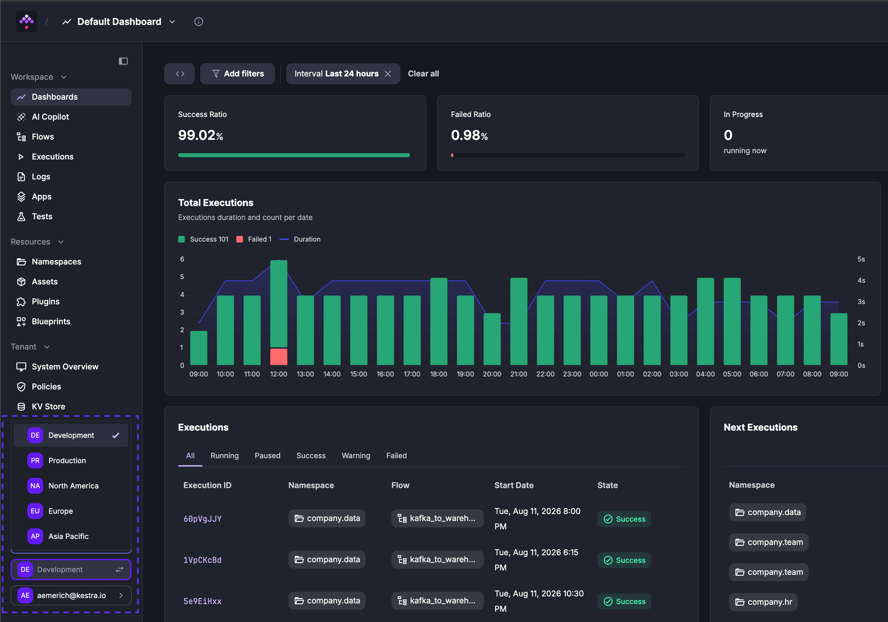

Multi-tenancy lets you run isolated environments for different teams, projects, or customers within a single Kestra instance.

<div class="video-container">
  <iframe src="https://www.youtube.com/embed/z4uzAyjKeoc?si=vy-CPQKNYXYZMwoo" title="YouTube video player" allow="accelerometer; autoplay; clipboard-write; encrypted-media; gyroscope; picture-in-picture; web-share" referrerpolicy="strict-origin-when-cross-origin" allowfullscreen></iframe>
</div>

## Multi-tenancy — configure and manage tenants

A tenant represents an **isolated environment within a single Kestra instance**.

Each tenant functions as a separate entity with its own resources, such as flows, triggers, or executions. Multi-tenancy enables different teams, projects, or customers to operate independently within the same Kestra instance, ensuring data privacy, security, and separation of resources between business units, teams, or customers. For example, you can have a `dev` tenant for development, a `staging` tenant for testing, and a `prod` tenant for production.

:::alert{type="info"}
You can think of multi-tenancy as running multiple virtual instances in a single physical instance of [Kestra Cloud](/cloud) or [Kestra Enterprise Edition](../../01.overview/01.enterprise-edition/index.md).
:::

All resources (such as [flows](../../../05.workflow-components/01.flow/index.md), [triggers](../../../05.workflow-components/07.triggers/index.mdx), [executions](../../../05.workflow-components/03.execution/index.md), [RBAC](../../03.auth/rbac/index.md), and more) are isolated by the tenant. This means that you can have a flow with the same identifier and the same namespace in multiple tenants at the same time.

Data stored inside the internal storage is also separated by tenants.

Users switch between tenants using the tenant dropdown in the bottom-left corner of the UI. The dropdown shows every tenant the user has access to; the active tenant is indicated with a checkmark. Each UI page includes the tenant ID in the URL (e.g., `https://demo.kestra.io/ui/yourTenantId/executions/namespace/flow/executionId`).



Most [API](../../../api-reference/index.mdx) endpoints also include the tenant identifier. Instance-level endpoints such as `/api/v1/configs`, `/api/v1/license-info`, `/api/v1/banners`, and `/api/v1/tenants` do not. Any signed-in user can call `/configs` and `/license-info`, while managing banners and tenants requires Instance Owner access.

For example, the URL of the API operation to list flows of the `products` namespace is `/api/v1/{your_tenant_id}/flows/products`. You can check the [Enterprise Edition API Guide](../../../api-reference/01.enterprise/index.mdx) for more information.

Tenants must be created upfront, and a user needs to be granted access to use a specific tenant.

## Key benefits of multi-tenancy

1. **Data Isolation**: each tenant's data, configuration, and code is isolated and inaccessible to other tenants.
2. **Resource Isolation**: each tenant's resources are isolated from other tenants — including flows, triggers, executions, logs, audit logs, secrets, etc.
3. **Simple Configuration**: create new tenants at any time, each providing a fresh, fully isolated workspace accessible from your existing Kestra instance.
4. **Intuitive UI Navigation**: the UI provides a dropdown as well as tenant identifiers included in the URL to make switching between tenants seamless.


## Creating and managing tenants

Tenants are created and managed through the **Instance Owner console**. Only users with the Instance Owner privilege can create, edit, or delete tenants. The console lists tenants under **Instance Owner → Tenants → All tenants**. Tenants can also be managed with `kestractl`, the API, or Terraform.

### Creating a tenant from the UI

Create a tenant from **Instance Owner → Tenants → All tenants**. The Instance Owner who creates the tenant is automatically granted the Admin role for it.

### Creating a tenant from the CLI

[`kestractl`](../../../kestra-cli/kestractl/index.md#tenant-management-enterprise-edition) lists, creates, updates, and deletes tenants through the API. The following command creates a tenant with the identifier `stage` and the name `Staging`:

```bash
kestractl tenants create stage --name "Staging"
```

The `kestra` server CLI can also create a tenant. It writes directly to the database in the Kestra configuration, so run it where that configuration is available. It takes the tenant identifier and name as positional arguments. Add `--admin-username` to grant the Admin role on the new tenant to an existing user:

```bash
kestra tenants create stage "Staging" --admin-username admin@example.com
```

### Creating a tenant from the API

Tenants can be managed programmatically via Kestra's [API](../../../api-reference/01.enterprise/index.mdx#post-/api/v1/tenants). The request must be authenticated as an Instance Owner, for example with an API token:

```bash
curl -X POST "https://kestra.example.com/api/v1/tenants" \
  -H "Authorization: Bearer $KESTRA_API_TOKEN" \
  -H "Content-Type: application/json" \
  -d '{"id": "stage", "name": "Staging"}'
```

### Creating a tenant from Terraform

Tenants can be managed via Infrastructure as Code using [Kestra's Terraform provider](../../../13.terraform/resources/tenant/index.md).

:::alert{type="info"}
This example assumes you have already configured the [Kestra Terraform Provider](../../../13.terraform/index.mdx)
:::

Here is an example of a Terraform configuration for creating a tenant:

```hcl
resource "kestra_tenant" "stage" {
  tenant_id = "stage"
  name      = "staging"
}
```

### Deleting a tenant

Deleting a tenant removes its flows, namespaces, apps, dashboards, roles, groups, role bindings, security integrations, and every user's and service account's access to the tenant.

Kestra keeps the following, which you can purge separately with the corresponding [Purge tasks](../../../10.administrator-guide/purge/index.md) if needed:

- execution data, logs, metrics, and audit logs, which stay in the database
- key-value pairs and namespace files, which stay in internal storage

:::alert{type="warning"}
Deleting a tenant is irreversible. The removed resources cannot be restored, even though the data listed above is kept.
:::

### Admin role assignment

When a tenant is created from the UI, the API, `kestractl`, or Terraform, the Instance Owner who creates it automatically gets the Admin role on that tenant.

The `kestra tenants create` server command has no signed-in user. It grants the Admin role only to the user named with `--admin-username`. Without that option, assign the Admin role to a user, service account, or group afterwards.

### Tenant settings

An Instance Owner edits a tenant's settings from **Instance Owner → Tenants → All tenants**. Besides the name and the backends described below, the settings include:

| Setting | Effect |
|---|---|
| **Require existing namespace** | Rejects flows whose namespace has not been created first |
| **Quotas** | Caps how many executions the tenant can create in a time window. See [Quotas](../../../05.workflow-components/21.quotas/index.md#tenant-level) |
| **Concurrency** | Caps how many executions run at the same time across the tenant. See [Concurrency](../../../05.workflow-components/14.concurrency/index.md#tenant-level) |
| **Default Worker Selector** | Routes tasks to Worker Queues when no closer level sets a selector. See [Worker Groups](../../04.scalability/worker-group/index.md#flow-namespace-and-tenant-level-routing-defaults) |
| **Read Only** (dedicated secrets manager) | Uses the secrets manager in [read-only mode](../secrets-manager/index.md#read-only-mode) |
| **Worker access** (dedicated secrets manager) | Chooses whether workers read secrets directly or [through the controller](../secrets-manager/index.md#worker-access-to-secrets) |
| **Default authentication credentials** | Credentials for SDK plugins. See [Default service account for SDK plugins](#default-service-account-for-sdk-plugins) |

### Dedicated storage and secrets backend per tenant

By default, each tenant uses the same [runtime and storage configuration](../../../configuration/02.runtime-and-storage/index.md) and [secrets backend](../secrets-manager/index.md) configured for your Kestra instance. If you need more isolation, you can configure a dedicated storage and secrets backend per tenant. This can be useful if each of your tenants serves different customers and you need to ensure complete data isolation between them.

Configure a dedicated backend from the tenant's **Settings** page (**Instance Owner → Tenants → All tenants**, then select the tenant), under **Dedicated internal storage** and **Dedicated secrets manager**. Turn on a section with its switch to show a type selector and a YAML configuration editor. In the API, the fields are `storageType`, `storageConfiguration`, `secretType`, and `secretConfiguration`. The [Terraform `kestra_tenant` resource](../../../13.terraform/resources/tenant/index.md) exposes them as `storage_type`, `storage_configuration`, `secret_type`, and `secret_configuration`, with the configuration as a flat map of strings.

Keep in mind:

- Dedicated storage and dedicated secrets managers require the corresponding Enterprise license features.
- The `jdbc` and `elasticsearch` secrets backends are not available as a dedicated secrets manager.
- Changes can take up to one hour to apply because Kestra caches each tenant's backend.
- A namespace's own dedicated backend takes precedence over its tenant's.

#### Use camelCase keys

Write the configuration in camelCase, for example `accessKey` and `projectId`. In `application.yml` and Helm values, Kestra converts kebab-case keys such as `access-key` for you. Tenant settings pass your keys straight to the backend plugin with no conversion, so a kebab-case key fails when you save:

```
Failed to create storage 's3'. Error: Unrecognized field "access-key"
```

To reuse an existing instance configuration:

1. Copy the properties nested under `kestra.storage.<type>` or `kestra.secret.<type>`.
2. Remove that prefix and the `type` key. The type selector sets the backend type.
3. Rename every kebab-case key to camelCase.

Common keys:

| `application.yml` or Helm key | Tenant settings key | Backend |
|---|---|---|
| `access-key`, `secret-key` | `accessKey`, `secretKey` | S3 storage |
| `force-path-style` | `forcePathStyle` | S3 storage |
| `project-id`, `service-account` | `projectId`, `serviceAccount` | GCS storage |
| `connection-string` | `connectionString` | Azure Blob storage |
| `shared-key-account-name`, `shared-key-account-access-key` | `sharedKeyAccountName`, `sharedKeyAccountAccessKey` | Azure Blob storage |
| `access-key-id`, `secret-key-id` | `accessKeyId`, `secretKeyId` | AWS Secrets Manager |
| `app-role.role-id`, `app-role.secret-id` | `appRole.roleId`, `appRole.secretId` | HashiCorp Vault |
| `filter-on-tags`, `filter-on-prefix` | `filterOnTags`, `filterOnPrefix` | AWS, Azure, and Google secrets managers |

Single-word keys such as `bucket`, `region`, `endpoint`, and `address` stay the same.

#### Dedicated storage example

An S3 bucket as the tenant's internal storage, entered in **Dedicated internal storage** with the type set to `s3`:

```yaml
bucket: tenant-a-kestra-storage
region: eu-west-1
accessKey: YOUR_ACCESS_KEY
secretKey: YOUR_SECRET_KEY
```

The same bucket in `application.yml` uses kebab-case keys under `kestra.storage.s3`:

```yaml
kestra:
  storage:
    type: s3
    s3:
      bucket: tenant-a-kestra-storage
      region: eu-west-1
      access-key: YOUR_ACCESS_KEY
      secret-key: YOUR_SECRET_KEY
```

For a GCS bucket, set the type to `gcs`:

```yaml
bucket: tenant-a-kestra-storage
projectId: my-gcp-project
serviceAccount: |
  { "type": "service_account", ... }
```

#### Dedicated secrets manager example

AWS Secrets Manager, entered in **Dedicated secrets manager** with the type set to `aws-secret-manager`:

```yaml
region: eu-west-1
accessKeyId: YOUR_ACCESS_KEY_ID
secretKeyId: YOUR_SECRET_ACCESS_KEY
```

HashiCorp Vault with AppRole authentication, with the type set to `vault`:

```yaml
address: https://vault.example.com:8200
appRole:
  path: approle
  roleId: YOUR_ROLE_ID
  secretId: YOUR_SECRET_ID
```

For every property of each backend, see [Runtime and Storage](../../../configuration/02.runtime-and-storage/index.md) and the [Secrets Manager documentation](../secrets-manager/index.md). Those pages show `application.yml` keys, so rename them to camelCase before you paste them here.

### Isolate Kestra services

When using [Dedicated Storage or Secret backends](../tenants/index.md#dedicated-storage-and-secrets-backend-per-tenant), you can isolate specific [Kestra services](../../../08.architecture/02.server-components/index.md) to prevent them from accessing the storage or secret backend. For example, you may not want the [Webserver](../../../08.architecture/02.server-components/index.md#webserver) to be able to access the dedicated internal storage. This isolation is intended for Kestra instances where multiple teams or organizations share access, but storage or secret data access must be limited to specific segments.

Isolation is configured separately for each backend:

- **A tenant's dedicated backend**: in the tenant's **Settings**, turn on **Isolation** in the **Dedicated internal storage** or **Dedicated secrets manager** section and pick the **Denied Services**. In the API, use the tenant's `storageIsolation` and `secretIsolation` fields, each with `enabled` and `deniedServices`. In Terraform, use `storage_isolation` and `secret_isolation`.
- **The instance-wide backend**: set `kestra.storage.isolation` or `kestra.secret.isolation` in the Kestra configuration. This setting does not carry over to tenants' dedicated backends.

For example, to deny the instance-wide storage to the executor and the webserver:

```yaml
kestra:
  storage:   # or secret
    isolation:
      enabled: true
      denied-services: [EXECUTOR, WEBSERVER]
```

The `STANDALONE`, `WORKER`, and `CONTROLLER` services always keep access. When isolation is enabled with an empty list, Kestra denies `EXECUTOR`, `SCHEDULER`, and `WEBSERVER`.

For additional configuration details, refer to dedicated [Security and Secrets](../../../configuration/05.security-and-secrets/index.md) and [Runtime and Storage](../../../configuration/02.runtime-and-storage/index.md) pages in the configuration guide.

:::alert{type="info"}
If this feature is enabled some UI or flow execution capabilities may not work as expected. If unsure, contact support.
:::

### Default service account for SDK plugins

Each tenant can define **default authentication credentials** used by [SDK-based plugins](/plugins/plugin-kestra). Configure them in the tenant settings: an optional Kestra URL, plus an API token or a username and password.

SDK plugins look for credentials in this order:

1. the task's own properties
2. the [namespace's default service account](../07.namespace-management/index.md#default-service-account-for-sdk-plugins)
3. the tenant's default credentials
4. `kestra.tasks.sdk.authentication` in the Kestra configuration
