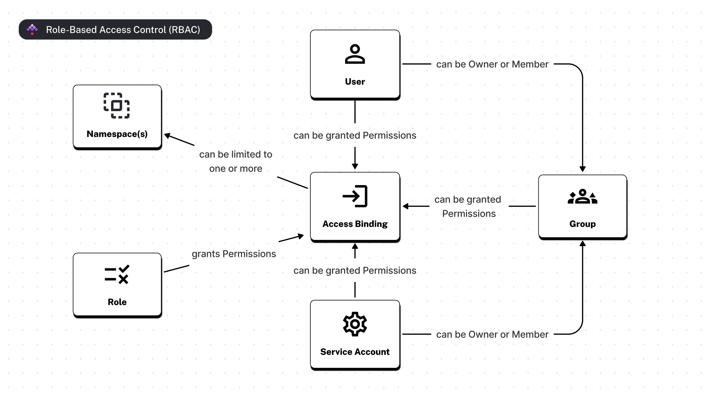
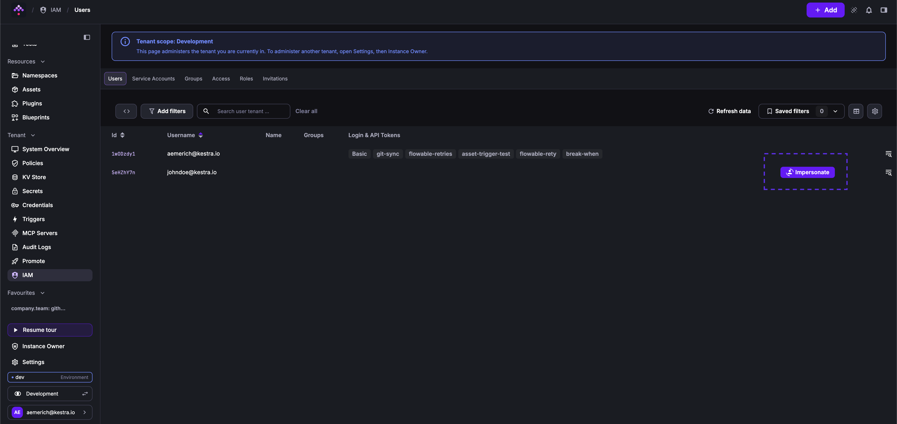
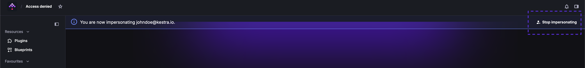
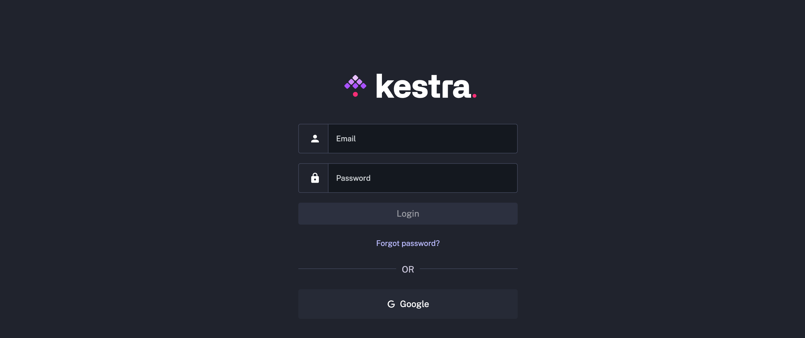
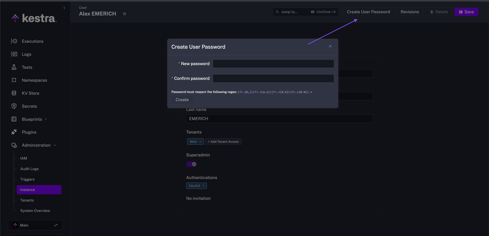

Kestra Enterprise supports Role-Based Access Control (RBAC) to manage access to tenants, namespaces, flows, and resources.

Kestra has three types of entities:

- Users: Represent a **person**. To add users to your Kestra instance, you can do one of the following:
  - [Invite users](../invitations/index.md) to your instance or tenant from the UI
  - Sync users from an external identity provider using [SCIM](../scim/index.mdx)
  - Create users directly using [Terraform](../../../13.terraform/index.mdx)
  - Automate user onboarding, offboarding, and group management from inside a flow using [IAM tasks](../../../15.how-to-guides/iam-automation/index.md)

- Groups: Represent a collection of **Users** and **Service Accounts**. Groups are a useful mechanism for providing the same roles to multiple users or service accounts at once by binding a role to a group.
- Service Accounts: Represent an **application**. They are treated as users when binding role assignments.

All these entities can be assigned to a role, which defines what resources the user, group, or service account can access. These entities do not belong to namespaces, but their permissions can be limited to specific namespaces via bindings on the **IAM** page.

The image below shows the relationship between Users, Groups, Service Accounts, Roles, and Bindings:



## Roles and Bindings

A role is a collection of permissions that can be assigned to users, service accounts, or groups. Each permission is a combination of a **resource** (e.g., `FLOW`, `EXECUTION`, `SECRET`) and one or more **actions** (e.g., `EXECUTE`, `VIEW`, `DELETE`). A role alone grants nothing — it must be attached to a user, service account, or group via a **binding** on the **IAM** page.

Users, service accounts, and groups can hold any number of roles simultaneously. Bindings can be scoped to one or more namespaces — scoped access automatically extends to all child namespaces (for example, binding to `prod` also grants access to `prod.engineering`). You can [configure a default role](../../../configuration/05.security-and-secrets/index.md) to assign it automatically to new users joining via [SSO](../sso/index.md). [Impersonate](#impersonate) allows Instance Owners to verify a user's effective permissions after role assignment.

## Impersonate

After assigning permissions to a user, Instance Owners can impersonate them to verify their access is correct. Impersonation switches your view to that user's perspective. A persistent banner confirms who you are impersonating, and you can return to your own session at any time using the **Stop impersonating** button in the top right.

**From the UI:** go to **IAM → Users**, find the user row, and select **Impersonate** from the action menu on the right.



Once active, a banner at the top of the page confirms the impersonation session. Select **Stop impersonating** to return to your own session.



**From the API:** send a `POST` request to `/api/v1/users/{id}/impersonate`. The response contains a short-lived JWT you can use in place of your regular credentials to act as that user.

```bash
curl -X POST https://your-kestra-instance/api/v1/users/{userId}/impersonate \
  -H "Authorization: Bearer YOUR_API_TOKEN"
```

**From kestractl:** use the `users impersonate` command, which calls the same endpoint and prints the token:

```bash
kestractl users impersonate <user_id>
```

### Resources

A resource is a category of product entity or capability that can be controlled through RBAC. Each resource has its own set of allowed actions.

**Core resources** (namespace-scoped — bindings can restrict access to specific namespaces):

| Resource | Description |
|---|---|
| `FLOW` | Flows, their revisions, graphs, and dependencies |
| `EXECUTION` | Executions, their state, logs, outputs, and files |
| `TRIGGER` | Triggers attached to flows |
| `NAMESPACE` | Namespaces and their files |
| `KVSTORE` | Key-value store entries |
| `SECRET` | Secrets stored in the namespace |
| `CREDENTIAL` | Credentials for external integrations (namespace-level and tenant-level) |
| `REUSABLE_INPUTS` | Reusable input sets defined at the namespace level |

**Apps and features** (tenant-scoped):

| Resource | Description |
|---|---|
| `DASHBOARD` | Custom dashboards |
| `BLUEPRINT` | Custom blueprints |
| `APP` | Apps and their executions |
| `TESTSUITE` | Unit tests |
| `ASSET` | Data assets and lineage |
| `MCP_SERVER` | MCP servers exposing flows as AI tools |
| `COPILOT` | AI Copilot flow generation |

**Administration** (tenant-scoped):

| Resource | Description |
|---|---|
| `USER` | Users in the tenant |
| `GROUP` | Groups and their members |
| `ROLE` | RBAC roles |
| `BINDING` | Role-to-entity bindings |
| `SERVICE_ACCOUNT` | Service accounts |
| `INVITATION` | User invitations |
| `AUDITLOG` | Audit log entries |
| `POLICY` | Governance policies controlling flow and task behavior (namespace-scope and tenant-scope) |
| `SYSTEM_SETTINGS` | Instance-level settings |
| `TENANT_SETTINGS` | Tenant-level settings |

### Actions

Each resource defines its own set of allowed actions. Not every action applies to every resource.

**Common actions** (available on most resources):

| Action | Meaning |
|---|---|
| `VIEW` | Read a single item's details |
| `LIST` | Search or browse items |
| `CREATE` | Create a new item |
| `UPDATE` | Modify an existing item |
| `DELETE` | Remove an item |

**Resource-specific actions:**

| Resource | Additional actions |
|---|---|
| `FLOW` | `EXECUTE` (trigger an execution), `DISABLE`, `ENABLE`, `VALIDATE`, `EXPORT`, `IMPORT` |
| `EXECUTION` | `RESTART`, `KILL`, `REPLAY`, `PAUSE`, `RESUME`, `CHANGE_LABELS`, `ACCESS_LOGS`, `ACCESS_OUTPUTS`, `ACCESS_FILES`, `FOLLOW` (live SSE stream), `EXPORT`, `UNQUEUE`, `FORCE_RUN` |
| `TRIGGER` | `UNLOCK`, `RESTART`, `DISABLE`, `ENABLE`, `EXPORT`, `BACKFILL` |
| `NAMESPACE` | `MANAGE_FILES` (all namespace file operations) |
| `POLICY` | `EXECUTE` (dry-run evaluate a policy against its scope), `EXPORT`, `IMPORT` |
| `APP` | `EXECUTE`, `ACCESS_FILES`, `ACCESS_LOGS` |
| `TESTSUITE` | `EXECUTE` |
| `AUDITLOG` | `EXPORT` |
| `USER` | `MANAGE_GROUP_MEMBERSHIP`, `IMPERSONATE` |
| `GROUP` | `MANAGE_MEMBERS` |
| `COPILOT` | `USE` (only action) |
| `SYSTEM_SETTINGS` | — (`VIEW` and `UPDATE` only; no `CREATE`, `DELETE`, or `LIST`) |
| `TENANT_SETTINGS` | — (`VIEW` and `UPDATE` only; no `CREATE`, `DELETE`, or `LIST`) |

:::alert{type="info"}
For a complete resource-to-endpoint mapping, see the [Permissions reference](./permissions-reference/index.md).

If you are upgrading from Kestra 1.x, see the [RBAC action model migration guide](../../../11.migration-guide/v2.0.0/rbac-action-model/index.md) for how old CRUD permissions map to the new actions and what was dropped.
:::

### MCP server permissions

`MCP_SERVER` is a first-class RBAC resource that controls access to [flow MCP servers](../../../ai-orchestration/03.mcp-server/index.md). Supported actions are `VIEW`, `LIST`, `CREATE`, `UPDATE`, and `DELETE`.

Default role assignments:

| Role | Actions granted |
|---|---|
| Admin | All (`VIEW`, `LIST`, `CREATE`, `UPDATE`, `DELETE`) |
| Developer / Editor | All (`VIEW`, `LIST`, `CREATE`, `UPDATE`, `DELETE`) |
| Launcher | — (not included) |
| Viewer | `VIEW`, `LIST` |

In addition to these permissions, access to a **private** MCP server is also flow-scoped: a user can connect to a private server only if they have `FLOW: EXECUTE` on at least one namespace that contains a flow with an `McpToolTrigger` pointing at that server.

### Managed roles

Kestra ships five managed roles. Each role's full permission set is visible under **IAM → Roles**. Users with `ROLE` `CREATE` can create additional custom roles on top of these. Users can hold multiple roles.

| Role | Description |
|---|---|
| **Admin** | All actions on all resources, including granting any access to anyone. See [Who can grant access](#who-can-grant-access). |
| **Developer** | Everything Editor has, plus: full namespace management (including file management), secrets, credentials, and full blueprint CRUD. For engineers who also need platform-level access. |
| **Editor** | Full flow and execution management (create, update, delete, execute, restart, kill, etc.), triggers, KV, reusable inputs, dashboards, apps, test suites, assets, MCP servers, settings, and Copilot. No namespace file management, no secrets or credentials, blueprint read-only. No IAM resources. |
| **Launcher** | Execute flows and monitor executions (`EXECUTE`, `REPLAY`, `RESTART`, `CHANGE_LABELS`, `ACCESS_LOGS`, `ACCESS_OUTPUTS`, `ACCESS_FILES`, `FOLLOW`, `EXPORT`). Read-only on triggers, KV, dashboards, and assets. No flow write access, no namespace management. |
| **Viewer** | `VIEW`, `LIST`, and `EXPORT` on flows, executions, triggers, and namespaces. Can access execution logs, outputs, files, and live-follow executions. No execution state changes (no restart, kill, replay, etc.). No write access anywhere. |

## Who can grant access

Permissions to manage roles, bindings, groups, and invitations let the holder grant access to anyone, themselves included. Kestra does not limit what they grant to the permissions they already hold. This is by design. Treat these permissions as admin rights for their scope, and grant them only to people you would make admin there.

### Roles

`ROLE` `CREATE` and `UPDATE` let you put any permission in a role, including permissions you don't hold. Updating a role changes every binding that uses it, including tenant-wide bindings. Only an Instance Owner can add `USER` `IMPERSONATE` to a role, set the default role, or edit a managed role.

### Bindings

`BINDING` `CREATE` lets you bind any role to any user, group, or service account, yourself included, at the scope where you hold it:

- On a namespace, you can bind roles on that namespace and its child namespaces. Binding the Admin role to yourself there gives you every permission on those namespaces.
- On the tenant, you can create tenant-wide bindings, which grant every permission in the role.

If the user you bind has no access to the tenant yet, the binding gives them access.

### Groups

Each group member is either a member or an owner. A group owner can add users already in the tenant to the group and make other members owners, without any RBAC permission. Making someone owner of a group lets them give out everything the group's bindings grant.

`GROUP` `MANAGE_MEMBERS` held tenant-wide gives the same power over every group in the tenant, including adding yourself. `USER` `MANAGE_GROUP_MEMBERSHIP` does too, when combined with any tenant-wide `GROUP` permission such as `VIEW`. Joining a group gives you everything its bindings grant, including tenant-wide bindings.

### Invitations

To create an [invitation](../invitations/index.md), you need `INVITATION` `CREATE`. You also need `BINDING` `CREATE` at the scope of each binding in the invitation. For each group in it, you need ownership of the group or `GROUP` `MANAGE_MEMBERS`. Only an Instance Owner can invite an Instance Owner.

### Review changes

Every change to roles and bindings is recorded in the [audit logs](../../02.governance/06.audit-logs/index.md). Filter by the `ROLE` or `BINDING` resource type to review who granted what.

## Instance Owner and Admin

Kestra provides two roles for managing your instance: Instance Owner and Admin.

- Instance Owner is a user type with elevated privileges for global control.
- Admin is a customizable role that grants full access to all resources (scoped to a tenant if multi-tenancy is enabled).

:::collapse{title="Summary"}
Key differences between Admin and Instance Owner:

| Feature                             | Admin (scoped to a tenant if enabled)              | Instance Owner                                       |
|-------------------------------------|----------------------------------------------------|------------------------------------------------------|
| Access Level                        | By default as all permissions, depends on the Role | Manages tenants and IAM across all tenants           |
| Tenant Management                   | No                                                 | View, create, update, delete tenants across all tenants |
| User/Role/Group/Bindings Management | Has the permission by default                      | View, create, update, delete across all tenants         |
| Flow/Execution Management           | Has the permission by default                      | No                                                   |
| Set Instance Owner privilege        | No                                                 | Yes                                                  |
:::

## Instance Owner

Instance Owner is a powerful user type with instance-wide privileges. Instance Owner is intended for tasks that require instance-wide control, such as creating tenants, troubleshooting, or assisting users.

Unlike tenant-scoped roles, Instance Owner operates across all tenants and does not require any Role or Binding. Instance Owners access instance-wide controls through the [Instance Owner console](../../05.instance/00.instance-owner/index.md), which covers tenant management, instance IAM, infrastructure, and governance.

For how to create Instance Owner users and manage the privilege, see [Instance Owner](../../05.instance/00.instance-owner/index.md).

## Admin

Kestra has no Admin user type; Admin is a role with full permissions.

This role can be assigned to any user, service account, or group. This allows you to have different types of admins, grant admin permissions to a whole group, and revoke those permissions at any time without deleting any group or user.

When using multi-tenancy, Kestra assigns the Admin role to the user who created the tenant by default.

:::alert{type="info"}
If you see an error when creating a new User or Service Account, it might be caused by a limit on your license. In that case, [reach out to us](/contact-us) to validate and optionally upgrade your license.
:::

## Creating a user with an Admin role

Admin users are created via the [Setup Page](../../01.overview/02.setup/index.md) on first launch, or by assigning the Admin role to a user in IAM or with [`kestractl`](../../../kestra-cli/kestractl/index.md#iam-management-enterprise-edition):

```bash
# Create the user
kestractl users create --email prod.admin@kestra.io --user-password 'TopSecret42'

# Find the Admin role ID, then bind it to the user in the active tenant
kestractl roles list
kestractl bindings create --type USER --external-id <user_id> --role <admin_role_id>
```

## User lockout

User lockout behavior is configured under `kestra.security.login.failed-attempts`. By default, Kestra locks the user for the `lock-duration` period after a `threshold` number of failed attempts within the `monitoring-window` duration. The default values are:

```yaml
kestra:
  security:
    login:
      failed-attempts:
        threshold: 10
        monitoring-window: PT5M
        lock-duration: PT30M
```

The key attributes are:

- `threshold`: Sets the number of allowed failed attempts before a user is locked out.
- `monitoring-window`: Defines the period during which failed login attempts are counted before triggering a lock.
- `lock-duration`: Defines how long the account remains locked.

With the configuration above, a user gets 10 failed login attempts in a 5-minute window before lockout. They must wait 30 minutes, be unlocked by an Admin, or reset their password using the Forgot Password link. An Instance Owner can also unlock a user manually from the user's detail page.

## Change password

Passwords are changed from the user profile (user avatar, bottom-left of the UI). "Forgot Password" behavior is configured under `kestra.security.basic-auth.password-reset`. Settings to consider are the cooldown time between reset requests and how many requests can be made in a given time window.

```yaml
kestra:
  security:
    basic-auth:
      password-reset:
        cooldown: PT5M         # Minimum time required between two password reset emails for the same user
        rate-limit:
          max-requests: 10     # Maximum number of password reset requests allowed per client within the time window
          window: PT1H         # Time window during which password reset requests are counted for rate limiting
```

### Reset a password as an Instance Owner

Users can reset their password via the Forgot Password link on the login page. An Instance Owner can also reset a user's password from the User Edit page at **Instance Owner → Instance IAM → Users**.





## Password expiration and reuse

:::badge{version=">=2.1" editions="EE"}
:::

Kestra can make Basic Auth passwords expire after a set age, and stop users from setting a password they used recently. Both are off by default.

```yaml
kestra:
  security:
    basic-auth:
      password-max-age: P90D              # How long a password stays valid. Unset by default: passwords never expire
      password-expiry-warning: P7D        # How long before expiry users are warned. Default: P7D
      prevent-reuse-of-last-passwords: 5  # How many passwords, counting the current one, cannot be reused. Default: 0 (no check)
```

`password-max-age` must be a positive duration, and `prevent-reuse-of-last-passwords` must be zero or more. Kestra refuses to start otherwise.

Password expiry applies to users only. Service account passwords never expire because of `password-max-age`, and API tokens are not affected. The reuse check applies to every password, service accounts included.

### Expired passwords

A password expires `password-max-age` after it was last changed, whoever changed it: the user from their profile or the reset page, or an Instance Owner from the user's detail page.

- **Warning:** during the last `password-expiry-warning` before expiry, a banner at the top of the UI tells the user when their password expires, with a link to their profile to change it.
- **Login:** a user who signs in with an expired password is not logged in. Kestra sends them to the reset page with a message explaining that their password has expired, where they choose a new one. This link is valid for one hour and does not need the mail service.
- **API requests:** requests that authenticate with the username and password (HTTP Basic) are rejected once the password has expired.
- **Open sessions:** a session opened with the password cannot be refreshed once the password has expired, so it ends when its current access token does.

When Kestra issues a link for an expired password, it records the attempt as **Password expired** in the instance-level audit logs. The attempt never counts toward the [user lockout](#user-lockout) threshold.

These links follow the same limits as **Forgot password?**: `password-reset.cooldown` per user and `password-reset.rate-limit` per IP address. When a limit is reached, no new link is issued and nothing is recorded. The user is asked to use **Forgot password?**, which requires the mail service, or to sign in again a few minutes later. Any reset link already sent stays valid.

Expiry only applies to signing in with the password. A user who also signs in through [SSO](../sso/index.md) or a one-time code can keep doing so, and does not see the banner in those sessions.

:::alert{type="info"}
Passwords set before this feature have no recorded change date. During the upgrade, every existing password is considered changed at the time of the upgrade, so the upgrade itself expires no password, and the first expiry happens `password-max-age` after it.
:::

### Password reuse

With `prevent-reuse-of-last-passwords` set to `N`, a new password is rejected if it matches the current password or one of the `N - 1` before it. The check applies everywhere a password is set: the user profile, the reset page, and the user detail page used by an Instance Owner. A rejected password does not change anything, and the user can try another one.

The history has these limits:

- Previous passwords are only recorded from the moment the setting is enabled. When you turn it on, only each user's current password is known, so older ones can be reused once.
- Lowering `prevent-reuse-of-last-passwords` takes effect immediately, and the extra entries are deleted at the user's next password change. Raising it again after that does not bring them back.
- Each stored password is checked with the same deliberately slow hash as a login, so a large history makes every password change slower. Keep it to a small number, such as 5 to 10.

### Password reset links

A user has at most one pending reset link. Requesting a new one, from **Forgot password?** or by signing in with an expired password, cancels the previous link, and any password change cancels the pending one.

## RBAC design notes

:::collapse{title="Why is Admin a Role rather than User type?"}

The Admin role is a collection of permissions that can be assigned to users, service accounts, or groups. This lets you grant admin permissions to multiple users or groups, and revoke them at any time without deleting anything.

A user can start as Admin and later have that permission narrowed or removed. Multiple users can share the Admin role, or the same user can hold multiple roles with different scopes.

Users represent authentication (who you are); roles represent authorization (what you can do). Decoupling the two lets you grant permissions to multiple users or groups at once by attaching a single role to a group.
:::

:::collapse{title="Why can't I edit an existing Binding?"}

A binding is immutable. If a binding no longer reflects the desired permissions, delete it and create a new one for the same user, service account, or group with different roles and/or namespaces.
This prevents accidental changes to existing permissions.
:::

:::collapse{title="What happens if you delete a Group?"}

All users and service accounts in that group lose the permissions granted by bindings attached to it. The users and service accounts themselves still exist.
:::
