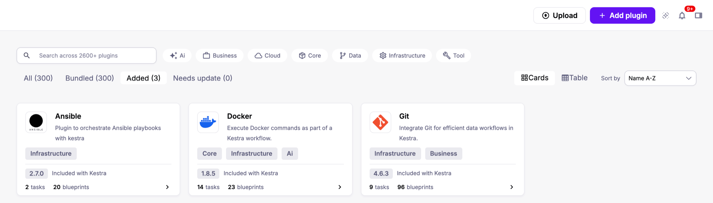
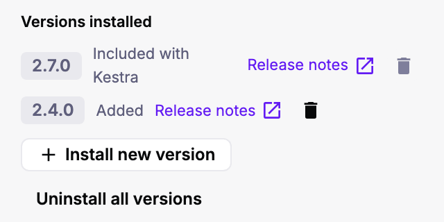

Install multiple versions of any plugin and run them simultaneously across all your flows — assigned at the task, flow, namespace, or instance level.

Versioned plugins give you fine-grained control over which plugin version runs in each flow, namespace, or across your entire instance. Common use cases include:

- **Build and iterate on plugins**: Upload a custom plugin directly from a `.jar` file and test it immediately in any flow — no instance restart required.
- **Ship fixes to production fast**: When Kestra ships a new or patched plugin, install it via the UI or API and point specific flows to the new version within minutes.
- **Upgrade on your own timeline**: Run the latest plugin version in new flows while existing flows stay pinned to a stable version until you're ready to migrate.

## Configuration

Versioned plugins support several properties that can be modified in your Kestra configuration:

- `remoteStorageEnabled`: Specifies whether remote storage is enabled (i.e., plugins are stored on the internal storage).
- `localRepositoryPath`: The local path where managed plugins will be synced.
- `autoReloadEnabled`: Whether the server should periodically rescan repositories for new or removed plugins.
- `autoReloadInterval`: How often to rescan (duration, e.g., `60s`).
- `defaultVersion`: The version to use when none is specified in a flow. Accepted values: `LATEST`, `CURRENT`, `OLDEST`, `NONE`, or an explicit version (e.g., `0.20.0`).

```yaml
kestra:
  plugins:
      management:
        enabled: true # false removes the management actions from the Plugins page, and the /api/v1/instance/versioned-plugins endpoints return 403
        remoteStorageEnabled: true
        customPluginsEnabled: true # setting to false will disable installing or uploading custom plugins
        localRepositoryPath: /tmp/kestra/plugins-repository
        autoReloadEnabled: true
        autoReloadInterval: 60s
        defaultVersion: LATEST
```

### Allow-list URLs

The following URLs must be reachable from your Kestra instance:

- https://repo.maven.apache.org/maven2/
- https://registry.kestra.io/maven/
- https://api.kestra.io/

```yaml
kestra:
  plugins:
    repositories:
      central:
        url: https://repo.maven.apache.org/maven2/
      kestra:
        url: https://registry.kestra.io/maven
```

Refer to the [Plugins and Execution](../../../configuration/04.plugins-and-execution/index.md) page in the Configuration guide for custom Maven repositories.

With remote storage enabled, installed plugins are stored in a plugins repository in the `_plugins/repository` path. For example, the below paths show the storage for 0.19.0 and 0.20.0 versions of the Shell script plugin:

```bash
_plugins/repository/io_kestra_plugin__plugin-script-shell__0_19_0
_plugins/repository/io_kestra_plugin__plugin-script-shell__0_19_0.jar
_plugins/repository/io_kestra_plugin__plugin-script-shell__0_20_0
_plugins/repository/io_kestra_plugin__plugin-script-shell__0_20_0.jar
```

Artifact files are renamed using the format: `<groupId>__<artifactId>__<version>` to be easily parseable (dots `.` are replaced with `_` for `groupId` and `version`).

For locally stored plugins configured by the `localRepositoryPath` attribute, the file path looks like `/tmp/kestra/plugins-repository`. For example, the following plugins are stored locally, where the local repository contains a JSON `plugins.meta` file that contains metadata about remote plugins. This file is used for synchronization, where only plugins with detected changes are synchronized.

```bash
├── io_kestra_plugin__plugin-kafka__0_20_0.jar
├── io_kestra_plugin__plugin-script-shell__0_20_0.jar
├── io_kestra_plugin__plugin-terraform__0_20_0.jar
├── io_kestra_plugin__plugin-transform-grok__0_20_0.jar
└── plugins.meta
```

## Configuration for EE-specific plugins

Some plugins are available only in the Enterprise Edition (EE) of Kestra. To install EE-specific plugins, you need to make sure that your [Enterprise and Advanced configuration](../../../configuration/06.enterprise-and-advanced/index.md) has the `kestra.ee.license.fingerprint` property set (apart from the `kestra.ee.license.id` and `kestra.ee.license.key` properties). The `kestra.ee.license.fingerprint` property is used to verify that the EE license is valid and allows you to use EE-specific plugins.

## Install versioned plugins

Versioned plugins can be installed from the Kestra UI as well as programmatically.

### From the UI

Plugins are managed on the **Plugins** page, under **Resources** in the left sidebar. Every user can open it, and only the Instance Owner can install, update, or uninstall plugins.

Each card is one plugin and shows its highest installed version and where it comes from:

- **Included with Kestra**: the version ships with the Kestra image.
- **Added**: the version was installed through plugin management.
- **Update available**: a newer version of an official Kestra plugin is compatible with this Kestra version. Kestra checks for new versions in the background about once an hour, so after a restart this can take a moment to appear. Custom plugins never show it.

Filter the plugins with **All**, **Bundled**, **Added**, and **Needs update**. A plugin with both a bundled and an added version counts in both **Bundled** and **Added**. When some plugins have an update, a banner says how many, and **Show them** applies the **Needs update** filter. Switch between **Cards** and **Table** to change the layout.

A plugin marked **Not versionable** ships one version per Kestra image, so it can't be updated or installed in another version.



As the Instance Owner, you can:

- select **Add plugin** at the top of the page to install a plugin from the Kestra registry or, when custom plugins are enabled, from its Maven coordinates
- select **Upload** to install a plugin from a `.jar` file, when custom plugins are enabled
- select **Update to {version}** on a card to install the newer version alongside the current one

Open a plugin to see its **Versions installed** in the right-hand column, each with its source and, for official plugins, a link to its release notes. A version marked **Not loaded on this server** was installed but isn't available on this webserver yet. From there, **Install new version** adds another version, the trash icon next to an added version uninstalls it, and **Uninstall all versions** removes every added version. Versions included with the Kestra image can't be uninstalled.



Installs from **Add plugin**, **Install new version**, and **Update to {version}** run in the background. You can leave the page while a plugin downloads, and the install finishes on its own. An upload completes before its dialog closes.

Other users see the same pages in a **Read-only view**: installed versions, their sources, and available updates, with the actions disabled.

When `kestra.plugins.management.enabled` is `false`, the page shows the plugins and their sources, with no management actions and no **Added** or **Needs update** filters.

Links to the former **Instance Owner → Infrastructure → Versioned Plugins** screen open the **Plugins** page filtered on **Added**, and links to a plugin on that screen open the **Plugins** page searched by its artifact ID.

### From the API

Only Instance Owner users can install versioned plugins with the API. To install a versioned plugin, you can use the API POST request with your username and password with `-u` or an [API token](../../03.auth/api-tokens/index.md).

With Kestra username and password:

```bash
curl -X POST http://0.0.0.0:8080/api/v1/instance/versioned-plugins/install \
-u 'admin@kestra.io:kestra' \
-H "Content-Type: application/json" \
-d '{"plugins":["io.kestra.plugin:plugin-airbyte:0.21.0"]}'
```

With API Token:

```bash
curl -X POST http://0.0.0.0:8080/api/v1/instance/versioned-plugins/install \
-H "Authorization: Bearer YOUR-API-TOKEN" \
-H "Content-Type: application/json" \
-d '{"plugins":["io.kestra.plugin:plugin-airbyte:0.21.0"]}'
```

To uninstall a versioned plugin, use the following DELETE request:

```bash
curl -X DELETE http://0.0.0.0:8080/api/v1/instance/versioned-plugins/uninstall \
-u 'admin@kestra.io:kestra' \
-H "Content-Type: application/json" \
-d '{"plugins":["io.kestra.plugin:plugin-airbyte:0.21.0"]}'
```

Starting in 2.1, only plugins installed through plugin management can be uninstalled. A plugin bundled with the Kestra image returns a `409 Conflict` with the message `Plugin artifact '<coordinates>' was not installed through plugin management and cannot be uninstalled.`, and a plugin that isn't installed returns a `404`. In 2.0, uninstalling a bundled plugin returned `200` without removing anything.

To check for all available versions of a plugin, you can use the following API request to resolve:

```bash
curl -X POST http://0.0.0.0:8080/api/v1/instance/versioned-plugins/resolve \
-u 'admin@kestra.io:kestra' \
-H "Content-Type: application/json" \
-d '{"plugins":["io.kestra.plugin:plugin-airbyte:0.21.0"]}'
```

If you want to install a newer plugin version, use the install request with the specified version or use `LATEST` instead of the version number. This creates a second, separate installation of the plugin, so you can keep using an old version in production flows and test using the newer version in development.

```bash
curl -X POST http://0.0.0.0:8080/api/v1/instance/versioned-plugins/install \
-u 'admin@kestra.io:kestra' \
-H "Content-Type: application/json" \
-d '{"plugins":["io.kestra.plugin:plugin-airbyte:LATEST"]}'
```

#### Install in the background

:::badge{version=">=2.1" editions="EE"}
:::

`POST /api/v1/instance/versioned-plugins/install` waits until every plugin is downloaded. To install without waiting, start an install job with the same body. It returns `202` with the job right away. When custom plugins are disabled, a request that includes a plugin outside `io.kestra` returns `403`, while `/install` skips that plugin:

```bash
curl -X POST http://0.0.0.0:8080/api/v1/instance/versioned-plugins/install-jobs \
-H "Authorization: Bearer YOUR-API-TOKEN" \
-H "Content-Type: application/json" \
-d '{"plugins":["io.kestra.plugin:plugin-airbyte:LATEST"]}'
```

The job runs on the webserver that received the request, whether or not the client stays connected. To follow it, open the Server-Sent Events stream at `GET /api/v1/instance/versioned-plugins/install-jobs/{jobId}/follow`. It sends the job's state, then each change with the download progress of each plugin, and ends when the job finishes with `SUCCEEDED` or `FAILED`. Only the user who started a job can follow it; any other job ID returns `404`.

A webserver runs four install jobs at a time and queues the next ones as `PENDING`. It accepts up to 16 unfinished jobs and returns `429` beyond that. Jobs live on the webserver that runs them. If it shuts down, its unfinished jobs fail. If it stops responding, the stream reports them as `FAILED` about a minute later. Start failed jobs again. The user who started a job also sees it in their notifications.

#### List installed plugins

:::badge{version=">=2.1" editions="EE"}
:::

To see every plugin loaded on the instance, whether it ships with the image or was installed through plugin management, use the installed plugins endpoint. Any authenticated user can call it.

```bash
curl http://0.0.0.0:8080/api/v1/plugins/installed \
-H "Authorization: Bearer YOUR-API-TOKEN"
```

The endpoint isn't tenant-scoped and returns up to 1,000 plugins per page (`size`, default and maximum `1000`). Filter with `filters[q][EQUALS]=<text>` to search plugins, or `filters[artifactId][IN]=<artifactId>` to match artifact IDs. To get a single plugin, use `GET /api/v1/plugins/installed/{groupId}/{artifactId}`.

Each plugin lists its installed `versions`, highest first. Two flags on each version tell you where it came from:

- `bundled`: the plugin ships with the Kestra image.
- `managed`: the plugin was installed through plugin management and can be uninstalled.

A version can be both. `updateStatus` reports `UP_TO_DATE`, `UPDATE_AVAILABLE`, or `UNKNOWN` when Kestra can't check for a newer version, alongside `latestVersion` and `latestReleaseNotesUrl`.

The `/api/v1/instance/versioned-plugins` endpoints are unchanged: they remain restricted to Instance Owners and list only plugins installed through plugin management.

<!-- Runtime-verified 2026-11-04 on EE develop c1ec09b: response shape, 401 anonymous, size/q/artifactId IN filters. Uninstall 409/404 is source-verified only (needs an Instance Owner). -->

### From the CLI

To install versioned plugins from the [Kestra CLI](../../../kestra-cli/kestra-server/index.md), you can use the following command:

```bash
./kestra plugins install --locally=false io.kestra.plugin:plugin-jdbc-duckdb:0.21.2
```

The `--locally` flag specifies whether the plugin should be installed locally or according to your Kestra configuration, where remote storage can be enabled.

- `--locally=true` installs the plugin locally.
- `--locally=false` checks if `remoteStorageEnabled` is enabled and then plugins are downloaded and pushed to the [configured runtime and storage backend](../../../configuration/02.runtime-and-storage/index.md) directly.

## `version` property in a Flow

Specify the plugin version on any task or trigger using the `version` property. The following flow pins the Shell Script plugin to `0.21.0` while a newer version is also installed on the instance:

```yaml
id: shell_script_example
namespace: company.team

tasks:
  - id: http_download
    type: io.kestra.plugin.core.http.Download
    uri: https://huggingface.co/datasets/kestra/datasets/raw/main/csv/orders.csv

  - id: shell_script_task
    type: io.kestra.plugin.scripts.shell.Script
    version: "0.21.0"
    outputFiles:
      - first.txt
    script: |
      echo "The current execution is : {{ execution.id }}"
      echo "1" >> first.txt
      cat {{ outputs.http_download.uri }}
```

The `version` property also accepts specific, non-case-sensitive values like in the configuration file:

- `LATEST` (or `latest`): To use the latest available version of a Kestra plugin.
- `OLDEST` (or `oldest`): To use the oldest available version of a Kestra plugin.

When there are multiple versions of a plugin available, Kestra resolves the version of a plugin by following this priority order:
1. **Task-Level**: Using the version specified in the `version` property.
2. **Flow-Level**: Using the plugin’s default version.
3. **Namespace-Level**: Using the plugin’s default version for the namespace.
4. **Instance-Level**: Using the value set in `kestra.plugins.management.defaultVersion` (default: `LATEST`).
    - This property can be configured to `NONE` to enforce that a version is always explicitly defined.

By default, Kestra uses `LATEST` for core plugins when no version can be resolved. For other plugins, an unresolvable version renders the flow invalid.

:::alert{type="info"}
The version is resolved both at flow creation time and execution time to ensure the correct plugin version is used during both stages. This means that a Task/Trigger can only be deserialized after ensuring that all default versions are properly resolved.
:::

