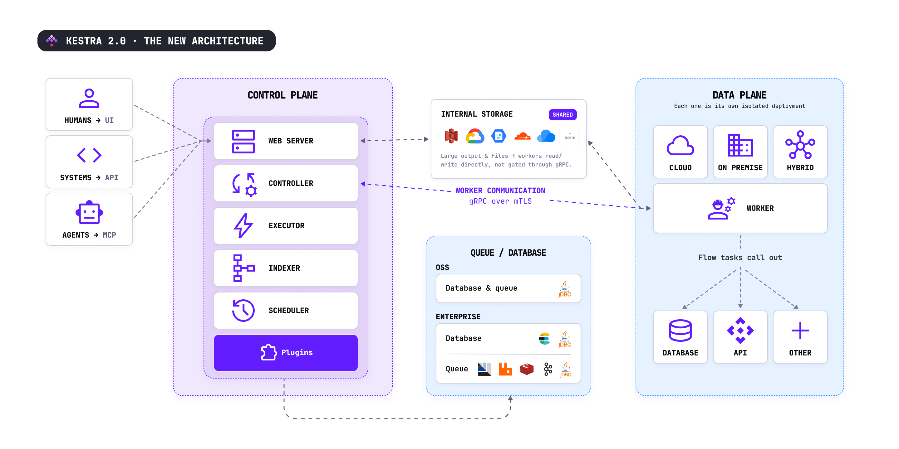
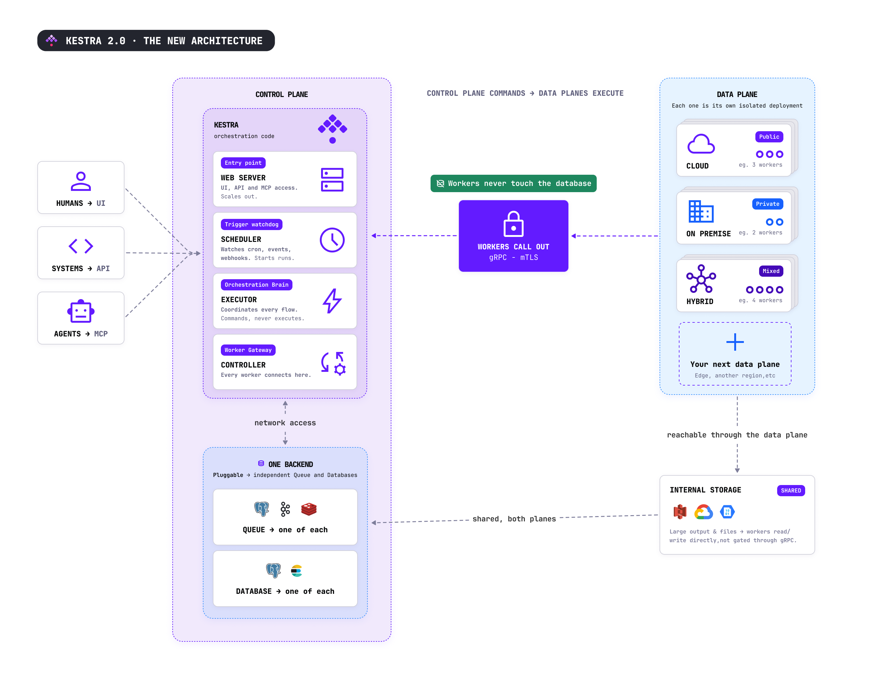

Kestra is built on a single unified, pluggable backend. One set of queue and persistence contracts is satisfied by your chosen backend: a relational database by default, or a broker-backed alternative for higher throughput. All server roles are stateless and communicate through the queue layer, except Workers, which connect to a Worker Controller over gRPC.

## Control plane and data plane

Kestra's server roles divide into two planes:

- **Control plane**: the stateless coordination roles: Executor, Worker Controller, Scheduler, Webserver, and Indexer. These roles don't run user tasks, apart from the platform maintenance tasks that the system Worker embedded in each Executor runs, and they communicate through the queue.
- **Data plane**: the Worker. Workers run runnable tasks, polling triggers, and realtime triggers, and are the roles that run task code against your infrastructure. A Worker connects to the control plane's Worker Controller over gRPC and can run in cloud, on-premises, or hybrid environments independently of the rest of the deployment.

This separation enables hybrid deployments where the control plane is managed by Kestra while Workers run inside your own infrastructure, or both are self-hosted.

## Server roles

Kestra has six server roles. In a standalone deployment, all six run as threads inside a single process. In a distributed deployment, each role runs as its own independently scaled process.

| Role | Responsibility |
|------|---------------|
| **Executor** | Drives the execution state machine. Consumes execution events and worker results, determines the next task to run, and dispatches work. Runs no user code. |
| **Worker Controller** | The single point that Workers talk to. Dispatches jobs to Workers over gRPC and receives their results, logs, and metrics. Workers never touch the queue or database directly. Runs embedded in the Webserver and standalone server by default. |
| **Worker** | Runs runnable tasks, polling triggers, and realtime triggers. Connects to the Worker Controller over gRPC, and reads and writes task files in [internal storage](./data-components/index.md#internal-storage). |
| **Scheduler** | Evaluates Schedule, polling, and realtime triggers and starts executions when they fire. Flow triggers are evaluated by the Executor, and webhook triggers by the Webserver. |
| **Webserver** | Serves the [REST API](../api-reference/index.mdx) and [UI](../09.ui/index.mdx), live updates, and webhooks. Embeds an Indexer and a Worker Controller by default. |
| **Indexer** | Writes logs, metrics, and execution statistics from the queue to the repository, plus audit logs and asset lineage in the Enterprise Edition. Required with every backend. |

## Queue and repository

The queue layer is how server roles communicate, apart from the gRPC connection between Workers and the Worker Controller. A server emits a typed message onto a named queue; another server consumes it. One backend implementation satisfies all queue contracts:

- **JDBC** (default) — backed by any supported relational database (PostgreSQL, MySQL). Available in all editions.
- **Kafka** — Enterprise Edition. Pairs with Elasticsearch for the search and read model.
- **Redis**, **AMQP**, **GCP Pub/Sub** — Enterprise Edition. Additional broker-backed options for higher throughput.

The repository stores all domain entities: flows, executions, logs, triggers, and secrets. In a JDBC deployment, the relational database handles both the queue and repository. With an Elasticsearch repository, components write flows, executions, and triggers to Elasticsearch directly, and the Indexer writes logs, metrics, and other high-volume records in batches.

## Worker communication

Workers do not subscribe to the job queue directly. Each worker opens a persistent bidirectional gRPC stream to the Worker Controller and uses that stream for the lifetime of its connection:

- The Worker Controller dispatches jobs from the queue onto the stream.
- Workers send results, logs, and metrics back to the Worker Controller over the same gRPC connection.
- Kill signals and metadata changes are broadcast to all connected workers.

gRPC transport is available in all editions. TLS, mTLS, and JWT-based worker authentication for the channel are Enterprise Edition features. The open-source edition uses a plaintext channel and can require a shared username and password; see [transport security](../security-hardening/index.md#transport-security).

## How an execution runs

1. A user or client defines a flow through the Webserver's REST API. The flow is validated and stored in the repository under its namespace.
2. A trigger fires — a schedule comes due, an external event matches, or an API call requests a run. The Scheduler (for schedule and polling triggers) or the Webserver (for manual runs) emits a new execution onto the queue.
3. The Executor picks up the execution and runs its state machine to decide the next task.
4. For each task, the Executor asks the worker-queue resolver for a routing decision, then dispatches a worker task onto the queue.
5. The Worker Controller routes the job to a matching worker. The worker loads the task plugin, reads any inputs from internal storage, executes the task code, writes outputs back to internal storage, and emits the result.
6. The Executor joins the result back into the execution, advances the state machine, and either dispatches the next task or terminates the execution.
7. The Webserver serves the evolving execution state and logs to the UI by reading the repository, and streams live updates. The Indexer writes logs and metrics to the repository in batches.

## Execution context

Task outputs are stored separately from the execution row and fetched on demand. This keeps the execution record small as flows grow in complexity and improves performance at high concurrency.

## Enterprise Edition

Enterprise Edition is an additive overlay on the open-source core — not a fork. It adds multi-tenancy, action-based RBAC, identity-provider integration, audit logging, and additional queue backends by supplying alternative implementations of the same core contracts the open-source engine depends on. All open-source behavior is preserved.

## Monitoring

Every server role exposes a Prometheus scrape endpoint and OpenTelemetry traces. Three platform-wide metrics serve as primary health signals:

| Metric | Description |
|--------|-------------|
| `kestra.queue.message.lag` | Backlog of unprocessed worker jobs, tagged by worker queue. A steadily rising lag means Workers cannot keep up. Opt-in: set `kestra.metric.queue.lag.enabled: true`. |
| `kestra.worker.pending.count` | Jobs waiting for a free Worker thread, per Worker. |
| `kestra.worker.running.count` | Jobs currently running, per Worker. |

Per-role metrics are documented on each component's page.

## Components in detail

import ChildCard from "~/components/docs/ChildCard.astro"

<ChildCard />
