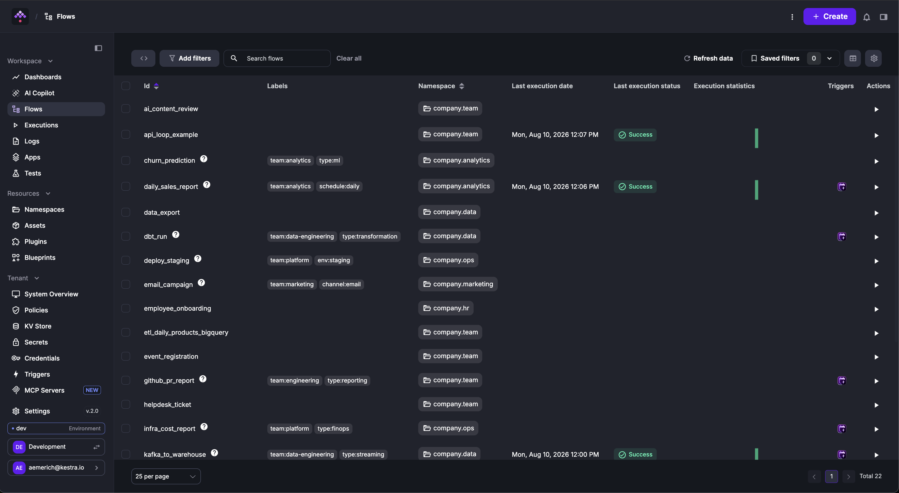
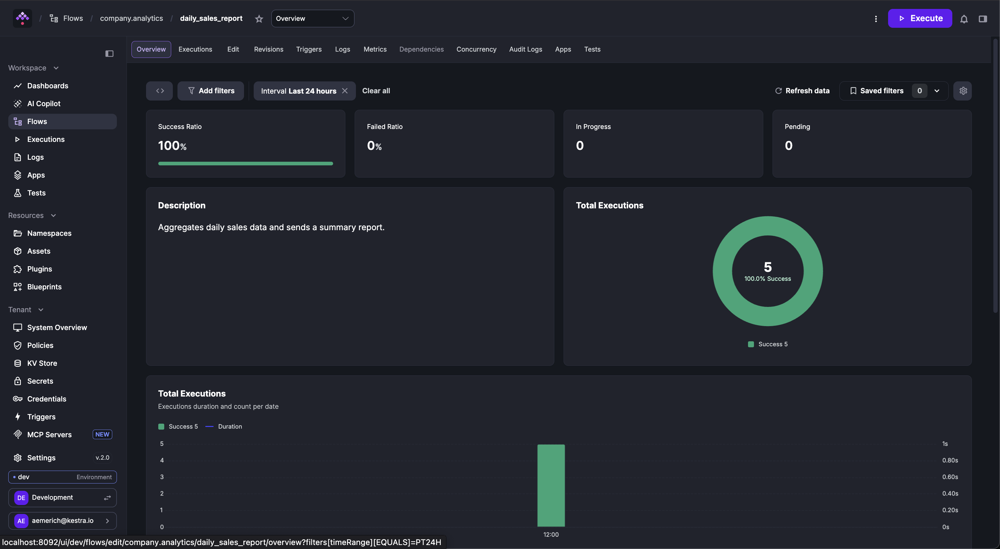
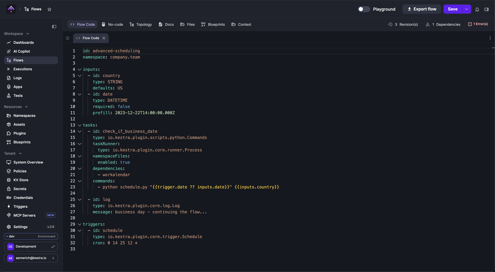
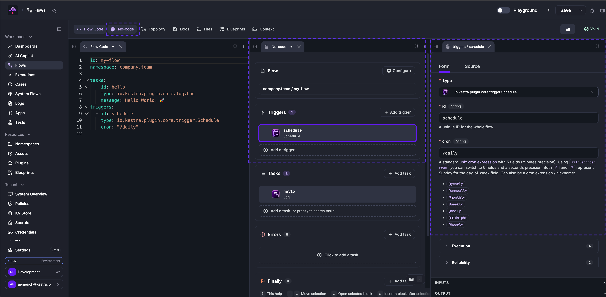
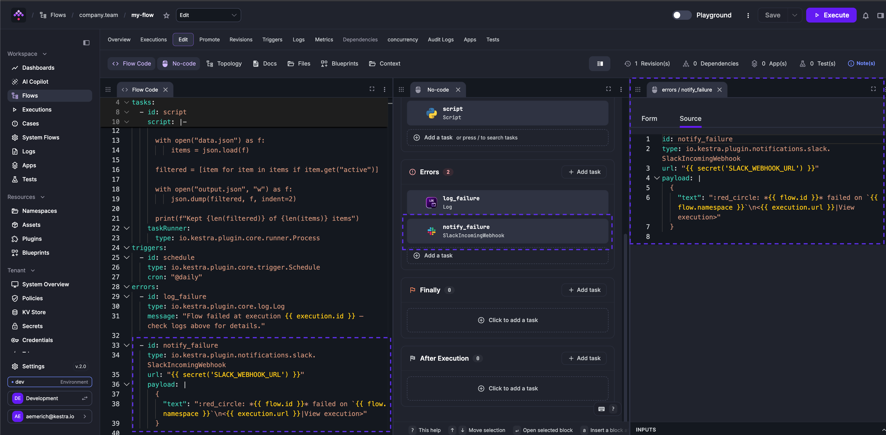
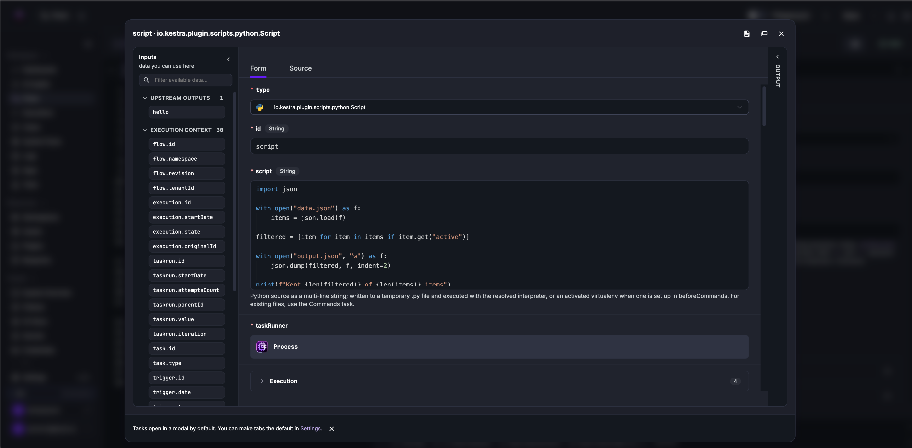
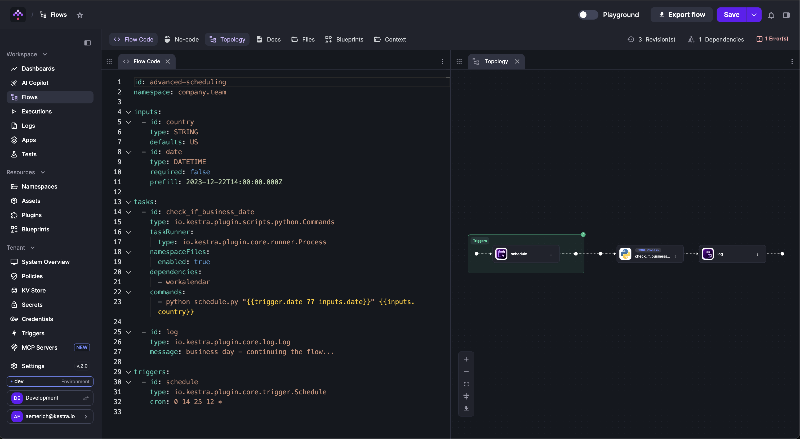

The **Flows** page is the primary interface for authoring and running flows.

The **Flows** page lists all flows. Flow IDs open to the individual flow page; new flows are created from the top-right corner.

A **Flow** page has tabs for Overview, Executions, Edit, Revisions, Triggers, Logs, Metrics, Dependencies, and more.

## Filters

From the main Flows page, you can filter the displayed flows on fields like namespace, scope, labels, and open text. The filters are key based with comma-separated OR-conditions and spaced-separated AND-conditions. The following video demonstrates the filters in action:

<iframe src="https://demo.arcade.software/azAPQSNOo4z4I3CZcF9c?embed&embed_mobile=tab&embed_desktop=inline&show_copy_link=true" title="Flows Filters | Kestra" frameborder="0" loading="lazy" webkitallowfullscreen mozallowfullscreen allowfullscreen allow="clipboard-write; autoplay" style="position: absolute; top: 0; left: 0; width: 100%; height: 100%; color-scheme: light;" ></iframe>

## Source search

**Source search** finds a value across your flows and replaces it in bulk, for example to find every flow that uses a plugin, a property, or a secret name, and rename it everywhere. Open it from the actions menu (**⋮**) next to **Create** at the top of the Flows page, or go to `/ui/<tenant>/flows/search`.

Pick what to search under **Search in**:

- **Flows**: searches the flow source. Narrow it with a namespace and a **Scope** (**All source**, **Tasks**, **Triggers**, or **Inputs**), and turn on **Match case**, **Match whole word**, or **Use regular expression**.
- **Namespace files**: matches file paths only, not file content.
- **KV keys** and **Secret keys**: match key names only. Values are never searched or shown.

Results are grouped by flow, with a preview of each match. Select **Show replace** to enter a replacement, then use **Replace this match**, **Replace all in flow**, or **Replace all** for every selected match. Kestra shows a diff of the change before applying it. Replace applies to flows only; the other result types are search-only.

Some flows are excluded from a replace and are marked **Read-only**: flows synced from Git (with the `system.readOnly` label) and, in the Enterprise Edition, flows in namespaces where you don't have the `UPDATE` permission on `FLOW`. A flow is also skipped if the replacement would make it invalid. Kestra reports how many flows were updated and why any were skipped.

When a search returns more matches than it can show, **Replace all** applies only to the matches shown, so narrow the query first.

<!-- Source-verified against kestra#17438 (2.0, merged 2026-08-10) and releases/v2.0.x en.json; not runtime-tested. TODO: screenshot. -->

## Edit

The **Edit** tab is the main authoring environment. Open panels from the tab bar and arrange them side by side:
- **Flow Code** — YAML editor with autocomplete
- **No-code** — visual flow builder with task cards and a structured outline
- **Topology** — visual DAG of the flow
- **Docs** — plugin documentation, updates as you move the cursor
- **Files** — namespace files editor
- **Blueprints** — ready-to-use flow examples
- **Context** — namespace variables, KV pairs, and secrets (Enterprise)

From the top-right of the editor, you can access **Revisions**, **Dependencies**, and any validation **Errors**. Use **Export flow** to download the flow as a YAML file.

  <iframe src="https://www.youtube.com/embed/SGlzRmJqFBI?si=ZIGsOoyp1KlXus72" title="YouTube video player" allow="accelerometer; autoplay; clipboard-write; encrypted-media; gyroscope; picture-in-picture; web-share" referrerpolicy="strict-origin-when-cross-origin" allowfullscreen></iframe>

### Flow Code view

The **Flow Code** view is a YAML editor with autocomplete. Tasks added here appear immediately in the No-code and Topology views.

### No Code view

The **No Code** view is a canvas-based flow editor. The canvas displays each flow section — Triggers, Tasks, Errors, Finally, and After Execution — as a group of visual blocks. Selecting a block opens its configuration form in a third panel alongside the canvas.

Selecting a block opens its configuration form in a third panel alongside the canvas. The form has two tabs: **Form** (guided fields with inline documentation) and **Source** (raw YAML for that block). Switching to **Source** allows YAML to be written or pasted directly — the flow YAML editor on the left stays in sync instantly.

Blocks are added via **+ Add task** or **+ Add trigger** in the relevant section, or by pressing `/` anywhere on the canvas to search and insert at the cursor position. The keyboard shortcuts shown in the bottom bar support navigation (`↑ ↓`), opening a selected block (`⇧`), and insertion after the current selection.

**Configure** at the top of the canvas opens flow-level properties: namespace, description, inputs, outputs, variables, and more.

#### Focused view

Opening a block expands it into a focused modal by default. The modal has two panels:

- **Left — Inputs**: lists every value you can reference in this task's properties. **Upstream Outputs** shows the output keys of all tasks that run before this one; **Execution Context** lists all built-in variables available at runtime (`flow.id`, `execution.id`, `taskrun.id`, `trigger.date`, and so on). Use these as a reference when writing Pebble expressions in the form fields.
- **Right — Form / Source**: the task configuration form. Switch to **Source** to edit raw YAML for the block. An **Output** panel on the right edge shows the task's output schema.

Tasks open as a modal by default; this can be changed to tabs in **Settings**.

Multiple panels can be open simultaneously — for example, **Docs** alongside the canvas for plugin documentation while configuring a task. The **Actions** menu provides export and copy options at any time.

:::alert{type="info"}
Flow Code, No-code, and [AI Copilot](../../develop-with-ai/01.ai-copilot/index.md) all stay in sync. Start in any mode — write YAML, describe your flow to the Copilot, or build visually on the canvas — and switch freely at any point. Every change is reflected across all three views instantly.
:::

### Topology view

The **Topology** view shows a visual DAG of the flow — useful for complex flows with multiple branches. Zoom controls and a `.png` export are in the bottom-left corner.

### Documentation view

The **Documentation** view displays plugin docs directly inside the editor. The panel updates as you move your cursor to reflect the task type at the current position.

:::alert{type="warning"}
If you use the [Brave browser](https://brave.com/), you may need to disable Brave Shields to make the editor work as expected. To view task documentation, set the **Block cookies** option to **Disabled** in Shields settings at `brave://settings/shields`.
:::

### Files view

The **Files** view lets you create, edit, and delete [Namespace Files](../../06.concepts/02.namespace-files/index.md). Open multiple files side by side using the multi-panel layout.

### Blueprints view

The **Blueprints** view gives you example flows to copy directly into the editor — useful when working with a new plugin.

### Context panel (Enterprise)

The **Context** panel gives you direct access to namespace Variables, KV pairs, and Secrets from within the editor. You can also render expressions against those values inline.

## Revisions

The **Revisions** tab shows the history of flow code changes. For more details, see [Revisions](../../06.concepts/03.revision/index.md).

## Dependencies

The **Dependencies** tab shows the relationship between this flow and other flows, with navigation between them. The **Dependencies View** on the **Namespaces** page shows all flows in the namespace and how they relate to one another — the flow-level Dependencies view is scoped to the selected flow only.

