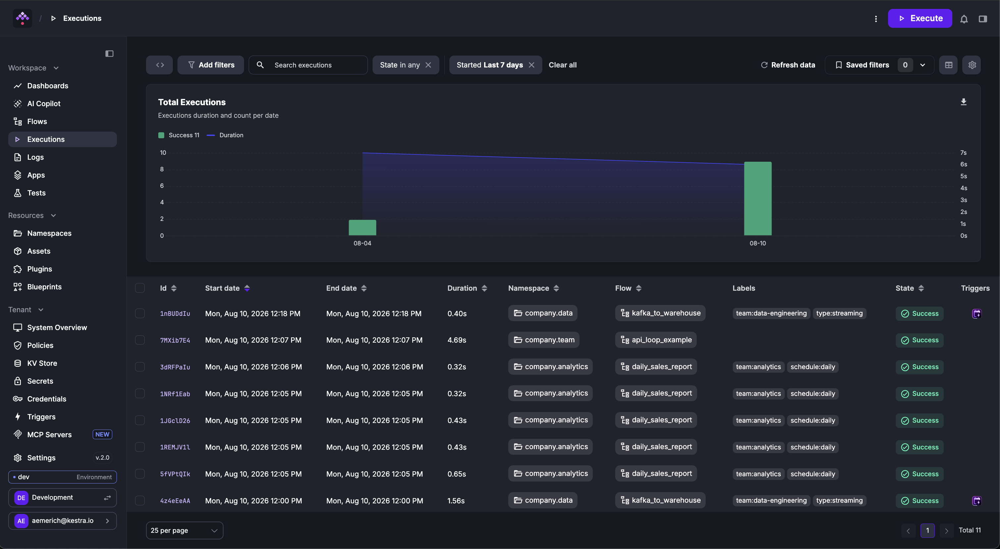
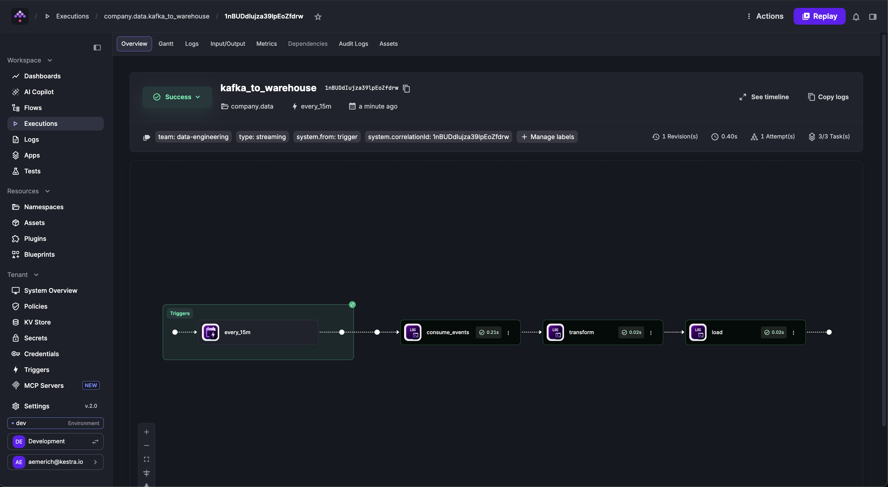
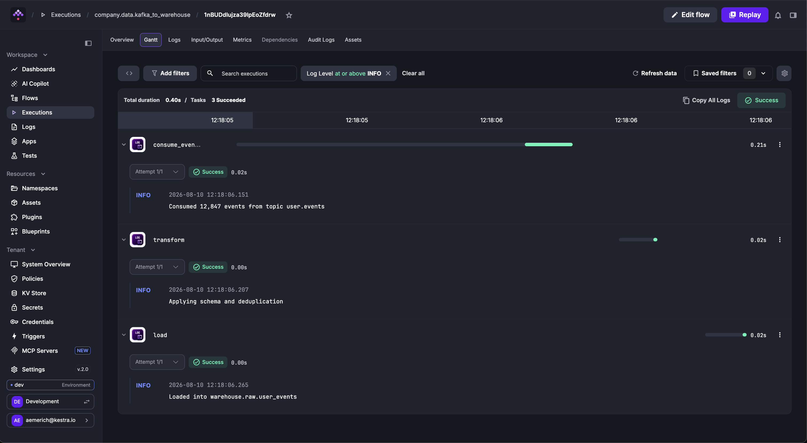
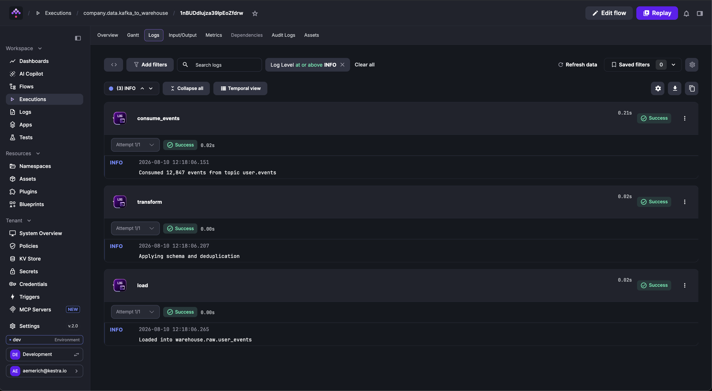
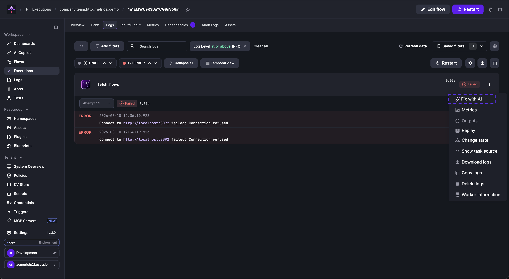
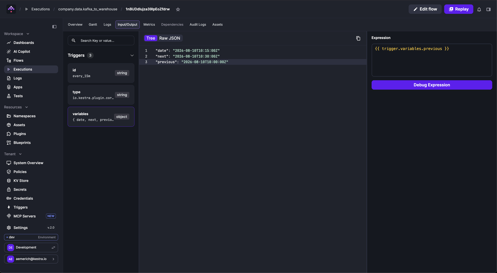
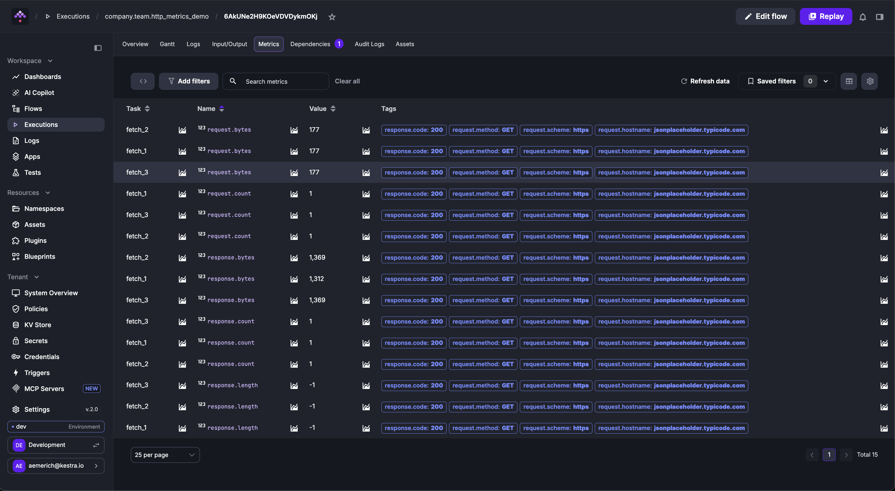
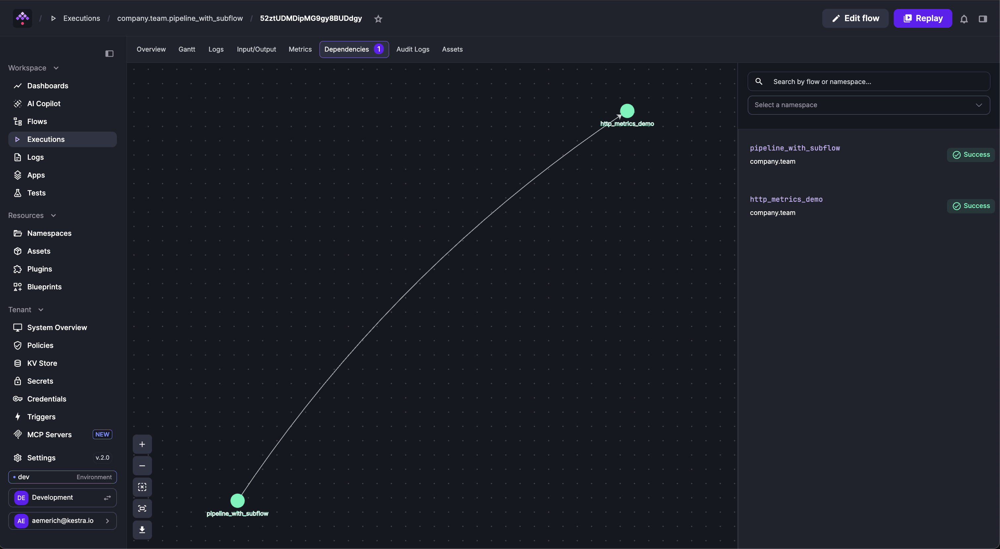

The **Executions** page lists all flow executions across the tenant.

Selecting one or more executions enables bulk actions (Restart, Kill, Pause, Force Run). An execution ID opens to the execution detail view.

## Overview

The **Overview** tab displays the details of a flow execution.

The **Overview** tab provides these actions:
- **Set Labels** — adds a label to the execution for tracking or filtering.
- **Change State** — manually updates the execution state.
- **Force Run** — forces the execution to run. May create duplicate task executions.

The **Previous** and **Next Execution** buttons step through past and scheduled future executions.

- Execution **state** is displayed along with a timestamped state history from `CREATED` to `RUNNING` to `SUCCESS` (or any other possible state).
- Flow [Variables](../../05.workflow-components/04.variables/index.md) and [Inputs](../../05.workflow-components/05.inputs/index.md) are clearly listed along with execution details including dates and the corresponding namespace and flow.
- Flow outputs and trigger data are captured with expression rendering.

The **Overview** tab also supports [**Replay**](../../15.how-to-guides/replay/index.md) and **Pause**, and displays execution history for comparing previous runs.

The Overview tab also embeds a **topology diagram** showing each task's state in the execution graph — green for `SUCCESS`, red for `FAILED`. Click any task node to access its logs, replay it, or change its status.

## Filters

Executions can be filtered by namespace, flow ID, labels, state, start date, or free text. Applied filters can be saved and results exported. The following video demonstrates the filters in action:

<iframe src="https://demo.arcade.software/1zqBYvR7JifFkwNSa7Qh?embed&embed_mobile=tab&embed_desktop=inline&show_copy_link=true" title="Executions | Kestra EE" frameborder="0" loading="lazy" webkitallowfullscreen mozallowfullscreen allowfullscreen allow="clipboard-write; autoplay" style="position: absolute; top: 0; left: 0; width: 100%; height: 100%; color-scheme: light;" ></iframe>

## Timeline

:::badge{version=">=2.1" editions="OSS,EE,Cloud"}
:::

The chart at the top of the Executions page has two modes: **Counts**, which shows the number of executions per state over time, and **Timeline**, which draws each execution as a bar from its start date to its end date. Use the timeline to spot overlapping runs, gaps in a schedule, or an execution that held a concurrency slot longer than expected. Kestra remembers the mode you last picked.

- **Rows**: executions are grouped by namespace. Click a namespace to drill into its flows; the breadcrumb shows the total and failed run counts for the current level.
- **Bars**: each bar takes its color from the execution state, and running executions extend to the current time. When a row has too many executions to draw individually, bars are aggregated into buckets tinted by the most common state. Zoom in for execution-level detail.
- **Bar details**: click a bar to see its namespace, flow, state, and dates, then **Open execution** or **Show only this flow**.
- **Legend**: shows the count per state. Click a state to dim it.
- **Time range**: zoom, pan, or jump to **Now** from the toolbar, or drag across the density bar to select a range. The default range is 24 hours, from 5 minutes up to 1 year.

The filters applied to the Executions page also apply to the timeline. The timeline loads at most 1,000 executions, newest first; narrow the time range or filters to see the rest.

<!-- TODO: screenshot. kestra#19334 merged to develop 2026-10-30, not in the v2.1.x RC cut; confirm it ships in 2.1 GA. Not verified: which filters the density bar ignores. -->

## Gantt

The **Gantt** tab visualizes each task's duration. From this view, a specific task can be replayed, its source code viewed, status changed, or metrics and outputs inspected.

The **Gantt** view displays all successful and failed tasks in the execution. For failed tasks, use **Fix with AI** from the task menu to open the flow editor with [AI Copilot](../../develop-with-ai/01.ai-copilot/index.md) pre-loaded with the error context.

Click a row, or select it and press Enter, to open its details in a resizable panel next to the Gantt. For a task run, the panel shows where the task sits in the flow, its attempts, and its logs. Press Escape to close the panel.

### Loop iterations

Each [`Loop`](../../05.workflow-components/01.tasks/00.flowable-tasks/index.md#loop) iteration runs as its own execution, and the Gantt shows those iterations in place, without leaving the execution you have open:

- A Loop row shows its number of iterations and, when some failed, a failed count. Expand the row with its chevron to list its iterations, each with its value, state, and duration. Click the failed count to expand the loop and keep only its failed iterations.
- Expand an iteration to list its task runs. A Loop inside an iteration expands the same way, at any depth.
- Select an iteration to see its first failure and its task runs in the panel. **Open iteration** opens its execution page.
- Select a Loop row to browse its iterations in the panel, 10 at a time. Filter them by state, search them by exact value, or select **Show all executions** to open the executions list filtered on this loop.
- With a task run inside an iteration selected, press `[` or `]`, or use **Previous iteration** and **Next iteration**, to open the same task in the neighboring iteration.

Above the Gantt, **Failed only** keeps only failed task runs and iterations, so stepping between iterations hops from one failure to the next. **Go to first failure** walks down nested loops to the first task that failed and selects it.

If the same Loop task runs more than once in an execution, for example after a retry, the Gantt can't tell its iterations apart and shows them together.

<!-- TODO(runtime test): Gantt panel and in-place Loop iterations (kestra#19603, PRs kestra#19989 and kestra#21564, merged to develop 2026-10-21 and 2026-10-30) documented from source only. Check in the UI on a 2.1 build: chips and failed-chip filter, panel content per row type, [ / ] stepping, Failed only, Go to first failure, the duplicate-Loop behavior. Retake execution-gantt-view.png and add a screenshot of an expanded nested Loop with the panel open. -->

## Logs

The **Logs** tab displays task logs, filterable by log level. Logs can be copied to clipboard or downloaded as a file. Logs can be viewed per task in the **Default View** or temporally based on timestamp in the **Temporal View**.

For failed tasks, use **Fix with AI** from the task menu to open the flow editor with [AI Copilot](../../develop-with-ai/01.ai-copilot/index.md) pre-loaded with the error context.

## Input/Output

The **Input/Output** tab shows execution inputs and all task outputs — variables to pass downstream or files to download and inspect. The example below downloads a file generated from a SQL query.

<iframe src="https://demo.arcade.software/BTW4jefHMCoxw5VgY9mB?embed&embed_mobile=tab&embed_desktop=inline&show_copy_link=true" title="Execution Outputs | Kestra" loading="lazy" webkitallowfullscreen mozallowfullscreen allowfullscreen allow="clipboard-write" style="position: absolute; top: 0; left: 0; width: 100%; height: 100%; color-scheme: light;" ></iframe>

The **Debug Expression** button evaluates [expressions](../../expressions/index.mdx) against task outputs. A task must be selected first to enable it.

## Metrics

The **Metrics** tab shows every metric exposed by tasks after execution. For example, an HTTP Request task emits `request.bytes`, `response.bytes`, and `response.length` per request. A BigQuery load task might expose rows inserted and bytes processed. An AI plugin task might show token usage.

## Dependencies

The **Dependencies** tab shows the relationship between other flows and the selected execution, including extra execution metadata such as state.

