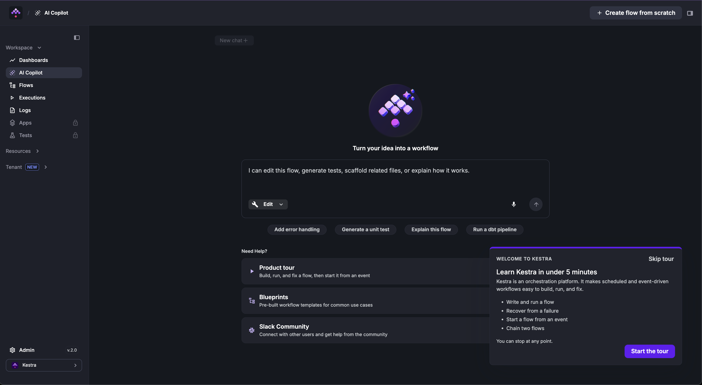
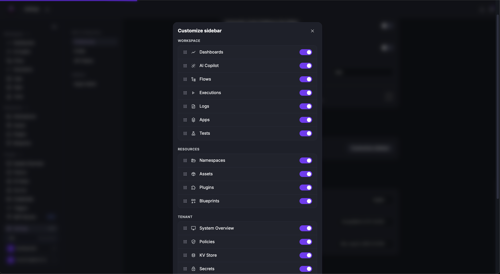

import ChildCard from "~/components/docs/ChildCard.astro"

Kestra's web UI is available by default on port 8080.

When you first open the UI, a **Welcome to Kestra** tour popup appears on the AI Copilot page.

The tour walks through creating and executing a first flow.

The UI includes a **No Code editor** for building flows and dashboards visually without writing YAML — available from the Flows and Dashboard pages.

The left sidebar is organized into three sections:

**Workspace** — day-to-day work:
- **Dashboards** — visualizations of flow execution data and metrics.
- **AI Copilot** — generate and edit flows from a plain-language description.
- **Flows** — browse, create, edit, and execute flows.
- **Executions** — inspect and manage previous executions.
- **Logs** — task logs from previous executions.

**Resources** — reusable assets and plugins:
- **Namespaces** — namespace-level configuration, files, secrets, and variables.
- **Plugins** — catalog of plugins available in your flows.
- **Blueprints** — ready-to-use flow examples.

**Tenant** — instance-level configuration:
- **System Overview** — instance health and usage metrics.
- **KV Store** — key-value pairs available across flows.
- **Triggers** — all active triggers across the tenant.
- **MCP Servers** — registered Model Context Protocol servers.

[Kestra Enterprise Edition](../oss-vs-paid/index.md) adds the following to the UI:

- **Apps** (Workspace) — list and create Apps that expose flows as user-facing forms.
- **Tests** (Workspace) — run flow unit tests and view assertions without creating executions.
- **Assets** (Resources) — browse the [assets](../07.enterprise/02.governance/01.assets/index.md) your flows read and write, such as tables, files, and virtual machines, with their lineage.
- The **Tenant** section gains: **Policies**, **Secrets**, **Credentials**, **Audit Logs**, and **IAM**.
- **Instance Owner** (sidebar footer, visible to Instance Owner users only) — instance-wide administration covering services, tenants, Worker Groups, Worker Queues, Kill Switch, Announcements, and instance-level IAM.

The sidebar is customizable from **Settings → Preferences → Customize Sidebar** — items can be reordered or hidden.

## Notifications

:::badge{version=">=2.1" editions="OSS,EE,Cloud"}
:::

The bell icon in the top navigation bar lists your in-app notifications, with **All** and **Unread** tabs and **Mark all as read**. Notifications arrive live, and the bell pulses while one of your operations is still running.

When you run a bulk action from the Executions, Triggers, or Backfills pages, Kestra processes it in the background and reports its progress in the bell, for example "Killing 3 executions", with the number of items processed and rejected. Only the user who started the operation sees it. These bulk actions send notifications:

- Executions: kill, pause, resume, restart, replay, force run, unqueue, change status, and set labels. Deleting executions doesn't send a notification.
- Triggers: unlock, delete, disable, and enable.
- Backfills: pause, resume, and delete.

In the Enterprise Edition, the bell also receives [Cases](../07.enterprise/02.governance/cases/index.md#notifications) events and [asset expiry](../07.enterprise/02.governance/01.assets/02.tasks-and-triggers/index.md#owner-notifications) notifications for the assets you own, and shows only notifications from tenants you can access.

Read notifications are deleted after 7 days and unread ones after 30 days. A background job removes them every hour; it can be configured with `kestra.notifications.purge-expired.enabled`, `initial-delay`, and `fixed-delay`.

    <iframe
        src="https://www.youtube.com/embed/6o0PNVrA84k?si=QyjOSo5HMZ-wKHol"
        title="YouTube video player"
        allow="accelerometer; autoplay; clipboard-write; encrypted-media; gyroscope; picture-in-picture; web-share"
        referrerpolicy="strict-origin-when-cross-origin"
        allowfullscreen
    ></iframe>

 

## Expired sessions

:::badge{version=">=2.1" editions="OSS,EE,Cloud"}
:::

When your session ends, for example because you logged out in another window, the next action in the UI opens a **Your session has expired** dialog instead of sending you to the login page. Sign in again and Kestra retries the request that failed, so the page you are on and its unsaved changes, such as flow edits, stay as they were. **Go to login page** discards them and opens the login page.

In the open-source edition, sign in with your username and password in the dialog.

In the Enterprise Edition, Kestra first renews your access token on its own, and shows the dialog only when the [session](../07.enterprise/03.auth/04.authentication/index.md#sessions) itself has ended:

- With a password, sign in in the dialog. Your username is filled in and can't be changed. If your password has expired, Kestra opens the page to change it instead, and unsaved changes are lost.
- With [SSO](../07.enterprise/03.auth/sso/index.md) or a one-time code, select **Sign in in a new tab**, sign in there, then come back and select **Continue**. When the instance also accepts passwords, the dialog shows the password form, and **Use another sign-in method** opens the login page in a new tab.
- If a different user signs in in the other tab, the page reloads instead of retrying the request as that user.

If you sign in again in another tab, the dialog closes on its own when you come back to this one.

When the UI can't reach the Kestra server, a **Cannot reach the Kestra server** banner asks you to copy any unsaved work before refreshing the page. It disappears once the server responds again.

<ChildCard />
