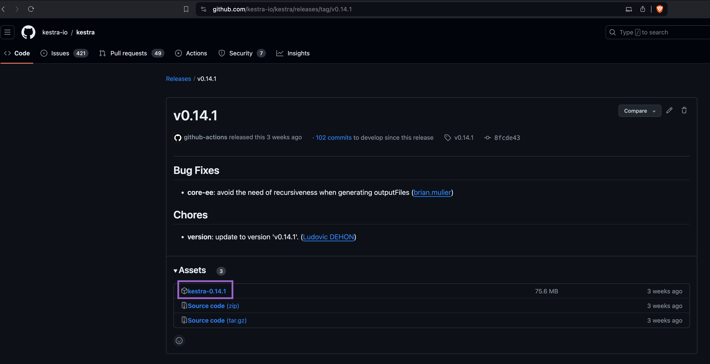
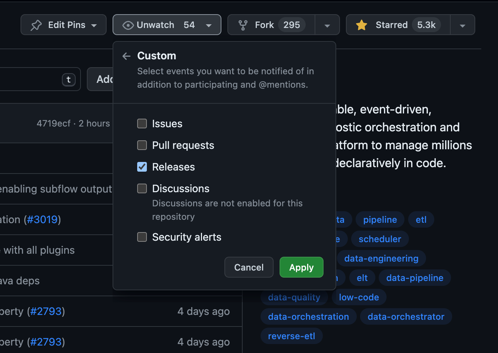

Kestra evolves quickly. This page explains how to upgrade your installation.

<div class="video-container">
  <iframe src="https://www.youtube.com/embed/S9DlGYIEzE0?si=oujCyp5qeNvKCVb9" title="YouTube video player" allow="accelerometer; autoplay; clipboard-write; encrypted-media; gyroscope; picture-in-picture; web-share" referrerpolicy="strict-origin-when-cross-origin" allowfullscreen></iframe>
</div>

## How to upgrade Kestra

To upgrade Kestra, follow these steps:
1. Perform a database backup (optional but recommended).
2. Read the [release notes](https://github.com/kestra-io/kestra/releases) to understand the changes in the new version.
3. Perform a rolling upgrade of Kestra components. For Kubernetes, upgrade the Kestra Helm chart as described in “Rolling upgrades in Kubernetes,” below.
4. Apply any actions noted in the release notes (for example, update configuration files or adjust deprecated features).

## How to rollback Kestra to a previous version

Sometimes you might need to roll back Kestra to a previous version. Follow these steps:

1. Perform a database backup (optional but recommended).
2. Stop all Kestra components.
3. Restore from a backup.
4. Restart with the older version.

Check the [Backup and Restore](../backup-and-restore/index.md) section for more information on how to backup and restore Kestra, and [Maintenance Mode](../../07.enterprise/05.instance/maintenance-mode/index.md) to pause your Kestra instance for maintenance, upgrade, and backup tasks.

:::alert{type="warning"}
We strongly recommend avoiding downgrades. To prevent surprises, test the new version in a non-production environment before upgrading. If you must roll back, closely follow the steps above.
:::

## Release changelog

The changelog is on the main repository’s [Releases](https://github.com/kestra-io/kestra/releases) page. It lists changes, new features, and bug fixes for each release, as well as any breaking changes. For a high-level overview, see the release [blog posts](/blogs).

## Breaking changes

In addition to bug fixes and enhancements, the release notes include a `Breaking Changes` section. It lists changes that may require adjustments to your code or Kestra configuration, with links to [migration docs](../../11.migration-guide/index.mdx).

:::alert{type="warning"}
The `Breaking Changes` section appears at the end of the [release notes](https://github.com/kestra-io/kestra/releases). Review it before upgrading.
:::

## How to minimize downtime when updating Kestra

If you run Kestra as separate components, you should:

- Stop the executors and the scheduler
- Stop the workers. A graceful shutdown waits for active jobs to finish. The default is `kestra.server.terminationGracePeriod = 'PT5M'`, configurable in [Liveness and worker task restarts](../../configuration/05.security-and-secrets/index.md#liveness-and-worker-task-restarts).
- If the job finishes within the grace period, the worker shuts down as soon as it does. Otherwise, the worker stops the task, and the Executor resubmits it to an available worker unless `kestra.server.worker-task-restart-strategy` is `NEVER`.
- Stop the webserver, and the indexer and Worker Controller if you run them as separate components.

All components support graceful shutdown, so no data is lost. Afterward, update and restart everything in the opposite order (or in any order, as components are independent).

:::alert{type="info"}
The webserver hosts the API, so stop and then start it immediately to avoid downtime. After that, restart the other components so flow executions can resume.
:::

## How to stick to a specific Kestra version

If you want to stick to a specific Kestra version, you can pin the [Docker image tag](https://hub.docker.com/r/kestra/kestra/tags) to a specific release. Here are some examples:

- `kestra/kestra:v2.0.0-slim` — the 2.0.0 release without bundled plugins
- `kestra/kestra:v2.0.0` — the 2.0.0 release with all plugins

The `-slim` suffix replaces the former `-no-plugins` suffix; releases older than the rename only exist under `-no-plugins` (e.g. `kestra/kestra:v0.21.4-no-plugins`).

You can also create a custom image with your own plugins and dependencies, as explained in the [Docker installation](../../02.installation/02.docker/index.md).

## Migrating a standalone installation

If you use a manual standalone installation with Java, you can download the Kestra binary for a specific version from the Assets menu of a specific [Release](https://github.com/kestra-io/kestra/releases) page. The image below shows how you can download the binary for the 0.14.1 release.



Once you’ve downloaded the binary, start Kestra with the following command:

```bash
./kestra-VERSION server standalone
```

## Migrating an installation with Docker

If you use Docker, change the [Docker image tag](https://hub.docker.com/r/kestra/kestra/tags) to the desired version and restart the container(s) or Kubernetes pod(s).

### Docker Compose

If you use Docker Compose, update your compose file to the desired [Docker image tag](https://hub.docker.com/r/kestra/kestra/tags) and run `docker compose up -d` to restart the container(s).

## Migration in Kubernetes using Helm

If you use Helm, set the [Helm chart `image.tag` value](https://github.com/kestra-io/kestra/blob/develop/charts/kestra/values.yaml) to the desired version. For example:

```bash
helm upgrade kestra kestra/kestra --set image.tag=v1.0.0
```

For more complex configurations that include multiple changes, consider using a custom values file:
1. First, create a `values.yaml` file that contains the settings you want to adjust.
2. Then, use the `helm upgrade` command with the `-f` flag to specify your custom values file:

```sh
helm upgrade kestra kestra/kestra -f values.yaml
```

## Rolling upgrades in Kubernetes

Upgrading Kestra on Kubernetes depends on your deployment rollout strategy. Every service can be rolled out without downtime, except workers, which need special attention.

During rollout, each component creates a new pod (the old one keeps running). After the new pod passes health checks, Kubernetes shuts down the previous pod, resulting in zero downtime.

Upgrading workers is more involved because they handle data-processing tasks that can run from seconds to hours. Define the desired behavior for in-flight tasks.

By default, Kestra workers wait for all task runs to complete before shutting down during a migration. You can override this behavior if needed. Kestra [Helm charts](https://github.com/kestra-io/kestra/blob/develop/charts/kestra/values.yaml) provide a configuration of a `terminationGracePeriodSeconds` (set to 60 seconds by default) that allows you to define the amount of time you want to wait before force-killing the worker.

If the worker has no running tasks, or finishes them before the grace period, it shuts down immediately. If the pod cannot finish tasks before `terminationGracePeriodSeconds`, Kubernetes kills the pod, and those tasks are resubmitted to another worker.

If a worker exits unexpectedly, the executor detects it and resubmits unfinished task runs to a new worker. The same behavior applies when a pod is terminated at `terminationGracePeriodSeconds`.

## Migration guides

The [Migrations section](../../11.migration-guide/index.mdx) details deprecated features and explains how to migrate to the new behavior.

For all breaking changes, the migration guides are linked in the [release notes](https://github.com/kestra-io/kestra/releases).

## Release notifications

New releases are announced through:
1. The `#announcements` channel in the [Slack](/slack) community.
2. [X (Twitter)](https://twitter.com/kestra_io)
3. [LinkedIn](https://www.linkedin.com/company/kestra/)
4. The [Kestra newsletter](/blogs)
5. Release notifications on the [main GitHub repository](https://github.com/kestra-io/kestra), as shown in the image below:




## Database migrations

Kestra applies database schema changes with versioned migration scripts. How they run depends on your edition:

- **Open-source**: pending migrations run automatically when Kestra starts.
- **Enterprise Edition**: migrations don't run automatically by default, and Kestra refuses to start while any are pending. Run them with `kestra migrate run` before you restart on the new version.

On either edition, you can apply migrations before you start the new version, which is useful on large databases where a migration can take a long time. Run the commands with the same configuration as your Kestra instance, for example through `docker exec` or `kubectl exec`:

```bash
# Preview pending migrations without applying them
kestra migrate plan

# Apply all pending migrations
kestra migrate run
```

For the upgrade sequence, Docker Compose and Kubernetes examples, and the `kestra.migration.*` settings, see [Database migrations](../../11.migration-guide/v2.0.0/database-migrations/index.md). For every `kestra migrate` command, see the [Kestra server CLI reference](../../kestra-cli/kestra-server/index.md#migration-commands).


## Getting help

If you have questions about the upgrade process:
- If you are a [Kestra Enterprise](/enterprise) customer, submit a [support ticket](https://support.kestra.io/).
- Or reach out [via Slack](/slack).

For further help, [contact us](/contact-us) for assistance with migration based on your environment and use case.
