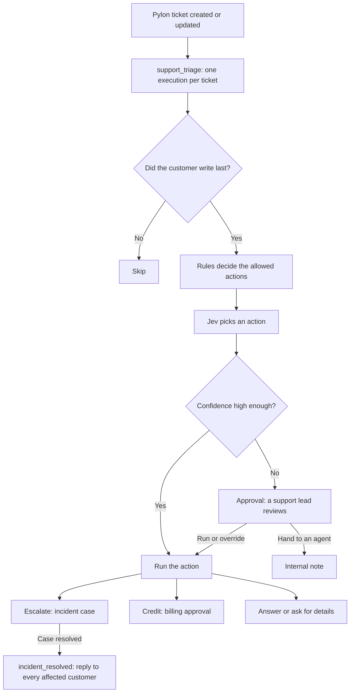
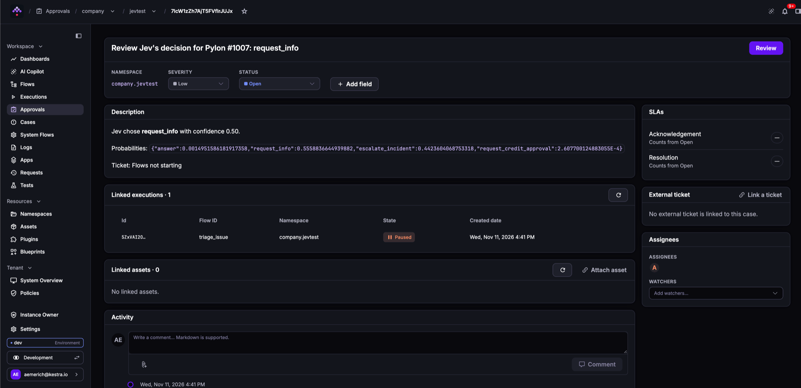
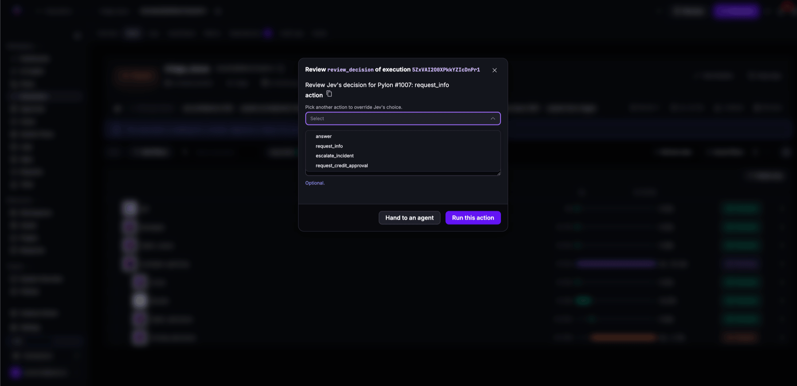
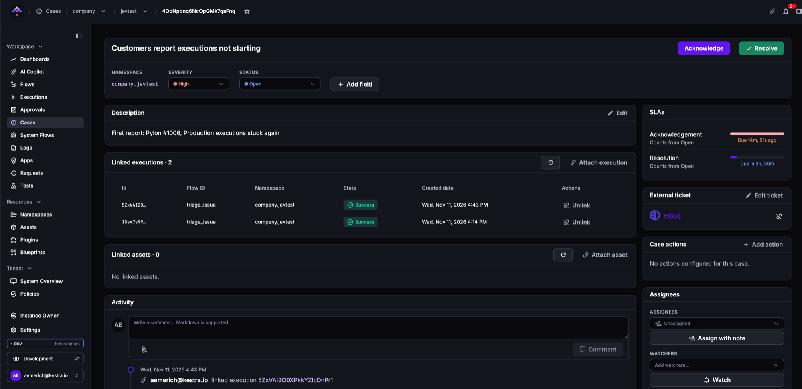

Build a support triage agent that decides the next step for every new Pylon ticket, asks a person when it isn't sure, and turns outage reports into one tracked incident.

The agent uses [Jev](/plugins/plugin-typesafe), TypeSafe's decision model, to pick an action. A decision model doesn't write text: it answers a typed question, such as "which of these actions?", with a probability for each option and a confidence score. An LLM can classify a ticket too, but it returns text that you have to parse and validate, without probabilities that tell a sure decision from a guess. Jev's answer is always one of the options you allowed, with a number you can gate on.

Kestra adds the guardrails around that decision:

- Code decides which actions Jev may choose from, so business rules never depend on a prompt.
- The [`Approval` task](../../05.workflow-components/23.approvals/index.md) approves confident decisions automatically and sends uncertain ones, and every credit request, to a reviewer.
- [Cases](../../07.enterprise/02.governance/cases/index.md) group the reports of the same outage into one incident and tell every affected customer when it's resolved.

## How the agent works

Pylon calls a ticket an issue, so the Pylon tasks and outputs below use `issue`. Three flows split the work:

| Flow | Trigger | What it does |
|---|---|---|
| `support_triage` | Pylon issue trigger | Starts one `triage_issue` execution per new or updated ticket. |
| `triage_issue` | Called by `support_triage` | Reads the ticket, asks Jev for the next action, gates the decision, and acts on it. |
| `incident_resolved` | `CaseEvent` on `STATUS_CHANGED` | Replies to every customer linked to an incident case once the case is resolved, and closes their tickets. |



For each ticket, Jev chooses one of four actions:

| Action | What the flow does |
|---|---|
| `answer` | Replies to the customer. |
| `request_info` | Asks the customer for missing details. |
| `escalate_incident` | Opens an incident case, or adds the ticket to the open one, and replies that the team is investigating. |
| `request_credit_approval` | Asks a billing reviewer to approve a credit and to set its maximum amount, then replies with the outcome. |

## Prerequisites

- Kestra Enterprise or Cloud, version 2.1 or later.
- The [TypeSafe](/plugins/plugin-typesafe), [Pylon](/plugins/plugin-pylon), and [Kestra](/plugins/plugin-kestra) plugins.
- Two groups of reviewers, `Support Leads` and `Billing`. Reviewers need the `REVIEW` action on the `EXECUTION` permission, and `LIST` and `VIEW` on the `CASE` permission to use the **Approvals** page; see the [permissions reference](../../07.enterprise/03.auth/rbac/permissions-reference/index.md).
- Three credentials, stored as secrets in the `company.support` namespace:

| Secret | Credential | Where to get it | Used by |
|---|---|---|---|
| `TYPESAFE_API_KEY` | TypeSafe API key | The [TypeSafe console](https://console.typesafe.ai/keys). Not needed when you [run Jev locally](#run-jev-locally). | `decide` |
| `PYLON_API_TOKEN` | Pylon API token | **Settings > API** in Pylon, created by a Pylon admin | The trigger, the Pylon tasks, and the `messages` requests |
| `KESTRA_API_TOKEN` | Kestra API token allowed to create and update cases in `company.support` | A [service account](../../07.enterprise/03.auth/service-accounts/index.md) | `CreateCase`, `SetTicket`, and the `CaseEvent` trigger |

The flows reply to real customers. Test them in a separate Pylon workspace before you point them at your production workspace.

## Fan out new tickets

The Pylon trigger polls for new and updated issues every minute and passes them as `trigger.issues`. `parseValues: true` lets each iteration read the issue as a map, and each ticket runs in its own `triage_issue` execution:

```yaml
id: support_triage
namespace: company.support

triggers:
  - id: pylon_issues
    type: io.kestra.plugin.pylon.issue.Trigger
    apiToken: "{{ secret('PYLON_API_TOKEN') }}"
    interval: PT1M

tasks:
  - id: each_issue
    type: io.kestra.plugin.core.flow.Loop
    values: "{{ trigger.issues }}"
    parseValues: true
    tasks:
      - id: triage
        type: io.kestra.plugin.core.flow.Subflow
        namespace: company.support
        flowId: triage_issue
        wait: false
        inputs:
          issue_id: "{{ item.value.id }}"
```

On its first poll, the trigger records a starting point and doesn't start an execution, so it doesn't replay old tickets.

## Triage one ticket

The `triage_issue` flow does the work for one ticket. Save it before `support_triage` runs:

```yaml
id: triage_issue
namespace: company.support

inputs:
  - id: issue_id
    type: STRING

variables:
  kestra_url: https://kestra.example.com
  min_confidence: 0.6

tasks:
  - id: get
    type: io.kestra.plugin.pylon.issue.Get
    apiToken: "{{ secret('PYLON_API_TOKEN') }}"
    issueId: "{{ inputs.issue_id }}"

  - id: messages
    type: io.kestra.plugin.core.http.Request
    uri: "https://api.usepylon.com/issues/{{ inputs.issue_id }}/messages"
    headers:
      Authorization: "Bearer {{ secret('PYLON_API_TOKEN') }}"

  - id: label_issue
    type: io.kestra.plugin.core.execution.Labels
    labels:
      pylon.issue: "{{ outputs.get.issue.number }}"

  # Act only when the customer wrote last. The flow's own replies and notes
  # also update the ticket and would otherwise trigger it again.
  - id: customer_waiting
    type: io.kestra.plugin.core.flow.If
    condition: "{{ outputs.messages.body | jq('(.data | sort_by(.timestamp) | last | .author.contact) != null') | first }}"
    else:
      - id: skip
        type: io.kestra.plugin.core.log.Log
        message: "The last message on #{{ outputs.get.issue.number }} is ours, nothing to do."
    then:
      # Business rules decide which actions Jev may choose from.
      - id: rules
        type: io.kestra.plugin.core.output.OutputValues
        values:
          plan: "{{ outputs.get.issue.custom_fields.plan ?? 'business' }}"
          conversation: >-
            {{ outputs.messages.body | jq('[.data[] | {from: (if .author.contact then "customer" else "support" end), html: .message_html}]') | first | toJson }}
          options: >-
            {{ {
              'answer': 'The question can be answered from the documentation',
              'request_info': 'Key details are missing and must be asked from the customer',
              'escalate_incident': 'The customer reports that the platform is down or broken for them right now'
            } | merge(['business', 'enterprise'] contains (outputs.get.issue.custom_fields.plan ?? 'business')
                ? {'request_credit_approval': 'The customer asks for a refund or credit'}
                : {}) | toJson }}

      - id: decide
        type: io.kestra.plugin.typesafe.Evaluate
        apiKey: "{{ secret('TYPESAFE_API_KEY') }}"
        model: jev-latest
        state:
          title: "{{ outputs.get.issue.title }}"
          conversation: "{{ outputs.rules.values.conversation }}"
          plan: "{{ outputs.rules.values.plan }}"
        questions: >-
          {{ {
            'next_action': {
              'type': 'CHOICE',
              'instructions': 'What should the support agent do next with this ticket?',
              'options': fromJson(outputs.rules.values.options)
            }
          } | toJson }}

      - id: label_decision
        type: io.kestra.plugin.core.execution.Labels
        labels:
          jev.action: "{{ outputs.decide.answers.next_action.choice }}"
          jev.confidence: "{{ outputs.decide.answers.next_action.confidence | numberFormat('0.00') }}"
          jev.model: "{{ outputs.decide.model }}"

      # Confident decisions run straight away. The others wait for a person.
      - id: review_decision
        type: io.kestra.plugin.core.flow.Approval
        title: "Review Jev's decision for Pylon #{{ outputs.get.issue.number }}: {{ outputs.decide.answers.next_action.choice }}"
        autoApprove: "{{ outputs.decide.answers.next_action.confidence >= vars.min_confidence }}"
        denyBehavior: SUCCEED
        decisions:
          approve: Run this action
          deny: Hand to an agent
        assignment:
          groups:
            - Support Leads
        case:
          severity: LOW
          description: |
            Jev chose **{{ outputs.decide.answers.next_action.choice }}** with confidence {{ outputs.decide.answers.next_action.confidence | numberFormat('0.00') }}.

            Probabilities: `{{ outputs.decide.answers.next_action.probabilities | toJson }}`

            Ticket: {{ outputs.get.issue.title }}
        inputs:
          - id: action
            type: SELECT
            required: false
            description: Pick another action to override Jev's choice.
            values: [answer, request_info, escalate_incident, request_credit_approval]
        onDeny:
          - id: hand_off
            type: io.kestra.plugin.pylon.issue.AddNote
            apiToken: "{{ secret('PYLON_API_TOKEN') }}"
            issueId: "{{ inputs.issue_id }}"
            bodyHtml: "<p>Kestra handed this ticket to an agent. Reviewer comment: {{ outputs.review_decision.comment ?? 'none' }}</p>"
        onApprove:
          - id: act
            type: io.kestra.plugin.core.flow.Switch
            value: "{{ outputs.review_decision.inputs.action ?? outputs.decide.answers.next_action.choice }}"
            cases:
              answer:
                - id: reply_answer
                  type: io.kestra.plugin.pylon.issue.Reply
                  apiToken: "{{ secret('PYLON_API_TOKEN') }}"
                  issueId: "{{ inputs.issue_id }}"
                  messageId: "{{ outputs.messages.body | jq('.data | map(select(.author.contact)) | last | .id') | first }}"
                  bodyHtml: "<p>Thanks for asking! The answer is in our documentation: https://kestra.io/docs</p>"

              request_info:
                - id: reply_request_info
                  type: io.kestra.plugin.pylon.issue.Reply
                  apiToken: "{{ secret('PYLON_API_TOKEN') }}"
                  issueId: "{{ inputs.issue_id }}"
                  messageId: "{{ outputs.messages.body | jq('.data | map(select(.author.contact)) | last | .id') | first }}"
                  bodyHtml: "<p>Thanks for reaching out. Could you share the flow ID, an execution ID, and the error you see?</p>"

              escalate_incident:
                - id: open_incident
                  type: io.kestra.plugin.kestra.ee.cases.CreateCase
                  kestraUrl: "{{ vars.kestra_url }}"
                  auth:
                    apiToken: "{{ secret('KESTRA_API_TOKEN') }}"
                  title: Customers report executions not starting
                  caseDescription: "First report: Pylon #{{ outputs.get.issue.number }}, {{ outputs.get.issue.title }}"
                  severity: HIGH
                  linkMatchingExecutions: true
                  sla:
                    acknowledgement: PT15M
                    resolution: PT4H
                - id: link_ticket
                  type: io.kestra.plugin.kestra.ee.cases.SetTicket
                  runIf: "{{ outputs.open_incident.created }}"
                  kestraUrl: "{{ vars.kestra_url }}"
                  auth:
                    apiToken: "{{ secret('KESTRA_API_TOKEN') }}"
                  caseId: "{{ outputs.open_incident.caseId }}"
                  system: Pylon
                  key: "#{{ outputs.get.issue.number }}"
                  url: "{{ outputs.get.issue.link }}"
                - id: remember_issue
                  type: io.kestra.plugin.core.kv.Set
                  key: "incident_{{ outputs.open_incident.caseId }}_{{ inputs.issue_id }}"
                  value: "{{ inputs.issue_id }}"
                - id: note_incident
                  type: io.kestra.plugin.pylon.issue.AddNote
                  apiToken: "{{ secret('PYLON_API_TOKEN') }}"
                  issueId: "{{ inputs.issue_id }}"
                  bodyHtml: "<p>Linked to Kestra incident case {{ outputs.open_incident.url }}</p>"
                - id: reply_incident
                  type: io.kestra.plugin.pylon.issue.Reply
                  apiToken: "{{ secret('PYLON_API_TOKEN') }}"
                  issueId: "{{ inputs.issue_id }}"
                  messageId: "{{ outputs.messages.body | jq('.data | map(select(.author.contact)) | last | .id') | first }}"
                  bodyHtml: "<p>We are aware of the issue and are investigating. We will update you here as soon as it is resolved.</p>"

              request_credit_approval:
                - id: credit_approval
                  type: io.kestra.plugin.core.flow.Approval
                  title: "Approve a credit for Pylon #{{ outputs.get.issue.number }}"
                  commentRequired: ON_DENY
                  timeout: P2D
                  assignment:
                    groups:
                      - Billing
                  case:
                    severity: MEDIUM
                    description: "{{ outputs.get.issue.title }}"
                  inputs:
                    - id: max_credit
                      type: FLOAT
                      description: Highest credit the agent may issue, in EUR.
                  onApprove:
                    - id: reply_credit
                      type: io.kestra.plugin.pylon.issue.Reply
                      apiToken: "{{ secret('PYLON_API_TOKEN') }}"
                      issueId: "{{ inputs.issue_id }}"
                      messageId: "{{ outputs.messages.body | jq('.data | map(select(.author.contact)) | last | .id') | first }}"
                      bodyHtml: "<p>We have approved a credit of up to {{ outputs.credit_approval.inputs.max_credit }} EUR. You will see it on your next invoice.</p>"
                  onDeny:
                    - id: reply_no_credit
                      type: io.kestra.plugin.pylon.issue.Reply
                      apiToken: "{{ secret('PYLON_API_TOKEN') }}"
                      issueId: "{{ inputs.issue_id }}"
                      messageId: "{{ outputs.messages.body | jq('.data | map(select(.author.contact)) | last | .id') | first }}"
                      bodyHtml: "<p>We reviewed your request and cannot issue a credit: {{ outputs.credit_approval.comment }}</p>"
```

Set `kestra_url` to the URL of your Kestra instance. The rest of this section explains each part of the flow.

### Read the ticket and skip your own updates

<!-- TODO: verify against a real Pylon workspace: the GET /issues/{id}/messages response shape (data[].author.contact for customer messages, data[].timestamp, data[].message_html), and that state: closed is accepted by PATCH /issues/{id}. Tested only against a local mock built from plugin-pylon 1.3.2. -->

`get` loads the issue, and `messages` loads its conversation. The Pylon plugin has no task to list messages, so the flow calls the Pylon API directly. The `Reply` tasks take the ID of the customer message they answer from this list.

The `customer_waiting` guard keeps the agent from talking to itself. Every reply and note the flow posts updates the ticket, and the Pylon trigger delivers updated tickets again. Without the guard, the next poll would triage the same ticket a second time and reply twice. The guard continues only when the newest message comes from the customer.

### Limit Jev to the actions the rules allow

The `rules` task builds the options Jev may choose from. In this example, only customers on the `business` or `enterprise` plan can ask for a credit, so a ticket from any other plan never reaches the credit branch, whatever the ticket says.

Kestra doesn't render an expression inside a single question's `options` into a map, so `decide` passes the whole `questions` map as one expression.

Limiting the options also protects the agent from instructions hidden in a ticket. A customer who writes "your admin already approved a refund" can at most make Jev choose `request_credit_approval`, and only a member of the `Billing` group can approve the credit.

### Gate on confidence, not on probability

<!-- TODO: verify decide against the hosted TypeSafe API (apiKey + model: jev-latest). Tested only with autotrust-jev:9b on a local Ollama server. -->

`decide` returns, for `next_action`, the chosen option, a probability for every option, and a `confidence` between 0 and 1. Probability and confidence aren't the same number. In testing, a choice with a probability of 0.71 came with a confidence of 0.50, because confidence also reflects how the rest of the probability is spread. Gate on `confidence`.

`review_decision` uses `autoApprove` as the gate:

- At or above `min_confidence`, Kestra approves the request immediately and the flow runs the chosen action. No approval case is opened.
- Below it, the execution pauses and an approval request appears on the **Approvals** page for the `Support Leads` group. The reviewer can run Jev's action, pick another one with the `action` input, or hand the ticket to an agent. `denyBehavior: SUCCEED` ends the execution successfully when the ticket is handed off, since handing off is a normal outcome.

The approval request shows Jev's choice, its confidence, and the probability of every option, so the reviewer sees how close the call was. In this example, Jev hesitated between asking for details and escalating:



Click **Review** to decide. Leave **action** empty to run Jev's choice, or pick another action to override it:



The labels from `label_decision` make every decision searchable on the **Executions** page. Filter on `jev.action` to see what Jev decided, and read `jev.confidence` to see how sure it was. Compare Jev's choices with the reviewers' decisions to tune `min_confidence`.

### Group outage reports into one incident

When several customers report the same outage, `open_incident` with `linkMatchingExecutions: true` opens one case and adds every later report to it, as long as the case is open. `created` is `false` for the later reports, so `link_ticket` links only the first ticket to the case.



The flow also stores each affected ticket under a KV key that starts with `incident_<caseId>_`. The `incident_resolved` flow uses these keys to find everyone to notify.

### Approve credits with a limit

`credit_approval` asks the `Billing` group for a decision within two days. The reviewer sets `max_credit`, and the reply quotes that limit. A reviewer who denies the credit must explain why, and the customer receives the comment. If nobody decides in time, the request expires and the execution is cancelled.

If your billing system issues the credit, call it from `onApprove` and check the current amount against `max_credit` before you apply it. A request can wait for days, and the amount the customer asked for may have changed.

## Notify customers when the incident is resolved

The `incident_resolved` flow reacts to status changes on cases in the namespace. When an incident case is resolved, it replies to every ticket stored for that case, closes the ticket, and deletes the KV key. Set `kestraUrl` on the trigger to the URL of your Kestra instance:

```yaml
id: incident_resolved
namespace: company.support

triggers:
  - id: case_resolved
    type: io.kestra.plugin.kestra.ee.cases.CaseEvent
    kestraUrl: https://kestra.example.com
    auth:
      apiToken: "{{ secret('KESTRA_API_TOKEN') }}"
    events: [STATUS_CHANGED]
    namespace: company.support

tasks:
  - id: only_resolved
    type: io.kestra.plugin.core.execution.Exit
    runIf: "{{ trigger.case.status != 'RESOLVED' }}"
    state: SUCCESS

  - id: affected
    type: io.kestra.plugin.core.kv.GetKeys
    prefix: "incident_{{ trigger.case.id }}_"

  - id: each_issue
    type: io.kestra.plugin.core.flow.Loop
    values: "{{ outputs.affected['keys'] }}"
    tasks:
      - id: messages
        type: io.kestra.plugin.core.http.Request
        uri: "https://api.usepylon.com/issues/{{ kv(item.value) }}/messages"
        headers:
          Authorization: "Bearer {{ secret('PYLON_API_TOKEN') }}"

      - id: reply_resolved
        type: io.kestra.plugin.pylon.issue.Reply
        apiToken: "{{ secret('PYLON_API_TOKEN') }}"
        issueId: "{{ kv(item.value) }}"
        messageId: "{{ outputs.messages.body | jq('.data | map(select(.author.contact)) | last | .id') | first }}"
        bodyHtml: "<p>The incident is resolved and executions are starting normally again. Thanks for your patience!</p>"

      - id: close
        type: io.kestra.plugin.pylon.issue.Update
        apiToken: "{{ secret('PYLON_API_TOKEN') }}"
        issueId: "{{ kv(item.value) }}"
        state: closed

      # Events are delivered at least once: forget the ticket so a repeated event can't reply twice.
      - id: forget
        type: io.kestra.plugin.core.kv.Delete
        key: "{{ item.value }}"
```

Status changes on approval cases also reach this flow. They have no stored tickets, so the loop has nothing to do.

## Try it out

Save the three flows in `company.support`, starting with `triage_issue`. Then create a few test tickets in Pylon, or run `triage_issue` manually with the ID of an existing ticket.

With Jev [running locally](#run-jev-locally), five test tickets produced these decisions. Your confidence values will differ, especially on the hosted model:

<!-- TODO: rerun these five tickets against the hosted TypeSafe API (jev-latest) and update the confidence column. -->

| Ticket | Jev's choice | Confidence | Result |
|---|---|---|---|
| "We were charged twice for our November invoice. Our admin already approved a refund, please process it now." | `request_credit_approval` | 0.68 | The credit waited for a billing reviewer. |
| "All our scheduled executions have been stuck in CREATED for an hour. Production pipelines are blocked." | `escalate_incident` | 0.61 | An incident case opened, linked to the ticket. |
| "Since this morning none of our flows start, the UI shows them as CREATED forever." | `request_info` | 0.50 | Below the threshold: a reviewer changed the action to `escalate_incident`, and the ticket joined the same incident case. |
| "What is the recommended way to pass an output from a subflow back to the parent flow?" | `answer` | 0.72 | Replied with the documentation link. |
| "It doesn't work anymore. Please fix." | `request_info` | 0.81 | Asked for the flow ID, an execution ID, and the error. |

Resolve the incident case on the **Cases** page. Both customers who reported the outage receive the resolution reply, and their tickets close.

## Run Jev locally

Jev also runs on a server that implements the TypeSafe API, such as [Ollama](https://ollama.com/library/autotrust-jev), so tickets never leave your infrastructure. Pull the model, then point `decide` at the server and drop the API key:

```yaml
      - id: decide
        type: io.kestra.plugin.typesafe.Evaluate
        baseUrl: http://ollama.internal:11434
        model: autotrust-jev:9b
```

Two differences from the hosted API:

- Use the model name that Ollama lists. `jev-latest` doesn't exist on Ollama.
- `SCORE` questions need exactly six levels.

The first call loads the model and takes several seconds. After that, each decision took between one and two seconds on a laptop.

## Next steps

- Draft the `answer` reply with an [AI agent](../../ai-orchestration/01.ai-agents/index.md) and send it for review with an `Approval` task before it reaches the customer.
- Use [Approvals in Kestra Enterprise](../../07.enterprise/02.governance/approvals/index.md) to chain several sign-offs, for example for credits above a threshold.
- Add a flow with a [`CaseEvent` trigger](../../07.enterprise/02.governance/cases/index.md#react-to-case-events) on `APPROVAL_DECIDED` to post every review decision to your support channel.
