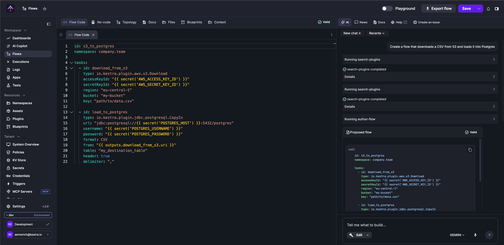
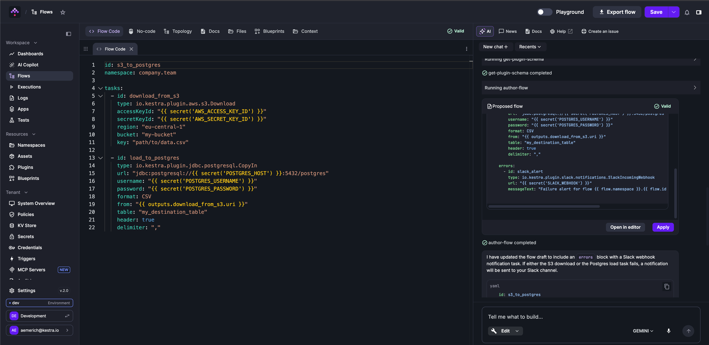
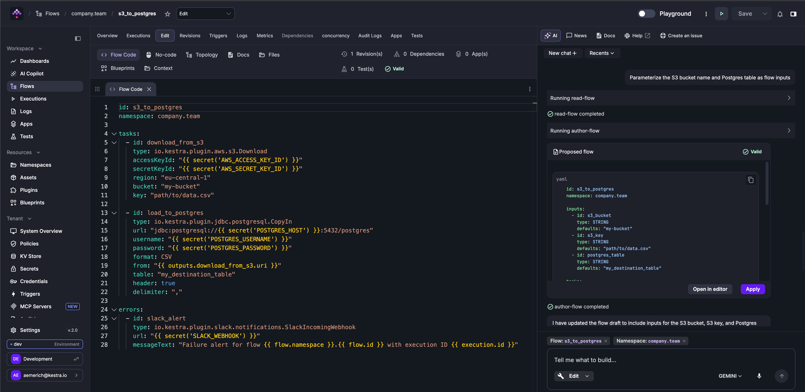
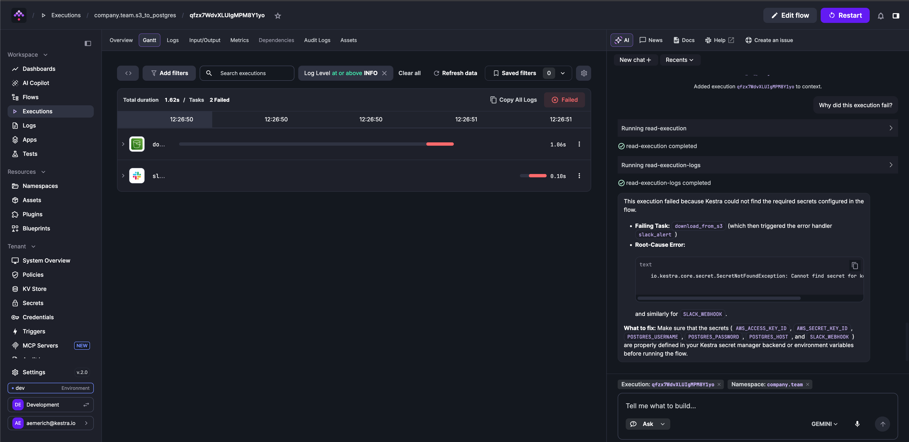
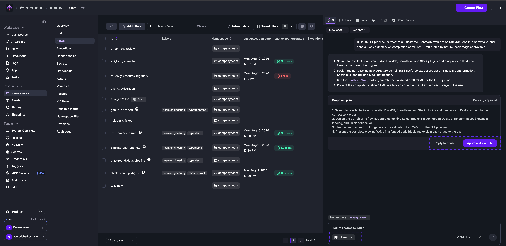

Build and edit flows, diagnose failed executions, and run multi-step plans from a chat sidebar in the Kestra UI.

This page is for anyone who works in the Kestra UI. Administrators who need to enable Copilot or choose its model can go straight to [Configure an LLM provider](#configure-an-llm-provider). If you write flows in Claude Code, Cursor, or another coding agent instead, see the [Docs MCP server](../02.kestra-mcp-resources/index.md) and [Agent Skills](../03.agent-skills/index.md).

Open Copilot with the **AI** button in the top toolbar. Click **New chat +** to start a conversation, or use **Recents** to return to a previous one. Conversations last for the browser session. Type a prompt, or click the microphone button to dictate it.

## Modes

Choose a mode from the dropdown at the bottom left of the chat panel:

| Mode | What it does |
|---|---|
| **Ask** | Answers questions about Kestra from the documentation, and diagnoses failed executions from their logs. Ask mode doesn't change anything. |
| **Edit** | Generates and edits YAML for flows, apps, unit tests, and dashboards. Copilot proposes each change and applies it only after you approve. |
| **Plan** | Proposes a numbered plan for a multi-step task. Nothing runs until you approve the plan, and each step that changes a resource asks for confirmation again. |

You can switch modes at any point; Copilot keeps the conversation history.

| If you want to… | Use |
|---|---|
| Build, modify, or refactor a flow | Edit |
| Diagnose a failed execution | Ask |
| Ask about Kestra features, plugins, or configuration | Ask |
| Complete a multi-step task with approval at each step | Plan |

## Context

When you open the panel, Copilot attaches the resource you are viewing as context. Attached resources appear as pills above the input. Remove a pill to narrow Copilot's focus; the transcript records each addition and removal.

You can attach these resources as context:

- Flow
- Namespace
- Execution
- Dashboard
- App
- Test suite
- Blueprint
- Plugin

Copilot also reads namespace metadata, such as Policies, Variables, Secrets, and key-value pairs. A prompt like "Create a task that integrates with MongoDB" can then reuse the credentials and variables configured in that namespace.

## Confirmation

In Edit and Plan modes, any action that changes a resource, such as creating or updating a flow or restarting an execution, waits for your confirmation. The confirmation prompt has an optional field to steer the next step.

- In Edit mode, rejecting an action returns you to the conversation.
- In Plan mode, rejecting the plan, or any action after you approved it, stops the plan.

## Build flows with Edit mode

Open the Copilot sidebar, select **Edit** mode, and describe what you want to build. Copilot searches for the right plugins, generates YAML, and validates it before proposing the change, so the flow is marked **Valid** when you see the proposal. After you accept a change, keep iterating: add triggers, adjust tasks, or refactor a section. Copilot changes only the part you ask about.

**Step 1: Build the initial flow**

```txt
Create a flow that downloads a CSV from S3 and loads it into Postgres
```



The Copilot searches for the S3 and Postgres plugins, authors the flow with secrets referenced via `{{ secret('...') }}`, and presents the proposal. Select **Apply** to write it to the editor, or **Open in editor** to review the diff before accepting.

**Step 2: Add error handling**

```txt
Add error handling that sends a Slack alert if any task fails
```



The Copilot adds an `errors` block and leaves the existing `download_from_s3` and `load_to_postgres` tasks unchanged. The Copilot explains what it changed before presenting the proposal.

**Step 3: Parameterize hardcoded values**

```txt
Parameterize the S3 bucket name and Postgres table as flow inputs
```



The Copilot reads the current flow (note the `read-flow` step in the sidebar), adds an `inputs` block with `s3_bucket`, `s3_key`, and `postgres_table`, and rewires the hardcoded values to `{{ inputs.* }}` references throughout the flow. The flow and namespace context pills are attached automatically while working inside the editor.

Each accepted change is saved as a revision. You can track the full edit history from the **Revisions** tab, or use [Git sync](../../version-control-cicd/04.git/index.md) to push revisions to your repository.

## Ask mode

Use Ask mode to ask natural-language questions about Kestra without generating any code. Ask mode grounds its answers in the Kestra documentation and can analyze execution failures by reading the execution logs directly.

**Diagnosing a failed execution**

When you open the Copilot from a failed execution view, the execution is automatically attached as context. Ask "Why did this execution fail?" and the Copilot reads the execution metadata and logs, then gives a structured answer: which task failed, the root-cause error, and what to fix.



In the example above, the Copilot ran `read-execution` and `read-execution-logs`, identified that the `download_from_s3` task failed due to `SecretNotFoundException`, and listed the secrets to create before running the flow again.

Other example questions:

- "What is the difference between a Worker Group and a Task Runner?"
- "How do I configure namespace-level Policies?"
- "What secrets and variables are available in this namespace?" (with a namespace attached as context)

Start in Ask mode to understand your options, then switch to Edit or Plan to act on the answer.

## Plan mode

Use Plan mode for tasks with several ordered steps that you want to review before anything runs. Copilot presents the whole plan as a numbered list and waits. Select **Approve & execute** to run it, or **Reply to revise** to send feedback and get a revised plan.



In the example above, the prompt "Build an ELT pipeline: extract from Salesforce, transform with dbt on DuckDB, load into Snowflake, and send a Slack summary on completion or failure" produced a four-step plan. The `company.team` namespace pill is attached, so Copilot can use the plugins and credentials available in that namespace.

After you approve the plan, Copilot carries it out one step at a time. Each step that changes a resource asks for confirmation. Rejecting one stops the plan.

Use Plan mode for tasks like:

- Building a multi-stage pipeline where you want to review the structure before any YAML is generated
- Migrating flows from one pattern to another, for example from `ForEach` to the Loop task
- Setting up namespaces, variables, and RBAC in sequence for a new team

## Fix with AI

From the **Logs** and **Gantt** views of an execution, open the three-dot menu on a failed task and select **Fix with AI**. The flow editor opens with Copilot in Edit mode, loaded with the error context and ready to propose a fix.

## Starter prompts

:::collapse{title="Edit mode prompts"}
```markdown
- Create a flow that runs a dbt build command on DuckDB
- Create a flow cloning https://github.com/kestra-io/dbt-example Git repository from a main branch, then add a dbt CLI task using DuckDB backend that will run dbt build command for that cloned repository using my_dbt_project profile and dev target. The dbt project is located in the root directory so no dbt project needs to be configured.
- Create a flow that sends a POST request to https://dummyjson.com/products/add
- Send a POST request to https://dummyjson.com/products/add
- Write a Python script that sends a POST request to https://dummyjson.com/products/add
- Write a Node.js script that sends a POST request to https://dummyjson.com/products/add
- Create a flow with a Python script that fetches weather data for New York City
- Make a REST API call to https://kestra.io/api/mock and allow failure
- Create a flow that logs "Hello from AI" to the console
- Create a flow that returns Hello as output
- Create a flow that outputs Hello as value
- Run a flow every 10 minutes
- Run a flow every day at 9 AM
- Run a shell command echo 'Hello Docker' in a Docker container
- Run a command python main.py in a Docker container
- Run a script main.py stored as namespace file
- Build a Docker image from an inline Dockerfile and push it to a GitHub Container Registry
- Build a Docker image from an inline Dockerfile and push it to a DockerHub Container Registry
- Create a flow that adds a string KV pair called MYKEY with value myvalue to namespace company
- Fetch value for KV pair called MYKEY from namespace company
- Create a flow that downloads a file mydata.csv from S3 bucket named mybucket
- Create a flow that downloads all files from the folder kestra/plugins/ from S3 bucket mybucket in us-east-1
- Send a Slack notification that approval is needed and Pause the flow for manual approval
- Send a Slack alert whenever any execution from namespace company fails
- Fetch value for string kv pair called mykey from Redis
- Fetch value for mykey from Redis
- Set value for mykey in Redis to myvalue
- Sync all flows and scripts for selected namespaces from Git to Kestra
- Create a flow that clones a Git repository and runs a Python script
- Export a Postgres table called mytable to a CSV file
- Query a Postgres table called mytable
- Find documents in a MongoDB collection called mycollection
- Load documents into a MongoDB mycollection using a file from input mydata
- Trigger an Airbyte connection sync and retry it up to 3 times
- Run an Airflow DAG called mydag
- Orchestrate an Ansible playbook stored in Namespace Files
- Run a DuckDB query that reads a CSV file
- Fetch AWS ECR authorization token to push Docker images to Amazon ECR
- Run a flow whenever 5 records are available in Kafka topic mytopic
- Submit a run for a Databricks job
```
:::

:::collapse{title="Ask mode prompts"}
```markdown
- Why did this execution fail? (attach the execution as context)
- What secrets and variables are available in this namespace? (attach the namespace as context)
- What is the difference between a Worker Group and a Task Runner?
- What plugins are available for working with Kafka?
- How do I configure RBAC so developers can run flows but not edit them?
- What is the best way to handle retries for a flaky HTTP API?
- How do I pass outputs from one task to the next?
- What does the errors block do and when should I use it?
- How do I schedule a flow to run only on weekdays?
- What is the difference between Namespace Variables and the KV Store?
```
:::

:::collapse{title="Plan mode prompts"}
```markdown
- Build an ELT pipeline: extract from Salesforce, transform with dbt on DuckDB, load into Snowflake, and send a Slack summary on completion or failure
- Migrate all ForEach tasks in this flow to use the Loop task
- Add retry logic, error notifications, and a timeout to every task in this flow
- Set up namespaces for dev, staging, and prod with RBAC roles for the engineering team
- Create a flow that ingests data from five different S3 paths in parallel, merges the results, and loads them into BigQuery
```
:::

## Configure an LLM provider

Copilot needs an LLM provider. Until you configure one, the Copilot panel opens but can't answer prompts. Add providers under `kestra.ai.providers` in your Kestra configuration.

Kestra Open Source supports Google Gemini:

```yaml
kestra:
  ai:
    providers:
      - id: gemini
        display-name: Gemini
        type: gemini
        configuration:
          api-key: YOUR_GEMINI_API_KEY
          model-name: gemini-3.5-flash-lite
```

Enterprise Edition supports Amazon Bedrock, Anthropic, Azure OpenAI, DeepSeek, Google Gemini, Google Vertex AI, Mistral, OpenAI, OpenRouter, and open-source models served by Ollama. If you need another provider, [contact us](https://kestra.io/demo).

For every configuration property, including generation parameters, extended reasoning, request timeouts, mTLS, and custom headers, see the [AI Copilot configuration reference](../../configuration/06.enterprise-and-advanced/index.md#ai-copilot).

:::alert{type="info"}
Legacy single-provider configurations (`kestra.ai.type` plus a provider block) still work. Use the `providers` array to register several providers and choose a default.
:::

### Register multiple providers

In Enterprise Edition, register several providers and mark one with `is-default: true`. Users can switch between them from the model dropdown in the Copilot panel.

```yaml
kestra:
  ai:
    providers:
      - id: gemini
        display-name: Gemini - Private
        type: gemini
        configuration:
          model-name: gemini-3.5-flash-lite
          api-key: YOUR_GEMINI_API_KEY
      - id: gpt
        display-name: OpenAI
        type: openai
        is-default: true
        configuration:
          model-name: gpt-5-mini
          api-key: YOUR_OPENAI_API_KEY
```

### Provider examples

Each example below shows the minimum configuration for one Enterprise Edition provider.

#### Amazon Bedrock

```yaml
kestra:
  ai:
    providers:
      - id: bedrock
        display-name: Amazon Bedrock
        type: bedrock
        configuration:
          model-name: amazon.nova-lite-v1:0
          access-key-id: BEDROCK_ACCESS_KEY_ID
          secret-access-key: BEDROCK_SECRET_ACCESS_KEY
```

#### Anthropic

Anthropic does not accept an `api-key` configuration field. Set the `ANTHROPIC_API_KEY` environment variable on the Kestra server instead.

```yaml
kestra:
  ai:
    providers:
      - id: anthropic
        display-name: Anthropic
        type: anthropic
        configuration:
          model-name: claude-opus-4-5
```

#### Azure OpenAI

```yaml
kestra:
  ai:
    providers:
      - id: azure-openai
        display-name: Azure OpenAI
        type: azure-openai
        configuration:
          model-name: gpt-4o-2024-11-20
          api-key: AZURE_OPENAI_API_KEY
          tenant-id: AZURE_TENANT_ID
          client-id: AZURE_CLIENT_ID
          client-secret: AZURE_CLIENT_SECRET
          endpoint: "https://your-resource.openai.azure.com/"
```

#### DeepSeek

```yaml
kestra:
  ai:
    providers:
      - id: deepseek
        display-name: DeepSeek
        type: deepseek
        configuration:
          model-name: deepseek-chat
          api-key: DEEPSEEK_API_KEY
          base-url: "https://api.deepseek.com/v1"
```

#### Google Gemini

```yaml
kestra:
  ai:
    providers:
      - id: gemini
        display-name: Google Gemini
        type: gemini
        configuration:
          model-name: gemini-3.5-flash-lite
          api-key: YOUR_GEMINI_API_KEY
```

#### Google Vertex AI

Vertex AI authenticates with Application Default Credentials, so there is no `api-key` field. Configure ADC on the Kestra server, for example with the `GOOGLE_APPLICATION_CREDENTIALS` environment variable or Workload Identity.

```yaml
kestra:
  ai:
    providers:
      - id: vertex
        display-name: Google Vertex AI
        type: googlevertexai
        configuration:
          model-name: gemini-2.5-flash
          project: GOOGLE_PROJECT_ID
          location: us-central1
```

#### Mistral

```yaml
kestra:
  ai:
    providers:
      - id: mistral
        display-name: Mistral
        type: mistralai
        configuration:
          model-name: mistral-small-latest
          api-key: MISTRALAI_API_KEY
          base-url: "https://api.mistral.ai/v1"
```

#### Ollama

```yaml
kestra:
  ai:
    providers:
      - id: ollama
        display-name: Ollama
        type: ollama
        configuration:
          model-name: llama3
          base-url: http://localhost:11434
```

If Kestra runs in a container and Ollama runs on the host, `localhost` points to the container. Set the base URL to `http://host.docker.internal:11434` instead.

:::alert{type="warning"}
Some Ollama model tags resolve to thinking models; for example, `qwen3:30b-a3b` points to a thinking variant. Thinking models that can't disable thinking produce incorrect YAML. Choose a model with a non-thinking mode, or set `thinking-enabled: false` where the provider supports it.
:::

#### OpenAI

```yaml
kestra:
  ai:
    providers:
      - id: openai
        display-name: OpenAI
        type: openai
        configuration:
          model-name: gpt-5-nano
          api-key: OPENAI_API_KEY
          base-url: https://api.openai.com/v1
```

#### OpenRouter

```yaml
kestra:
  ai:
    providers:
      - id: openrouter
        display-name: OpenRouter
        type: open-router
        configuration:
          api-key: OPENROUTER_API_KEY
          model-name: "anthropic/claude-sonnet-4"
```

### Disable AI Copilot

Set `kestra.ai.enabled` to `false`. The property defaults to `true`.

```yaml
kestra:
  ai:
    enabled: false
```

:::alert{type="warning"}
**Known issue (Kestra 2.0.0):** `kestra.ai.enabled: false` does not fully disable AI Copilot in the current release. The Copilot UI button and other AI features such as "Fix with AI" remain visible and the feature continues to respond. This is being tracked and will be resolved in an upcoming release.
:::

### Control access with RBAC

In Enterprise Edition, an [RBAC permission](../../07.enterprise/03.auth/rbac/index.md) lets administrators allow or deny Copilot usage per role, at tenant or namespace scope.
