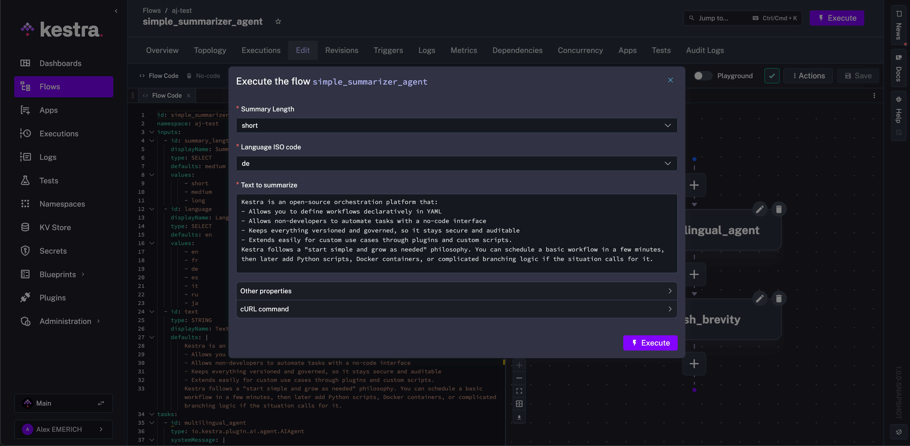
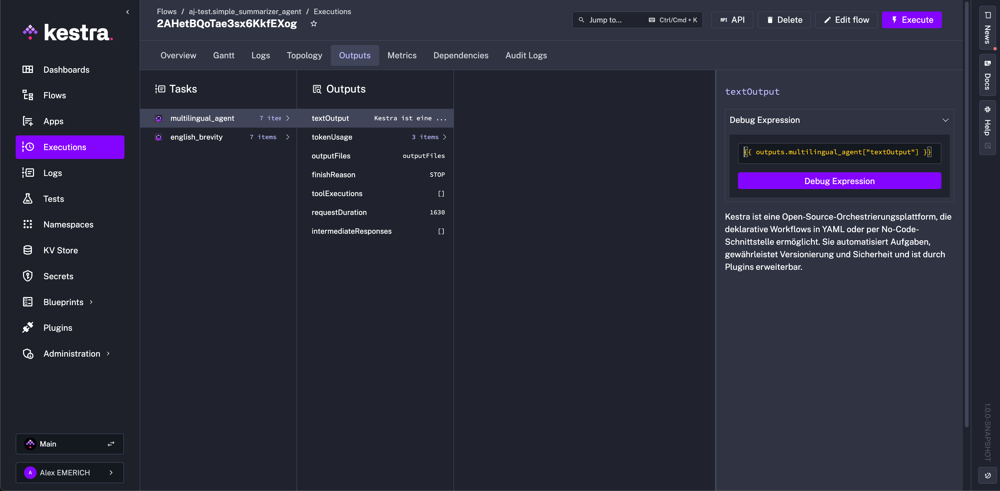
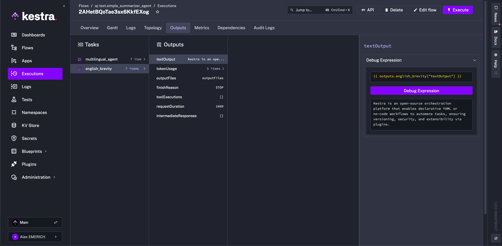

Call a language model as a task in your flow, or give an `AIAgent` task a goal and the tools to reach it.

This page is for flow authors who want a model to do work during an execution. To get AI help writing flows, use [AI Copilot](../01.ai-copilot/index.md) or [your own coding agent](../index.mdx#build-and-operate-kestra-with-ai). To ground answers in your own documents, see [RAG workflows](../06.ai-rag-workflows/index.md).

## Choose an LLM task or an AI agent

| | LLM task | AI agent |
|---|---|---|
| Who decides the steps | You, in the flow definition | The model, at runtime |
| Task type | [`ChatCompletion`](/plugins/plugin-ai/completion/chatcompletion) or a provider plugin | [`AIAgent`](/plugins/plugin-ai/agent) |
| Typical jobs | Summarize, classify, or extract structured data, then hand the result to regular tasks | Open-ended goals that need tools: web search, calling flows, running code, delegating to other agents |
| Calls per run | Fixed | Varies with the tools the model decides to call |

Start with an LLM task when you can write the steps down. Use an agent when the model has to decide which tools to call and in what order.

## Configure the model provider

Every AI plugin task takes a `provider` block with the provider `type`, the `modelName`, and the credentials. Store API keys as [secrets](../../06.concepts/04.secret/index.md) and reference them with `{{ secret('...') }}`. To switch providers, change the `provider` block; the rest of the task stays the same.

### Centralize provider configuration

To avoid repeating the `provider` block on every task, use a [Policy](../../07.enterprise/02.governance/policies/index.md) with an `Add` rule to inject it into all AI tasks across a namespace. Policies are available in Enterprise Edition and Kestra Cloud.

### Fall back to another provider

Use `io.kestra.plugin.ai.provider.Fallback` to try multiple chat providers in order. The task moves to the next provider on connection failures, timeouts, and retriable errors such as HTTP 5xx and 429 responses. Authentication failures, invalid requests, guardrail violations, tool execution errors, and response-processing failures stop the task without trying the next provider.

```yaml
id: agent_with_fallback
namespace: company.ai

inputs:
  - id: prompt
    type: STRING

tasks:
  - id: agent
    type: io.kestra.plugin.ai.agent.AIAgent
    systemMessage: You are a helpful assistant. Answer clearly and concisely.
    prompt: "{{ inputs.prompt }}"
    provider:
      type: io.kestra.plugin.ai.provider.Fallback
      providers:
        - type: io.kestra.plugin.ai.provider.OpenAI
          modelName: gpt-5-mini
          apiKey: "{{ secret('OPENAI_API_KEY') }}"
        - type: io.kestra.plugin.ai.provider.GoogleGemini
          modelName: gemini-2.5-flash
          apiKey: "{{ secret('GEMINI_API_KEY') }}"
```

Set `modelName` on each nested provider. Connection properties such as `baseUrl`, `clientPem`, and `caPem` also belong on the nested provider, not on `Fallback`.

Each provider gets the full configured timeout. If all N providers time out, the task can run for up to N times the timeout before it fails. When every provider fails, the error message lists each provider and its failure type.

Kestra logs each attempt:

```text
INFO  Attempting chat request with provider OPEN_AI [model=gpt-5-mini] (1/2)
WARN  Skipping provider OPEN_AI [model=gpt-5-mini] after provider-side failure of type ConnectException
INFO  Attempting chat request with provider GOOGLE_AI_GEMINI [model=gemini-2.5-flash] (2/2)
```

`Fallback` supports chat tasks only. Using it with image generation or embedding tasks throws an error.

## Call an LLM as a task

An LLM task calls the model once, at a fixed point in the flow, and passes the result to the next task. Use [`io.kestra.plugin.ai.completion.ChatCompletion`](/plugins/plugin-ai/completion/chatcompletion) to stay provider-agnostic. Provider plugins such as [OpenAI](/plugins/plugin-openai), [Gemini](/plugins/plugin-gemini), and [Ollama](/plugins/plugin-ollama) expose provider-specific features.

<div class="video-container">
  <iframe src="https://www.youtube.com/embed/FiL5MQZBj-s" title="AI Workflows Explained: Automation That Can Think" allow="accelerometer; autoplay; clipboard-write; encrypted-media; gyroscope; picture-in-picture; web-share" referrerpolicy="strict-origin-when-cross-origin" allowfullscreen></iframe>
</div>

### Turn a request into structured data

This flow asks the model to split a free-text request into to-do items, returns them as JSON that matches a schema, and creates one [Todoist](https://developer.todoist.com/api/v1/) task per item. The schema uses Todoist's field names, so each item is already a valid request body.

```yaml
id: add_tasks_to_todoist
namespace: company.ai

inputs:
  - id: request
    type: STRING
    displayName: What do you need to get done?
    defaults: I need to pick up my prescription on Friday afternoon and go shopping afterwards

tasks:
  - id: extract_tasks
    type: io.kestra.plugin.ai.completion.ChatCompletion
    provider:
      type: io.kestra.plugin.ai.provider.GoogleGemini
      modelName: gemini-3.5-flash-lite
      apiKey: "{{ secret('GEMINI_API_KEY') }}"
    configuration:
      responseFormat:
        type: JSON
        jsonSchema:
          type: object
          required: ["tasks"]
          properties:
            tasks:
              type: array
              items:
                type: object
                required: ["content"]
                properties:
                  content:
                    type: string
                  description:
                    type: string
                  due_datetime:
                    type: string
                    description: Due date and time as an RFC 3339 timestamp
    messages:
      - type: SYSTEM
        content: Split the user's request into separate to-do items. The current time is {{ now() }}.
      - type: USER
        content: "{{ inputs.request }}"

  - id: create_tasks
    type: io.kestra.plugin.core.flow.Loop
    values: "{{ outputs.extract_tasks.jsonOutput.tasks }}"
    tasks:
      - id: create_task
        type: io.kestra.plugin.core.http.Request
        uri: https://api.todoist.com/api/v1/tasks
        method: POST
        contentType: application/json
        headers:
          Authorization: "Bearer {{ secret('TODOIST_API_TOKEN') }}"
        body: "{{ item.value }}"
```

`jsonOutput` holds the parsed response, so the [Loop](../../05.workflow-components/01.tasks/00.flowable-tasks/index.md) task reads the `tasks` array directly and runs one HTTP request per item. Not every provider supports JSON schemas. For those that don't, describe the expected JSON in the system message and parse `textOutput` instead.

### Run a local model with Ollama

This flow summarizes the past week of commits in a GitHub repository with a model that runs on your own infrastructure, then posts the summary to Slack every Friday. [`OllamaCLI`](/plugins/plugin-ollama/cli/ollamacli) starts Ollama in a container, so the flow needs no model API key and the commit data stays on your worker.

```yaml
id: summarize_weekly_commits
namespace: company.ai

inputs:
  - id: repository
    type: STRING
    defaults: kestra-io/blueprints
    description: GitHub repository in owner/name form

tasks:
  - id: fetch_commits
    type: io.kestra.plugin.core.http.Request
    uri: https://api.github.com/repos/{{ inputs.repository }}/commits?per_page=50&since={{ now() | dateAdd(-7, 'DAYS') | date("yyyy-MM-dd'T'00:00:00'Z'") }}

  - id: summarize_commits
    type: io.kestra.plugin.ollama.cli.OllamaCLI
    inputFiles:
      commits.json: "{{ outputs.fetch_commits.body | jq('[.[].commit.message]') | first | toJson }}"
    commands:
      - ollama run --nowordwrap gemma3:1b "Summarize these Git commit messages as a short weekly update in plain text, without Markdown. $(cat commits.json)" > summary.txt
    outputFiles:
      - summary.txt

  - id: notify
    type: io.kestra.plugin.slack.notifications.SlackIncomingWebhook
    url: "{{ secret('SLACK_WEBHOOK') }}"
    messageText: "Weekly update for {{ inputs.repository }}: {{ read(outputs.summarize_commits.outputFiles['summary.txt']) }}"

triggers:
  - id: every_friday
    type: io.kestra.plugin.core.trigger.Schedule
    cron: "0 15 * * 5"
```

The first execution pulls the `gemma3:1b` model. `OllamaCLI` caches models in a Docker volume by default, so later executions reuse it. The `--nowordwrap` flag keeps terminal line-wrapping codes out of `summary.txt`.

Ollama writes its server output to stderr, which Kestra logs at ERROR level. Those red log lines are expected; check the task state to confirm the run succeeded.

## Build an AI agent

An [`AIAgent`](/plugins/plugin-ai/agent) task gives a model a goal and a set of tools, such as web search, running Kestra tasks, or calling other flows. The model decides which tools to call and in what order, and can keep calling them until it reaches the goal. Each run combines a **system message**, which defines the agent's role and constraints, with a **prompt**, which carries the input for that execution. Add `memory` to keep context across executions.

<div class="video-container">
  <iframe src="https://www.youtube.com/embed/osrS9mi5-eg?si=Tc8kMRP6NhqLQ4_u" title="AI Agents in Kestra: Autonomous Orchestration with Declarative Workflows" allow="accelerometer; autoplay; clipboard-write; encrypted-media; gyroscope; picture-in-picture; web-share" referrerpolicy="strict-origin-when-cross-origin" allowfullscreen></iframe>
</div>

### Example: summarize text in any language

<div style="position: relative; padding-bottom: calc(48.95833333333333% + 41px); height: 0; width: 100%;"><iframe src="https://demo.arcade.software/KL8TVCdgVc4nS5OTS6VS?embed&embed_mobile=tab&embed_desktop=inline&show_copy_link=true" title="AI Agent 3 | Kestra" loading="lazy" webkitallowfullscreen mozallowfullscreen allowfullscreen allow="clipboard-write" style="position: absolute; top: 0; left: 0; width: 100%; height: 100%; color-scheme: light;" ></iframe></div>

The following flow summarizes arbitrary text with controllable length and language. Each component of the flow is broken down below.

```yaml
id: simple_summarizer_agent
namespace: company.ai
inputs:
  - id: summary_length
    displayName: Summary Length
    type: SELECT
    defaults: medium
    values:
        - short
        - medium
        - long
  - id: language
    displayName: Language ISO code
    type: SELECT
    defaults: en
    values:
        - en
        - fr
        - de
        - es
        - it
        - ru
        - ja
  - id: text
    type: STRING
    displayName: Text to summarize
    defaults: |
        Kestra is an open-source orchestration platform that:
        - Allows you to define workflows declaratively in YAML
        - Allows non-developers to automate tasks with a no-code interface
        - Keeps everything versioned and governed, so it stays secure and auditable
        - Extends easily for custom use cases through plugins and custom scripts.
        Kestra follows a "start simple and grow as needed" philosophy. You can schedule a basic workflow in a few minutes, then later add Python scripts, Docker containers, or complicated branching logic if the situation calls for it.
tasks:
  - id: multilingual_agent
    type: io.kestra.plugin.ai.agent.AIAgent
    provider:
      type: io.kestra.plugin.ai.provider.GoogleGemini
      modelName: gemini-3.5-flash-lite
      apiKey: "{{ secret('GEMINI_API_KEY') }}"
    configuration:
      logRequests: true
      logResponses: true
      responseFormat:
        type: TEXT
    systemMessage: |
        You are a precise technical assistant.
        Produce a {{ inputs.summary_length }} summary in {{ inputs.language }}.
        Keep it factual, remove fluff, and avoid marketing language.
        If the input is empty or non-text, return a one-sentence explanation.
        Output format:
        - 1-2 sentences for 'short'
        - 2-5 sentences for 'medium'
        - Up to 5 paragraphs for 'long'
    prompt: |
        Summarize the following content: {{ inputs.text }}

  - id: english_brevity
    type: io.kestra.plugin.ai.agent.AIAgent
    provider:
      type: io.kestra.plugin.ai.provider.GoogleGemini
      modelName: gemini-3.5-flash-lite
      apiKey: "{{ secret('GEMINI_API_KEY') }}"
    configuration:
      logRequests: true
      logResponses: true
      responseFormat:
        type: TEXT
    prompt: Generate exactly 1 sentence English summary of "{{ outputs.multilingual_agent.textOutput }}"
```

#### Inputs

The flow uses three inputs (`summary_length`, `language`, and `text`) to control the summary length, language, and source text.

All inputs have a default value. Any of them can be referenced in downstream tasks with [expressions](../../expressions/index.mdx). When executing the flow, any input can be selected or modified from its default.



The example selects `short` for the summary length and German (`de`) for the summary language.

#### Tasks

The flow has two tasks using the [AI Agent plugin](/plugins/plugin-ai/agent): `multilingual_agent` and `english_brevity`. The first task, `multilingual_agent`, uses the `systemMessage` property to set the agent's role and behavior. The system message references the input selections for summary length and language, and defines what to output for each length option.

The `prompt` property instructs the agent to summarize the input text. For a short summary, `multilingual_agent` produces a 1–2 sentence German summary of Kestra.



The `english_brevity` task has no `systemMessage`, so the prompt alone instructs the model. It reads the first task's `textOutput` and produces a one-sentence English summary, whatever the original language or length.



Pass these outputs to notification tasks, subflows, or other agents. Use the `tokenUsage` output to compare providers on the same task. Kestra also emits the counter metrics `ai.agent.tool.calls`, `ai.provider.calls`, and `ai.embedding.store.calls`, tagged by class name, which you can scrape with Prometheus or export through OpenTelemetry. For all properties and outputs, see the [AI Agent plugin documentation](/plugins/plugin-ai/agent).

## Agent tools

The AI Agent can be extended with **tools**: capabilities the model can call at runtime to complete its task. Tools are listed under the `tools` property of an `AIAgent` task.

### Skills

The [**Skill**](/plugins/plugin-ai/tool/skill) tool lets you attach structured instructions to an agent that it can activate on demand. Rather than including all instructions in the system message, skills let you define discrete, reusable knowledge blocks, each with a name, a description the LLM uses to decide when to activate it, and the actual instruction content.

This is useful when an agent has multiple possible modes of operation, such as translating text, reviewing code, or formatting data, where you want the LLM to select and apply the right instructions based on context rather than always receiving all instructions at once.

Each skill requires:
- `name`: a unique identifier for the skill
- `description`: explains to the LLM when to activate the skill
- `content` or `contentUri`: the instruction content, either inline or loaded from Kestra internal storage

#### Inline skill content

The simplest way to define a skill is with inline `content`:

```yaml
id: agent_with_skills
namespace: company.ai

tasks:
  - id: agent
    type: io.kestra.plugin.ai.agent.AIAgent
    prompt: Translate the following text to French - "Hello, how are you today?"
    provider:
      type: io.kestra.plugin.ai.provider.GoogleGemini
      modelName: gemini-3.5-flash-lite
      apiKey: "{{ secret('GEMINI_API_KEY') }}"
    tools:
      - type: io.kestra.plugin.ai.tool.Skill
        skills:
          - name: translation_expert
            description: Expert translator for multiple languages
            content: |
              You are an expert translator. When translating text:
              1. Preserve the original meaning and tone
              2. Use natural phrasing in the target language
              3. Keep proper nouns unchanged
```

#### Loading skill content from storage

For longer or reusable instructions, store the skill content as a file in Kestra internal storage and reference it with `contentUri`. This is especially useful when skill content is generated or updated by an earlier task in the same flow:

```yaml
id: agent_with_skill_from_storage
namespace: company.ai

tasks:
  - id: write_instructions
    type: io.kestra.plugin.core.storage.Write
    content: |
      You are a senior code reviewer. When reviewing code:
      1. Check for security vulnerabilities
      2. Ensure proper error handling
      3. Verify naming conventions are followed
      4. Flag any code duplication

  - id: agent
    type: io.kestra.plugin.ai.agent.AIAgent
    prompt: "Review this Python function - 'def add(a, b): return a + b'"
    provider:
      type: io.kestra.plugin.ai.provider.GoogleGemini
      modelName: gemini-3.5-flash-lite
      apiKey: "{{ secret('GEMINI_API_KEY') }}"
    tools:
      - type: io.kestra.plugin.ai.tool.Skill
        skills:
          - name: code_review_expert
            description: Expert code reviewer with strict guidelines
            contentUri: "{{ outputs.write_instructions.uri }}"
```

A single `Skill` tool can define multiple skills. Each skill must have a unique name. `content` and `contentUri` are mutually exclusive, and each skill needs exactly one of them. For more details on all available properties, refer to the [Skill plugin documentation](/plugins/plugin-ai/tool/skill).

### Kestra-native tools

- [**KestraFlow**](/plugins/plugin-ai/tool/kestraflow): Triggers a Kestra flow as a tool, either with a predefined namespace and flow ID or dynamically based on the agent's prompt.
- [**KestraTask**](/plugins/plugin-ai/tool/kestratask): Exposes one or more Kestra runnable tasks as tools, letting the agent supply values for properties left unset.

### Web search

- [**TavilyWebSearch**](/plugins/plugin-ai/tool/tavilywebsearch): Gives the agent access to live web results via the Tavily search API.
- [**GoogleCustomWebSearch**](/plugins/plugin-ai/tool/googlecustomwebsearch): Gives the agent access to live web results via a Google Custom Search Engine.

### Code execution

- [**CodeExecution**](/plugins/plugin-ai/tool/codeexecution): Lets the agent write and run JavaScript snippets in a Judge0 sandbox (via RapidAPI).

### Nested agents

- [**AIAgent**](/plugins/plugin-ai/tool/aiagent): Wraps another AI agent as a callable tool so a parent agent can delegate sub-tasks to a specialized child agent.
- [**A2AClient**](/plugins/plugin-ai/tool/a2aclient): Forwards prompts to a remote AI agent over the Agent-to-Agent (A2A) protocol and returns its response.

### MCP clients

Kestra supports MCP in two directions. These clients cover the **Kestra-as-client** direction: your flow calls tools on an *external* MCP server. To go the other way and expose your flows *as* MCP tools for external AI agents, see [flow MCP servers](../07.mcp-server/index.md) and the [McpToolTrigger](../../05.workflow-components/07.triggers/06.mcp-tool-trigger/index.md).

Connect the agent to any [Model Context Protocol (MCP)](https://modelcontextprotocol.io) server to expose its tools:

- [**DockerMcpClient**](/plugins/plugin-ai/tool/dockermcpclient): Runs an MCP server inside a Docker container.
- [**SseMcpClient**](/plugins/plugin-ai/tool/ssemcpclient): Connects to a remote MCP server over Server-Sent Events (SSE).
- [**StdioMcpClient**](/plugins/plugin-ai/tool/stdiomcpclient): Spawns a local MCP server process and communicates over stdio.
- [**StreamableHttpMcpClient**](/plugins/plugin-ai/tool/streamablehttpmcpclient): Connects to an MCP server over HTTP streaming.

The [Kestra Python MCP server](https://github.com/kestra-io/mcp-server-python) is an example of an external MCP server you can connect to from a Kestra AI Agent task using one of the clients above.

## Docker Agent

[Docker Agent](https://docs.docker.com/ai/docker-agent/) is a multi-agent framework where specialized agents, defined in a YAML configuration file, collaborate and delegate work. The `io.kestra.plugin.docker.cli.Agent` task runs a Docker Agent team from a Kestra flow, so you can schedule agent workloads, chain them after upstream tasks, and capture results as a `ScriptOutput`.

The task requires a Docker task runner and accepts model provider credentials through the inherited `env` property. Model strings use the `provider/model-name` format: `openai/` with `OPENAI_API_KEY` for OpenAI, or `google/` with `GOOGLE_API_KEY` for Google Gemini.

**OpenAI:**

```yaml
id: docker_agent_openai
namespace: company.ai

triggers:
  - id: every_morning
    type: io.kestra.plugin.core.trigger.Schedule
    cron: "0 7 * * *"

tasks:
  - id: daily_digest
    type: io.kestra.plugin.docker.cli.Agent
    taskRunner:
      type: io.kestra.plugin.scripts.runner.docker.Docker
      user: root
    env:
      OPENAI_API_KEY: "{{ secret('OPENAI_API_KEY') }}"
    prompt: "Write a short digest of yesterday's failed deployments."
    agentConfig: |
      agents:
        root:
          model: openai/gpt-4o-mini
          instruction: You write concise operations digests.
```

**Google Gemini:**

```yaml
id: docker_agent_gemini
namespace: company.ai

triggers:
  - id: every_morning
    type: io.kestra.plugin.core.trigger.Schedule
    cron: "0 7 * * *"

tasks:
  - id: daily_digest
    type: io.kestra.plugin.docker.cli.Agent
    taskRunner:
      type: io.kestra.plugin.scripts.runner.docker.Docker
      user: root
    env:
      GOOGLE_API_KEY: "{{ secret('GOOGLE_API_KEY') }}"
    prompt: "Write a short digest of yesterday's failed deployments."
    agentConfig: |
      agents:
        root:
          model: google/gemini-3.5-flash-lite
          instruction: You write concise operations digests.
```

The `agentConfig` property accepts inline YAML (as above), a relative path to an existing file in the working directory, or a `kestra://` internal storage URI. When using a relative path, the file must exist in the working directory before the `Agent` task starts. Stage it with a `WorkingDirectory` task and an earlier write or download step.

:::alert{type="info"}
Docker Agent prints a startup banner to stderr. Kestra captures stderr as ERROR-level log entries, so those lines appear red in the execution logs even when the task succeeds. The agent's actual output appears at INFO level.
:::

For all properties and outputs, see the [Docker Agent plugin reference](/plugins/plugin-docker/cli/agent).

## Execution details

When you open an execution in the topology view, the details panel for `AIAgent`, `ChatCompletion`, and `rag.ChatCompletion` tasks shows the LLM configuration and post-execution context for each call.

**Pre-execution:**
- Model name and provider
- System prompt (collapsible)
- Tools available to the agent
- RAG retriever and embedding store configuration (when applicable)

**Post-execution:**

| Signal | Description |
|---|---|
| LLM response | The final text or JSON output rendered inline |
| Tool call timeline | Each tool invocation in order: name, arguments, and result |
| Token usage | Input tokens, output tokens, total, and an estimated cost by provider and model |
| Reasoning chain | Intermediate responses and extended thinking steps when present |
| RAG sources | Retrieved chunks ranked by similarity score, showing which context grounded the answer |
| Finish reason | Why the model stopped: natural stop, max tokens reached, or a guardrail trigger |
