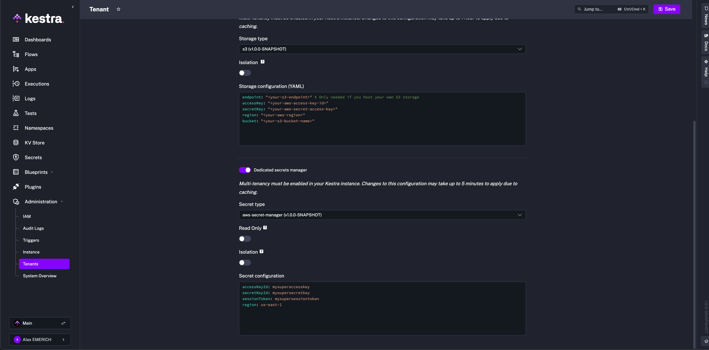

Use this page when you need to protect sensitive values or harden a Kestra deployment.

## Encryption

This is the minimum security configuration most self-managed instances should think about early, because it determines whether sensitive flow values can be stored safely at rest.

Kestra supports encryption of sensitive inputs and outputs at rest through `kestra.encryption.secret-key`.

Example:

```yaml
kestra:
  encryption:
    secret-key: BASE64_ENCODED_STRING_OF_32_CHARACTERS
```

Generate a key with:

```bash
openssl rand -base64 32
```

Without `kestra.encryption.secret-key`, `SECRET` inputs and outputs fail at runtime because Kestra cannot encrypt the value at rest.

Example flow using `SECRET` types:

```yaml
id: my_secret_flow
namespace: company.team

inputs:
  - id: secret
    type: SECRET

tasks:
  - id: mytask
    type: io.kestra.plugin.core.log.Log
    message: task that needs the secret to connect to an external system

outputs:
  - id: secret_output
    type: SECRET
    value: "{{ inputs.secret }}"
```

## Secret backends

Choose the backend based on where your organization already stores secrets. In practice, most teams want Kestra to consume an existing cloud or Vault-based secret system rather than create a separate one just for workflows.

Kestra can be configured to use a secrets backend through `kestra.secret.*`.

:::alert{type="info"}
For the full backend reference — including all supported backends, complete property tables, permissions, credential resolution order, and read-only mode — see [Secrets Manager](../../07.enterprise/02.governance/secrets-manager/index.md).
:::

Base structure:

```yaml
kestra:
  secret:
    type: azure-key-vault
    azure-key-vault:
      client-secret:
        tenant-id: "id"
        client-id: "id"
        client-secret: "secret"
    isolation:
      enabled: true
      denied-services:
        - EXECUTOR
```

`isolation` is the key control to understand here: it limits which Kestra services are allowed to resolve secrets, which is useful when you want workers or executors to have narrower access than the whole platform.

To keep secrets manager credentials off workers entirely, set `kestra.secret.worker-access: CONTROLLER` on the workers and `kestra.controller.secret-api.enabled: true` on the controller. Workers then read secrets through the controller over gRPC. See [Worker access to secrets](../../07.enterprise/02.governance/secrets-manager/index.md#worker-access-to-secrets).

The Azure service principal referenced in the base structure above must have the following Key Vault access policy permissions: `Get`, `List`, `Set`, `Delete`, `Recover`, `Backup`, `Restore`, `Purge`.

Representative backend examples:

AWS Secrets Manager requires the following IAM permissions: `CreateSecret`, `DeleteSecret`, `DescribeSecret`, `GetSecretValue`, `ListSecrets`, `PutSecretValue`, `RestoreSecret`, `TagResource`, `UpdateSecret`.

```yaml
kestra:
  secret:
    type: aws-secret-manager
    aws-secret-manager:
      access-key-id: mysuperaccesskey
      secret-key-id: mysupersecret-key
      session-token: mysupersessiontoken
      region: us-east-1
```

Google Secret Manager requires the `roles/secretmanager.admin` role. Omit `service-account` to fall back to `GOOGLE_APPLICATION_CREDENTIALS` or the environment's default credentials:

```yaml
kestra:
  secret:
    type: google-secret-manager
    google-secret-manager:
      project: gcp-project-id
      service-account: |
        <service-account JSON>
```

Elasticsearch secrets are additionally encrypted with AES. The key must be at least 32 characters:

```yaml
kestra:
  secret:
    type: elasticsearch
    elasticsearch:
      secret: "a-secure-32-character-minimum-key"
```

HashiCorp Vault (KV v2) supports Userpass, Token, and AppRole authentication.

Userpass:

```yaml
kestra:
  secret:
    type: vault
    vault:
      address: "http://localhost:8200"
      password:
        user: john
        password: foo
```

Token:

```yaml
kestra:
  secret:
    type: vault
    vault:
      address: "http://localhost:8200"
      token:
        token: your-secret-token
```

AppRole:

```yaml
kestra:
  secret:
    type: vault
    vault:
      address: "http://localhost:8200"
      app-role:
        path: approle
        role-id: your-role-id
        secret-id: your-secret-id
```

JDBC-backed secrets, secret tags, and secret caching are covered below.

### JDBC secret backend

Use JDBC-backed secrets only when secrets must stay inside the same database boundary as Kestra and you do not already have a dedicated secret manager:

```yaml
kestra:
  secret:
    type: jdbc
    jdbc:
      secret: "your-secret-key"
```

### Secret tags

Some backends let you scope lookups with tags so the same secret manager can serve multiple environments:

```yaml
kestra:
  secret:
    <secret-type>:
      tags:
        application: kestra-production
```

Tags are useful when secrets are selected by metadata rather than by one fixed path convention.

### Secret cache

:::alert{type="info"}
Secret caching applies to [external secrets managers](../../07.enterprise/02.governance/secrets-manager/index.md), available in Enterprise Edition and Kestra Cloud.
:::

Caching reduces repeated calls to the secrets manager for frequently used values. The cache is enabled by default:

```yaml
kestra:
  secret:
    cache:
      enabled: true
      maximum-size: 1000
      expire-after-write: 60s
      negative-cache-enabled: false
      negative-cache-ttl: 45s
```

Keep `expire-after-write` short if secret rotation happens often. Set `negative-cache-enabled: true` to also cache lookups that find no secret, which avoids repeated queries for parent namespaces that don't hold the secret. See [Secret caching](../../07.enterprise/02.governance/secrets-manager/index.md#secret-caching) for how each setting behaves.



## Security settings

This section is about hardening the running platform rather than managing secret values. Reach for it when you are locking down access, controlling invitations and roles, or tuning how the server reacts to component health issues.

This group includes:

- instance owner behavior
- default roles
- invitation expiration
- password rules
- server basic auth
- gRPC basic auth between workers and controllers
- deletion of configuration files

Server and endpoint hardening examples:

```yaml
kestra:
  server:
    basic-auth:
      username: admin@kestra.io
      password: change-me
      open-urls:
        - "/api/v1/main/executions/webhook/"
```

```yaml
endpoints:
  all:
    basic-auth:
      username: your-user
      password: your-password
```

### gRPC basic authentication

Require a shared username and password on the gRPC channel between workers and the Worker Controller. This applies to the open-source edition only. Enterprise Edition ignores these properties and uses [TLS and worker authentication](../../security-hardening/index.md#tls-and-worker-authentication-ee) instead.

```yaml
kestra:
  grpc:
    basic-auth:
      enabled: true
      username: kestra-worker
      password: ${KESTRA_GRPC_PASSWORD}
```

| Property | Default | Description |
| --- | --- | --- |
| `kestra.grpc.basic-auth.enabled` | `false` | Require the credentials on every gRPC call to the controller, except health checks. |
| `kestra.grpc.basic-auth.username` | — | Username that workers present and controllers expect. Required when `enabled` is `true`. |
| `kestra.grpc.basic-auth.password` | — | Password that workers present and controllers expect. Required when `enabled` is `true`. |

Set identical values on every worker and on every server that runs a controller, including webserver and standalone servers started without `--no-controller`. If `enabled` is `true` and `username` or `password` is missing or blank, the controller or worker fails to start with an error that includes `Property kestra.grpc.basic-auth.username is required when gRPC basic authentication is enabled.`

Changing the credentials requires restarting the controllers and the workers. The channel stays plaintext, so the credentials are readable to anyone who can capture its traffic. See [Basic authentication (OSS)](../../security-hardening/index.md#basic-authentication-oss) for the security model.

### Instance Owner

The instance owner account has the highest level of platform access and should be reserved for break-glass administration:

```yaml
kestra:
  security:
    instance-owner:
      username: your_username
      password: ${KESTRA_INSTANCE_OWNER_PASSWORD}
      tenant-admin-access:
        - <optional>
```

:::alert{type="info"}
`kestra.security.super-admin` is a deprecated alias for `kestra.security.instance-owner` and still works.
:::

:::alert{type="warning"}
Never store clear-text passwords in config. Use environment variables or your platform secret mechanism.
:::

### Default role

Assign a default role to newly created users when you want them to land with a predictable permission set:

```yaml
kestra:
  security:
    default-role:
      name: default
      description: "Default role"
      permissions:
        FLOW: ["VIEW", "LIST", "CREATE", "UPDATE", "DELETE", "EXECUTE"]
```

In multi-tenant environments, scope that role to one tenant:

```yaml
kestra:
  security:
    default-role:
      name: default
      description: "Default role"
      permissions:
        FLOW: ["VIEW", "LIST", "CREATE", "UPDATE", "DELETE", "EXECUTE"]
      tenant-id: staging
```

:::alert{type="info"}
Place `default-role` under `kestra.security`, not `micronaut.security`.
:::

### Invitation expiration and password rules

Invitation links expire after seven days by default. Extend them if user onboarding happens through slower approval processes:

```yaml
kestra:
  security:
    invitations:
      expire-after: P30D
```

For username/password auth, configure password complexity explicitly:

```yaml
kestra:
  security:
    basic-auth:
      password-min-length: 8
      password-require-special: true
      password-min-digits: 1
      password-min-lower-case: 1
      password-min-upper-case: 1
      password-allowed-special-characters: "!@#$%^&*"
```

These rules apply anywhere Kestra asks a user to set or reset a password, including the initial setup flow, invitation acceptance, and user management screens.

### Delete configuration files after startup

If the runtime reads secrets from configuration files, delete them after startup so tasks cannot read them later from disk:

```yaml
kestra:
  configurations:
    delete-files-on-start: true
```

### Liveness and worker task restarts

Every Kestra server sends heartbeats, and executors use them to detect servers that stopped responding. The defaults are:

```yaml
kestra:
  server:
    liveness:
      enabled: true
      interval: 10s
      timeout: 1m
      initial-delay: 1m
      heartbeat-interval: 3s
```

These constraints affect cluster stability:

- `timeout` must match across **all Executors**.
- `initial-delay` must match across **all Executors**.
- `heartbeat-interval` must be strictly less than `timeout`.

When a worker stops responding, `kestra.server.worker-task-restart-strategy` decides what happens to the tasks it was running:

- `NEVER`: the tasks are not restarted.
- `IMMEDIATELY`: the tasks are restarted as soon as the worker is detected as disconnected. Recovery is faster, but a task can run twice.
- `AFTER_TERMINATION_GRACE_PERIOD` (default): the tasks are restarted after the termination grace period elapses, which limits the risk of running a task twice.

Set the termination grace period long enough for tasks to exit cleanly. The default is `5m`:

```yaml
kestra:
  server:
    termination-grace-period: 5m
```

Kestra keeps records of stopped server instances for 30 days by default. If the deployment regularly creates short-lived server instances, shorten the retention:

```yaml
kestra:
  server:
    service:
      purge:
        retention: 7d
```

:::alert{type="warning"}
Keep the external process manager timeout longer than Kestra's own termination grace period. Otherwise Kubernetes, Docker, or systemd can kill the process before graceful shutdown finishes.
:::

## Regex timeout

Kestra protects worker threads from ReDoS (catastrophic backtracking) by enforcing a timeout on all regex operations. This applies to [Pebble expression filters](../../expressions/index.mdx) (`regexMatch`, `regexReplace`, `regexExtract`, `replace` with `regexp=true`) and to `validator` patterns on `STRING` and `SECRET` inputs. When a pattern exceeds the limit, the task fails immediately with a timeout error rather than hanging indefinitely.

The default timeout is **10 seconds**. To change it, set `kestra.regex.timeout` in your configuration:

```yaml
kestra:
  regex:
    timeout: 30s
```

Accepts ISO 8601 duration strings (e.g., `PT30S`, `PT1M`) or Micronaut shorthand (e.g., `5s`, `1m`).

:::alert{type="info"}
The timeout is set once at startup and cannot be changed at runtime without restarting the server.
:::

## Passwordless OTP

Enable passwordless One-Time-Password login so users authenticate via an emailed code instead of a password. Requires a mail service to be configured.

```yaml
kestra:
  security:
    one-time-password:
      enabled: true
      expiration: PT5M
      code-length: 6
      rate-limit:
        max-requests: 10
        window: PT1H
```

See [Passwordless (OTP)](../../07.enterprise/03.auth/04.authentication/index.md#passwordless-one-time-password) for setup prerequisites and full property details.

## Related docs

- Secrets manager concepts: [External Secrets Manager](../../07.enterprise/02.governance/secrets-manager/index.md)
- Enterprise auth and RBAC: [Authentication and Users](../../07.enterprise/03.auth/index.mdx)
- EE platform settings and advanced backends: [Enterprise and Advanced](../06.enterprise-and-advanced/index.md)
