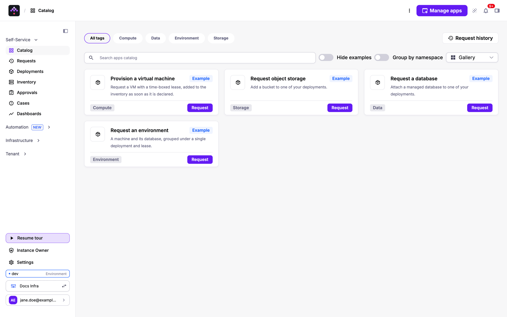
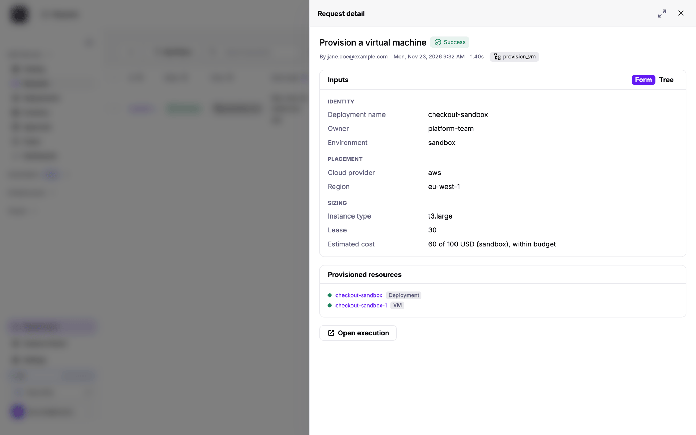

The Catalog is where teams request infrastructure, and Requests is where everyone follows what was asked for.

Each catalog entry is an [app](../../07.enterprise/04.scalability/apps/index.md) that runs a flow. A request is the execution that app starts. The Catalog is the home page of an [Infrastructure tenant](../index.mdx).

## Request a resource

1. Open **Catalog**.
2. Find the entry. Filter by tag, search by name, or turn on **Group by namespace**.
3. Click **Request** on its card. The request form opens in a new tab.
4. Fill in the form and submit it.

The form shows the app's progress while the flow runs. When the flow finishes, the form shows the result, for example the resources that were provisioned. To follow the request later, click **Request history** on the Catalog, or open **Requests**.

<div style="position: relative; padding-bottom: calc(56.4617% + 41px); height: 0px; width: 100%;"><iframe src="https://demo.arcade.software/3DXLsMaDFuodZH72jPAC?embed&embed_mobile=tab&embed_desktop=inline&show_copy_link=true" title="Provision a Virtual Machine Using the Self-Service Catalog" frameborder="0" loading="lazy" webkitallowfullscreen mozallowfullscreen allowfullscreen allow="clipboard-write; autoplay" style="position: absolute; top: 0; left: 0; width: 100%; height: 100%; color-scheme: light;" ></iframe></div>

An entry with a **Needs approval** badge pauses until someone approves it. The request stays in Requests while it waits. See [Approvals](../../07.enterprise/02.governance/approvals/index.md) for how reviewers act on it.

## Publish an entry to the Catalog

An app appears in the Catalog when all of these are true:

- It's enabled and hasn't [expired](../../07.enterprise/04.scalability/apps/index.md#app-expiration).
- Its `access.catalog` is `true`.
- For a `PRIVATE` app, you have the `APP` `EXECUTE` permission on its namespace. If the app sets `access.groups`, you must also be in one of those groups.

```yaml
id: request-vm
namespace: platform.catalog
type: io.kestra.plugin.ee.apps.Execution
flowId: provision_vm
displayName: Provision a virtual machine
description: Request a VM with a time-boxed lease.
tags:
  - compute
access:
  type: PRIVATE
  catalog: true
  groups:
    - engineering
layout:
  - on: OPEN
    blocks:
      - type: io.kestra.plugin.ee.apps.execution.blocks.CreateExecutionForm
      - type: io.kestra.plugin.ee.apps.execution.blocks.CreateExecutionButton
        text: Provision
  - on: SUCCESS
    blocks:
      - type: io.kestra.plugin.ee.apps.execution.blocks.Assets
```

The `tags` become filters on the Catalog. The `Assets` block shows the resources the request provisioned once the flow succeeds. See [Assets emitted by an execution](../../07.enterprise/04.scalability/apps/index.md#assets-emitted-by-an-execution).

To create an entry and the flow behind it in one step, use an [app template](../05.app-templates/index.md). To manage apps that are already published, click **Manage apps** on the Catalog.

## Catalog page



| Control | What it does |
|---|---|
| Tags | Show only the entries with a tag. |
| Search | Filter entries by name. |
| **Hide examples** | Hide the [example environment](../01.setup/index.md#example-environment). Your browser remembers the setting. |
| **Group by namespace** | Group the entries under their namespace. |
| **Gallery** / **List** | Switch between cards and a table. |
| **Request history** | Open the 10 most recent requests, yours (**Mine**) or everyone's (**Everyone**). **Full view** opens Requests. |
| **Manage apps** | Open the list of apps in the tenant. |

The menu in the page header also has **Copy catalog URL** and **Open standalone page**. The standalone page shows the Catalog without the Kestra sidebar, for teams that only request resources.

### Brand the standalone Catalog

The Instance Owner can set the title, colors, and logo of the standalone Catalog page. Select **Customize display** in the Catalog's header menu, or open **Instance Owner**, select the tenant, and open **Apps Catalog**. See [Customize the Apps Catalog](../../07.enterprise/04.scalability/apps/index.md#customize-the-apps-catalog) for the settings.

The branding applies only to the standalone page. The Catalog inside the tenant keeps the Kestra look.

## Follow requests

**Requests** lists the executions started from a catalog app. Day-2 actions run from a deployment's page don't appear here. Find them on the deployment's **Executions** tab.

| Column | Shows |
|---|---|
| **Id** | The execution ID |
| **State** | The execution state |
| **Flow** | The flow the app ran |
| **Start date** | When the request was submitted |
| **Item** | The catalog entry that was requested |
| **Inputs** | The values entered in the form |
| **Asset** | The resources the request created or updated |
| **By** | Who submitted the request |

Filter the list by state and start date. Click a request to open its details:

- Its status, requester, start date, duration, and the flow it ran.
- The error, if the request failed.
- A **Resume** button, if the request is paused, for example waiting for approval.
- The form values, as a form or as a tree. Secret values are masked.
- The resources it provisioned.
- **Open execution**, to see its logs, outputs, and Gantt chart.



You need the `EXECUTION` `LIST` permission to open Requests, and you see only the requests in namespaces where you hold it. The **Asset** column needs the `ASSET` `LIST` permission.

### Find requests through the API

Requests are executions labeled `system.from: app`. Search for them with the executions API:

```bash
curl -g "https://kestra.example.com/api/v1/<tenant>/executions/search?filters[labels][EQUALS][system.from]=app&filters[childFilter][EQUALS]=MAIN" \
  -H "Authorization: Bearer <token>"
```

Each request also carries `system.app`, the ID of the app, and `system.username`, the requester. See [System labels](../../06.concepts/system-labels/index.md).
