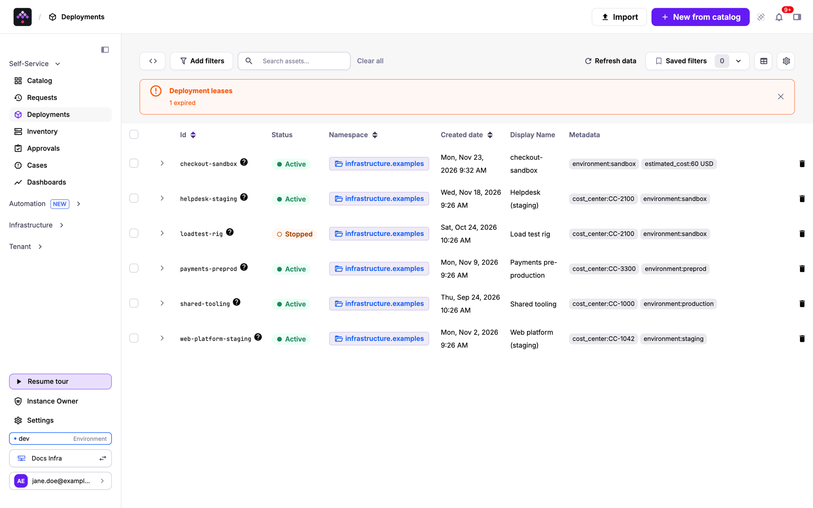
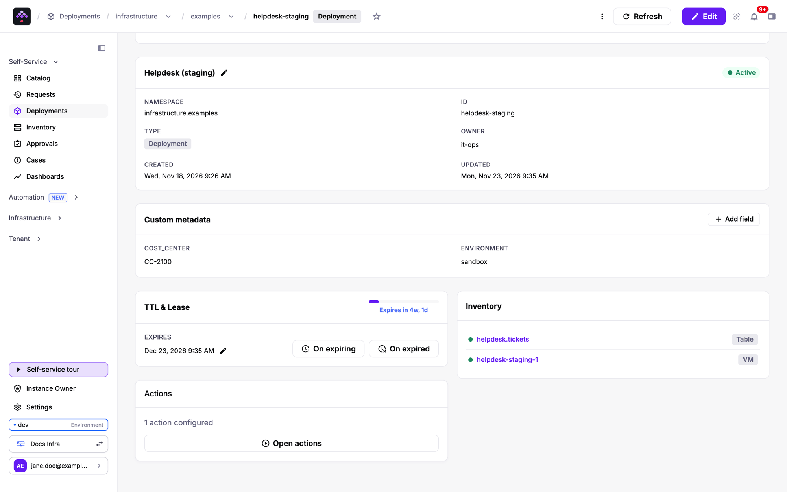

A deployment is one environment a team received, such as an application's VM and database, with a lease on it.

Deployments are [assets](../../07.enterprise/02.governance/01.assets/index.md) of type `io.kestra.plugin.ee.assets.Deployment`. The resources inside a deployment are other assets that point to it with `partOf`, and they're listed in [Inventory](../04.inventory/index.md). The **Deployments** page of an [Infrastructure tenant](../index.mdx) lists only deployments.

## Declare a deployment from a flow

A provisioning flow declares the deployment and its resources as [asset outputs](../../07.enterprise/02.governance/01.assets/01.declare-assets/index.md). This task records a deployment with a 30-day lease and a **Decommission** action, and a VM that belongs to it. The VM offers **Resize** only while its status is `active`:

```yaml
tasks:
  - id: provision
    type: io.kestra.plugin.core.log.Log
    message: "Provisioning {{ inputs.name }}"
    assets:
      outputs:
        - id: "{{ inputs.name }}"
          type: io.kestra.plugin.ee.assets.Deployment
          displayName: "{{ inputs.name }}"
          owner: platform-team
          ttl: "{{ now() | dateAdd(amount=30, unit='DAYS', format='iso_milli', timeZone='UTC') }}"
          assetActions:
            - namespace: platform.catalog
              flowId: decommission_resource
              label: Decommission
        - id: "{{ inputs.name }}-vm-1"
          type: io.kestra.plugin.ee.assets.VM
          owner: platform-team
          assetActions:
            - namespace: platform.catalog
              flowId: resize_vm
              label: Resize
              when:
                - field: status
                  operator: EQUAL_TO
                  value: active
          partOf:
            id: "{{ inputs.name }}"
          metadata:
            region: "{{ inputs.region }}"
```

The lease is the deployment's `ttl`, a UTC instant in the format `yyyy-MM-dd'T'HH:mm:ss.SSS'Z'`. Like `status` and `owner`, it's a top-level field of the asset, not a `metadata` entry. See [Lifecycle fields](../../07.enterprise/02.governance/01.assets/01.declare-assets/index.md#lifecycle-fields) for the formats and the keys to use in queries.

## Deployments page

The list has **New from catalog**, which opens the [Catalog](../02.catalog-and-requests/index.md), and **Import**, which brings existing infrastructure in as a deployment. See [Import an existing inventory](../04.inventory/index.md#import-an-existing-inventory).

- **Filters**: **Status**, and **Expiry**, which offers **Expires ≤ 7 days**, **Expires ≤ 30 days**, **Expired**, and **No expiry**.
- **Deployment leases** banner: counts the deployments that expire within 7 days and those already expired. Destroyed deployments aren't counted. If you dismiss the banner, it comes back when the counts change.
- **Row expansion**: expand a deployment to see the resources linked to it.
- **Hide examples**: hide the [example environment](../01.setup/index.md#example-environment).



The **Source** column, hidden by default, shows where an imported deployment came from: `terraform`, `csv`, `json`, or `yaml`. Add it from the column settings.

## Deployment page

A deployment's page shows its details and metadata, and three cards:

- **TTL & Lease**: when the lease expires, and the flows that run before and after it expires.
- **Actions**: the day-2 actions you can run.
- **Inventory**: the resources that are `partOf` the deployment.



The **Executions** tab lists the executions linked to the deployment, including its day-2 actions. The **Dependencies** tab shows its relations to other assets.

## Extend or change a lease

If you can update assets in the deployment's namespace, and the deployment isn't destroyed, change its lease from the **TTL & Lease** card:

1. Click the pencil icon next to **Expires**.
2. Choose **Keep current**, **No expiry**, 7, 30, 60, or 90 days from now, or **Pick a date and time**. A picked time uses the time zone from your [UI settings](../../09.ui/06.settings/index.md), and defaults to 23:59:59 if you only pick a day. Past dates and times are disabled.
3. Click **Save**.

Changing the lease updates only the deployment's `ttl`. It doesn't change the infrastructure behind it.

## Act when a lease expires

To act on a deployment when its lease is about to expire or has expired, attach a flow from the **TTL & Lease** card with **On expiring** or **On expired**. Kestra opens the flow editor with a [`TtlTrigger`](../../07.enterprise/02.governance/01.assets/02.tasks-and-triggers/index.md#ttltrigger) already set, scoped to this deployment, to its namespace, or to every asset with a lease in the tenant. You need the `FLOW` `CREATE` permission.

For example, an **On expiring** flow can notify the owner a few days before expiry, and an **On expired** flow can decommission the resources.

## Run a day-2 action

Day-2 actions are flows attached to an asset, which users with the right permissions run from the asset's page, for example **Resize** on a VM or **Decommission** on a deployment.

1. On the deployment's or the resource's page, click **Open actions** on the **Actions** card.
2. Select an action.
3. Fill in its inputs and click **Execute**.

<div style="position: relative; padding-bottom: calc(56.4617% + 41px); height: 0px; width: 100%;"><iframe src="https://demo.arcade.software/CXQzSthSroYruAfZJmgK?embed&embed_mobile=tab&embed_desktop=inline&show_copy_link=true" title="Change VM Size in an Existing Deployment" frameborder="0" loading="lazy" webkitallowfullscreen mozallowfullscreen allowfullscreen allow="clipboard-write; autoplay" style="position: absolute; top: 0; left: 0; width: 100%; height: 100%; color-scheme: light;" ></iframe></div>

To run an action, you need the `ASSET` `UPDATE` permission on the asset's namespace and the `FLOW` `EXECUTE` permission on the action flow's namespace. An action whose `when` conditions aren't met can't run.

The execution is labeled `system.from: asset` and `system.assetId` with the asset's ID, and appears on the asset's **Executions** tab. It doesn't appear in [Requests](../02.catalog-and-requests/index.md#follow-requests).

Attach actions with `assetActions` on the asset declaration, as in the example above. Each action names a flow by namespace and ID, and gives the button a label. To limit when an action can run, or to run one through the API, see [Asset actions](../../07.enterprise/02.governance/01.assets/01.declare-assets/index.md#asset-actions).

## Delete a deployment

Deleting a deployment removes its record from Kestra. It doesn't deprovision anything. To tear down the infrastructure, run a decommission action first.

When you delete a deployment from the list or its page, **Also remove the N linked resources** is selected by default. Clear it to keep the resources in Inventory, detached from the deployment.

Through the API, call `DELETE /api/v1/<tenant>/assets/<id>` with `children=DELETE` to delete the linked resources, or `children=DETACH`, the default, to keep them.
