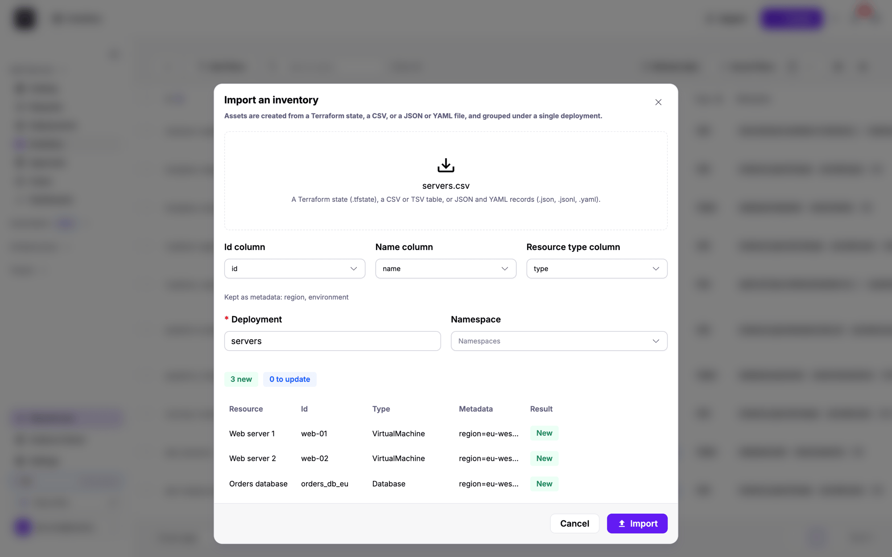

The Inventory lists the resources inside your deployments: VMs, databases, buckets, tables, files, and any other asset type your flows declare.

**Inventory** shows every [asset](../../07.enterprise/02.governance/01.assets/index.md) in an [Infrastructure tenant](../index.mdx) except deployments, which have their own [Deployments](../03.deployments/index.md) page. Resources usually get there because a provisioning flow declared them. To bring in infrastructure that already exists, [import it](#import-an-existing-inventory).

## Inventory page

- **Filters**: by status.
- **Deployment** column: the deployment the resource is `partOf`. Click it to open the deployment.
- **Source** column, hidden by default: where an imported resource came from: `terraform`, `csv`, `json`, or `yaml`. Add it from the column settings.
- **Create**: declare a single asset by hand.
- **Import**: import a file. See [Import an existing inventory](#import-an-existing-inventory).
- **Hide examples**: hide the [example environment](../01.setup/index.md#example-environment).

Click a resource to open its page, with its metadata, its day-2 actions, the executions that touched it, and its dependencies. To run an action on it, see [Run a day-2 action](../03.deployments/index.md#run-a-day-2-action).

## Import an existing inventory

Import a Terraform state or a file of records to bring existing infrastructure into Kestra. Kestra creates one asset per resource and groups the resources under a single deployment, so they appear in Deployments and Inventory next to the resources your flows provision.

You need the `ASSET` `CREATE` permission in the target namespace, and `ASSET` `UPDATE` for assets that already exist.

1. On the **Deployments** or **Inventory** page, click **Import**.
2. Drop a file in the upload area, or click it to select one:
   - Terraform state: `.tfstate`, `.backup`, or a `.json` state file
   - Table: `.csv` or `.tsv`
   - Records: `.json`, `.jsonl`, `.ndjson`, `.yaml`, or `.yml`
3. For a table or records file, check the **Id column**, **Name column**, and **Resource type column**. Kestra preselects them from the column names.
4. Check the **Deployment** name, which defaults to the file name. Optionally, choose a **Namespace**.
5. Review the preview, then click **Import**.



A confirmation shows how many assets were imported and into which deployment.

<div style="position: relative; padding-bottom: calc(56.4617% + 41px); height: 0px; width: 100%;"><iframe src="https://demo.arcade.software/V1PLG7Nrqv2CK7j9afh4?embed&embed_mobile=tab&embed_desktop=inline&show_copy_link=true" title="Import and View a Terraform State Inventory" frameborder="0" loading="lazy" webkitallowfullscreen mozallowfullscreen allowfullscreen allow="clipboard-write; autoplay" style="position: absolute; top: 0; left: 0; width: 100%; height: 100%; color-scheme: light;" ></iframe></div>

### How a file maps to assets

| Asset field | Terraform state | Table or records file |
|---|---|---|
| ID | `tf:<deployment>:<resource address>`, made into a valid ID, so `aws_instance.web[0]` in deployment `prod` becomes `tf:prod:aws_instance.web_0` | Value of the **Id column**, made into a valid ID |
| Display name | Resource address, for example `aws_instance.web[0]` | Value of the **Name column**, or the ID |
| Type | Resource type in PascalCase, for example `AwsInstance` | Value of the **Resource type column** |
| Metadata | `provider` and `externalId`, the resource's `arn` or `id` | Every other column |

A Terraform state imports one asset per instance of each managed resource. Data sources are skipped. The deployment gets a `terraformVersion` metadata entry from the state file. The output of `terraform show -json` isn't accepted. Import the state file itself, for example the output of `terraform state pull`.

Kestra makes each ID valid before importing it:

- Characters other than letters, digits, `.`, `_`, `:`, `/`, and `-` become `_`, and repeated `_` are collapsed.
- `/` becomes `:`.
- Leading and trailing characters that aren't letters or digits are removed.

So `orders db (eu)` becomes `orders_db_eu`, and `arn:aws:rds:eu-west-1:1:db/orders` becomes `arn:aws:rds:eu-west-1:1:db:orders`. For a table or records file, when this changes an ID, the original value is kept in the `externalId` metadata. An ID longer than 150 characters is shortened to a prefix and a hash, and the original ID is kept in the `system.fullId` metadata.

For a table or records file:

- A type that contains a dot, such as `com.example.VirtualMachine`, is used as is. Other values are converted to PascalCase, so `virtual_machine` becomes `VirtualMachine`. An empty value becomes `io.kestra.core.models.assets.External`.
- Rows with an empty ID, an ID already used earlier in the file, or the deployment's own ID are skipped. The preview shows how many.
- The columns mapped to the ID, name, and type aren't imported as metadata, and neither are a `deployment` column or columns starting with `system.`.

Each imported resource is linked to its deployment with `partOf`, so it appears in the **Inventory** card of the deployment's page and in the **Deployment** column of Inventory. The resources and the deployment also get a `system.source` value of `terraform`, `csv`, `json`, or `yaml`, shown in the **Source** column.

If you leave **Namespace** empty and the deployment already exists, new resources go into the deployment's namespace.

### Preview and re-import

Before anything is written, the preview labels each resource:

| Result | Meaning |
|---|---|
| **New** | No asset with this ID exists. Kestra creates it. |
| **Will be updated** | An asset with this ID already belongs to this deployment. Kestra updates its metadata with the file's values. |
| **Outside this deployment** | An asset with this ID exists but doesn't belong to this deployment. Kestra leaves it untouched. |

**Import** stays disabled when nothing would be created or updated.

When you re-import, an asset keeps its stored display name unless the file provides one through the **Name column**. An import can't change the namespace or the type of an existing asset, except to or from `External`. Kestra validates every resource before writing, so if any resource is invalid or locked, nothing is imported.

### Import through the API

The **Import** dialog calls the bulk asset endpoint, which you can also call directly in any tenant. It takes asset definitions as YAML documents separated by `---` and applies the same preview and re-import rules as the dialog. The dialog cleans up IDs before sending them, so when you call the endpoint directly, send IDs that already follow the rules above. For example, this `assets.yaml` defines a deployment and one resource in it:

```yaml
id: web-prod
type: io.kestra.plugin.ee.assets.Deployment
namespace: company.infra
---
id: vm-web-01
type: VirtualMachine
namespace: company.infra
partOf:
  id: web-prod
metadata:
  region: eu-west-1
```

Send the file with `dryRun=true` to preview the result without writing anything:

```bash
curl -X POST "https://kestra.example.com/api/v1/<tenant>/assets/bulk?dryRun=true" \
  -H "Authorization: Bearer <token>" \
  -H "Content-Type: application/x-yaml" \
  --data-binary @assets.yaml
```

The response lists asset IDs under `created`, `updated`, and `skipped`, which match the preview's **New**, **Will be updated**, and **Outside this deployment**. To import, set `dryRun=false` or omit it.
