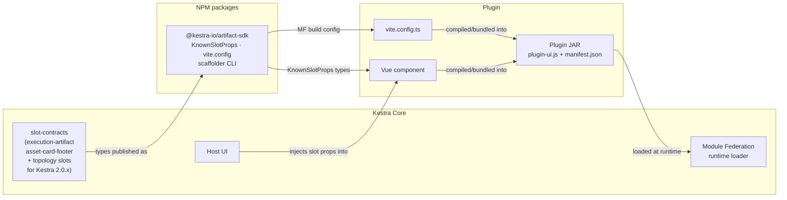

Plugins can ship custom Vue.js frontend components that load directly into the Kestra UI at runtime, without any changes to Kestra core.

This lets you build domain-specific experiences in the Kestra UI: show a model graph, a compiled query or a report in the **Artifacts** tab of an execution, or add a line of metadata to an asset card. The core UI stays lean; each plugin brings exactly the UI it needs.

Register **both slot sets** in the same manifest, so one plugin version works on Kestra 2.0.x and on 2.1 and later. No `kestraVersion` bump and no newer Java version is needed for this.

| Kestra version | What the host does | Slots to register |
|---|---|---|
| 2.0.x | Renders the topology slots | `topology-details`, `topology-task-drawer`, `topology-task-modal` |
| 2.1 and later | Ignores the topology slots and renders `execution-artifact` | `execution-artifact` (and `asset-card-footer` in the Enterprise Edition) |

:::alert{type="info"}
**Which slot should I use?** Both. Register [`execution-artifact`](#execution-artifact) for Kestra 2.1 and later, and keep the `topology-details`, `topology-task-drawer` and `topology-task-modal` slots for Kestra 2.0.x, see [Kestra 2.0.x: topology slots](#kestra-20x-topology-slots). Each host ignores the slots it does not know. The topology slots are kept for Kestra 2.0.x support and can be dropped once Kestra 2.0.x is out of support.
:::

## Why plugin artifacts?

Tasks in Kestra produce structured outputs and have rich configuration. But the default execution view is generic: it shows a task's state, logs and raw outputs, not what the task did. When a task is query-centric, graph-centric, or data-heavy, that generic view loses signal.

Plugin artifacts let you close this gap without forking Kestra's core. An `execution-artifact` component can render a formatted query, a dependency graph or a report at full size in the Artifacts tab. This keeps the core UI generic and lets each plugin deliver the right experience for its domain.

## Architecture

Plugin artifacts are built as **Vue.js micro-frontends** using [Module Federation](https://module-federation.io/). The plugin's `ui/` directory compiles to a federated JavaScript module, which is bundled into the plugin JAR under `src/main/resources/plugin-ui/`. At runtime, the Kestra host app discovers and loads these modules dynamically. No static linking is required.

```
Plugin JAR
└── src/main/resources/plugin-ui/
    ├── plugin-ui.js       ← the federated module entry point
    ├── manifest.json      ← declares which task types have UI and which slots they fill
    └── *.css              ← scoped styles
```

The `manifest.json` is the contract between the plugin and the host. It tells Kestra which task types expose UI components, which slot each component fills, and any static metadata (dimensions, feature flags) the host needs before loading the component.

The [`@kestra-io/artifact-sdk`](https://github.com/kestra-io/artifact-sdk) handles all the Module Federation configuration, manifest generation, and shared dependencies. You write a Vue component; the SDK takes care of the bundling contract.



## Available UI slots

Each plugin component targets a specific **slot**, a named extension point in the Kestra UI. Slots are defined in Kestra core (OSS) and distributed via the `@kestra-io/artifact-sdk` package. Kestra core owns the runtime contract (what props are injected, what `manifest.json` shape is accepted); the SDK exposes the corresponding TypeScript types and powers the scaffolding CLI. Two slots are used by Kestra 2.1 and later: `execution-artifact` and `asset-card-footer`. The three topology slots, rendered only by Kestra 2.0.x, are documented [at the end of this page](#kestra-20x-topology-slots).

### `execution-artifact`

Renders in the **Artifacts** tab of an execution, next to **Overview**, **Gantt**, and **Logs**, and in the **Artifacts** tab of a task run's popup, which opens from the artifact count on the task's node in the execution topology. Kestra 2.1 and later show it in place of the topology slots. Use it for a result that a user opens full size after a run, such as a model graph, a compiled query, or a report. The contract is defined in [`ui/packages/slot-contracts/src/execution-artifact.ts`](https://github.com/kestra-io/kestra/blob/develop/ui/packages/slot-contracts/src/execution-artifact.ts) in Kestra core.

The component receives `taskType`, `task`, `execution`, `namespace`, `flowId`, `tenant`, `progress`, `fetchOutputs`, `fetchMetrics`, and `fetchEndpoint`. Read them with `defineProps<KnownSlotProps["execution-artifact"]>()`. `progress` lists the live lifecycle steps of the task's current task run, and is empty when there is none (see [Tracking live task progress](#tracking-live-task-progress)). For the fetchers, see [Fetching outputs and metrics](#fetching-outputs-and-metrics) and [Call an endpoint from an artifact](#call-an-endpoint-from-an-artifact). There is no `displayMode` attribute.

The tab appears only when the flow contains at least one task whose type declares an artifact, and its badge shows the number of artifacts. The tab groups artifacts by task and opens the selected one in a viewer beside the list.

A task type can ship several artifacts. Each one is its own component, registered in `vite.config.ts` as `execution-artifact/<id>`, and each gets its own entry in the manifest:

```ts
"cli.DbtCLI": [
  {
    slotName: "execution-artifact/model-graph",
    path: "./src/components/ModelGraphArtifact.vue",
    additionalProperties: { title: "Model graph" },
  },
  {
    slotName: "execution-artifact/compiled-sql",
    path: "./src/components/CompiledSqlArtifact.vue",
    additionalProperties: { title: "Compiled SQL" },
  },
],
```

The host builds the list from `additionalProperties`:

- **`title`** is the label of the artifact in the tab. It is required.
- **`description`** is an optional line shown under the title.

The Artifacts tab lists only entries registered as `execution-artifact/<id>` that set `title`. The scaffolder writes `slotName: "execution-artifact"` without an ID, so add one after scaffolding. An entry with no ID or no `title` never appears in the tab.

To show a line that depends on the run, such as `8 nodes · 8 dependencies`, export `getSubtitle` from the component. The host calls it again each time a task run changes state, so it can read outputs that exist only once the task has run:

```vue
<script lang="ts">
export async function getSubtitle({ fetchOutputs }) {
  const outputs = await fetchOutputs();
  return outputs.modelCount ? `${outputs.modelCount} models` : undefined;
}
</script>
```

`getSubtitle` receives `{ task, execution, fetchOutputs, fetchMetrics, fetchEndpoint }`. `fetchOutputs` and `fetchMetrics` accept an optional `taskRunId` and default to the latest run of the task. Return a string, or `undefined` to show only the description.

:::alert{type="warning"}
`@kestra-io/artifact-sdk` versions before 0.3.1 reject the `execution-artifact/<id>` slot name at build time. Use 0.3.1 or later. Kestra 2.0.x doesn't render this slot, which is why plugins that support 2.0.x also register the topology slots.
:::

### `asset-card-footer`

Renders below an asset's card in the dependency graph. Use it for a short line that the card doesn't show, such as a row count, a freshness date, or a link to the source. The contract is defined in [`ui/packages/slot-contracts/src/asset-card-footer.ts`](https://github.com/kestra-io/kestra/blob/develop/ui/packages/slot-contracts/src/asset-card-footer.ts) in Kestra core.

Kestra picks the footer from the task type that produced the asset. Unlike the other slots, the component doesn't receive a task or an execution. It receives these props:

- **`assetId`** is the asset's ID, as shown in the graph.
- **`assetType`** is the asset's type. It is optional.
- **`metadata`** holds everything the producing task attached to the asset, such as the keys a plugin emits through `Asset.metadata`.
- **`tenant`** is the current tenant, so a component that bundles its own SDK copy doesn't have to guess it.

Set `footerHeight` in `additionalProperties` to the height of your component in pixels. The graph reserves that space for every card at once, so rows stay aligned. A graph with no footer keeps the compact card.

```ts
"table.Sync": [
  {
    slotName: "asset-card-footer",
    path: "./src/components/TableSyncAssetCardFooter.vue",
    additionalProperties: { footerHeight: 24 },
  },
],
```

Assets are available in Enterprise Edition and Kestra Cloud. For how plugins write asset metadata and how this slot displays it, see [Plugin artifacts and assets](../../06.concepts/plugin-artifacts-vs-assets/index.md).

## Quick start

Use the [`@kestra-io/create-artifact-sdk`](https://github.com/kestra-io/artifact-sdk) scaffolder to bootstrap the `ui/` directory in your plugin. Run this from your plugin's root (the directory containing `settings.gradle` or `settings.gradle.kts`):

```bash
npm create @kestra-io/artifact-sdk
```

The CLI will:

1. **Detect your plugin**: reads `settings.gradle[.kts]` to infer the plugin group ID (e.g. `io.kestra.plugin.example`).
2. **Ask which task** you want to add UI for (e.g. `query.RunQuery`).
3. **Ask which UI slot** to target. Choose `execution-artifact` for Kestra 2.1 and later. For the topology slots used by Kestra 2.0.x, see [Kestra 2.0.x: topology slots](#kestra-20x-topology-slots).
4. **Show a summary** and ask for confirmation before writing anything.
5. **Scaffold the `ui/` directory** with all required files and run `npm install`.

:::alert{type="info"}
Node.js ≥ 18 is required. The scaffolder can also be run from inside an existing `ui/` directory if you want to add more components later.
:::

:::alert{type="warning"}
After scaffolding, add `@kestra-io/design-system` as a **direct** dependency:

```bash
cd ui
npm install @kestra-io/design-system
```

`@module-federation/vite` resolves shared package entries from its own `node_modules` path. Even though `@kestra-io/design-system` is already a dependency of `artifact-sdk`, the Module Federation build will fail unless it is also listed as a top-level dependency in your plugin's `package.json`.
:::

## Project structure

After scaffolding, the `ui/` directory looks like this:

```
ui/
├── .gitignore
├── .storybook/
│   ├── main.ts
│   └── preview.ts
├── index.html                          ← dev server entry
├── package.json
├── tsconfig.json
├── vite.config.ts                      ← Module Federation config
└── src/
    ├── App.vue                         ← dev server wrapper
    ├── main.ts                         ← dev server entry
    ├── components/
    │   └── QueryRunQueryExecutionArtifact.vue   ← your component to edit
    └── QueryRunQueryExecutionArtifact.stories.ts
```

The component file is the only file you need to edit. The rest of the scaffolding is boilerplate that wires up the local dev server, Storybook, and the production build.

## Fetching outputs and metrics

Task outputs and metrics are the two things almost every artifact component needs, and they do not require calling the API yourself. Use the `fetchOutputs` and `fetchMetrics` props. They are bound to this task and the current tenant by the host, and resolve on call rather than on mount, so a component that never calls them never fires a request:

```ts
import type { KnownSlotProps } from "@kestra-io/artifact-sdk";
import { ref, watch, computed } from "vue";

const props = defineProps<KnownSlotProps["execution-artifact"]>();

const executionId = computed(() => props.execution?.id as string | undefined);

// Task outputs
const outputs = ref<Record<string, unknown>>({});

watch(executionId, async (id) => {
  outputs.value = id ? await props.fetchOutputs?.() ?? {} : {};
}, { immediate: true });

// Task metrics
const metrics = ref<Array<{ name: string; value: number }>>([]);

watch(executionId, async (id) => {
  metrics.value = id ? (await props.fetchMetrics?.())?.results ?? [] : [];
}, { immediate: true });
```

Both fetchers take an optional query object:

```ts
fetchOutputs(query?: { taskRunId?: string }): Promise<Record<string, unknown>>
fetchMetrics(query?: { page?: number; size?: number; sort?: string; taskRunId?: string }): Promise<PagedResultsMetricEntry>
```

Pass `taskRunId` to address one iteration of a looped task; omit it to let the host resolve the task's current run. Outside an execution both resolve to an empty result (`{}` / an empty page) rather than rejecting, so no `try/catch` is needed for that case.

:::alert{type="info"}
`fetchOutputs` and `fetchMetrics` are optional in the type because they aren't injected in every rendering context (e.g. a bare dev-server harness). Guard with `?.()` and a fallback, as in the example above, rather than assuming they're always present.
:::

## Tracking live task progress

Tasks that go through several lifecycle steps before finishing, such as a batch job or a runner that provisions an external resource, can report progress while they're still running, instead of waiting for outputs and metrics at completion.

Task code reports a step with `RunContext#emitProgress`:

```java
runContext.emitProgress("pod.created", "Pod scheduled on node gke-cluster-1");

// or backdate the event to a real timestamp known only after the fact,
// e.g. a Kubernetes condition's lastTransitionTime
runContext.emitProgress("pod.running", "Pod is running", podStartedAt);
```

Each call emits a regular INFO log line carrying a typed `progress` key, so it rides the existing log queue, no separate channel or endpoint is needed. `step` is an opaque, plugin-defined identifier (e.g. `"pod.created"`); `message` is the human-readable text shown in the log console.

The `execution-artifact` slot, and the `topology-details` slot on Kestra 2.0.x, pick these up automatically: `progress` is an array of `{ taskId, taskRunId, step, timestamp }` entries, fed live from the execution's follow-logs stream while the task run is in progress.

```ts
const props = defineProps<KnownSlotProps["execution-artifact"]>();
const steps = computed(() => props.progress ?? []);
```

Use `progress` to render a step indicator or timeline while `hasExecution` is true but before outputs and metrics are available, it updates live, whereas outputs and metrics only materialize once the task run completes.

### Rendering a stepper

The `ui/` directory is a standalone Vue app, so you're not limited to `@kestra-io/design-system`, any Vue 3 component library works. [Element Plus](https://element-plus.org/) ships a ready-made `<el-steps>` component that's a natural fit for `progress`:

```bash
cd ui
npm install element-plus
```

```vue
<!-- ui/src/components/QueryRunQueryExecutionArtifact.vue -->
<script setup lang="ts">
import type { KnownSlotProps } from "@kestra-io/artifact-sdk";
import { computed } from "vue";
import { ElSteps, ElStep } from "element-plus";
import "element-plus/es/components/steps/style/css";
import "element-plus/es/components/step/style/css";

const props = defineProps<KnownSlotProps["execution-artifact"]>();

// progress events land one SSE message at a time and aren't guaranteed to arrive in order
const orderedSteps = computed(() =>
  [...props.progress].sort((a, b) => a.timestamp.localeCompare(b.timestamp))
);
</script>

<template>
  <el-steps :active="orderedSteps.length" finish-status="success" align-center>
    <el-step v-for="s in orderedSteps" :key="s.step" :title="s.step" />
  </el-steps>
</template>
```

`active` set to the number of steps received so far marks everything up to the latest one as done; new entries pushed into `progress` advance the stepper live as the task runs.

:::alert{type="warning"}
`RunContext#emitProgress` requires your plugin to build against `kestraVersion = 1.3.27` (or later) in `gradle.properties`, it ships in Kestra core, not the artifact-sdk.
:::

## Calling the Kestra API

**A new data need is a new slot prop, not a new SDK call.** An artifact renders what the host passes to it. The props above, `task`, `execution`, `tenant`, `fetchOutputs`, and `fetchMetrics`, already cover flow definitions, execution state, outputs, and metrics. For work that has to run on the server when the user asks for it, `fetchEndpoint` calls a [plugin endpoint](#running-backend-logic-with-plugin-endpoints). No case remains where an artifact needs to call the Kestra REST API directly, including rendering task properties for display (see [Pebble expressions](#pebble-expressions-in-task-config) below). A direct call bypasses the permission scoping that the props provide and ties your component to internal API shapes. If your component needs data the props don't provide, the slot contract is missing a prop: raise that instead of working around it.

Don't add `@kestra-io/kestra-sdk` to your `ui/package.json`. The Kestra UI doesn't share it with plugin modules, and `@kestra-io/artifact-sdk` no longer depends on it or offers it in the scaffolder.

## Running backend logic with plugin endpoints

:::alert{type="warning"}
Plugin endpoints are a preview, and the `PluginEndpoint` interface can still change.
:::

Outputs and metrics contain only what the task computed while it ran. Some data can't be prepared in advance, such as a file too large to store as an output, or one part of an execution's files that the user picks. For that data, the plugin can expose an **endpoint**: a Java class that Kestra runs on the server when it is called.

Prefer task outputs whenever the value is known at the end of the task. Use an endpoint only for work that has to happen on demand.

### Implement an endpoint

Implement `PluginEndpoint` and annotate the class with `@Plugin`. Kestra discovers it the same way it discovers tasks and triggers.

```java
@Plugin
public class HelloEndpoint implements PluginEndpoint {
    @Override
    public String name() {
        return "hello";
    }

    @Override
    public PluginEndpointResponse handle(PluginEndpointContext context) {
        String name = context.param("name");
        return PluginEndpointResponse.of(Map.of("message", "hello: " + name));
    }
}
```

- **`name()`** is a URL segment. It must be unique within a plugin JAR. When two endpoints share a name, Kestra logs a warning and keeps the first.
- **`context.param(name)`** returns the first value of a query parameter, or `null`. `context.parameters()` returns all of them.
- **`context.body()`** returns the JSON request body as a `Map<String, Object>`. It is empty for a `GET` call.
- **`context.executionId()`** and **`context.taskRunId()`** identify the task run the endpoint was called for.
- **`PluginEndpointResponse.of(object)`** serializes the object as JSON. **`PluginEndpointResponse.ofBytes(bytes, contentType)`** returns raw bytes. **`PluginEndpointResponse.ofFile(bytes, contentType, fileName)`** returns raw bytes with a download file name.

The class must be a stateless singleton with a public no-argument constructor.

### Read the task run from an endpoint

The context gives access to the task run the endpoint was called for, and nothing beyond it:

| Accessor | What it gives you |
|---|---|
| `context.logs()` | `find()` or `find(Level minLevel)` returns the task run's log entries. |
| `context.outputs()` | `get()` returns the task run's outputs. A value can be a `kestra://` storage URI instead of inline data. |
| `context.storage()` | `getFile`, `list`, `exists`, `putFile`, and `deleteFile` on the internal storage of the current execution. A URI outside that execution's storage, or one that uses `..`, is rejected with an `IllegalArgumentException`. |

Use `context.storage()` to read a file that an output points to.

### Call an endpoint from an artifact

Call the endpoint with the `fetchEndpoint` prop. The host binds it to your plugin, the current execution, and the task's current run:

```ts
const props = defineProps<KnownSlotProps["execution-artifact"]>();

const greeting = await props.fetchEndpoint?.("hello", { name: "kestra" });
// { message: "hello: kestra" }
```

`fetchEndpoint(name, params?, query?)` sends a `GET` request with `params` as query parameters, and resolves to the response body. Pass `query.taskRunId` to call it for one iteration of a looped task. Outside an execution, it rejects instead of resolving to an empty result, so check `execution?.id` before calling it.

The `execution-artifact` slot receives `fetchEndpoint`, and so does its `getSubtitle` export. Kestra 2.0.x has no plugin endpoints, so the topology slots don't receive it.

### Call an endpoint over HTTP

Kestra serves every endpoint at:

```
GET|POST /api/v1/{tenant}/plugins/{cls}/endpoints/{name}/{executionId}/{taskRunId}
```

`{cls}` is the fully qualified name of any plugin class in the same JAR as the endpoint, such as `io.kestra.plugin.example.Hello`. A `POST` call needs a JSON object body.

```bash
curl -H "Authorization: Bearer $TOKEN" \
  "http://localhost:8080/api/v1/main/plugins/io.kestra.plugin.example.Hello/endpoints/hello/$EXECUTION_ID/$TASKRUN_ID?name=kestra"
```

```json
{"message":"hello: kestra"}
```

### What to expect

| Situation | Result |
|---|---|
| In Enterprise Edition, the caller lacks the **FLOW** `EXECUTE` or the **EXECUTION** `VIEW` permission on the execution's namespace | `403` |
| The execution or task run doesn't exist, no plugin has that class, or no endpoint has that name | `404` |
| A `POST` call has no JSON body | `422` |
| The request body is larger than the server limit (10 MiB by default, set with `kestra.plugins.endpoint.max-body-size`) | `413` |
| `handle()` throws an exception | `500` with a generic message. Kestra writes the exception only to the server log. |
| The response is JSON | Served inline |
| The response is any other content type | Always served as a download (`Content-Disposition: attachment`, `X-Content-Type-Options: nosniff`), never rendered in the page |

Kestra checks permissions before your code runs. Don't implement your own permission checks in `handle()`.

To turn the feature off, set `kestra.plugins.endpoint.enabled: false`.

### Limits

- `handle()` has no access to secrets, the flow definition, other task runs, or other executions.
- `handle()` runs synchronously on a web server thread, and there is no timeout yet. Keep it short and bounded, and never wait indefinitely on an external system.
- A response has only a body, a content type, and an optional file name. You can't set a status code or headers, so invalid input and internal errors both return `500`.

## Pebble expressions in task config

Task configuration is authored with [Pebble expressions](../../expressions/index.mdx): a `sql` property might be `SELECT * FROM {{ vars.dataset }}.users`, and a `projectId` might be `{{ inputs.project }}`. The `task` prop holds these values as written, unrendered. Your component never resolves them, because expressions that call `secret()`, `kv()`, or variables from a real execution can't resolve safely outside one.

Follow these rules for every value your artifact displays:

- **After an execution**, show a value only if it comes from `fetchOutputs`, `fetchMetrics`, or the `execution` prop. Never fall back to `task` for a property that can hold an expression. If the output is missing, for example in an execution from an older plugin version, show `—`.
- **Before an execution**, in the flow editor or while the task run hasn't finished, no outputs exist yet. Show the raw value from `task`, and mark any value that contains `{{` or `{%` as a template, or show `—`.
- **Values that can't hold an expression**, such as the plugin `type`, enum-like flags, and hard-coded defaults, can come from `task` in both cases.

```ts
const hasExecution = computed(() => !!props.execution?.id);
const isTemplate = (v?: string) => !!v && /\{[{%]/.test(v);

const projectId = computed(() => {
  if (hasExecution.value) return (taskOutputs.value.projectId as string | undefined) ?? "—";
  const raw = props.task?.projectId as string | undefined;
  if (!raw) return "—";
  return isTemplate(raw) ? `(template) ${raw}` : raw;
});
```

When an artifact needs to show a resolved value, the task must publish it as an output. Add the value to the task's `Output` class with a `@Schema` description, set it from the value the task actually used at runtime, and read it with [`fetchOutputs`](#fetching-outputs-and-metrics). Publish identifiers only, never credentials: a service account email rather than its key, an ARN rather than an access key.

<!-- TODO: kestra#18884 open decisions. Update this section when they're settled:
     - Large or sensitive values (BigQuery `sql`, AI `prompt`/`systemMessage`): proposal is not to output them
       and to keep showing the raw template, labelled as a template.
     - Failed runs: runner details on failure aren't passed through on 1.3.x/2.0.x/2.1.x (c0e0016abe backport
       proposed), so outputs-only artifacts show `—` after a failed run except LambdaMicroVm.
     - Identifiers close to secrets (role ARNs reveal the account ID, Azure subscriptionId): proposal is to
       publish ARNs and serviceAccountEmail, keep subscriptionId raw and masked.
     - customAction: an output-based variant instead of `taskProp`, or dropping the option. -->


## Configuring the exposed components

The `vite.config.ts` file declares which components are exposed and under which task types:

```ts
import defaultViteConfig from "@kestra-io/artifact-sdk/vite.config";

export default defaultViteConfig({
  plugin: "io.kestra.plugin.example",

  exposes: {
    "query.RunQuery": [
      {
        slotName: "execution-artifact/query",
        path: "./src/components/QueryRunQueryExecutionArtifact.vue",
        additionalProperties: { title: "Query" },
      },
    ],
  },
});
```

- **`plugin`**: the plugin group ID, matching the prefix used in task types.
- **`exposes`**: a map from task type suffix (everything after `io.kestra.plugin.example.`) to a list of slot definitions.
- **`slotName`**: which UI slot this component fills. For `execution-artifact`, use `execution-artifact/<id>` to ship several artifacts for one task type.
- **`path`**: path to the Vue component, relative to `ui/`.
- **`additionalProperties`**: static metadata written to the manifest (see [below](#additional-properties)).

A single task can expose components for several slots. **Register both sets** to support Kestra 2.0.x and 2.1 and later with one plugin version: each host ignores the slots it does not know. The topology slots are kept for Kestra 2.0.x support, so drop them once Kestra 2.0.x is out of support. The same component file can back all of them if it only reads props the slots share.

```ts
"query.RunQuery": [
  // Kestra 2.1 and later
  {
    slotName: "execution-artifact/details",
    path: "./src/components/QueryRunQueryExecutionArtifact.vue",
    additionalProperties: { title: "Query" },
  },
  // Kestra 2.0.x, ignored by Kestra 2.1 and later
  {
    slotName: "topology-details",
    path: "./src/components/QueryRunQueryTopologyDetails.vue",
    additionalProperties: { height: 120, heightWithExecution: 150 },
  },
  {
    slotName: "topology-task-drawer",
    path: "./src/components/QueryRunQueryTopologyDetails.vue",
  },
  {
    slotName: "topology-task-modal",
    path: "./src/components/QueryRunQueryTopologyDetails.vue",
  },
],
```

## Complete example

The snippet below is adapted from the BigQuery plugin. It shows an `execution-artifact` component that:

- shows project and location from the task outputs, and from `task` while the task run hasn't produced outputs yet, marking templated values
- adds duration and cost estimates after execution, via `fetchMetrics`
- adds a job-details section fed by `fetchOutputs`
- shows a run-dependent line in the artifact list through `getSubtitle`

```vue
<!-- ui/src/components/QueryRunQueryExecutionArtifact.vue -->
<script lang="ts">
export async function getSubtitle({ fetchOutputs }) {
  const outputs = await fetchOutputs();
  return outputs.size ? `${outputs.size.toLocaleString()} rows` : undefined;
}
</script>

<script setup lang="ts">
import type { KnownSlotProps } from "@kestra-io/artifact-sdk";
import { computed, ref, watch } from "vue";

// KnownSlotProps["execution-artifact"] includes taskType, task, execution, namespace, flowId,
// tenant, progress, fetchOutputs, fetchMetrics, fetchEndpoint
const props = defineProps<KnownSlotProps["execution-artifact"]>();

const executionId = computed(() => props.execution?.id as string | undefined);

// Task outputs, via the lazy fetchOutputs prop. Resolves to {} outside an execution.
const taskOutputs = ref<Record<string, any>>({});

watch(executionId, async (id) => {
  taskOutputs.value = id ? await props.fetchOutputs?.() ?? {} : {};
}, { immediate: true });

// Read resolved values from the outputs. While the task run has none yet, fall back to
// the definition and mark unrendered Pebble expressions.
const isTemplate = (v?: string) => !!v && /\{[{%]/.test(v);
const fromOutputsOrTask = (key: string) => {
  const output = taskOutputs.value[key] as string | undefined;
  if (output) return output;
  const raw = props.task?.[key] as string | undefined;
  return raw && isTemplate(raw) ? `(template) ${raw}` : raw;
};
const projectId = computed(() => fromOutputsOrTask("projectId"));
const location = computed(() => fromOutputsOrTask("location"));

// Task metrics, via the lazy fetchMetrics prop, already scoped to this task and execution
const metrics = ref<Array<{ name: string; value: number }>>([]);

watch(executionId, async (id) => {
  metrics.value = id ? (await props.fetchMetrics?.())?.results ?? [] : [];
}, { immediate: true });

const getMetric = (name: string) => metrics.value.find((m) => m.name === name)?.value;
const bytesBilled = computed(() => getMetric("total.bytes.billed"));
const durationMs = computed(() => getMetric("duration"));

function formatBytes(b?: number) {
  if (b === undefined) return "-";
  const units = ["B", "KB", "MB", "GB", "TB"];
  let i = 0, v = b;
  while (v >= 1024 && i < units.length - 1) { v /= 1024; i++; }
  return `${v.toFixed(i === 0 ? 0 : 2)} ${units[i]}`;
}

function formatCost(b?: number) {
  if (b === undefined) return "-";
  const cost = (b / Math.pow(1024, 4)) * 5;
  return cost < 0.01 ? "< $0.01" : `~$${cost.toFixed(4)}`;
}

function formatDuration(ms?: number) {
  if (ms === undefined) return "-";
  return ms < 1000 ? `${ms} ms` : `${(ms / 1000).toFixed(2)} s`;
}
</script>

<template>
  <div class="artifact">
    <dl class="grid">
      <dt>Project</dt><dd>{{ projectId ?? "-" }}</dd>
      <dt>Location</dt><dd>{{ location ?? "-" }}</dd>
      <template v-if="executionId">
        <dt>Duration</dt><dd>{{ formatDuration(durationMs) }}</dd>
        <dt>Est. cost</dt><dd>{{ formatCost(bytesBilled) }}</dd>
      </template>
    </dl>

    <section v-if="executionId" class="section">
      <h4 class="section-title">Job Details</h4>
      <dl class="grid">
        <dt>Job ID</dt><dd>{{ taskOutputs.jobId ?? "-" }}</dd>
        <dt>Rows</dt><dd>{{ taskOutputs.size?.toLocaleString() ?? "-" }}</dd>
        <dt>Bytes billed</dt><dd>{{ formatBytes(bytesBilled) }}</dd>
      </dl>
    </section>
  </div>
</template>

<style scoped>
.artifact { padding: 1rem; font-size: 0.875rem; }
.grid { display: grid; grid-template-columns: auto 1fr; gap: 0.25rem 1rem; margin: 0; }
.grid dt { font-weight: 500; color: var(--ks-color-text-secondary, #6b7280); white-space: nowrap; }
.grid dd { margin: 0; }
.section { margin-top: 1rem; }
.section-title { margin: 0 0 0.25rem; font-size: 0.75rem; font-weight: 600; text-transform: uppercase; color: var(--ks-color-text-secondary, #6b7280); }
</style>
```

Register it in `ui/vite.config.ts`. `title` is required, since the host uses it as the label in the Artifacts tab:

```ts
// ui/vite.config.ts
import defaultViteConfig from "@kestra-io/artifact-sdk/vite.config";

export default defaultViteConfig({
  plugin: "io.kestra.plugin.example",

  exposes: {
    "query.RunQuery": [
      {
        slotName: "execution-artifact/query",
        path: "./src/components/QueryRunQueryExecutionArtifact.vue",
        additionalProperties: { title: "Query", description: "Project, cost and job details" },
      },
    ],
  },
});
```

### Storybook stories

The scaffolder generates a starter story. Expand it with pre-execution and post-execution variants to cover both rendering modes:

```ts
// ui/src/QueryRunQueryExecutionArtifact.stories.ts
import type { Meta, StoryObj } from "@storybook/vue3";
import QueryRunQueryExecutionArtifact from "./components/QueryRunQueryExecutionArtifact.vue";

const meta: Meta<typeof QueryRunQueryExecutionArtifact> = {
  title: "Plugin Artifacts / execution-artifact / QueryRunQueryExecutionArtifact",
  component: QueryRunQueryExecutionArtifact,
  tags: ["autodocs"],
};

export default meta;
type Story = StoryObj<typeof QueryRunQueryExecutionArtifact>;

const baseTask = {
  id: "run-query",
  type: "io.kestra.plugin.example.query.RunQuery",
  sql: "SELECT id, name FROM users WHERE active = true LIMIT 1000",
  projectId: "my-project",
};

export const PreExecution: Story = {
  name: "Pre-execution",
  args: {
    taskType: "io.kestra.plugin.example.query.RunQuery",
    task: baseTask,
    namespace: "company.team",
    flowId: "my-flow",
  },
};

export const PostExecution: Story = {
  name: "Post-execution",
  args: {
    taskType: "io.kestra.plugin.example.query.RunQuery",
    task: baseTask,
    namespace: "company.team",
    flowId: "my-flow",
    execution: {
      id: "exec-abc123",
      state: { current: "SUCCESS" },
      taskRunList: [{ id: "tr-001", taskId: "run-query", executionId: "exec-abc123" }],
    },
    // Plain prop fixtures: no transport to stub, since fetchOutputs/fetchMetrics are
    // just functions the host would otherwise inject.
    fetchOutputs: async () => ({ jobId: "bqjob_r1234", projectId: "my-project", location: "US", size: 42500 }),
    fetchMetrics: async () => ({
      results: [
        { name: "duration", value: 1230, taskId: "run-query" },
        { name: "total.bytes.billed", value: 10737418240, taskId: "run-query" },
      ],
      total: 2,
    }),
  },
};
```

The dev server (`npm run dev`) renders your component using `SLOTS['execution-artifact'].defaultProps` from `@kestra-io/artifact-sdk`, which provides the same shape as the story props:

```vue
<!-- ui/src/App.vue -->
<script setup lang="ts">
import QueryRunQueryExecutionArtifact from "./components/QueryRunQueryExecutionArtifact.vue";
import { SLOTS } from "@kestra-io/artifact-sdk";
</script>

<template>
  <div style="padding: 1rem">
    <QueryRunQueryExecutionArtifact v-bind="SLOTS['execution-artifact'].defaultProps" />
  </div>
</template>
```

## Development workflow

### Local dev server

The scaffolded `src/App.vue` renders your component with the slot's default props (via `SLOTS` from `@kestra-io/artifact-sdk`). Start it to iterate quickly without running Kestra:

```bash
cd ui
npm run dev
```

### Storybook

Run Storybook to develop and test your component in isolation:

```bash
npm run storybook
```

See the [Complete example](#complete-example) above for a full stories file with pre-execution and post-execution variants.

### Building

```bash
npm run build -- --outDir ../src/main/resources/plugin-ui
```

The build output goes directly into the plugin's resource directory, where it will be picked up by the JAR packaging step. See [Gradle integration](#gradle-integration) to automate this.

### Testing in Kestra UI

To see your component running inside a real Kestra instance:

1. Build the UI module:

```bash
cd ui
npm run build -- --outDir ../src/main/resources/plugin-ui
```

2. Package the plugin as a JAR:

```bash
./gradlew shadowJar
```

3. Copy the JAR from `build/libs/` into your local Kestra plugins folder. Make sure there is **only one version** of the plugin JAR in that folder, remove any older versions first to avoid conflicts.

4. Restart both the Kestra backend and frontend.

5. Hard-reload the Kestra UI in your browser to bypass the cache:
   - **Chrome / Firefox**: `Ctrl + Shift + R` (Linux/Windows) or `Cmd + Shift + R` (macOS)
   - **Alternative**: `Ctrl + F5`

:::alert{type="info"}
The browser caches Module Federation bundles aggressively. A hard reload (`Ctrl + Shift + R`) is required after each UI build to ensure the browser fetches the latest version of your component.
:::

## Gradle integration

Add the [Node Gradle plugin](https://github.com/node-gradle/gradle-node-plugin) to your `build.gradle` and wire the UI build into the plugin packaging lifecycle:

```groovy
plugins {
    // ... existing plugins ...
    id 'com.github.node-gradle.node' version '7.1.0'
}

// Build the UI module before packaging (only if ui/ directory exists)
if (file('ui').exists()) {
    tasks.register('npmInstallUI', com.github.gradle.node.npm.task.NpmTask) {
        args = ['install']
        workingDir = file('ui')
        // Lets Gradle mark this UP-TO-DATE across separate ./gradlew invocations in the
        // same CI job (e.g. `check`, then `publish`); without this, npm install reruns from
        // scratch on every invocation, doubling peak memory on memory-constrained runners.
        inputs.files('ui/package.json', 'ui/package-lock.json')
        outputs.dir('ui/node_modules')
    }

    tasks.register('buildUI', com.github.gradle.node.npm.task.NpmTask) {
        dependsOn 'npmInstallUI'
        args = ['run', 'build', '--', '--outDir', '../src/main/resources/plugin-ui']
        workingDir = file('ui')
        // Same reasoning as npmInstallUI: avoids rebuilding the whole UI bundle a second time.
        inputs.dir('ui/src')
        inputs.files('ui/package.json', 'ui/vite.config.ts')
        outputs.dir('src/main/resources/plugin-ui')
    }

    processResources.dependsOn 'buildUI'
    shadowJar.dependsOn 'buildUI'
    // buildUI's output dir overlaps sourcesJar's implicit input (src/main/resources); without
    // this, Gradle's task validation fails the build once buildUI declares that directory as
    // an output above, since sourcesJar would consume it without a declared dependency.
    sourcesJar.dependsOn 'buildUI'
}
```

The `if (file('ui').exists())` guard keeps the build working for other developers and CI pipelines that haven't set up Node.js, without failing the Java build.

:::alert{type="warning"}
Declare `inputs`/`outputs` on `npmInstallUI` and `buildUI` as shown above, and add the `sourcesJar.dependsOn 'buildUI'` line. Omitting them let Gradle treat the UI build as never up-to-date, so a CI job running `check` and then `publish` in the same invocation rebuilt the whole UI bundle twice, doubling peak memory and OOM-killing the job on memory-constrained runners.
:::

Add the build output to `.gitignore` so the compiled assets are not committed:

```
# UI build artifact
src/main/resources/plugin-ui/
```

## Additional properties

The `additionalProperties` object in each slot definition is written verbatim into `manifest.json`. The host app reads this before loading the component, so it can build lists and reserve layout space without incurring the cost of loading the full module.

Properties for `execution-artifact`:

| Property | Type | Description |
|---|---|---|
| `title` | `string` | Label of the artifact in the Artifacts tab. Required. |
| `description` | `string` | Optional line shown under the title |

Properties for `asset-card-footer`:

| Property | Type | Description |
|---|---|---|
| `footerHeight` | `number` | Extra height (in px) the footer adds below an asset card |

The properties of the topology slots are listed in [Kestra 2.0.x: topology slots](#additional-properties-for-topology-details).

:::alert{type="info"}
`additionalProperties` values are static: they are evaluated at build time and embedded in the manifest. They cannot reference runtime task values.
:::

## Kestra 2.0.x: topology slots

:::alert{type="warning"}
The `topology-details`, `topology-task-drawer` and `topology-task-modal` slots are kept for Kestra 2.0.x support. Kestra 2.0.x renders plugin UIs through them. Kestra 2.1 and later ignore them and show the [`execution-artifact`](#execution-artifact) component instead. Keep them registered next to `execution-artifact` for as long as your plugin supports Kestra 2.0.x (see [Configuring the exposed components](#configuring-the-exposed-components)): each host ignores the slots it does not know, and no `kestraVersion` bump is needed. They can be dropped once Kestra 2.0.x is out of support.
:::

### `topology-details`

Renders in the **execution topology view** when a task node is selected. The contract is defined in [`ui/packages/slot-contracts/src/topology-details.ts`](https://github.com/kestra-io/kestra/blob/develop/ui/packages/slot-contracts/src/topology-details.ts) in Kestra core and distributed via `@kestra-io/artifact-sdk`:

```ts
import type { Execution, PagedResultsMetricEntry, Task } from "@kestra-io/kestra-sdk"
import { z } from "zod"

export const progressEventSchema = z.object({
    taskId: z.string(),
    taskRunId: z.string(),
    step: z.string(),
    timestamp: z.string(),
})

export const propsSchema = z.object({
    taskType: z.string(),
    task: z.custom<Task>(),
    execution: z.custom<Execution>().optional(),
    namespace: z.string().optional(),
    flowId: z.string().optional(),
    tenant: z.string().optional(),
    source: z.string().optional(),
    progress: progressEventSchema.array(),
    fetchOutputs: z.custom<(query?: { taskRunId?: string }) => Promise<Record<string, unknown>>>().optional(),
    fetchMetrics: z.custom<(query?: { page?: number; size?: number; sort?: string; taskRunId?: string }) => Promise<PagedResultsMetricEntry>>().optional(),
})
```

The core contract imports `Task`, `Execution`, and `PagedResultsMetricEntry` from `@kestra-io/kestra-sdk` for typing only. `@kestra-io/artifact-sdk` ships its own structural copies of these types, so your plugin doesn't depend on `@kestra-io/kestra-sdk`.


- **`task`** is complete. The host merges the graph node's task with the same task parsed out of `source`, so you never need to fetch the flow definition to fill in properties missing from the execution-graph node.
- **`tenant`** is the current tenant, so you don't need to read it from `localStorage` or resolve it yourself.
- **`fetchOutputs(query?)`** and **`fetchMetrics(query?)`** are lazy fetchers, not values: calling them resolves the current task run's outputs/metrics (scoped to this task and tenant already), and a component that renders neither costs no request. Both accept an optional `taskRunId` to address one iteration of a looped task; outside an execution they resolve to `{}` / an empty page rather than being absent. See [Fetching outputs and metrics](#fetching-outputs-and-metrics) below.

Check `execution?.id` to detect whether execution data is available and adjust the rendered content accordingly. `progress` is covered in [Tracking live task progress](#tracking-live-task-progress) below.

:::alert{type="info"}
**A new data need is a new slot prop, never a new SDK call.** If your component needs something the host already knows (task config, execution state, outputs, metrics) and it isn't in `propsSchema` yet, that's a gap in the contract, not a reason to reach for `@kestra-io/kestra-sdk`. An artifact should render what core hands it. Calling the REST API directly bypasses the permission model and ties your component to internal API shapes that can change independently of the slot contract.
:::

The host also injects `displayMode` as an HTML attribute. It isn't in the props type, so it lands in `attrs`. Use `useAttrs()` to read it:

```ts
const attrs = useAttrs();
const isFullView = computed(() => attrs.displayMode === "full");
```

When `displayMode` is `"full"` the component renders in an expanded drawer; otherwise it renders inline in the compact topology node.

:::alert{type="warning"}
During certain render phases, `namespace` and `flowId` may arrive as unresolved URL template strings, such as `"{namespace}"` instead of `"myteam"`. These strings are truthy in JavaScript, so a plain `if (!props.namespace)` check doesn't catch them. Guard with a `startsWith("{")` check before you display them or use them to build a link:

```ts
const flowRef = computed(() => {
  const ns = props.namespace;
  const fid = props.flowId;
  if (!ns || ns.startsWith("{") || !fid || fid.startsWith("{")) return undefined;
  return `${ns}.${fid}`;
});
```
:::

### `topology-task-drawer`

Renders in the **flow editor** (low-code editor) drawer when a task node is selected. It shares the exact same `propsSchema` as `topology-details` (defined in [`topology-task-drawer.ts`](https://github.com/kestra-io/kestra/blob/develop/ui/packages/slot-contracts/src/topology-task-drawer.ts)). This slot targets the design-time context, so `execution` is typically absent and `fetchOutputs`/`fetchMetrics` will resolve to empty results.

Same as `topology-details`, `displayMode` is injected as an HTML attribute and must be read via `useAttrs()`. `namespace` and `flowId` are props.

You can reuse the same Vue component file for both `topology-details` and `topology-task-drawer`: register it under both slot names in `vite.config.ts` and use `displayMode` to adjust what is rendered (see [Configuring the exposed components](#configuring-the-exposed-components)).

### `topology-task-modal`

Renders as a **full-screen modal** (`KsDialog`) over the topology. It shares the exact same `propsSchema` as `topology-details` (defined in [`ui/packages/slot-contracts/src/topology-task-modal.ts`](https://github.com/kestra-io/kestra/blob/develop/ui/packages/slot-contracts/src/topology-task-modal.ts) in Kestra core).

The host opens the modal in two ways, and handles the dialog lifecycle in both:

- **From a node action.** Declare a [`customAction`](#customaction) without `taskProp` on the task's `topology-details` entry. The host adds the action to the task node and, when the user clicks it, opens the modal with the action's `label` as its title.
- **From your own component.** Inject `kestra:openTaskModal`, which the host provides through `LowCodeEditor.vue`, and call it.

```ts
import { inject } from "vue"
import type { KnownSlotProps } from "@kestra-io/artifact-sdk"

defineProps<KnownSlotProps["topology-task-modal"]>()

const openTaskModal = inject<(ctx: Record<string, any>) => void>("kestra:openTaskModal")
```

This slot is the right choice when a task needs a rich detail view that goes beyond what fits in the compact topology node or the `topology-details` panel, such as a task runner's infrastructure phases (AWS Batch, Kubernetes) or the per-connector state of a Fivetran sync.

### Additional properties for `topology-details`

Commonly used properties for `topology-details`:

| Property | Type | Description |
|---|---|---|
| `height` | `number` | Height (in px) of the detail panel before execution |
| `heightWithExecution` | `number` | Height (in px) of the detail panel after execution, `height` + 30 (see [Sizing the node](#sizing-the-node)) |
| `customAction` | `object` | Adds a button on the task node that opens a drawer for a specific task property (e.g. a SQL query) |

#### Sizing the node

`height` and `heightWithExecution` are not hints, the host reserves exactly that many pixels for the node and anchors the dashed connector that leaves the **bottom** of the node at that declared height. They must match your component's **real rendered height** (the node header the host draws, plus your component, plus borders):

- **Too small**: your content overflows the reserved box, so the bottom connector is drawn behind the node body and appears stunted or missing, while the top connector still looks normal.
- **Too large**: an empty gap appears between the end of your content and the start of the bottom connector.

The two values are read in different contexts: the flow editor topology (no execution) uses `height`, and the execution topology uses `heightWithExecution`. Set **both**. With an execution, the host adds a badge row of about 30 px under the node, so `heightWithExecution` should be `height` + 30. Setting only one leaves the node mis-sized on the other view.

Because these values are static, measure the rendered component once and re-measure only if its layout changes.

:::alert{type="info"}
A reliable way to get the value: build the plugin, open the node in the topology with the component visible, and read the rendered height of the node element in your browser's dev tools. Round to the nearest pixel.
:::

#### `customAction`

The `customAction` property lets the host render an action button directly on the task node in the topology. When clicked, the host opens a drawer displaying the specified task property with syntax highlighting:

```ts
additionalProperties: {
  "customAction": {
    "label": "Show query",   // tooltip and button label
    "taskProp": "sql",       // the task property to display
    "lang": "sql"            // language for syntax highlighting
  }
}
```

This is useful for tasks that carry large or structured payloads (SQL queries, scripts, templates) that are better viewed in a dedicated panel than inline in the YAML editor. The drawer shows the property as written in the flow, so Pebble expressions in it appear unrendered, including after an execution.

Omit `taskProp` to open the task's [`topology-task-modal`](#topology-task-modal) instead of a drawer. The host uses `label` as the modal title, and the task type must also register a `topology-task-modal` component:

```ts
"connectors.Sync": [
  {
    slotName: "topology-details",
    path: "./src/components/ConnectorTopologyDetails.vue",
    additionalProperties: {
      height: 150,
      heightWithExecution: 214,
      customAction: { label: "Show Details" },
    },
  },
  {
    slotName: "topology-task-modal",
    path: "./src/components/ConnectorDetails.vue",
  },
],
```

:::alert{type="info"}
`additionalProperties` values are static: they are evaluated at build time and embedded in the manifest. They cannot reference runtime task values.
:::

### Complete topology example

The snippet below is the Kestra 2.0.x version of the [complete example](#complete-example), adapted from the BigQuery plugin's topology component. It shows a `topology-details` component that:

- renders project and location from `task` before an execution, marking templated values, and from the task outputs after one
- adds duration and cost estimates after execution, via `fetchMetrics`
- adds a job-details section fed by `fetchOutputs`
- uses `displayMode === "full"` to show the rich job-details section only in the expanded drawer
- reuses the same file for the `topology-task-drawer` slot

```vue
<!-- ui/src/components/QueryRunQueryTopologyDetails.vue -->
<script setup lang="ts">
import type { KnownSlotProps } from "@kestra-io/artifact-sdk";
import { computed, ref, watch, useAttrs } from "vue";

// KnownSlotProps["topology-details"] includes taskType, task, execution, namespace, flowId,
// tenant, source, progress, fetchOutputs, fetchMetrics
const props = defineProps<KnownSlotProps["topology-details"]>();
const attrs = useAttrs();
const isFullView = computed(() => attrs.displayMode === "full");

// Execution state
const hasExecution = computed(() => !!props.execution?.id);
const executionId = computed(() => props.execution?.id as string | undefined);

// Task outputs, via the lazy fetchOutputs prop — resolves to {} outside an execution
const taskOutputs = ref<Record<string, unknown>>({});

watch(executionId, async (id) => {
  taskOutputs.value = id ? await props.fetchOutputs?.() ?? {} : {};
}, { immediate: true });

// Before an execution, show the definition and mark unrendered Pebble expressions.
// After one, read only the outputs: the definition may still hold templates.
const isTemplate = (v?: string) => !!v && /\{[{%]/.test(v);
const markTemplate = (v?: string) => (v ? (isTemplate(v) ? `(template) ${v}` : v) : "—");

const projectId = computed(() => hasExecution.value
  ? (taskOutputs.value.projectId as string | undefined) ?? "—"
  : markTemplate(props.task?.projectId as string | undefined));
const location = computed(() => hasExecution.value
  ? (taskOutputs.value.location as string | undefined) ?? "—"
  : markTemplate(props.task?.location as string | undefined));

// Task metrics, via the lazy fetchMetrics prop — already scoped to this task and execution
const metrics = ref<Array<{ name: string; value: number }>>([]);

watch(executionId, async (id) => {
  metrics.value = id ? (await props.fetchMetrics?.())?.results ?? [] : [];
}, { immediate: true });

const getMetric = (name: string) => metrics.value.find((m) => m.name === name)?.value;
const bytesBilled  = computed(() => getMetric("total.bytes.billed"));
const durationMs   = computed(() => getMetric("duration"));

function formatBytes(b?: number) {
  if (b === undefined) return "—";
  const units = ["B", "KB", "MB", "GB", "TB"];
  let i = 0, v = b;
  while (v >= 1024 && i < units.length - 1) { v /= 1024; i++; }
  return `${v.toFixed(i === 0 ? 0 : 2)} ${units[i]}`;
}

function formatCost(b?: number) {
  if (b === undefined) return "—";
  const cost = (b / Math.pow(1024, 4)) * 5;
  return cost < 0.01 ? "< $0.01" : `~$${cost.toFixed(4)}`;
}

function formatDuration(ms?: number) {
  if (ms === undefined) return "—";
  return ms < 1000 ? `${ms} ms` : `${(ms / 1000).toFixed(2)} s`;
}
</script>

<template>
  <div class="details">
    <dl class="grid">
      <dt>Project</dt><dd>{{ projectId }}</dd>
      <dt>Location</dt><dd>{{ location }}</dd>
      <template v-if="hasExecution">
        <dt>Duration</dt><dd>{{ formatDuration(durationMs) }}</dd>
        <dt>Est. cost</dt><dd>{{ formatCost(bytesBilled) }}</dd>
      </template>
    </dl>

    <!-- Full details: only shown in expanded drawer (displayMode="full") -->
    <template v-if="hasExecution && isFullView">
      <section class="section">
        <h4 class="section-title">Job Details</h4>
        <dl class="grid">
          <dt>Job ID</dt><dd>{{ taskOutputs?.jobId ?? "—" }}</dd>
          <dt>Rows</dt><dd>{{ taskOutputs?.size?.toLocaleString() ?? "—" }}</dd>
          <dt>Bytes billed</dt><dd>{{ formatBytes(bytesBilled) }}</dd>
        </dl>
      </section>
    </template>
  </div>
</template>

<style scoped>
.details { padding: 0.5rem 0.75rem; font-size: 0.7rem; }
.grid { display: grid; grid-template-columns: auto 1fr; gap: 0.15rem 0.625rem; margin: 0; }
.grid dt { font-weight: 500; color: var(--ks-color-text-secondary, #6b7280); white-space: nowrap; }
.grid dd { margin: 0; overflow: hidden; text-overflow: ellipsis; white-space: nowrap; }
.section { margin-top: 0.5rem; }
.section-title { margin: 0 0 0.25rem; font-size: 0.6875rem; font-weight: 600; text-transform: uppercase; color: var(--ks-color-text-secondary, #6b7280); }
</style>
```

Register the same file under both slots — no `additionalProperties` needed for `topology-task-drawer` since the host drawer handles its own layout:

```ts
// ui/vite.config.ts
import defaultViteConfig from "@kestra-io/artifact-sdk/vite.config";

export default defaultViteConfig({
  plugin: "io.kestra.plugin.example",

  exposes: {
    "query.RunQuery": [
      {
        slotName: "topology-details",
        path: "./src/components/QueryRunQueryTopologyDetails.vue",
        additionalProperties: {
          height: 108,
          heightWithExecution: 135,
          customAction: { label: "Show query", taskProp: "sql", lang: "sql" },
        },
      },
      {
        slotName: "topology-task-drawer",
        path: "./src/components/QueryRunQueryTopologyDetails.vue",
      },
    ],
  },
});
```

