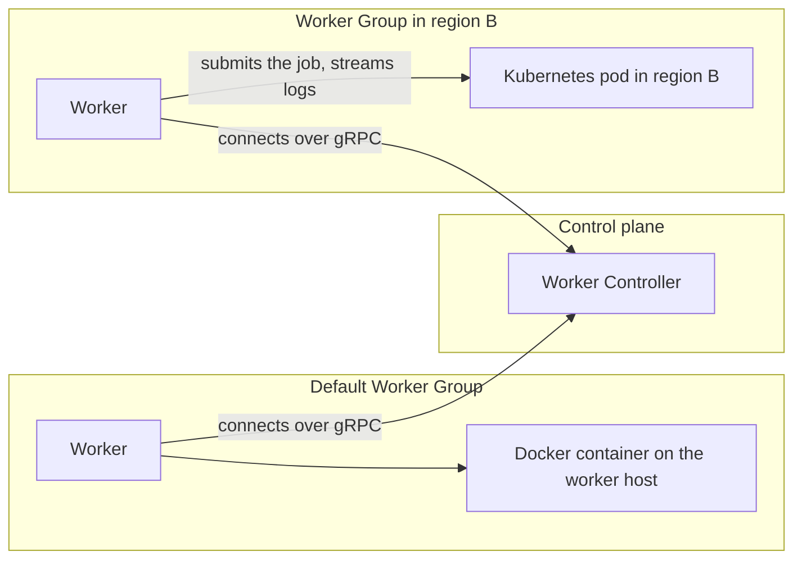

Worker groups decide which worker runs a task, and task runners decide where a script task's code runs. One task can use both.

## How they fit together

Every task in Kestra runs on a worker. Two independent settings decide where the work happens:

- A [Worker Group](../../07.enterprise/04.scalability/worker-group/index.md) decides which worker picks up the task, and so which network, region, or host the task starts from. You route a task to a Worker Group with `workerSelector`.
- A [task runner](../index.mdx) decides where a script task's code runs once a worker has picked it up: as a process on the worker host, in a Docker container on the worker host, or as a job on remote compute such as Kubernetes or AWS Batch. You choose one with `taskRunner`.

A task can set either one, both, or neither. A task with neither runs in the default Worker Group. If it is a script task, it also runs in a Docker container on that worker's host, because Docker is the default task runner.



The `workerSelector` routes the task first. If no Worker Group serves the matching Worker Queue, the task follows its [fallback](../../07.enterprise/04.scalability/worker-group/index.md#fallback-options) before any task runner starts.

:::alert{type="info"}
Worker Groups are available in Kestra Enterprise Edition only. Kestra open source and Kestra Cloud run every task on a single default pool of workers. Process and Docker task runners are available in every edition. Remote task runners require Enterprise Edition or Kestra Cloud.
:::

## What a remote task runner does

When a task uses a remote task runner, the worker that picked up the task stays in charge of it for the whole run:

1. The worker renders the commands, stages input files and namespace files, and submits the job through the platform's API.
2. The job runs on the remote compute, and the worker streams its logs back to Kestra.
3. When the job ends, the worker collects the declared output files and reports the result.

This has two consequences:

- The job is submitted from the worker's network. The worker needs network access to the platform's API, such as the Kubernetes API server or the AWS Batch endpoint, plus credentials for it.
- The task holds a worker thread until the remote job finishes, because each worker thread runs one task at a time. A remote task runner adds compute for the script. It does not add worker capacity.

## Choose by what the task needs

| Need | Use | Why |
|---|---|---|
| Reach systems in another network, region, or on-premises site | Worker Group | The task runs on a worker that can reach those systems. This works for any task type, including database queries and API calls. |
| Run on a specific long-lived host, such as a Windows server, a GPU server, or a machine with licensed software installed | Worker Group | Tasks route to the workers running on that host. |
| Keep all work for a namespace or tenant in one region or network | Worker Group set as a [namespace or tenant default](../../07.enterprise/04.scalability/worker-group/index.md#namespace-and-tenant-level-routing-defaults) | Every task and polling trigger below that level inherits the selector. |
| Give one script its own dependencies or container image | Docker or remote task runner | Each run gets its own container. |
| Give a script more CPU, memory, or a GPU only while it runs | Remote task runner, such as [AWS Batch](../04.types/04.aws-batch-task-runner/index.md), [Google Batch](../04.types/09.google-batch-task-runner/index.md), or [Kubernetes](../04.types/03.kubernetes-task-runner/index.md) | Compute is provisioned for each run, so you don't size every worker for the peak. |
| Run a heavy script on compute that is only reachable from a private network | Both | The Worker Group places the task in that network, and the task runner submits the job from there. |
| Run more tasks in parallel | Neither | Add workers to the Worker Group you already have. |
| Guarantee capacity for critical tasks | A Worker Queue with [reserved capacity](../../07.enterprise/04.scalability/worker-group/index.md#capacity-reservation) | Reserve slots on the group you already have so other work can't use them up. |

## Key differences

|  | Worker Groups | Task runners |
|---|---|---|
| **Applies to** | Every task type, plus polling triggers | Script and CLI tasks that have a `taskRunner` property. See the [supported plugins](../01.overview/index.md#supported-script-based-plugins). |
| **Where you set it** | On a task, trigger, or flow; as a namespace or tenant default; or through a [Policy](../../07.enterprise/02.governance/policies/index.md) | On a task, or through a [Policy](../../07.enterprise/02.governance/policies/index.md) |
| **Infrastructure** | Long-running worker processes that you deploy and that connect to the Worker Controller | Process and Docker: the worker host. Remote runners: compute that the platform provisions for each run. |
| **Startup time** | The worker is already running, so the task starts as soon as a thread is free. A script task still waits for its task runner to start. | Process: none. Docker: an image pull, if needed, and container startup. Remote runners: provisioning, from seconds to over a minute. For example, AWS Batch on ECS Fargate can take up to 50 seconds, and Google Batch without a reservation up to 90 seconds. |
| **Cost** | You pay for worker hosts whether or not tasks run. This suits frequent tasks and systems you must reach continuously. | Remote runners bill for compute per run, plus the worker that submits the job. This suits infrequent, heavy scripts. |
| **Editions** | Enterprise Edition | Process and Docker: all editions. Remote runners: Enterprise Edition and Kestra Cloud. |

## Example: combine a Worker Group and a task runner

The following flow trains a model on a Kubernetes cluster whose API server is only reachable from region B:

```yaml
id: train_in_region_b
namespace: company.team

tasks:
  - id: train
    type: io.kestra.plugin.scripts.python.Commands
    namespaceFiles:
      enabled: true
    containerImage: ghcr.io/kestra-io/pydata:latest
    workerSelector:
      tags: [region-b]
    taskRunner:
      type: io.kestra.plugin.ee.kubernetes.runner.Kubernetes
      namespace: ml-jobs
      config:
        masterUrl: https://k8s.region-b.internal:6443
        caCertData: "{{ secret('K8S_CA_CERT_DATA') }}"
        oauthToken: "{{ secret('K8S_OAUTH_TOKEN') }}"
    commands:
      - python train.py
```

A worker from a Worker Group subscribed to the Worker Queue tagged `region-b` picks up the task. That worker calls the API server at `masterUrl`, and the pod runs on the region B cluster.

Change one setting and the behavior changes:

- Without `workerSelector`, the task runs in the default Worker Group, so the default workers need network access to the region B API server.
- Without `taskRunner`, the script runs in a Docker container on the region B worker host.

## Next steps

- To create Worker Queues and Worker Groups, register workers, and set fallbacks and capacity, see [Worker Groups](../../07.enterprise/04.scalability/worker-group/index.md).
- To compare the available runners, see [task runner types](../04.types/index.mdx).
- To configure a task runner on a script task, see [Task runners for scripts](../../16.scripts/03.task-runners/index.md).
