## Executive summary

Enterprise infrastructure teams are already automated. They provision with Terraform, configure with Ansible, deliver to Kubernetes with Argo, patch with a dedicated endpoint platform, and script the rest. Every one of those tools does its own job well. None of them sequences the work across the others. Infrastructure automation removes manual work inside a single tool. Infrastructure orchestration sequences work across many tools, and the second layer is what most enterprises are missing.

Fragmentation in infrastructure operations is the result of modernization, not the absence of it. **Enterprises have automated everything and coordinated nothing.** The coordination gap is what automation left behind.

This paper makes the case for one control plane above the automation tools an enterprise already runs. It walks through three cost drivers: operational risk on the nights when a change crosses several tools, licensing meters that grow with every node and resource the AI buildout adds, and audit evidence that stops existing once a process spans several consoles. It then sets out the target architecture, shows what it looks like in a production deployment, and states plainly which tools stay exactly where they are. It compares the alternatives on the market.

The pattern is not a rip-and-replace. Most of the stack stays. What changes is that something now sequences it. The one layer that does get replaced is the old coordination itself: the glue scripts and the legacy orchestration products that exist only to connect the tools.

## The coordination gap in infrastructure automation

### Infrastructure automation today

Infrastructure automation is the use of tooling to perform infrastructure work without manual execution: provisioning compute, storage, and network; configuring operating systems and middleware; deploying to clusters; applying patches; rotating certificates; running backups; detecting and correcting drift; and remediating incidents.

Most large enterprises have automated much of this list, though rarely all of it and never in one place. Mature pipelines run next to manual runbooks and spreadsheet-driven processes, and each automated piece lives in its own tool.

A typical inventory includes Terraform or OpenTofu for provisioning, Ansible for configuration, Argo CD and Kubernetes operators for cluster delivery, and a CI system such as GitLab or Jenkins pressed into operational duty. Add per-cloud services including AWS Systems Manager and Azure Automation, an endpoint and patch platform, a vulnerability platform, a backup product, a certificate authority workflow, and a folder of scripts nobody has opened in two years.

### Where today's tools earn their place

Any argument for another layer has to start by naming what the existing layer is good at, because these tools earned their position.

Terraform and OpenTofu reconcile the declared state with the real infrastructure, and no orchestrator should try to replace that reconciliation loop. Ansible applies configuration across thousands of hosts with agentless reach into places nothing else reaches. Kubernetes operators run continuous control loops that hold workloads at their declared state without any external trigger. Endpoint and vulnerability platforms carry vendor intelligence, CVE mappings, and agents that make patching accurate rather than merely automated. Cloud-native services are efficient inside their own provider and cost nothing extra to call.

Each one is excellent within a scope that ends at the tool boundary.

### Why more automation does not produce less complexity

The clearest statement of this comes from IBM, which now owns both Terraform and Ansible Automation Platform. It describes infrastructure automation as operating through three core functions: provisioning, configuration management, and workflow orchestration. No single tool handles all three, IBM says, so organizations build end-to-end toolchains where different tools handle different stages. In practice the toolchain is rarely even one vendor's: it mixes commercial products from several vendors, open source projects, and per-cloud services, and every merger or acquisition adds another set overnight.

The toolchain is the accepted architecture. Nobody designed the seams: the handoffs between tools where a chain breaks and a person fills the gap.

The environment those seams run through keeps getting more complex. In the Flexera 2026 State of the Cloud report, 73 percent of organizations run hybrid environments, rising to 78 percent among enterprises above five thousand employees, and 89 percent use more than one cloud. Flexera's finding on why is the telling one: multi-cloud growth is often not a strategy but an inheritance, driven by mergers, SaaS sprawl, and decentralized teams.

Each tool was added for a locally rational reason, and nobody chose the accumulated result.

### Execution surfaces and orchestrators

There is a distinction hiding in that inventory, and naming it resolves most of the confusion in this market.

**An execution surface performs work in one domain.** A configuration runner executes playbooks. A provisioning tool reconciles state. A patch platform applies patches to endpoints. A vulnerability platform decides what matters and confirms the fix.

**An orchestrator sequences work across execution surfaces.** It decides what runs, in what order, on what condition, with what approval, and it records what happened. Execution surface is this paper's term rather than an industry standard: the market has names for the tools but not for the role they share.

Enterprises accumulate execution surfaces far faster than they accumulate orchestration. Mistaking one for the other is how the sprawl becomes invisible. Every individual tool reports success while the chain that spans them has no owner, no view, and no record.

> Enterprises have automated everything and coordinated nothing.

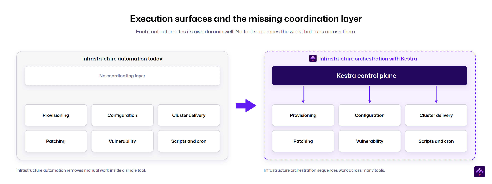

*Figure 1. Infrastructure automation removes manual work inside a single tool. Infrastructure orchestration sequences work across many tools.*

### The tools in each category

Named concretely, the picture is familiar to anyone who has inventoried an enterprise environment. Five of the six categories below are execution surfaces that stay exactly where they are and get orchestrated. Pieces of them can still move into workflows over time, a script here, a scheduled job there, but the default motion is to orchestrate them, not to replace them. The sixth exists only to connect the others: the glue layer of homegrown scripts, cron entries, CI jobs doing operations work, and legacy orchestration products. The glue layer is the category this paper proposes replacing.

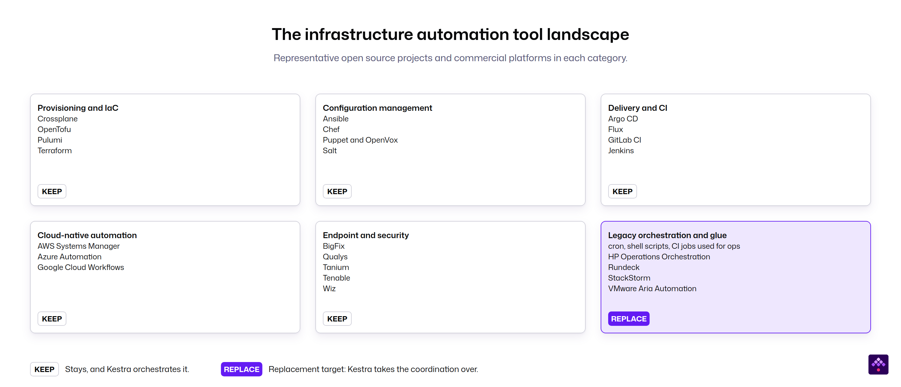

*Figure 2. Representative open source projects and commercial platforms in each category, listed alphabetically.*

> **Sidebar: who owns the automation stack · October 2026**
>
> The modern infrastructure stack is consolidating underneath the teams using it. Within three years, Chef, Puppet, and HashiCorp all changed hands or changed terms, IBM came to own both Terraform and Ansible Automation Platform, and the most widely deployed private cloud orchestrator stopped being sold on its own.
>
> IBM completed its 6.4 billion dollar acquisition of HashiCorp on 27 February 2025. The legacy HCP Terraform free plan ended on 31 March 2026, the replacement free tier caps at 500 managed resources, and paid tiers charge between 0.10 and 0.99 dollars per resource per month.
>
> Chef, owned by Progress since 2020, retires the open source Chef Infra Server in November 2026 in favor of Chef 360, and the Cinc community project is forking it. Puppet, owned by Perforce since 2022, saw its community fork to OpenVox after access to Puppet binaries was restricted.
>
> VMware Aria Automation, which includes the former vRealize Orchestrator, is no longer available as a standalone product. Broadcom folded the functionality into VMware Cloud Foundation 9 as VCF Automation, and the Aria SaaS services reached end of availability in February 2024. Organizations that used the orchestrator without the full VCF stack now face a bundling decision at renewal. European cloud providers reported post-acquisition price increases of 800 to 1,500 percent to the European Commission, documented in a 2025 report by CISPE's European Cloud Competition Observatory, and Gartner analysts have told the press that enterprise renewal quotes rose by 200 to 500 percent.
>
> Regulation is moving the other way. The EU published its Open Source Strategy on 3 June 2026 as part of the Technological Sovereignty Package, citing the more than 260 billion euros Europe spends each year on digital technologies from non-EU vendors, and the proposed Cloud and AI Development Act puts open source first in public cloud and AI procurement.

## What the coordination gap costs

### How infrastructure orchestration programs start

Infrastructure orchestration programs rarely begin with an architecture review. In the enterprises we work with, these programs begin with one of five events. Knowing which one is in play tells you how the rest of the conversation will go.

- **A platform retires underneath the automation.** A group-mandated move to a new private cloud, or a hypervisor and cloud management stack that is no longer sold standalone, takes the orchestration layer with it. The workflows built on VMware Aria and vRealize Orchestrator do not migrate on their own, and the team is asked to rebuild them somewhere else on a fixed timeline. Increasingly the trigger is the renewal rather than the retirement: the same stack, repriced several times higher, forces the same decision.
- **The glue layer reaches end of life.** The engineer who wrote the scripts leaves, the legacy orchestration product stops being sold standalone, or an audit asks who owns the cron entries on the jump host and nobody answers.
- **Manual execution stops scaling.** Ansible playbooks run by hand from a command line, dozens of workflows per cluster, a new cluster every few weeks. The automation exists. The coordination of it is a person.
- **A platform is built greenfield.** An AI infrastructure buildout or a new private cloud starts without legacy automation, and the team puts the control plane in before the glue accumulates.
- **A platform team rolls out self-service.** Product teams own their services end to end, often through an internal developer portal, and need to request servers, load balancers, and storage themselves. Approval and cost control sit behind the request rather than a ticket queue in front of it.

All five lead to the same requirement: something above the tools that sequences them, gates them, and records what they did. Platform retirement and glue end-of-life also carry a deadline, which is why they tend to be the programs that get funded.

### Fragmentation on a bad night

The cost that arrives first is operational, and it arrives during an incident.

Consider a routine chain. A vulnerability platform flags a critical CVE. A change record opens. A patch platform stages the update across several thousand endpoints. A configuration run restarts the affected services. A verification scan confirms the fix and the ticket closes.

Five systems, five consoles. No single place where the chain is visible, no single record of whether it completed, and no automated path from step three failing to step four not running.

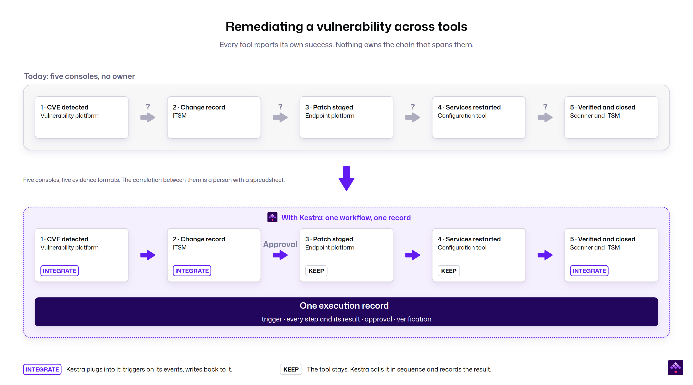

*Figure 3. Every tool reports its own success. Nothing owns the chain that spans them.*

The symptom has a name and a measurement. Analyst firm Enterprise Management Associates (EMA) found that 87 percent of network operations teams rely on multiple tools, often without meaningful integration. Swivel-chair troubleshooting, meaning hopping between dashboards to reconstruct what happened, remains widespread. New Relic's survey of 1,700 IT and engineering leaders found organizations still average 4.4 observability tools, and more than half plan to consolidate onto unified platforms.

> Reconstruction is the giveaway. When an operations team has to rebuild the sequence of a change after the fact, each tool records its own step, but the end-to-end sequence is never recorded in one place because no system owns it.

When the chain runs as one workflow, a failure has an owner as well as a record. The incident is tracked where the automation runs, and the ITSM system receives the outcome rather than the reconstruction.

> Infrastructure teams do not lack automation. They lack a single place where the entire change is visible as it runs.

### Why the bill grows when half the stack is free

Much of this stack costs nothing per run. Ansible core, OpenTofu, Argo CD, and Kubernetes carry no execution meter. The cost sits in the commercial tools around them, which meter the infrastructure itself.

- Per managed node, for Ansible Automation Platform, priced as an annual subscription by node count.
- Per managed resource, for HCP Terraform, at 0.10 to 0.99 dollars per resource per month.
- Per core or socket, for the VMware and cloud management platform lines, now bundled into VCF.
- Per endpoint, for patch, vulnerability, and backup platforms.

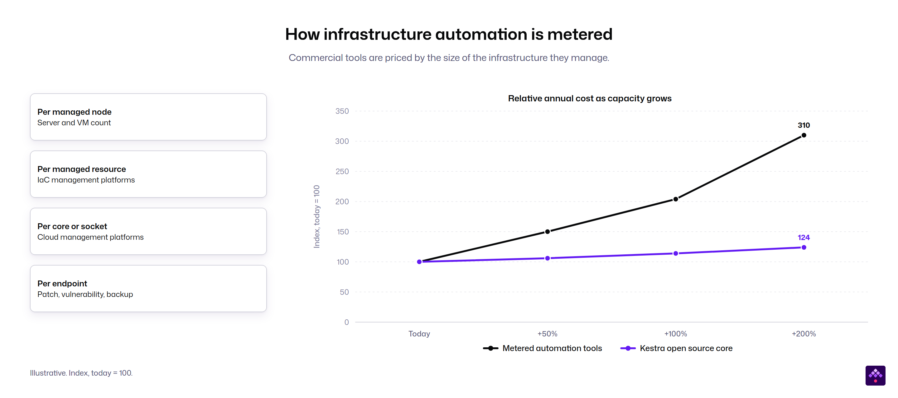

*Figure 4. Commercial tools are priced by the size of the infrastructure they manage. The cost curve is illustrative and indexed to today equals 100.*

Every one of those meters moves in the same direction as an AI buildout, and it moves without any decision by the team paying it. Every new cluster adds nodes, and every node moves a meter. The infrastructure grows because the business asked for AI capacity, and the automation bill grows as a side effect.

The macro pressure is arriving at the same time. Gartner forecasts worldwide IT spending of 6.37 trillion dollars in 2026, up 14.2 percent, driven by AI infrastructure across data centers and cloud. It advises CIOs to eliminate redundant tools and renegotiate vendor contracts to absorb it. Enterprises already report that AI deployment consumed more budget and operational resources than planned, straining I&O readiness.

So the financial case is not to rip out the execution tools and bank their licenses. Those tools stay. The case has two parts. Stop the metered surfaces from growing by routing new work through an orchestrator licensed by instance rather than by execution. Then remove the duplicated glue layer: the scripts, the cron entries, the CI jobs doing operations work, and the legacy orchestration products that exist only to connect other tools.

The second part is where published displacement results sit. [A Fortune 500 industrial manufacturer](/customers/fortune-500-company) replaced VMware Aria Automation at 90 percent lower licensing cost, securing hybrid cloud automation across IT and OT.

### Execution without audit evidence

The third cost, after operational risk and licensing, lands at audit, and in regulated industries it moves faster than the other two.

European regulation changed the question being asked. NIS2, DORA, and the Cyber Resilience Act moved the requirement from performing the work to proving the work. Not whether the patch was applied, but proof that it was applied, to which systems, within which window, approved by whom, and verified how. Europe moved first, and the pattern is global: SEC incident disclosure rules in the United States and APRA CPS 230 in Australia ask the same proof-of-process questions.

DORA's Registers of Information have been submitted annually since April 2025, and supervisors now expect structured proof rather than policy documents. NIS2 carries penalties up to 10 million euros or 2 percent of global turnover. In banking, DORA also lengthens vendor onboarding, which means the orchestration decision made this year is the one the institution lives with for the rest of the decade.

Sovereignty is the sharper form of the same driver. [A European government IT provider](/stories/government-it-provider) runs security operations across multiple German federal states and handles citizen data that cannot be processed in a commercial cloud by law, for at least the next decade. When its security automation vendor moved new capabilities to a cloud-first roadmap, the product was disqualified by the roadmap rather than by any missing feature. The team evaluated five alternatives, purpose-built security platforms included, and rebuilt more than one hundred alert workflows on a self-hosted control plane with zero cloud dependencies. Evidence rules decide what you must record. Sovereignty rules decide where the record is allowed to exist.

A chain that spans five tools produces evidence in five formats, and the correlation between them is a person with a spreadsheet. A chain that runs as one workflow produces one record: what triggered it, what ran, what each step returned, who approved the gate, and what the verification step confirmed.

The record has to reach the system the auditors read. In regulated environments that is usually a SIEM, and often one that accepts events only over syslog. The orchestration layer therefore has to speak the auditors' formats natively. Execution logs and audit logs, meaning who changed a flow, who ran it, and who changed a permission, ship to the SIEM as CEF messages over syslog, the format ArcSight, QRadar, and Trellix expect. HTTP-based exporters cover Splunk, Datadog, and Elasticsearch. Access control has to be action-based, granting replay on executions or backfill on triggers action by action rather than as a CRUD verb per resource. This is the granularity an ISO 27001 auditor asks for.

Evidence is the driver that converts an architecture preference into a funded program, because a finding creates spending authority that no budget cycle anticipated.

## One control plane over many execution surfaces

The problem so far has been described in vendor-neutral terms. This section defines what a control plane does, then shows how Kestra implements it: a production reference, the two motions, the resource model, and self-service.

### What an orchestration control plane does

Infrastructure orchestration is the coordination of end-to-end infrastructure work across multiple tools, in the correct sequence, with dependencies, conditions, approvals, failure handling, and a single record of execution.

Automation removes manual effort inside a single tool. Orchestration removes the seams between tools. This framing is not one vendor's argument. Analyst coverage and several adjacent platforms now describe the same layer. The question has moved from whether a control plane belongs above the tools to which properties it needs.

A control plane is where that orchestration lives. It holds the workflow definitions, the schedules and event triggers, the credentials, the access rules, and the execution history. It calls the execution surfaces. It does not become one.

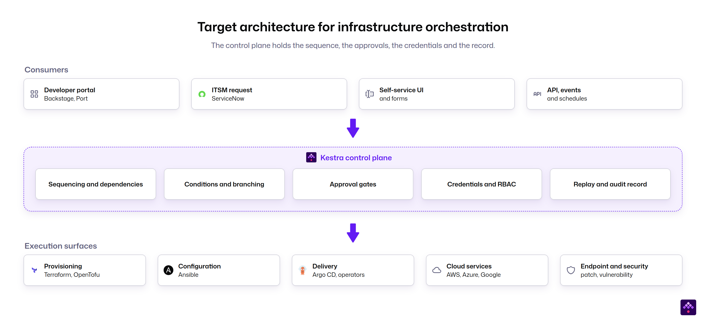

*Figure 5. The control plane holds the sequence, the approvals, the credentials, and the record. Execution surfaces are unchanged.*

### How Kestra implements the unified control plane

The concept above is vendor-neutral. Here is how Kestra implements it. In Kestra the separation between coordinating work and executing it is built into the deployment. The control plane, made up of the executor, controller, scheduler, webserver, and indexer, **coordinates work, executes no user code, and has no access to the enterprise's infrastructure**. The data plane is the worker, the only role that runs tasks, resolves secrets at runtime, and touches infrastructure or internal storage. The controller is the control plane's end of the worker connection: every worker communicates with the rest of the platform through it, and it runs no tasks itself. Each worker connects to the controller over a single outbound gRPC stream, and the worker always initiates that connection. The restricted zone therefore needs no inbound firewall exception, the worker holds no database credentials, and the channel supports mutual TLS with short-lived, revocable worker identities. Workers can run in another region, another cloud, or a network that permits outbound connections only. Both planes deploy wherever the enterprise needs them, on-premises, in any cloud, or fully air-gapped. Executions complete in milliseconds to low seconds at thousands of executions per minute on a standard PostgreSQL backend, which is what makes event-driven operations practical at enterprise scale.

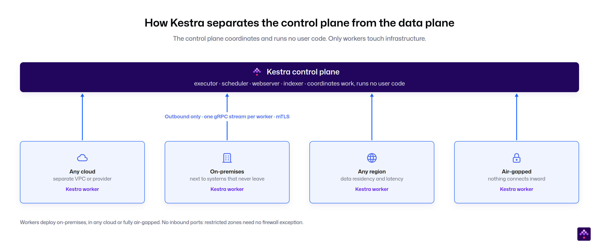

*Figure 6. The control plane coordinates and runs no user code. Workers connect outbound from wherever the work has to run.*

### A production reference: patching a bank's private cloud

The architecture above is a concept. Here is how it lands at a Kestra customer: a European bank running patch management and infrastructure operations on a self-hosted private cloud under strict network segmentation.

Users and administrators reach the control plane through a proxy on the office network, with single sign-on and role-based access. The control plane runs as a highly available pair in its own zone. Flow definitions live in Git and sync to the platform. Secrets come from Vault at runtime. Artifacts land in object storage. None of that is unusual, and that is the point.

The detail that matters is where the playbooks run. The playbooks do not run on the control plane. The control plane triggers a dedicated execution host in the admin network. The host is a server running a Kestra worker with the Ansible runtime preinstalled or deployed as a container, not a component of Ansible Automation Platform. The worker pulls secrets from Vault and artifacts from object storage at runtime, holds the host credentials, and reaches the tenant networks over SSH across multiple operating systems. Ansible itself stays and the playbooks are unchanged. What moved to Kestra is the layer around them that the commercial automation platform used to provide: scheduling, sequencing across tenants, approval gates, and the execution record. Data services such as streaming clusters and databases are called directly over their APIs from tasks on the worker. The orchestrator sequences, gates, and records. The execution host executes.

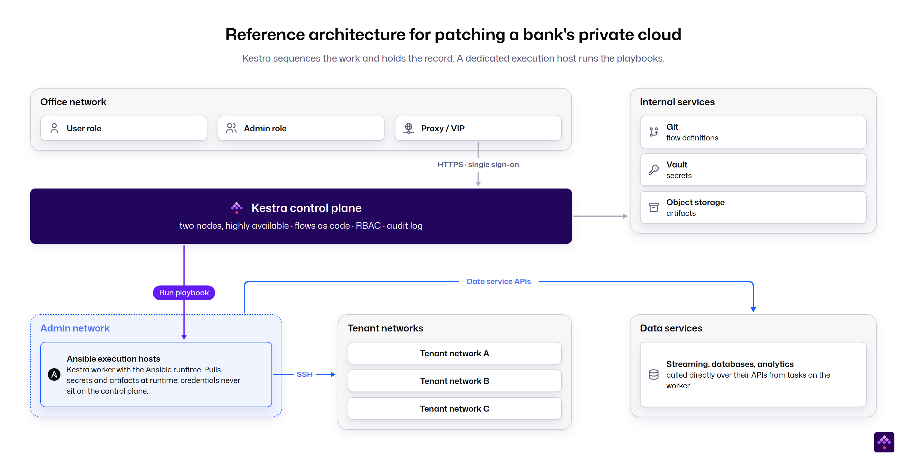

*Figure 7. Anonymized production deployment at a European bank. The control plane never holds credentials to the servers it patches.*

Two properties follow from that separation. Security teams can reason about the blast radius of the orchestrator, because it never has direct access to the servers it patches. And the Ansible investment is untouched. Every playbook that ran from a command line yesterday runs from a workflow today, versioned in Git, with an audit record that did not exist before.

The same principle applies to the orchestrator's own components. Workers can be placed inside the admin network or any restricted zone and reach outward to the control plane, so the control plane never needs an inbound path into the zones it orchestrates. Worker groups with tag-based routing and per-group capacity reservations keep security zones isolated from each other on one shared control plane, where policy allows it. The same pattern serves zones that are not allowed to communicate directly, each with its own directory domain, and the IT and OT split in industrial environments. A worker group inside each zone gives one chain reach into all of them without opening a path between the zones. Where policy prohibits one control plane spanning IT and OT, a manufacturer runs one control plane per zone, and the worker pattern is the same inside each. The [deployment options handout](https://hs.kestra.io/hubfs/kestra-deployment-options-enterprise-edition.pdf) covers these configurations in detail.

### The first motion: govern the tools that stay

**Kestra runs two motions on one platform: it governs the tools that stay, and it replaces the layer that only coordinates.** Where no such layer exists, because the sequence lives in runbooks and in people's heads, it creates one. The first motion, governing, changes nothing about the tools and everything about the chain.

Terraform keeps provisioning. Ansible keeps configuring. Operators keep reconciling. The patch platform keeps patching. The orchestrator triggers them in sequence, passes outputs between them, branches on failure, waits for the approval gate, and records the whole run. Governance applies uniformly across those tools. The same secrets backend injects credentials whether the step is an Ansible playbook, a Terraform run, or a Python script. The same role model gates each of them at the same granularity. Because the platform injects the credentials, the backend is swappable: replace one secrets manager with another and the flows do not change.

A failure inside that chain has an owner as well as a record. A failed execution opens a case directly from the flow's error handling, carrying the affected resource, a severity, a status, an SLA countdown, and an assignee. Repeated failures of the same flow and task join the case already open instead of opening a new one. The ITSM system receives the outcome rather than the reconstruction.

> One platform governs the chain. Every tool keeps its job.

**The tools stay where they are. The team keeps its expertise, its playbooks, and its modules. The new work is defining the end-to-end process once: versioned in Git, and readable by someone who was not on the original team.**

Crédit Agricole Group Infrastructure Platform is a useful public illustration, because it appears in two vendors' published stories at once. Red Hat reported in 2022 that CA-GIP adopted Ansible Automation Platform to manage provisioning, configuration, and patching across more than 20,000 Linux servers. Kestra's published story describes the same organization running Kestra as a shared orchestration backbone across more than one hundred clusters and seven data teams, integrated with Vault, Git, and internal alerting. It replaced chains that had been scripted in Ansible and connected by hand in Jenkins. In the customer's own words, Kestra allowed them to move from fragmented automation to a unified control plane.

Ansible stayed. Jenkins stayed for CI. What changed is that something now sequences them.

### The second motion: replace the glue layer

The second motion, replacing, targets a narrow set.

Legacy orchestration products including VMware Aria Automation, vRealize Orchestrator, HP Operations Orchestration, Rundeck, and StackStorm exist to connect other tools. So does the undocumented glue: cron entries on jump hosts, CI jobs doing operational work they were never designed for, Python and Bash wrappers around cloud CLIs, scheduled tasks on Windows servers, and the homegrown application that maps applications to infrastructure and that nobody dares to touch.

These do the orchestrator's job without the orchestrator's properties. They have no shared audit trail, no access model, no replay, and often no owner.

Replacement here is staged and chain by chain, and the scripts go two ways. Existing Python, Shell, and PowerShell runs unchanged as a task inside a workflow. Logic written inside the legacy orchestrator itself, such as vRO's JavaScript, is the part that converts, and the [Kestra Migration Assistant](/resources/migration/vra/assistant) drafts that conversion for an engineer to review. In both cases, what changes is the coordination around them.

The Fortune 500 manufacturer from the licensing argument above is the [published example](/customers/fortune-500-company) of this motion. VMware Aria Automation was replaced, Ansible stayed and is now orchestrated, and the same team has since started evaluating whether the commercial platform around its playbooks still earns its license.

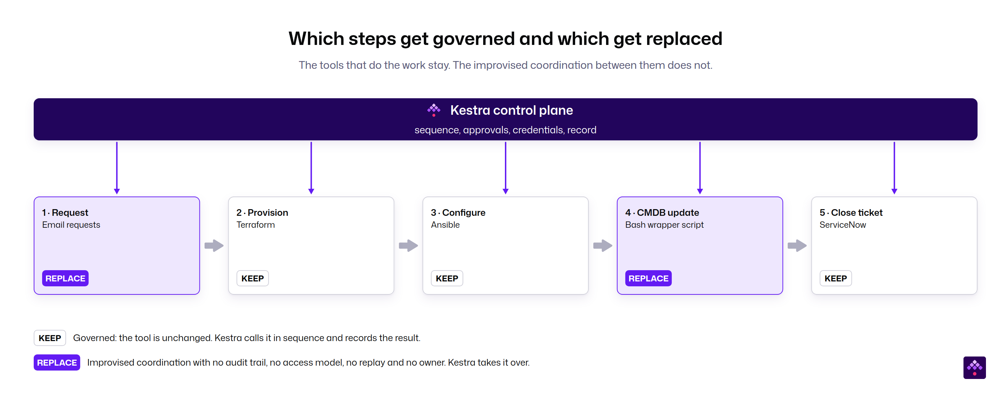

*Figure 8. One provisioning chain, two motions. Three of five steps stay on the tool that runs them. Two improvised steps are replaced.*

### The resource model an Aria Automation replacement needs

Replacing VMware Aria Automation or vRealize Orchestrator is not credible with a workflow engine alone, because those products carry a resource model. They keep an inventory of what they manage, a lock on a shared resource while a workflow touches it, and a lifecycle per resource. An orchestrator that takes over the glue layer needs the same, or two workflows will eventually write to the same virtual machine at the same time.

In Kestra that layer is Assets. Every resource the orchestrator acts on is registered in an inventory under the identifier the enterprise already uses. A corporate resource naming standard becomes the asset ID with no translation layer in between. A time-bounded lock serializes writes to a shared asset across flows and across workers.

An execution lock is acquired by a task and extended by each write. A user lock is taken from the UI for a maintenance window. Every lock expires on its own, so a failed flow cannot leave a resource locked, and locking and unlocking are separate permissions. The lock binds the writers the orchestrator knows about. A service or an administrator writing to the same resource from outside the platform is not bound by it. A maintenance window that has to exclude everything is therefore still enforced at the resource itself, by revoking write access or draining the clients as steps in the flow. What the lock removes is the collision that actually recurs in practice: an organization's own scheduled workflow arriving in the middle of another team's maintenance window.

The type of an asset can change after registration, so a resource first recorded as a generic virtual machine can be recategorized without being recreated. State changes on an asset can trigger workflows, so Day 2 operations run off the resource's own state transitions. A deployment, the set of resources one request created, carries an owner, a status, a lease, and its Day 2 actions, and a trigger can start a flow before the lease expires. Lifecycle event subscriptions serve the same purpose in the platforms being replaced. Lineage records which assets an execution consumed and which it produced. Freshness is derived from that lineage and from schedules. A stale resource can start a remediation flow on its own. Dashboards over the inventory show current state rather than a time window.

The boundary with the configuration management database matters here. Assets is the orchestrator's model of the resources it acts on, with locks and lineage attached. The inventory lives in Kestra Assets or in the CMDB, and both are valid. Where a CMDB stays the system of record, the orchestrator registers the asset, locks it while Terraform and Ansible work on it, updates it when they finish, and writes the record to the CMDB as one of its steps. Kestra registers, locks, and updates the asset. Where ServiceNow holds the record, it receives the update as a step.

How to run that replacement, from assessment to migration waves to ending the license at renewal, is covered step by step in the companion guide, [Migrating Off VMware vRA and vRO](/resources/migration/vra).

### Self-service without a ticket queue

A control plane that only centralizes becomes the next bottleneck. Permissioned self-service is what prevents it.

Application and platform teams deploy their own workflows into namespaces they own. Access is enforced by role, so a platform engineer role can provision through Terraform while an application developer role can only deploy into approved environments.

Less technical users never open the orchestrator at all. Kestra Apps put an interface on top of a flow: the flow is the backend, the app is the front end, and the layout follows the state of the run. One screen shows a form before submission, progress while the work runs, a review step when the flow pauses, and the outcome when it finishes. A requester and an approver therefore meet the same app at different moments, without either of them touching the definition. Permission to run an app is scoped to the namespace it lives in, so the boundary that governs the workflow governs the request surface with it. Values held on the namespace can pre-fill the fields a requester should not be picking out of a long list by hand. Where a request needs sign-off for cost or architecture reasons, the approval is a step in the workflow rather than an email outside it. Figure 9 shows one such app for a virtual machine request: the review step before submission, with the lease and the estimated cost checked against the environment's budget.

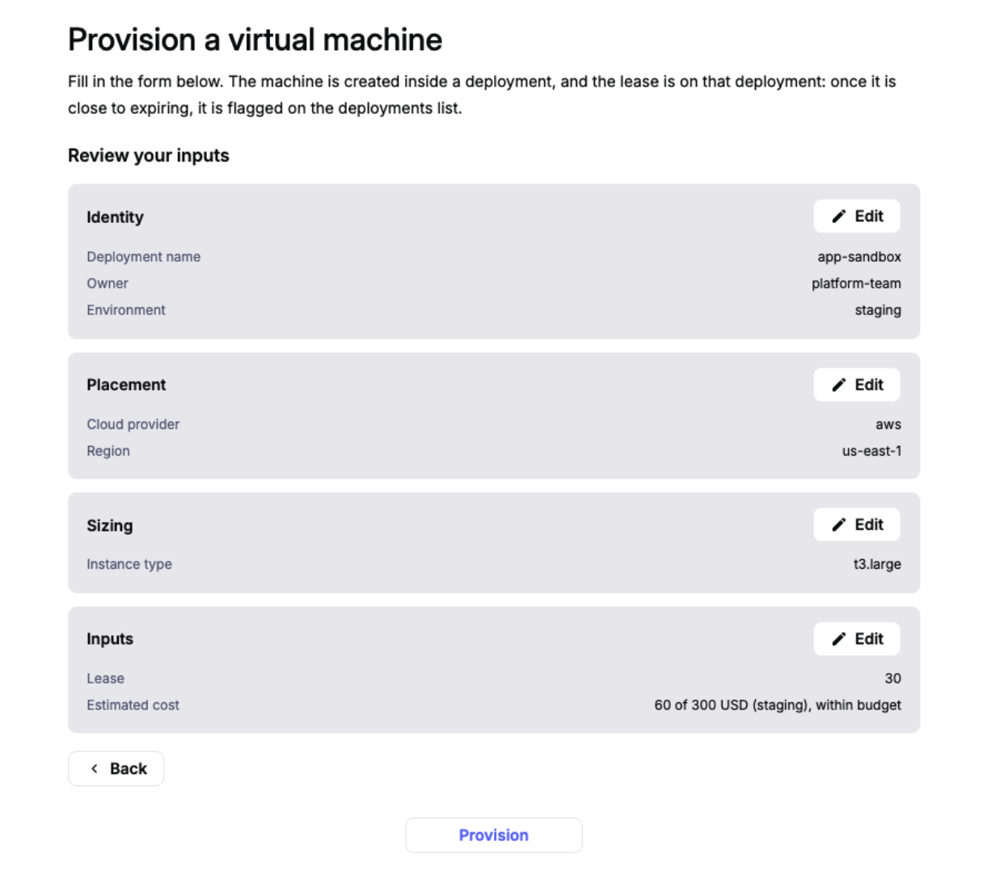

*Figure 9. A Kestra App for provisioning a virtual machine. The requester reviews the inputs, the lease, and the estimated cost against the budget before submitting; approval and provisioning run as steps in the same flow.*

Two mechanisms make that self-service safe at scale. The first is policy: guardrails on what self-service teams can write. A rule can inject a retry or a concurrency limit where the author set none, or block a non-compliant flow from being saved or run, and a policy can run in report-only mode against live traffic before it is enforced. This is what deterministic guardrails look like in practice, and it is the same mechanism that governs agents later in this paper. The second mechanism is the request surface itself. Blueprints are the template layer behind it: a user fills a form, the platform renders a ready-to-use flow from a validated pattern, and the library of patterns is versioned in Git. A less technical user gets a request that produces a valid flow rather than a ticket.

The market is already moving this way. In the 2026 Stonebranch survey, the native automation console fell to last place as an access path at 21 percent, down 14 points year over year. Organizations embedded automation access into their ITSM systems, messaging platforms, and internal portals instead.

On Kestra, change control gets stronger rather than weaker as access widens. Every workflow lives in Git as the canonical definition, not as a versioned export of a proprietary format, which is more than the platforms being replaced can say. Every change is reviewed, versioned, diffable, and reversible. A commit history is better audit evidence than a ticket history. Teams that do not run a Git pipeline promote a flow from one instance to another from the UI instead, with a diff against what runs on the target and an entry in the audit log. The two paths run alongside each other, and both leave the same evidence.

### Developer portals on top of the control plane

Platform engineering teams often already run a developer portal such as Backstage, Cortex, or Port, or route requests through ServiceNow. These are not competing with the control plane. They sit on top of it.

The portal owns the catalog and the interface: what a developer can request and what it looks like. The orchestrator owns what happens after the button is pressed: the sequence, the approvals, the failure handling, and the record. Portals that try to become execution engines end up maintaining a workflow system nobody scoped. Where a team already has a portal, it stays the front door and calls the orchestrator. Where there is none, the request form is built as a Kestra App on top of the same flow.

## Boundaries between the control plane and the tools

### The work that stays where it is

**A modernization argument that names no exclusions is not credible.** The following stays exactly where it is.

- Provisioning and state reconciliation stay with Terraform, OpenTofu, Pulumi, or Crossplane.
- Configuration at scale stays with Ansible, or with what remains of the Chef and Puppet installed base until it is replaced on its own timeline.
- Continuous reconciliation inside Kubernetes stays with operators and Argo CD. A control loop that runs every thirty seconds should not be an orchestrated workflow.
- Endpoint patching, vulnerability scoring, and backup stay with the platforms that carry the agents and the vendor intelligence.
- Ticketing and ITSM stay the system of engagement. ServiceNow keeps the request front door and the ticket of record, and the orchestrator updates it as a step. Kestra Cases covers the operational follow-up on failed executions and connects to the ITSM system through plugins rather than replacing it.
- Cloud-native services keep doing the work they are efficient at, and the orchestrator handles only the cross-provider dependencies none of them can see.

> The control plane owns the coordination. Every other capability stays on the tool built for it.

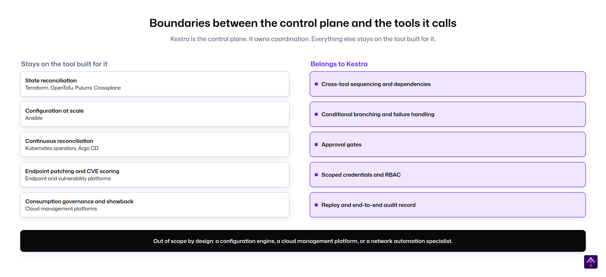

*Figure 10. The control plane owns coordination. Everything else stays on the tool built for it.*

### Out of scope by design

The list above is what Kestra works with. This list is what it will not try to become. Kestra is an orchestrator. It is not a configuration management engine, and it will not out-configure Ansible. It is not a cloud management platform, so VM placement, quota management, and chargeback are not provided in the way CloudBolt or VCF Automation provide them, and neither is the IaaS layer of cloud zones and image mappings that Aria Automation carries. Costs can be reported from what a workflow records on each resource, such as an owner, a cost center, or an estimated cost. It keeps an inventory of the resources it acts on, with locks and lineage. It is not a configuration management database, and where a CMDB is the system of record, Kestra writes to it rather than replacing it. It does not match dedicated network automation platforms on device-level depth, intent validation, or vendor-specific network integrations.

Where an enterprise needs those specific capabilities, the answer is to keep the tool that provides them and orchestrate it.

### When you do not need an orchestration control plane

Some environments have no case here, and recognizing that early is worth more than a long evaluation.

An organization running one automation tool over a small footprint, with no regulatory evidence obligation, already has coordination. It lives inside the one tool, and adding a control plane above a single execution surface adds a component without removing a seam. A single cloud alone is not the signal, because cross-tool chains appear quickly even there.

The trigger to revisit is the second tool, the first cross-team chain, or the first audit finding that asks for proof of a process rather than proof of a policy.

## Infrastructure orchestration alternatives

Enterprises evaluating an orchestration control plane will shortlist several categories. Most can run the work; they differ in scope and in what the choice costs later. Several of them also stay in the environment either way, as execution surfaces the control plane calls. The question in this section is only which layer owns the cross-tool chain.

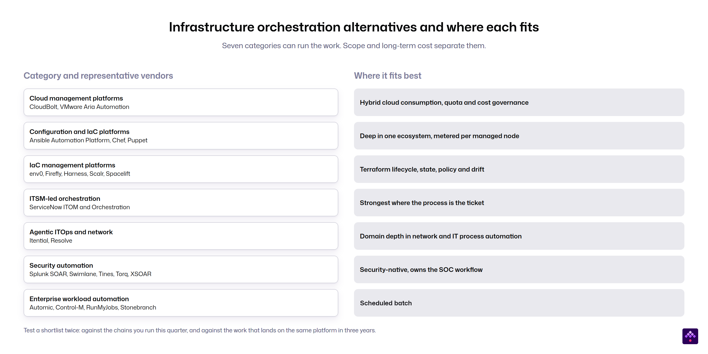

*Figure 11. Categories and representative vendors, listed alphabetically within each row.*

**Cloud management platforms**, including CloudBolt and VMware Aria Automation, now VCF Automation, are strongest where the requirement is hybrid cloud consumption: quota, placement, chargeback, and cost visibility. The self-service catalog can stay in an ITSM portal such as ServiceNow, or move to Kestra Apps. They are heavyweight for cross-domain workflow orchestration, and the VMware line carries the bundling question from the sidebar: no longer sold standalone. Teams facing that renewal will find the full migration method in [Migrating Off VMware vRA and vRO](/resources/migration/vra).

**Configuration and infrastructure-as-code platforms**, including Ansible Automation Platform, Chef, and Puppet with the OpenVox fork, are the natural center of gravity where the environment is playbooks end to end. The scope is that tool's own ecosystem, and the meter is per managed node.

**Infrastructure-as-code management platforms**, including env0, Firefly, Harness, Scalr, and Spacelift, govern the Terraform lifecycle well: state, policy, drift, and pull-request workflow. They stop where the infrastructure starts running, so patch waves, incident remediation, and cross-tool chains fall outside.

**ITSM-led orchestration**, chiefly ServiceNow ITOM and Orchestration, is strongest where the process is the ticket and the CMDB is the source of truth. In many enterprises it coexists rather than competes: the request originates in ServiceNow and the execution chain runs beneath it. In evaluations it is often the alternative front door being weighed against a self-service layer on the orchestrator, and the two can be combined.

**Agentic ITOps and network platforms**, including Itential and Resolve, each grew out of one domain and now position more broadly. Itential started in network automation and describes itself as a platform for agentic infrastructure operations, with a gateway that fronts Ansible, Terraform, and similar tools. Resolve started in IT process automation and service desk ticket deflection and now covers incident remediation across infrastructure, network, and ITSM. Both carry strong governed-change models. Their center of gravity remains IT and network operations, so data pipelines, application deployments, and business processes are not first-class work on either platform. This is the ceiling question in the shortlist criteria below.

**Security automation platforms**, including Palo Alto XSOAR, Splunk SOAR, Swimlane, Tines, and Torq, are security-native and own the SOC workflow. They ship what an orchestrator does not: analyst-facing case management, hundreds of prebuilt security integrations, threat intelligence management, and a playbook editor a Tier 1 analyst can use. Where a security leader is buying a console for analysts, they are the right answer. Strip the console away and the core loop is orchestration: fetch the alert, parse it, enrich it, decide, act, record. The boundary moves when sovereignty rules out a cloud-first roadmap, when a shared-service provider needs per-tenant isolation, or when a SOC development team already treats playbooks as code. [A European government IT provider](/stories/government-it-provider) replaced XSOAR on the first of those grounds, not because it found a better console.

**Enterprise workload automation platforms**, including ActiveBatch, Automic, Control-M, OpCon, RunMyJobs, Stonebranch, and Tidal, run scheduled batch and increasingly market into this space.

### How to evaluate a shortlist

**Run the evaluation twice.** The first pass is the infrastructure work itself: the chains you operate this quarter. Most of these categories will pass it, and the platform you pick has to win it on its own, because starting in one domain is the normal path. The second pass is the ceiling: what lands on the same platform in two or three years. Data pipelines, application deployments, business processes, and AI agents tend to arrive one at a time, and a category-native tool stops at its own domain. Nobody has to buy the four-domain story on day one. The ceiling decides what you will not have to replace later.

The properties that set the ceilings apart are worth testing explicitly, and each has a test that fits inside a proof of concept.

- **Domain neutrality.** Data pipelines, application deployments, and business processes are first-class work on the platform, not extensions bolted onto an infrastructure tool. The test: run one data pipeline or one application deployment on the same instance during the PoC.
- **Deployment and sovereignty flexibility.** The control plane and the workers run on-premises, in any cloud, or air-gapped, so a residency rule never disqualifies the architecture. The test: put a worker in your most restricted zone, air-gapped if you have one.
- **One canonical definition.** The workflow itself is the versioned artifact in Git, not an export of a proprietary format, and the open source core means the definition outlives the vendor. The test: change a flow in Git, review it as a pull request, and confirm that what runs is what was merged.
- **Licensing by instance, not by execution.** On the self-managed platform, cost does not scale with the number of runs, so event-driven operations and agent-driven work do not price themselves out. The test: price the platform at ten times your PoC's execution volume.
- **Reach across the whole chain.** Every system in the chain connects through a native plugin, and nothing is demoted to a generic REST call. The test: connect every system in your PoC chain through a native plugin.

## From governed infrastructure to governed AI agents

Agentic AI is entering infrastructure operations as software that does more than follow a schedule: an agent reads the environment, decides on a change, and executes it through the same tools a team already runs. The question for infrastructure teams is not whether agents arrive but what governs them when they act. The path there starts with deterministic work: one governed chain.

### Start with one chain

The lowest-risk entry point is one chain that already hurts.

**A good first chain crosses at least three tools, carries a compliance or SLA deadline, and is reconstructed by hand today.** A patch wave with approval and verification qualifies. So does a provision, configure, register, and close-the-ticket sequence. Server commissioning is the recurring example: allocate the address, clone the machine, join the domain, install the agents, update the CMDB, and close the request. In global environments the same sequence repeats across dozens of sites. Teams that already run the platform's open source edition for a few weeks usually know which chain it is by the time they call.

Success criteria inside one quarter are concrete. The chain runs as one workflow. The audit record exists without anyone assembling it. The execution surfaces underneath were not touched.

The pace of a first project is set by the state of the chain, not by the orchestrator. A sequence that has been run by hand for years carries steps nobody wrote down, credentials held in the wrong places, and differences between environments that a person accommodated at the keyboard. Writing it down brings all of that into view at once. The first months of a program often go into that cleanup rather than into building flows, so it belongs in the plan from the start. It is the hardest part of the first project, and it has to happen whichever platform ends up sequencing the result.

### Why agents need a governed execution layer

The forward argument is where the choice between a point tool and a platform gets decided.

Gartner expects agentic AI to arrive in this domain quickly, and to hurt where it is ungoverned. Its June 2025 press release predicts that over 40 percent of agentic AI projects will be canceled by the end of 2027, citing escalating costs, unclear business value, and inadequate risk controls. A Gartner article from July 2026 goes further: by 2029, at least 70 percent of organizations running production agentic AI in infrastructure and operations will experience a material service, security, or cost incident linked in part to insufficient runtime controls. It also expects reduced human approval to depend on deterministic guardrails, meaning policy-driven rules that bound what an agent may do.

**Agent sprawl is script sprawl with more speed and less visibility.** More actors making more changes, faster, in an environment that already could not reconstruct a five-step patch chain.

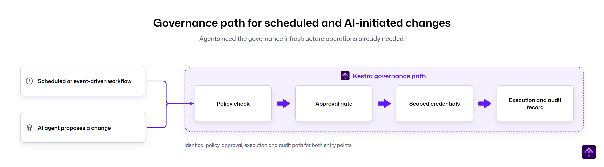

*Figure 12. The governance an agent needs is the governance infrastructure operations already needed.*

An organization that builds that layer for deterministic work has it ready for autonomous work. An organization that does not will be asked to grant an agent direct access to ten execution surfaces.

> An enterprise that can govern its workflows today can govern its agents tomorrow.

Kestra connects to MCP in three ways.

- **Calling MCP tools from a flow.** A flow invokes external MCP servers as one step in a deterministic sequence, with the tool choice logged and an approval gate available before it.
- **Exposing flows as MCP tools.** An agent discovers and invokes a flow as a named, typed tool, and the flow keeps its approval gates, scoped credentials, policies, and audit record, so the agent never touches an execution surface directly.
- **Giving AI assistants access to Kestra.** A client such as Claude or an IDE uses Kestra's MCP server to inspect flows, executions, and logs in natural language and to operate them, including running, replaying, and resuming executions.

Any model provider can be registered, including open-source models served inside the enterprise's own network, and use of the AI Copilot is itself a permission granted per role. The sovereignty argument that applies to the control plane applies to the model as well.

### Where infrastructure fits in unified orchestration

Unified orchestration means one control plane for data, infrastructure, applications, and business processes. Agentic AI is governed across all four: not a fifth domain, but a new kind of workload that runs across the other four and needs the same governance in each.

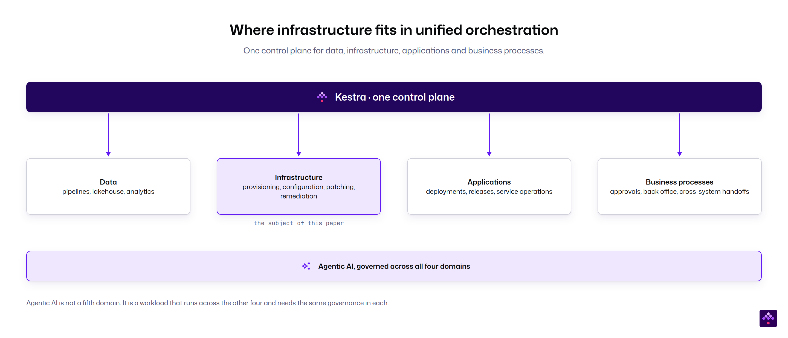

*Figure 13. Infrastructure is where many enterprises start, because the coordination gap is most visible there.*

In a practical example, a security team's alert workflows run in one namespace and an infrastructure team's patch waves run in another. Both run on the same platform, under one access model and one audit trail. The personas never meet, but the governance is shared.

Nothing has to move at once, and nothing has to be re-platformed when the next domain arrives, because the platform was never scoped to one.

The full argument is made in the Kestra whitepaper [Unified Orchestration](/resources/whitepapers/unified-orchestration).

### The bottom line

Fragmentation in infrastructure operations is the residue of modernization, and more automation will not remove it. The execution tools stay. A control plane above them sequences, gates, and records the chains they already run, and it retires the glue layer that only coordinates. The same governance that makes those chains auditable is the on-ramp for AI agents, because an agent can only be governed by a layer that sees everything it touches.

> The execution tools stay. The coordination gets one owner and one record.
